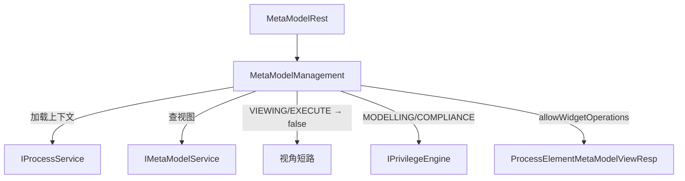
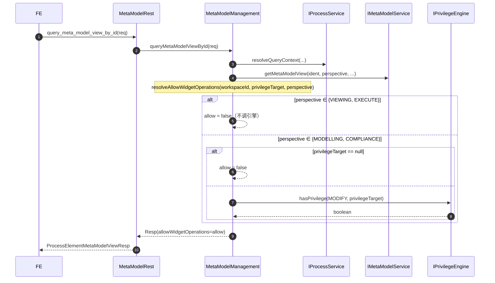

# Allow Widget Operations by Perspective

> 调整 `query_meta_model_view_by_id` 返回的 `allowWidgetOperations`：浏览/执行视角恒为 false；建模/合规视角按目标实例 `MODIFY` 权限判定。仅后端。

## Decisions Log

| Date | Decision | Reasoning | Alternatives Considered |
|------|----------|-----------|------------------------|
| 2026-07-16 | 视角规则：VIEWING/EXECUTE → 恒 false；MODELLING/COMPLIANCE → `MODIFY` 鉴权 | 用户确认（原文「执行和合规」订正为「建模和合规」）；与前端既有视角只读划分对齐 | 全部视角仅看权限；EXECUTE 也参与鉴权 |
| 2026-07-16 | 本轮仅改后端 | 用户确认；前端已有视角覆盖逻辑，本轮不碰 `web/` | 前后端同步改 |
| 2026-07-16 | 新建独立 feature context | 接口行为增量，避免污染已封闭的 privilege / perspectives 蓝图 | Enrich `query-available-perspectives.md` |
| 2026-07-16 | Level 1 Capabilities 批准 | 视角只读门禁 + 可写视角权限门禁 + 契约兼容；三条能力清晰 | 合并为单条规则矩阵 |
| 2026-07-16 | Level 2：不新增组件；判定逻辑留在 `MetaModelManagement` | 用户确认「暂不抽象」；单点改动足够 | 在 `MetaPerspective` 上抽 `isWidgetWritable()` |
| 2026-07-16 | Level 2 Components 批准 | 复用既有 Management + PrivilegeEngine；Resp/枚举不变 | 新增 Support |
| 2026-07-16 | Level 3：`perspective` 取自请求，不回读 metaView | 与入参校验一致；避免视图配置与请求不一致 | 用 `metaView.getPerspective()` |
| 2026-07-16 | Level 3 Interactions 批准 | 只读短路 / 可写鉴权 / fail-closed 数据流清晰 | — |
| 2026-07-16 | Level 4 Contracts 批准（真值表 + 测试矩阵 + Schema 描述更新） | 契约兼容前提下补齐视角语义 | 改字段名 / 新增 API |
| 2026-07-16 | Design approved at Level 4. Blueprint complete ready for implementation. | 四级齐全且已批准 | — |
| 2026-07-16 | 实现：Management 内联视角短路 + MODIFY；Schema 描述更新；单测矩阵 14 绿 | 按 L4 契约；Full autonomy | — |

## Open Questions

无。

## Constraints

- 仅修改后端；禁止改动 `web/`。
- 不改响应字段名/类型（仍为 `Boolean allowWidgetOperations`）；不新增 API。
- 权限判定继续复用 `IPrivilegeEngine.hasPrivilege(MODIFY, privilegeTarget)` + workspace 上下文切换；禁止自建 ACL。
- 浏览（`VIEWING`）、执行（`EXECUTE`）：`allowWidgetOperations` 恒为 `false`，不调用权限引擎。
- 建模（`MODELLING`）、合规（`COMPLIANCE`）：沿用现有 `MODIFY` 判定；`privilegeTarget == null` 时 fail-closed（`false`）。
- 判定逻辑内联于 `MetaModelManagement`，不抽到 `MetaPerspective` / 独立 Support。
- `perspective` 取自请求入参，不从 `metaView` 回读。

## Key Files

| 路径 | 角色 |
|------|------|
| `backend/components/gf/biz/.../MetaModelManagement.java` | `resolveAllowWidgetOperations(workspaceId, target, perspective)` |
| `backend/components/gf/biz/.../ProcessElementMetaModelViewResp.java` | Schema 描述已更新 |
| `backend/components/gf/sdk/.../MetaPerspective.java` | 视角枚举（未改） |
| `backend/components/gf/biz/.../MetaModelManagementBusinessTest.java` | VIEWING/EXECUTE 短路 + MODELLING/COMPLIANCE 矩阵 |

## Implementation Notes

**Status: Implemented 2026-07-16**

1. `resolveAllowWidgetOperations`：VIEWING/EXECUTE 提前 `return false`；其余走原 MODIFY + workspace 切换。
2. 调用点传入 `req.getPerspective()`。
3. 单测：只读路径 `verify(never).hasPrivilege(anyInt(), any())`；可写路径跟随 MODIFY。

## Design: Level 1 -- Capabilities

**Status: Approved 2026-07-16**

1. **视角只读门禁** — 浏览 / 执行视角下，`allowWidgetOperations` 恒为 `false`。
2. **可写视角权限门禁** — 建模 / 合规视角下，按目标实例 `MODIFY` 返回 `true`/`false`。
3. **契约兼容** — 既有 `query_meta_model_view_by_id`；字段不变；不改前端。

## Design: Level 2 -- Components

**Status: Approved 2026-07-16**

| 组件 | 分层 | DDD | 本轮职责 |
|------|------|-----|----------|
| `MetaModelManagement` | gf-biz | 应用服务 | `resolveAllowWidgetOperations` 增加 `perspective`：只读视角短路；可写视角调引擎 |
| `IPrivilegeEngine` | infrastructure-sdk | 领域服务 | 不变；仅 MODELLING/COMPLIANCE 调用 |
| `MetaPerspective` | gf-sdk | 值对象（枚举） | 不变；作判定输入，不新增方法 |
| `ProcessElementMetaModelViewResp` | gf-biz | 契约载体 | 字段不变；更新 Schema 描述 |



## Design: Level 3 -- Interactions

**Status: Approved 2026-07-16**



1. `perspective` 来自请求（已校验非空）。
2. 只读视角短路，跳过 workspace 切换与权限调用。
3. 可写视角：workspace 切换 + `MODIFY`。
4. 既有 VIEWING 单测「有权限→true」需改为恒 `false`；补矩阵用例。

## Design: Level 4 -- Contracts

**Status: Approved 2026-07-16**

### 1. 公开 API（不变）

```
POST .../query_meta_model_view_by_id
ProcessElementMetaModelViewQueryReq → ProcessElementMetaModelViewResp { ..., Boolean allowWidgetOperations }
```

字段名/类型不变；Swagger description 更新为视角感知语义。

### 2. Management 内部签名

```java
boolean resolveAllowWidgetOperations(
    Long workspaceId,
    IInnerDataObject privilegeTarget,
    MetaPerspective perspective);
```

调用点传入 `req.getPerspective()`。

### 3. 判定真值表

| perspective | privilegeTarget | MODIFY | allowWidgetOperations | 是否调引擎 |
|-------------|-----------------|--------|----------------------|------------|
| VIEWING / EXECUTE | * | * | `false` | 否 |
| MODELLING / COMPLIANCE | null | — | `false` | 否 |
| MODELLING / COMPLIANCE | non-null | true | `true` | 是 |
| MODELLING / COMPLIANCE | non-null | false | `false` | 是 |

### 4. 测试契约

| 用例 | 期望 |
|------|------|
| VIEWING + MODIFY=true | `allow=false`；引擎不被调用 |
| EXECUTE + MODIFY=true | `allow=false`；引擎不被调用 |
| MODELLING + MODIFY=true/false | 跟随权限 |
| COMPLIANCE + MODIFY=true/false | 跟随权限 |

### 5. 实现边界

- **改**：`MetaModelManagement` + 单测 + Resp `@Schema` 描述
- **禁改**：`web/`、Rest 路径/入参、字段名、`IPrivilegeEngine`、`MetaPerspective` 方法

## Design Summary

### Components and layer assignments
- **gf-biz**: `MetaModelManagement`（判定内联）；`ProcessElementMetaModelViewResp`（Schema 文案）
- **infrastructure-sdk**: `IPrivilegeEngine`（仅可写视角调用）
- **gf-sdk**: `MetaPerspective`（输入枚举，不扩展）

### Key contracts and interfaces
- `resolveAllowWidgetOperations(workspaceId, privilegeTarget, perspective)`
- 真值表：只读视角短路 false；可写视角 `MODIFY`；null target fail-closed

### Architectural constraints
- 仅后端；不新增组件/API/字段；禁止自建 ACL；不抽枚举方法

### Domain model decisions
- 视角 × 权限为应用编排规则，非独立聚合/领域事件

### Open questions resolved
- 「执行和合规」订正为「建模和合规」；仅后端；不抽象到枚举

### Design status
**Approved -- ready for implementation**

### Implementation status
**Implemented 2026-07-16** — `MetaModelManagementBusinessTest` 14/14 通过。
