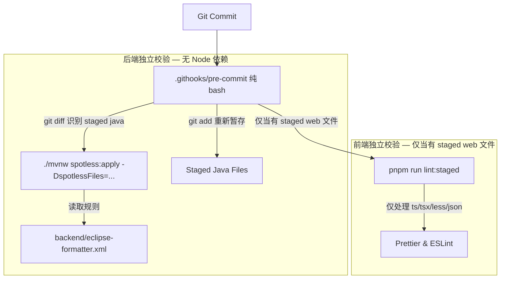
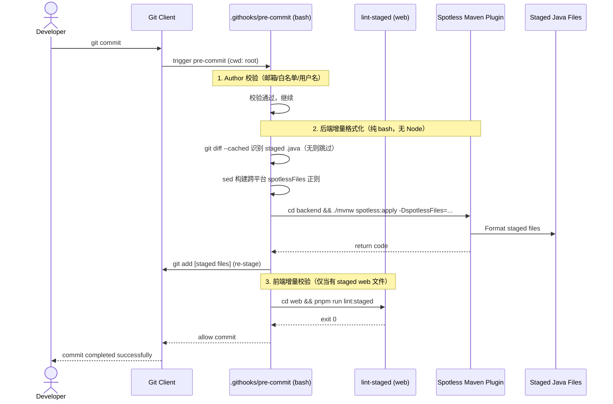

# 后端代码格式化校验与历史代码重构

> 为后端 Java 项目引入自动化代码格式化与提交校验机制，支持在提交前自动格式化或拒绝不合规的提交，并对历史代码进行全量格式化，保障团队协作时的代码风格一致性（对齐 IntelliJ IDEA 默认格式化规范）。

## Decisions Log

| Date | Decision | Reasoning | Alternatives Considered |
|------|----------|-----------|------------------------|
| 2026-07-17 | 采用 Spotless Maven Plugin 作为后端代码格式化引擎 | Spotless 支持与 Maven 生命周期集成，配置简单，可使用 Eclipse 格式化引擎对齐 IDEA 默认格式。 | 1. Prettier + prettier-plugin-java：Java 规则太刚性，难以适配 IDEA 默认。<br>2. checkstyle-maven-plugin：只能检查不能自动修复，易用性差。 |
| 2026-07-17 | Hook 收口至 `.githooks/`（非 Husky） | 仓库存在两套争抢 `core.hooksPath` 的 Hook 系统：`web/.husky`（pnpm prepare 设置）与 `.githooks`（docs/configure-git.sh 设置）。当前本机 hooksPath=web/.husky，导致 `.githooks/pre-commit` 的 Author 校验实际处于休眠状态。统一为 `.githooks/` 单一来源，与 README 文档意图一致，并停用 web/.husky。 | 维持 Husky 接管 hooksPath（拒绝：会让 Author 校验失效）。 |
| 2026-07-17 | pre-commit **去掉**全量 `mvn compile`；仅 Author + Spotless（+ 按需 lint-staged） | 全 reactor compile 是提交慢的主因；发版/CI 会编译；团队约定推送前自测编译通过 | 受影响模块 `-pl -am` compile；环境变量开关全量 |
| 2026-07-17 | 不新增 setup 脚本，扩展 docs/configure-git.sh | configure-git.sh 已是团队既有的后端 onboarding 入口（设置 hooksPath + Git 身份）。新增 setup.sh/setup.bat 会造成两套并行入口，违背易用性。改为在 configure-git.sh 末尾追加 `cd web && pnpm install`。 | 新建根目录 setup.sh/setup.bat（拒绝：重复）。 |
| 2026-07-17 | pre-commit 中 lint-staged 仅在有 staged 的 web/ 文件时执行 | 否则纯后端开发者未装前端依赖时，`pnpm run lint:staged` 报 command not found 阻断 Java 提交。 | 无条件每次执行 lint-staged（拒绝：破坏后端易用性）。 |
| 2026-07-17 | importOrder / eclipse-formatter 标注为「需验证」而非「完全一致」 | Eclipse 格式化引擎 ≠ IntelliJ 格式化引擎，无法 1:1。硬编码 import 顺序也只是近似。历史全量格式化作为最终验证闸门。 | 声称与 IDEA 默认完全一致（拒绝：过度承诺）。 |
| 2026-07-21 | Java 格式化 SSOT 收口为 Spotless + `eclipse-formatter.xml`；`.editorconfig` 仅镜像通用约定，删除 `ij_java_*` 平行细则；IDEA 通过 Import Eclipse XML Profile 使用同一文件 | 此前「日常靠 EditorConfig / IDEA 默认、提交靠 Spotless」双轨会漂移（如 trim trailing、continuation indent、import layout）。统一到 Spotless 引擎所用的同一 Eclipse profile。 | 继续用 EditorConfig `ij_java_*` 近似 Spotless（拒绝：双 SSOT）；另检入 IDEA Project.xml（拒绝：与 Eclipse 引擎仍非 1:1，且易与 eclipse-formatter.xml 再漂移） |

## Open Questions

| Question | Options / Proposed Solution | Status |
|----------|-----------------------------|--------|
| 1. 格式化规则与 IDEA 默认的对齐度如何验证？ | Eclipse formatter 是对 IDEA 默认风格的「最接近近似」，无法保证 1:1。以历史全量格式化（`mvn spotless:apply`）产生的 diff 作为验证闸门：若 diff 异常巨大说明规则偏离过大，需调整 eclipse-formatter.xml。 | Resolved |
| 2. pre-commit 增量还是全量？ | 增量：仅对 staged 的 `.java` 执行 `spotless:apply -DspotlessFiles=...`；lint-staged 仅在存在 staged 的 web/ 文件时执行。 | Resolved |
| 3. import 顺序硬编码 `java,javax,jakarta,org,com,` 是否贴合 IDEA 默认？ | 这是近似值，非 IDEA 真实默认分组。实现阶段需对照 IDEA 默认 Import 布局复核，必要时调整为空（交由 IDEA 默认）或真实分组。 | Open（实现时复核） |

## Technical Constraints
- 格式规则应尽量贴合 IntelliJ IDEA 默认的 Java 代码格式（4 空格缩进，Brace on same line 等）；Eclipse formatter 仅作近似，以历史全量格式化 diff 为验证闸门。
- 提交拦截机制必须统一收口到 monorepo 既有的 `.githooks/` 目录（停用 web/.husky 对 hooksPath 的争抢），无需开发人员手动安装额外工具。
- 根目录提交校验**不依赖 Node.js**；Node 仅用于 web/ 下的前端 lint-staged，纯后端提交不需 Node 环境。
- 必须提供一键命令对历史的所有 Java 代码做全量格式化。

## Design: Level 1 -- Capabilities

### 1. 历史代码一键重构 (Historical Reformatting)
- 提供一键命令，能够对 `backend/` 下的所有 `.java` 文件进行全量格式化，解决存量代码的风格不统一问题。
- 提供命令行输出，指出格式化了哪些文件。

### 2. 提交前自动格式化与验证 (Pre-commit Auto-format & Validation)
- 接入统一的 `.githooks/pre-commit` 钩子（纯 bash，不依赖 Node）。当开发人员提交代码（`git commit`）时，系统自动识别暂存区（Staged）中的 `.java` 文件。
- **自动格式化与重新暂存**：直接在暂存区的文件上执行 `spotless:apply`，并重新 `git add`，对开发人员无感知。
- **验证卡点**：如果执行失败，拒绝提交。

### 3. IntelliJ IDEA 默认风格对齐 (IDEA Style Alignment)
- 格式化标准对齐 IntelliJ IDEA 默认的 Java 风格：
  - 4 空格缩进（Indent = 4, Tab size = 4, Use tab character = false）。
  - 左大括号在行尾，右大括号独占一行（Braces on same line）。
  - 自动整理并清理未使用的 import（Optimize Imports）。
  - 统一的 Import 排序规则。

### 4. 团队一键开箱即用 (Seamless Team Promotion)
- **统一 Hook 来源**：将两套互相争抢 `core.hooksPath` 的 Hook 系统（`web/.husky` 与 `.githooks`）收口为单一来源 `.githooks/`。
- **前端开发**：执行 `pnpm install` 时 `prepare` 脚本自动执行 `git config core.hooksPath .githooks`，无需额外步骤。
- **纯后端开发**：执行既有的 `docs/configure-git.sh`（已扩展为末尾自动 `cd web && pnpm install`），一次完成 Git 身份、hooksPath 与前端依赖初始化。
- **纯后端提交不依赖 Node**：Java 格式化逻辑全内联在 pre-commit bash 脚本中。
- **双层强制校验**：
  - **Git 提交阶段**：根目录 `.githooks/pre-commit` 拦截并自动执行格式修复与重新暂存。
  - **Maven 构建生命周期**：`backend/pom.xml` 将 `spotless:check` 绑定到 `validate` 阶段，CI/本地打包时未格式化代码直接构建失败。

## Design: Level 2 -- Components

### 1. 组件关系图 (Mermaid Component Diagram)



### 2. 组件职责定义 (Component Responsibilities)

| 组件 (Component) | 职责 (Responsibility) | 技术选型 (Technology) | 位置 (Location) |
| :--- | :--- | :--- | :--- |
| **Spotless Maven Plugin** | 执行格式化与样式校验，集成至 Maven 生命周期 | `com.diffplug.spotless:spotless-maven-plugin` (v2.43.0) | `backend/pom.xml` |
| **Eclipse Formatter XML** | 承载与 IntelliJ IDEA 默认格式对齐的 Java 代码格式化配置规则 | XML Config (标准 Java/IDEA 规范) | `backend/eclipse-formatter.xml` |
| **Root Pre-commit Hook** | 单文件 bash 协调器：Author 校验 + git diff/spotless:apply/git add（内联） + lint-staged（按需） | Git Hook (bash, `#!/bin/bash`) | `.githooks/pre-commit` |
| **Husky Install Script** | 前端 `pnpm install` 时自动设置 `core.hooksPath=.githooks`，停用旧的 web/.husky 争抢 | Node.js | `web/scripts/husky-install.mjs` |

## Design: Level 3 -- Interactions

### 1. 提交前增量格式化与校验流 (Pre-commit Format & Verify Flow)

当开发人员在本地执行 `git commit` 时，各组件按以下顺序交互：



- **无感二次暂存**：如果 `spotless:apply` 修改了被暂存的 Java 文件，pre-commit 会自动对其执行 `git add`。
- **Fail-Closed 保护**：任一步骤（Author 校验 / spotless:apply / lint-staged）返回非 0，钩子立即退出并拒绝提交。
- **lint-staged 仅按需执行**：仅当暂存区存在 `web/` 下文件时才运行，纯后端提交不会被未安装的前端依赖阻断。
- **跨平台兼容**：Git 钩子在所有平台经 Git Bash 执行；`./mvnw` 是 POSIX shell 脚本（`#!/bin/sh`），Git Bash for Windows 可直接运行；spotlessFiles 正则用 `[\\/]` 兼容 Windows `\` 与 Unix `/` 路径分隔符。

### 2. 历史代码全量格式化流 (Full Codebase Reformat Flow)

开发人员或 CI 可以在 `backend/` 下运行以下命令：

```bash
cd backend
mvn spotless:apply
```

- 该命令会扫描 `backend/` 目录下除排除目录（如 `target/`, `.idea/` 等）外的所有 `.java` 文件，自动进行就地格式化和 import 优化。

## Design: Level 4 -- Contracts

### 1. Spotless Maven Plugin 配置 (backend/pom.xml)

在 `backend/pom.xml` 的 `<build><plugins>` 节点中，新增 `spotless-maven-plugin` 的配置：

```xml
<plugin>
    <groupId>com.diffplug.spotless</groupId>
    <artifactId>spotless-maven-plugin</artifactId>
    <version>2.43.0</version>
    <configuration>
        <upToDateChecking>
            <enabled>true</enabled>
        </upToDateChecking>
        <java>
            <!-- 仅格式化业务代码与单测代码 -->
            <includes>
                <include>src/main/java/**/*.java</include>
                <include>src/test/java/**/*.java</include>
            </includes>
            <!-- 使用自定义的 Eclipse 格式化程序规则近似 IDEA 默认规范（非 1:1，以历史格式化 diff 验证） -->
            <eclipse>
                <file>${maven.multiModuleProjectDirectory}/eclipse-formatter.xml</file>
            </eclipse>
            <!-- 清理未使用的 import -->
            <removeUnusedImports/>
            <!-- Import 排序（⚠️ 近似值，实现时需对照 IDEA 默认 Import 布局复核；可置空交由 IDEA 默认） -->
            <importOrder>
                <order>java,javax,jakarta,org,com,</order>
            </importOrder>
        </java>
    </configuration>
    <!-- 将样式校验绑定到 Maven 生命周期，在 mvn install 或编译打包时强制执行，如果不合规直接报错 -->
    <executions>
        <execution>
            <id>spotless-check</id>
            <phase>validate</phase>
            <goals>
                <goal>check</goal>
            </goals>
        </execution>
    </executions>
</plugin>
```

### 2. Eclipse 格式化配置规则 (backend/eclipse-formatter.xml)

创建 `backend/eclipse-formatter.xml`。**注意**：Eclipse 格式化引擎与 IntelliJ 格式化引擎并非同一实现，无法做到 1:1 完全一致；此处为对 IDEA 默认风格（4 空格缩进、大括号行尾）的最接近近似。最终以历史全量格式化（`mvn spotless:apply`）产生的 diff 作为验证闸门——若 diff 异常庞大，说明规则偏离过大需调整。建议实现时直接采用社区成熟的「intellij-default」完整 Eclipse profile，而非手工拼凑的精简版：

```xml
<?xml version="1.0" encoding="UTF-8" standalone="no"?>
<profiles version="12">
    <profile kind="CodeFormatterProfile" name="AirEdge-Spotless" version="12">
        <!-- 强制使用空格缩进而非 tab -->
        <setting id="org.eclipse.jdt.core.formatter.tabulation.char" value="space"/>
        <setting id="org.eclipse.jdt.core.formatter.tabulation.size" value="4"/>
        <setting id="org.eclipse.jdt.core.formatter.indentation.size" value="4"/>
        <setting id="org.eclipse.jdt.core.formatter.continuation_indentation" value="2"/>
        
        <!-- 大括号位置：同结尾行 (Braces on same line) -->
        <setting id="org.eclipse.jdt.core.formatter.brace_position_for_anonymous_type_declaration" value="end_of_line"/>
        <setting id="org.eclipse.jdt.core.formatter.brace_position_for_array_initializer" value="end_of_line"/>
        <setting id="org.eclipse.jdt.core.formatter.brace_position_for_block" value="end_of_line"/>
        <setting id="org.eclipse.jdt.core.formatter.brace_position_for_block_in_case" value="end_of_line"/>
        <setting id="org.eclipse.jdt.core.formatter.brace_position_for_constructor_declaration" value="end_of_line"/>
        <setting id="org.eclipse.jdt.core.formatter.brace_position_for_lambda_body" value="end_of_line"/>
        <setting id="org.eclipse.jdt.core.formatter.brace_position_for_method_declaration" value="end_of_line"/>
        <setting id="org.eclipse.jdt.core.formatter.brace_position_for_switch" value="end_of_line"/>
        <setting id="org.eclipse.jdt.core.formatter.brace_position_for_type_declaration" value="end_of_line"/>
        
        <!-- 行宽限制 120 字符 -->
        <setting id="org.eclipse.jdt.core.formatter.lineSplit" value="120"/>
        <setting id="org.eclipse.jdt.core.formatter.comment.line_length" value="120"/>
    </profile>
</profiles>
```

### 3. 根目录拦截协调器 (.githooks/pre-commit)

将既有的 `.githooks/pre-commit`（Author 校验）原样保留在脚本头部，并在尾部追加后端格式化（纯 bash，无 Node）与前端 lint-staged（按需）协调逻辑。注意：此前该 Author 校验因 husky 争抢 hooksPath 实际处于休眠，本设计统一收口后它将真正生效：

```bash
#!/bin/bash
# ==============================================================================
# AirEdge Git Commit Author Validation Hook & Format/Lint Coordinator
# ==============================================================================

CURRENT_NAME=$(git config user.name)
CURRENT_EMAIL=$(git config user.email)
REQUIRED_DOMAIN="airedge.com"

# users.xlsx 白名单中的 30 位合法在职人员拼音前缀
ALLOWED_USERS=(
    "liuruilan" "zhouchengcheng" "catia" "heyan" "liujiangye"
    "liuchaojie" "wuweiwei" "wuliangchen" "zhoushujian" "shicanhui"
    "zhuzhigang" "zhuxiongmin" "lizhixing" "lizuting" "jiangkun"
    "shenyong" "niuliwei" "wangliduan" "wangqi" "tianhengbao"
    "jihaiyan" "dongshihua" "xueshanshan" "zhaotao" "qiuqiming"
    "qiansheng" "chenhaibin" "chenjiancheng" "hantiejun" "huangguosong"
)

echo "=== [Git Author Check] ==="

# 1. 校验邮箱是否符合 @airedge.com
if [[ ! "$CURRENT_EMAIL" =~ ^([a-zA-Z0-9._%+-]+)@$REQUIRED_DOMAIN$ ]]; then
    echo "❌ 提交拒绝: 本地 Git 邮箱不合规！当前为 '$CURRENT_EMAIL'"
    echo "必须配置以 @$REQUIRED_DOMAIN 结尾的个人企业邮箱。"
    echo "请执行以下配置命令进行修复（推荐使用 --local 只在当前项目生效）："
    echo "  git config --local user.email \"<你的拼音前缀>@$REQUIRED_DOMAIN\""
    exit 1
fi

# 提取前缀
EMAIL_PREFIX="${BASH_REMATCH[1]}"
EMAIL_PREFIX_LOWER=$(echo "$EMAIL_PREFIX" | tr '[:upper:]' '[:lower:]')

# 2. 校验前缀是否在授权名单中
IS_ALLOWED=false
for user in "${ALLOWED_USERS[@]}"; do
    if [ "$user" = "$EMAIL_PREFIX_LOWER" ]; then
        IS_ALLOWED=true
        break
    fi
done

if [ "$IS_ALLOWED" = false ]; then
    echo "❌ 提交拒绝: 您的账号前缀 '$EMAIL_PREFIX' 暂无在此仓库提交的授权。"
    echo "若您的拼音前缀输入有误，请重新配置。如果是新账号，请联系管理员更新 .githooks/pre-commit 中的白名单。"
    exit 1
fi

# 3. 校验 user.name 是否设置且不为默认值
if [ -z "$CURRENT_NAME" ] || [ "$CURRENT_NAME" = "root" ] || [ "$CURRENT_NAME" = "admin" ] || [ "$CURRENT_NAME" = "Airedge" ] || [ "$CURRENT_NAME" = "test" ]; then
    echo "❌ 提交拒绝: 您的 Git 用户名 user.name 不合规！当前为 '$CURRENT_NAME'"
    echo "用户名不能为空或默认值。请使用您的标准拼音账号或真实中文姓名配置。"
    echo "请执行以下配置命令进行修复："
    echo "  git config --local user.name \"$EMAIL_PREFIX_LOWER\""
    exit 1
fi

echo "✅ Git Author 校验通过!"

# ==============================================================================
# 4. 后端 Java 自动格式化与校验 (增量, 纯 bash, 不依赖 Node)
# ==============================================================================
STAGED_JAVA=$(git diff --cached --name-only --diff-filter=ACMR | grep '^backend/.*\.java$')

if [ -n "$STAGED_JAVA" ]; then
    echo "=== [Backend] Running Java Formatter (Spotless) ==="

    # 4a. 将 staged 的 repo 相对路径转为 Spotless spotlessFiles 正则
    #     输入: backend/components/dqa/.../Foo.java
    #     输出: .*components[\\/]dqa[\\/]...[\\/]Foo\.java
    #     [\\/] 兼容 Windows \ 与 Unix / 路径分隔符
    SPOTLESS_FILES=""
    while IFS= read -r staged_file; do
        # 去掉 backend/ 前缀（因 mvn cwd=backend，Spotless 看到的是模块内路径）
        rel="${staged_file#backend/}"
        # 转义正则元字符（主要是 .）并将 / 替换为 [\\/] 实现跨平台匹配
        regex=$(printf '%s' "$rel" | sed 's/[.]/\\./g; s|/|[\\\\/]|g')
        if [ -z "$SPOTLESS_FILES" ]; then
            SPOTLESS_FILES=".*${regex}"
        else
            SPOTLESS_FILES="${SPOTLESS_FILES},.*${regex}"
        fi
    done <<< "$STAGED_JAVA"

    # 4b. 选择 Maven 执行器：优先 mvnd（daemon 更快），回退 mvnw
    if command -v mvnd &>/dev/null; then
        MVN_CMD="mvnd"
    else
        MVN_CMD="./mvnw"
    fi

    echo "[Java Format] $MVN_CMD spotless:apply -DspotlessFiles=...(${STAGED_JAVA_COUNT:-$(echo "$STAGED_JAVA" | wc -l)} files)"

    # 4c. 执行 Spotless 格式化（cwd=backend）
    cd backend
    $MVN_CMD spotless:apply -DspotlessFiles="$SPOTLESS_FILES"
    MVN_STATUS=$?
    cd ..

    if [ $MVN_STATUS -ne 0 ]; then
        echo "❌ [Backend] Spotless 格式化失败，提交终止！"
        exit $MVN_STATUS
    fi

    # 4d. 对格式化微调后的文件重新暂存
    while IFS= read -r staged_file; do
        git add "$staged_file"
    done <<< "$STAGED_JAVA"

    echo "✅ [Backend] Java 文件已格式化并重新暂存。"
fi

# ==============================================================================
# 5. 前端增量格式化与校验 (lint-staged) —— 仅当暂存区含 web/ 文件时执行
#    避免纯后端提交因未安装前端依赖而被 pnpm run lint:staged 阻断
# ==============================================================================
STAGED_ALL=$(git diff --cached --name-only --diff-filter=ACMR)
if echo "$STAGED_ALL" | grep -q '^web/'; then
    if [ -d "web/node_modules" ]; then
        echo "=== [Frontend] Running lint-staged ==="
        cd web
        pnpm run lint:staged
        FRONTEND_STATUS=$?
        cd ..
        if [ $FRONTEND_STATUS -ne 0 ]; then
            echo "❌ 前端格式化或校验失败，提交终止！"
            exit $FRONTEND_STATUS
        fi
    else
        echo "⚠️ [Frontend] 检测到 staged 的 web/ 文件但未安装前端依赖 (web/node_modules 缺失)，已跳过 lint-staged。请执行 cd web && pnpm install。"
    fi
fi

exit 0
```

### 4. 根目录 commit-msg 校验 (.githooks/commit-msg)

将 commitlint 调用从 `web/.husky/commit-msg` 迁移至 `.githooks/commit-msg`（hooksPath 收口后 web/.husky 不再生效）。在 `.githooks/` 目录下创建，调度前端 commitlint 规范提交说明：

```bash
#!/bin/bash
# ==============================================================================
# AirEdge Commit Message Validation Hook (commitlint)
# ==============================================================================

cd web || exit 1
npx --no -- commitlint --edit "$1"
```

### 5. Git Hooks 安装配置修改 (web/scripts/husky-install.mjs)

由于 husky 此前争抢 hooksPath 导致 `.githooks` 休眠，现统一收口：将 `web/scripts/husky-install.mjs`（由 `package.json` 的 `prepare` 在 `pnpm install` 时触发）改造为设置 Git 原生 `core.hooksPath` 指向 `.githooks`。同时删除已失效的 `web/.husky/pre-commit`、`web/.husky/commit-msg` 及 `web/.husky/_/`（husky 依赖可保留以减少 package.json 改动，但不再作为 hook 执行器）：

```javascript
import { execSync } from 'node:child_process';
import { existsSync } from 'node:fs';
import { dirname, join } from 'node:path';
import { fileURLToPath } from 'node:url';

const webDir = join(dirname(fileURLToPath(import.meta.url)), '..');
const monoRoot = join(webDir, '..');

if (existsSync(join(monoRoot, '.git'))) {
  console.log('[githooks] Configuring core.hooksPath -> .githooks');
  execSync('git config core.hooksPath .githooks', { cwd: monoRoot, stdio: 'inherit' });
} else {
  console.log('[githooks] skip: .git not found');
}
```

### 6. 扩展既有 onboarding 脚本 (docs/configure-git.sh)

**不新增** setup 脚本。既有 `docs/configure-git.sh` 已是团队文档中的后端 onboarding 入口（交互式设置 Git 身份 + `git config core.hooksPath .githooks`）。在其末尾追加安装前端依赖，使纯后端开发者一次完成全部初始化：

```bash
# （追加在 configure-git.sh 末尾，紧接既有 hooksPath 配置之后）
echo "⏳ 安装前端依赖 (lint-staged 等)..."
cd web && pnpm install && cd ..
echo "🎉 前端依赖安装完成。"
```

> Windows 开发者同样在 Git Bash 中执行 `bash docs/configure-git.sh`（脚本为 bash，Git for Windows 自带 Git Bash）。

## Design Summary

### 1. 组件与职责 (Components & Responsibilities)

- **Git Hooks 目录** (`.githooks/`)：统一单源拦截中心。`pre-commit` = Author 校验（既有，此前休眠，收口后生效）+ 后端增量 spotless:apply（纯 bash 内联，无 Node）+ 按需调起 lint-staged；`commit-msg` = commitlint（从 web/.husky 迁入）。
- **Spotless Maven Plugin** (`backend/pom.xml`)：样式校验强制拦截，`spotless:check` 绑定 Maven `validate` 阶段，本地构建/CI 时卡点。
- **eclipse-formatter.xml** (`backend/eclipse-formatter.xml`)：对 IDEA 默认风格的「最接近近似」（非 1:1），以历史格式化 diff 为验证闸门。
- **husky-install.mjs** (`web/scripts/husky-install.mjs`)：前端 `pnpm install` 时自动 `git config core.hooksPath .githooks`；并删除失效的 web/.husky。
- **docs/configure-git.sh**：扩展为末尾自动 `cd web && pnpm install`，纯后端一次完成 onboarding。

### 2. 关键设计点 (Key Design Decisions)

- **修复既有冲突**：仓库存在 `.githooks` 与 `web/.husky` 两套争抢 `core.hooksPath` 的 Hook 系统，导致 Author 校验实际休眠。本设计收口为 `.githooks/` 单一来源，既修复了潜在安全缺口，又与 README 文档意图一致。
- **后端提交零 Node 依赖**：Java 格式化逻辑（git diff → spotless:apply → git add）全部内联在 `.githooks/pre-commit` bash 脚本中。Git 钩子经 Git Bash 执行（含 Windows），`./mvnw` 是 POSIX shell 脚本可直接运行，无需 Node。删除了原方案的 `backend/scripts/format.mjs`。
- **双防线保障**：Git 提交前就地自动格式化修复（bash 内联），Maven 构建阶段 `spotless:check` 强制卡点（CI/本地打包）。
- **易用性**：纯后端提交不被前端依赖阻断（lint-staged 仅按需执行、有 staged web 文件才跑）；mvnd 优先提升提交速度；统一 onboarding 入口避免脚本重复。
- **解耦**：前端不耦合 Java 工具链，后端不耦合 Node/前端工具链。

## Implementation Notes

### Key Files Created/Modified

| File | Action | Purpose |
|------|--------|---------|
| `backend/eclipse-formatter.xml` | Created | IDEA 默认风格的 Eclipse formatter 配置 |
| `backend/pom.xml` | Modified (line ~694) | 添加 spotless-maven-plugin v2.43.0 + validate 阶段绑定 |
| `.githooks/pre-commit` | Enhanced | 追加后端 spotless:apply（纯 bash）+ 按需 lint-staged |
| `.githooks/commit-msg` | Created | commitlint 校验（从 web/.husky 迁入） |
| `web/scripts/husky-install.mjs` | Rewritten | `git config core.hooksPath .githooks` |
| `web/.husky/pre-commit` | Deleted | 失效的 husky hook |
| `web/.husky/commit-msg` | Deleted | 失效的 husky hook |
| `docs/configure-git.sh` | Appended | 末尾自动 `cd web && pnpm install` |

### Implementation Deviations from L4 Contracts

| Deviation | Reason |
|-----------|--------|
| **省略 `<importOrder>`** | Open Q#3 解决：IDEA 默认是字母排序无前缀分组（非 `java,javax,org,com`），故不设置 importOrder，交由 Spotless 默认行为 |
| **使用全限定插件坐标** | `com.diffplug.spotless:spotless-maven-plugin:2.43.0:apply` 而非简写 `spotless:apply`：Maven 不在默认 plugin group 中搜索 `com.diffplug.spotless`，简写不可用 |
| **添加 `-pl '!AirAPI,!upgrade'` 排除** | AirAPI 无 parent pom（独立 Java 8 SDK），upgrade 使用 spring-boot-starter-parent，两者不继承根 pom 的 plugin，CLI goal 直接执行会报 "Spotless plugin absent" |

### Verification Results

- ✅ pom.xml / eclipse-formatter.xml XML 语法有效
- ✅ pre-commit / commit-msg / configure-git.sh bash 语法有效
- ✅ husky-install.mjs JS 语法有效
- ✅ Spotless plugin 下载并运行成功
- ✅ 历史代码全量格式化已完成并**回退**：3761 个 Java 文件恢复至 HEAD（用户决定周末统一执行）
- ✅ `mvn validate` 通过（`spotless.skip=true` 过渡期跳过构建期校验）
  - **待办**：周末全量格式化后，将 `backend/pom.xml` 中 `<spotless.skip>` 改为 `false` 启用构建卡点
