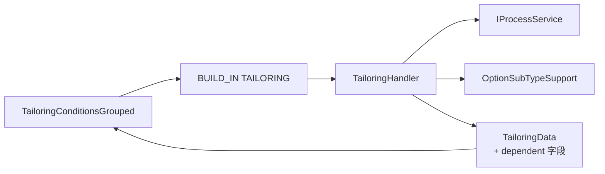

# bug-14527 裁剪条件展示 dependent 子元素

> 工作产品的状态/质量等级等属性改为 dependent 子元素存储后，裁剪动作绑定子元素时，父元素「裁剪条件」卡片应展示对应问答/动作，并标明被命中的 dependent 信息（非父元素自身被裁剪）。

## Decisions Log

| Date | Decision | Reasoning | Alternatives Considered |
|------|----------|-----------|------------------------|
| 2026-08-02 | 新建 context：`bug-14527-tailoring-conditions-dependent-child` | 无既有 context / requirement；design-blueprint Step 1 需落锚 | 直接编码 |
| 2026-08-02 | `requirement_doc = null` | Bug #14527，无正式需求文档 | 先跑 requirement-forge |
| 2026-08-02 | 父卡片展示命中其 dependent 的条件时，必须展示 **被裁剪的 dependent 信息**（独立字段，Option A） | 目标是子元素而非父元素；拼进 `actionText` 会污染动作文案、难 i18n/比对 | Option B：拼进 `actionText` |
| 2026-08-02 | 设计从 Level 1（Capabilities）完整走起 | 用户明确要求；需先对齐「展示 dependent 信息」的用户可见结果 | 从 Level 2 进入（能力已隐式约定） |
| 2026-08-02 | Level 1 Capabilities 获批 | 用户确认五条用户可见能力与边界 | — |
| 2026-08-02 | Level 2：匹配逻辑内聚 `TailoringHandler`；复用 `OptionSubTypeSupport` + `IProcessService.getElements`；前端改 `TailoringConditionsGrouped` | 不新建纯转发 Support；sdkImpl 不可依赖 biz 的 `ProcessElementTreeSupport` | 抽独立 Matcher Support；经 biz 判定 dependent |
| 2026-08-02 | Level 2 Components 获批 | 用户确认组件与分层 | — |
| 2026-08-02 | Level 3：父页归因 dependent 时填独立字段；子页直接命中字段为空；批量 getElements；metamodelIdent 来自 QueryContext.processObject | 对齐 L1「标明被命中 dependent」与 L2 组件边界 | 子页也回填自身为 dependent；逐条查库 |
| 2026-08-02 | Level 3 Interactions 获批 | 用户确认交互与数据约定 | — |
| 2026-08-02 | Level 4 字段命名：`dependentElementId` / `dependentElementName`（父归因时填充，直接命中为 null） | 语义对准「被裁剪的 dependent」；避免与 association.target 混淆 | `targetElementId/Name`；`hitElement*` |
| 2026-08-02 | Level 4 Contracts 获批 | 用户确认 DTO / 匹配 / 前端 / 测试契约 | — |
| 2026-08-02 | Design approved at Level 4. Blueprint complete ready for implementation. | 四级设计已落盘，可交 `/code-forge` | — |
| 2026-08-02 | 实现：`TailoringHandler` 注入 `OptionSubTypeSupport`；匹配三态；批量 `getElements` | 对齐 L4；sdkImpl 不依赖 biz | — |
| 2026-08-02 | ~~前端新增 tip `I18n.sys.tips.00001839`~~ → 改为不新增 i18n：`[{dependentElementName}]` 高亮附在「执行动作」旁 | 临近发版新词条沟通成本高；locales 由 `pnpm run i18n` 生成勿手改 | 独立「裁剪对象」标签行；手写 tip |

## Open Questions

（无）

## Constraints

- 父元素「裁剪条件」展示的是命中 **dependent 子元素** 的规则，不是「父元素被裁剪」。
- dependent 信息以 **独立字段** 暴露（`dependentElementId` / `dependentElementName`），禁止仅拼进 `actionText`。
- 同一问答/动作命中多个 dependent 时 **分条展示**，各自带对应 dependent 信息。
- 直接打开 dependent 自身详情时，仍展示以其为直接目标的条件（dependent 字段为 null）。
- 仅覆盖 dependent（如 state/qualitylevel）归因到父；非 dependent 子树不纳入父卡片。
- 遵循 Biz → SDK → SDKImpl；只读路径；不新增 SDK 仅凭 ID 的捷径 API。
- 前端 `TailoringConditionsGrouped` 需消费新增字段以渲染 dependent 信息。
- sdkImpl Handler 判定 dependent 须复用 `OptionSubTypeSupport`（或同层等价能力），**禁止**依赖 biz `ProcessElementTreeSupport`。

## Key Files

| Path | Role |
|------|------|
| `gf-sdkImpl/.../datasource/buildin/handler/TailoringHandler.java` | 裁剪条件 BUILD_IN 查询；扩展匹配 + 填充 dependent 字段 |
| `gf-sdk/.../datasource/dto/TailoringData.java` | 裁剪条件行 DTO；新增 `dependentElementId` / `dependentElementName` |
| `gf-sdkImpl/.../support/OptionSubTypeSupport.java` | 判定 subType 是否为 dependent（复用） |
| `gf-sdkImpl/.../datasource/buildin/handler/TailoringHandlerTest.java` | 匹配与字段填充单测 |
| `web/.../TailoringConditions/TailoringConditionsGrouped/index.tsx` | 裁剪条件卡片 UI；渲染 dependent 信息 |
| `gf-sdkImpl/.../tailoring/TailoringAnswerTargetAssociationSupport.java` | 动作目标写入（本需求不改） |

## Design: Level 1 -- Capabilities

1. 在工作产品（父元素）详情的「裁剪条件」中，能看到裁剪动作绑定到其 **dependent 子元素**（如状态、质量等级）的问答与动作。
2. 每条条件清楚标明 **被命中的 dependent**（独立展示信息，而非暗示父元素被裁剪）。
3. 同一问答/动作命中多个 dependent 时，**分条**展示，各自带对应 dependent 信息。
4. 打开某个 dependent 自身详情时，仍能看到以该子元素为直接目标的裁剪条件。
5. 非 dependent 的子级关系、其它卡片行为保持不变。

**边界**：不改裁剪执行/预览语义；只修条件卡片的反查与展示契约。

## Design: Level 2 -- Components

| 组件 | 分层 | 职责 | DDD |
|------|------|------|-----|
| `TailoringHandler` | gf-sdkImpl BuildIn | 反查答案动作：命中当前元素 **或** 其 dependent 子元素；组装行，父视角时填充 dependent 独立字段 | 读侧应用编排（Handler） |
| `TailoringData` | gf-sdk DTO | 裁剪条件行读模型；新增目标 dependent 展示字段 | 读模型 VO |
| `OptionSubTypeSupport`（既有） | gf-sdkImpl | 判定目标是否为元模型 dependent 子类型 | 无状态领域服务（复用） |
| `IProcessService`（既有） | gf-sdk | 批量加载动作目标元素，供 parentId / subType 判定 | 仓储门面（复用） |
| `TailoringConditionsGrouped` | web | 消费新字段，在父卡片上渲染被命中的 dependent 信息 | UI 呈现 |



**不改**：裁剪执行/预览引擎、动作目标写入语义、非 dependent 父子树、元模型 widget 注册。

## Design: Level 3 -- Interactions

### 主流程：父元素详情加载裁剪条件

1. UI → `TailoringHandler.queryData(elementId=父)`
2. Handler 加载过程裁剪问答 → `listAnswerActions`
3. 收集全部 `targetElementId` → `IProcessService.getElements` 批量加载
4. 自 `QueryContext.processObject` 取 `metamodelIdent`
5. 逐条判定：
   - `targetId == elementId` → 直接命中，dependent 字段为空
   - `target.parentId == elementId` 且 `OptionSubTypeSupport` 判定为 dependent → 父归因命中，填充目标 dependent id/name
   - 其它 → 跳过
6. 返回 `TailoringData` 行 → 前端有 dependent 字段时渲染子元素信息

### 数据约定

| 场景 | 页面 elementId | 行 elementId | dependent 独立字段 |
|------|----------------|--------------|-------------------|
| 动作直接绑父 | 父 | 父 | 空 |
| 动作绑 dependent，看父页 | 父 | 父 | 填子 id + name |
| 动作绑 dependent，看子页 | 子 | 子 | 空 |
| 同一动作绑多个 dependent | 父 | 父 | 每子一条 |

**约束**：批量加载；不改写路径。

## Design: Level 4 -- Contracts

### `TailoringData` 新增字段

```java
/** 父归因命中时：被绑定的 dependent 实例 ID；直接命中（含看子页自身）为 null */
private Long dependentElementId;

/** 父归因命中时：dependent 显示名称；直接命中为 null */
private String dependentElementName;
```

`elementId` / `question*` / `answer*` / `action*` 语义不变。`compareToRow` 纳入上述两字段。

### `TailoringHandler` 匹配契约

```text
DIRECT:
  association.targetElementId == pageElementId
  → elementId = pageElementId; dependent* = null

DEPENDENT_CHILD:
  target.parentId == pageElementId
  AND OptionSubTypeSupport.isOptionSubType(metamodelIdent, target.elementType, target.elementSubType)
  → elementId = pageElementId
  → dependentElementId = target.id; dependentElementName = target.name

NONE: 不产出行
```

前置：批量 `getElements`；`metamodelIdent` ← `QueryContext.processObject`；目标缺失 → NONE。

### 前端 `TailoringConditionRow`

```ts
dependentElementId?: number;
dependentElementName?: string;
```

有 `dependentElementName` 时在答案/动作旁展示；不拼进 `actionText`。

### 测试契约

| 用例 | 期望 |
|------|------|
| 动作绑 dependent，查父 | ≥1 行，dependent 字段 = 该子元素 |
| 同上查子 | ≥1 行，dependent 字段 null |
| 动作绑父自身 | 行存在，dependent 字段 null |
| 目标为非 dependent 子节点 | 父页不出现该行 |
| 两 dependent 同动作 | 父页两行，各自不同 dependent 字段 |

**不新增**对外 REST / SDK 捷径 API；**不改**动作关联写入契约。

## Design Summary

- **组件与分层**：`TailoringHandler`（sdkImpl）扩展匹配；`TailoringData`（sdk）增字段；复用 `OptionSubTypeSupport` + `IProcessService`；前端 `TailoringConditionsGrouped` 渲染。
- **关键契约**：`dependentElementId` / `dependentElementName`；匹配三态 DIRECT / DEPENDENT_CHILD / NONE。
- **架构约束**：只读路径；Biz→SDK→SDKImpl；sdkImpl 不依赖 biz；不新增捷径 API；不改执行/预览。
- **领域模型**：dependent 为 ELEMENT scope 子元素；父卡片归因展示 ≠ 父元素被裁剪。
- **Open questions**：无。
- **Design status**：**Implemented**（code-forge 已完成；建议 `/review`）

## Implementation Notes

- `TailoringHandlerTest`：8 用例通过（含父归因、子页直接命中、非 dependent 忽略、多分条）。
- 前端：动作旁高亮 `[子类型显示名: 名称]`（如 `[状态: 状态1]` / `[质量等级: …]`）；子类型名来自元模型 zh_CN label，无新 tip。
