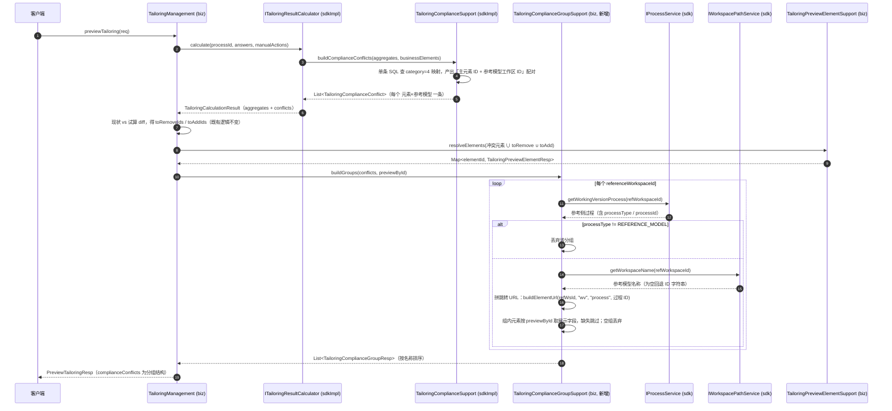

# Bug 15293 裁剪预览「违反参考模型一致性」按参考模型分组展示

> 裁剪助手预览中「这可能违反以下参考模型的一致性」当前只有扁平元素列表，看不出违反的是哪个参考模型。改为按参考模型分组：先显示参考模型（可跳转），其下列出该参考模型对应的被裁剪主元素。

## Decisions Log

<!-- Add new at bottom. Never remove. -->

| Date | Decision | Reasoning | Alternatives Considered |
|------|----------|-----------|------------------------|
| 2026-07-31 | 分组子项为**主模型元素**（本次将被裁出、且与该参考模型存在合规映射的主过程元素） | 用户明确：展示「该参考模型的主元素」；与现有 `complianceConflicts` 语义一致，无需解析参考侧元素 | 展示参考模型侧被映射元素（需额外跨工作区加载与权限处理） |
| 2026-07-31 | 区块标题计数 `(N)` 取**元素总数**，非参考模型数 | 用户明确；与相邻「将添加 / 将移除」两个区块的计数语义保持一致 | 按参考模型数量计数 |
| 2026-07-31 | 参考模型行需**可跳转**到该参考模型 | 用户明确；便于用户直接查看被违反的参考模型 | 仅作为纯文本分组标题 |
| 2026-07-31 | 元素映射到多个参考模型时，在**每个**相关分组下重复出现；标题 `(N)` 按**元素去重**计数 | 分组视角要求「该参考模型下所有受影响元素」完整可见；计数表达「受影响元素规模」，重复累加会虚高 | 只归入首个分组（信息缺失）；按分组条目数累加（同一元素多次计数） |
| 2026-07-31 | Level 1（Capabilities）已确认 | 五项能力与用户预期一致，范围不含冲突判定口径变更 | — |
| 2026-07-31 | `complianceConflicts` **直接改为分组结构**，不新增并行字段 | 前后端同仓可同步修改，无需兼容旧客户端；避免两套数据并存造成漂移 | 新增 `complianceConflictGroups` 并保留扁平列表 |
| 2026-07-31 | 分组归属**仅要求对端工作区 `process_type = REFERENCE_MODEL`** | 天然排除过程模块等其他 `association_category=4` 映射；把改动限制在展示层，不动冲突检测口径 | 额外限定为主过程参考模型页签实际引用的合规范围（对齐 `ComplianceMappingHandler`，但会改变检测口径） |
| 2026-07-31 | 参考模型类型过滤与呈现解析放在 **gf-biz 新 Support**，`TailoringComplianceSupport` 保持无依赖静态工具 | 类型判定与 URL 解析都需要 `IProcessService`；为此把静态工具改造成 Spring 组件代价大于收益 | 将 `TailoringComplianceSupport` 改为 `@Component` 并注入 `IProcessService` |
| 2026-07-31 | Level 2（Components）已确认 | 五个组件职责与分层边界与用户确认一致 | — |
| 2026-07-31 | Level 3（Interactions）已确认：分组行跳参考模型过程根，分组按名称排序 | 与参考模型页签既有跳转形状一致；排序口径对齐 `ComplianceMappingHandler` | 跳到具体被映射的参考元素；按冲突数量倒序排列 |
| 2026-07-31 | Level 4 设计批准，蓝图完成可进入实现 | Level 1-4 均与用户确认；契约明确且 `ExecuteTailoringResp` 通过继承自动传导 | — |
| 2026-07-31 | 一轮交互反馈后**分组单位由参考工作区改为参考模型元素**，分组行样式为「图标 参考元素 / 图标 参考空间」 | 用户要求把被违反的合规参考模型元素也显示出来，仅显示空间无法定位到具体参考元素 | 保留空间分组、在主元素下另起一行显示参考元素；把参考元素追加到主元素同行末尾 |
| 2026-07-31 | 分组行两段**各自可跳转**：元素名跳参考元素，空间名跳该参考模型过程根 | 两个跳转目标语义不同，用户明确要求分别可点 | 整行只跳参考元素；纯展示不跳转 |
| 2026-07-31 | 标题 `(N)` 计数口径**保持按被裁剪主元素去重**，不随分组粒度变细而膨胀 | 计数表达「受影响元素规模」；一个主元素映射多个参考元素时按配对计数会虚高 | 按「主元素 × 参考元素」配对条目数计数 |

## Constraints

- 冲突判定口径保持现状：元素 `finalAction == TAILOR_OUT` 且存在合规映射关联（不扩大或收窄检测范围）。
- 分组名称、跳转 URL 等呈现字段由**后端**解析下发，前端不拼装规则（对齐 `displayAsRemoved` 既有做法）。
- 事务边界不变：预览为只读路径，不加 `@Transactional`。
- 组件依赖方向不变：`gf-biz → gf-sdk → gf-sdkImpl`，禁止反向依赖。

## Key Files

- `backend/components/gf/sdkImpl/.../tailoring/TailoringComplianceSupport.java` — 合规冲突检测与映射关系查询
- `backend/components/gf/sdk/.../dto/TailoringComplianceConflict.java` — 冲突 DTO（已有未使用的 `scopeId`）
- `backend/components/gf/biz/.../tailoring/management/TailoringManagement.java` — `mapEngineResult` 组装预览响应
- `backend/components/gf/biz/.../tailoring/rest/resp/PreviewTailoringResp.java` — 预览响应契约
- `backend/components/gf/biz/.../tailoring/support/TailoringPreviewElementSupport.java` — 元素展示字段与 smartUrl 解析
- `backend/components/gf/sdkImpl/.../datasource/buildin/handler/ComplianceMappingHandler.java` — 既有「按参考模型分组」参照实现
- `web/src/frontend/pages/Gateflow/pages/Tailoring/components/TailoringModal/components/TailoringResultList/` — 预览结果区块渲染

## Design: Level 1 -- Capabilities

1. **按参考模型分组呈现**：「这可能违反以下参考模型的一致性」区块从扁平列表改为两层结构——先一行参考模型，紧随其下列出属于该参考模型的被裁剪元素；多个参考模型依次排列。
2. **组内元素为主模型元素**：子项是本次试算中将被裁出（划线移除）、且与该参考模型存在合规映射的主过程元素，展示图标、编号、名称，并可跳转到该元素（沿用现有 `smartUrl`）。
3. **参考模型行可跳转**：参考模型行展示其名称，点击跳转到该参考模型（工作区/过程根），跳转地址由后端下发。
4. **计数为元素总数**：区块标题 `(N)` 统计所有分组下的被裁剪元素总数（同一元素跨分组只计一次），而非参考模型数量。
5. **空组与无冲突降级**：没有被裁剪元素的参考模型不展示该分组；完全无冲突时区块保持 `(0)` 且无明细，与现状一致。

**范围外**：不改变冲突判定口径（仍为「裁出 + 存在合规映射」）；不改动「将添加 / 将移除」两个区块。

## Design: Level 2 -- Components

| # | 组件 | 分层 / DDD 角色 | 职责 |
|---|------|----------------|------|
| 1 | `TailoringComplianceSupport` | `gf-sdkImpl` / 无状态领域支持（改造） | 冲突检测：裁出元素 × 合规映射。由「只返回冲突元素 ID」扩展为返回**主元素 + 参考模型工作区**配对（单条 SQL，无 N+1） |
| 2 | `TailoringComplianceConflict` | `gf-sdk` / 值对象（扩展） | 新增 `referenceWorkspaceId`；已有 `scopeId` 不动（语义为合规范围，非工作区） |
| 3 | `TailoringComplianceGroupSupport` | `gf-biz/tailoring/support` / 应用层支持（**新增**） | 按参考模型聚合冲突、剔除非参考模型工作区、解析工作区名称与参考模型跳转 URL、组装分组响应 |
| 4 | `TailoringPreviewElementSupport` | `gf-biz/tailoring/support` / 应用层支持（复用，不改） | 组内元素展示字段与 `smartUrl` 解析 |
| 5 | `TailoringResultList` / `TailoringResultItem` | `web` 业务端组件（改造） | 渲染两层结构：参考模型分组行（可跳转）+ 其下被裁剪元素行 |

```
gf-sdkImpl                      gf-sdk                    gf-biz                         web
─────────────────────           ──────────────            ────────────────────────       ─────────────────
TailoringResultCalculatorImpl
TailoringWizardApplyServiceImpl
        │
        ├─► TailoringComplianceSupport ──► TailoringComplianceConflict
                                              (+referenceWorkspaceId)
                                                    │
                                                    └──► TailoringManagement.mapEngineResult
                                                              ├─► TailoringComplianceGroupSupport ──► TailoringResultList
                                                              │     ├─ IProcessService（参考模型类型判定 + 过程根）
                                                              │     ├─ IWorkspacePathService（工作区名称）
                                                              │     └─ GateflowProcessElementUrlBuilder（跳转 URL）
                                                              └─► TailoringPreviewElementSupport（元素展示字段）
```

**集成事实**：`buildComplianceConflicts` 同时被预览（`TailoringResultCalculatorImpl`）与执行（`TailoringWizardApplyServiceImpl`）调用；`executeTailoring` 复用 `mapEngineResult`，因此执行结果弹窗同样获得分组展示。

## Design: Level 3 -- Interactions



**关键数据流细节**

1. **SQL 方向**：关联主记录为「`instance_id` = 参考元素，`related_instance_id` = 主元素」。SQL 以 `related_instance_id` 关联本过程元素（`process_common_id` 命中）、以 `instance_id` 关联参考侧元素取 `work_space`。镜像行（`instance_id` = 主元素）因 `process_common_id` 不匹配自动排除；备注类自关联行用 `instance_id <> related_instance_id` 排除。
2. **一元素多参考模型**：SQL 天然产出多条配对，元素在每个分组重复出现；`elementId` 只解析一次展示字段（`previewById` 复用）。
3. **计数**：区块标题 `(N)` 由前端对所有分组的 `elementId` 去重后统计，不等于分组条目数之和。
4. **跳转层级**：分组行跳参考模型过程根 `/gateflow/workspace/{refWsId}/wv/process/process/{processId}`，与参考模型页签既有跳转形状一致；组内元素继续用元素自身 `smartUrl`。
5. **执行路径同步**：执行走同一 `buildComplianceConflicts` 与 `mapEngineResult`，自动获得同样分组。

## Design: Level 4 -- Contracts

### 1. `gf-sdk` 冲突值对象扩展

```java
@Data
@Builder
public class TailoringComplianceConflict {
    private Long elementId;
    private String reason;
    private Long scopeId;

    /** 被违反的参考模型所属建模工作区 ID；同一元素映射多个参考模型时产生多条 */
    private Long referenceWorkspaceId;
}
```

### 2. `gf-sdkImpl` 检测支持（**签名不变**，内部改造 → 两个调用点零改动）

```java
final class TailoringComplianceSupport {

    static List<TailoringComplianceConflict> buildComplianceConflicts(
            Map<Long, TailoringAggregateResult> aggregateByElement,
            List<IProcessElementsInner> businessElements);

    /** 替换原 loadMappedElementIds：主元素 ID → 其映射到的参考侧工作区 ID 集合 */
    private static Map<Long, Set<Long>> loadMappedReferenceWorkspacesByElement(Long processCommonId);
}
```

```sql
SELECT DISTINCT a.related_instance_id AS main_element_id,
                ref_e.work_space       AS reference_workspace_id
FROM air_inst_gf_element_tab_association a
JOIN air_inst_gf_element main_e ON a.related_instance_id = main_e.instance_id
JOIN air_inst_gf_element ref_e  ON a.instance_id = ref_e.instance_id
WHERE a.association_category = 4
  AND a.instance_id <> a.related_instance_id
  AND main_e.process_common_id = {0}
```

保留既有防护：`SqlRunner` 异常返回空集合（无 MyBatis 的纯单测场景）、列名大小写兼容。

### 3. `gf-biz` 新增分组响应 DTO

```java
@Data
@Builder
public class TailoringComplianceGroupResp {

    @Schema(description = "参考模型所属建模工作区 ID")
    private Long referenceWorkspaceId;

    @Schema(description = "参考模型名称；解析失败时回退为工作区 ID 文本")
    private String referenceWorkspaceName;

    @Schema(description = "参考模型过程根跳转 URL")
    private String smartUrl;

    @Schema(description = "该参考模型下将被裁剪的主过程元素")
    private List<TailoringPreviewElementResp> elements;
}
```

### 4. 预览响应契约变更

```java
public class PreviewTailoringResp {
    @Schema(description = "按参考模型分组的一致性冲突")
    private List<TailoringComplianceGroupResp> complianceConflicts;   // 原 List<TailoringPreviewElementResp>
    // answers / toRemoveElements / toAddElements / elementResults 不变
}
```

`ExecuteTailoringResp extends PreviewTailoringResp`，执行响应契约自动传导，无需单独修改。

### 5. `gf-biz` 分组编排支持（新增）

```java
@Component
@RequiredArgsConstructor
public class TailoringComplianceGroupSupport {

    private final IProcessService processService;
    private final IWorkspacePathService workspacePathService;

    /**
     * 按参考模型聚合冲突：剔除非 REFERENCE_MODEL 工作区与空分组，按名称排序。
     */
    public List<TailoringComplianceGroupResp> buildGroups(
            List<TailoringComplianceConflict> conflicts,
            Map<Long, TailoringPreviewElementResp> previewByElementId);
}
```

参考模型类型判定沿用既有读法：`process.getInnerValue(AirConstants.ProcessesDataObject.ATTR_PROCESS_TYPE, Long.class)` 与 `ProcessTypeEnum.REFERENCE_MODEL.getKey()` 比较（`ProcessVersionManagement` 已在 biz 层这样做）。

### 6. 前端类型与组件契约

```ts
// web/src/openapi/gateflowTailoring/typings.d.ts（pnpm openapi 生成）
type TailoringComplianceGroupResp = {
  referenceWorkspaceId?: number;
  referenceWorkspaceName?: string;
  smartUrl?: string;
  elements?: TailoringPreviewElementResp[];
};

// TailoringResultItem 新增分组渲染入口
type TailoringResultGroupItem = {
  title: string;
  url?: string;
  children: TailoringResultDetailItem[];
};

interface ITailoringResultItemProps {
  title: string;
  desc?: string;
  status: 'add' | 'warning' | 'subtract';
  detailList?: TailoringResultDetailItem[];
  groupList?: TailoringResultGroupItem[];   // 与 detailList 互斥，仅一致性区块使用
}
```

区块标题计数由 `TailoringResultList` 对各分组 `elementId` 去重后得出；i18n key `I18n.sys.tips.00001743` 文案不变。

### 7. 测试契约要点

| 层 | 用例 |
|---|---|
| `TailoringComplianceSupportTest` | 返回「元素×参考工作区」配对；自关联行排除；镜像行不重复；SQL 异常兜底 |
| `TailoringComplianceGroupSupportTest`（新增） | 非参考模型工作区剔除；名称为空回退 ID；URL 拼装；空分组丢弃；同一元素出现在多个分组 |
| `TailoringManagementTest` | `previewTailoring` 返回分组结构（既有 `previewTailoring_shouldMapDependentChildPreviewFieldsInComplianceConflicts` 按新契约改造）；`executeTailoring` 同步分组 |
| 前端 | `pnpm openapi` 刷新类型后 `pnpm tsc` 通过 |

## Design Summary

**组件与分层**

| 组件 | 分层 | 改动性质 |
|------|------|---------|
| `TailoringComplianceSupport` | gf-sdkImpl | 改造内部实现与 SQL，公共签名不变 |
| `TailoringComplianceConflict` | gf-sdk | 新增 `referenceWorkspaceId` |
| `TailoringComplianceGroupSupport` | gf-biz/tailoring/support | 新增 |
| `TailoringComplianceGroupResp` | gf-biz/tailoring/rest/resp | 新增 |
| `PreviewTailoringResp` | gf-biz/tailoring/rest/resp | `complianceConflicts` 类型改为分组列表 |
| `TailoringResultList` / `TailoringResultItem` | web | 支持两层渲染与去重计数 |

**关键契约**：`buildComplianceConflicts` 签名不变；`buildGroups(conflicts, previewByElementId)` 承担类型过滤与呈现解析；`ExecuteTailoringResp` 通过继承自动获得新契约。

**架构约束**：`gf-biz → gf-sdk → gf-sdkImpl` 依赖方向不变；预览为只读路径不加事务；呈现字段（名称、跳转 URL）后端解析下发。

**领域模型决策**：一致性冲突从「元素级事实」升级为「元素 × 参考模型 配对事实」；参考模型身份以建模工作区（`process_type = REFERENCE_MODEL`）为界。

**设计过程中已解决的问题**：分组子项语义（主元素）、计数口径（元素去重）、跳转需求（参考模型过程根）、契约演进方式（直接改造）、归属过滤严格度（仅类型）、类型过滤落层（gf-biz Support）。

**设计状态**：**Approved —— ready for implementation**

## Implementation Record

日期：2026-07-31（code-forge，全自动模式）

| 文件 | 改动 |
|------|------|
| `gf-sdk .../dto/TailoringComplianceConflict.java` | 新增 `referenceElementId`、`referenceWorkspaceId` |
| `gf-sdkImpl .../tailoring/TailoringComplianceSupport.java` | SQL 改为「主元素 × 参考元素 × 参考工作区」配对（`association_category` 取 `AssociationCategoryEnum.COMPLIANCE_MAPPING`，排除自关联行），按参考元素展开多条冲突；公共签名不变 |
| `gf-biz .../rest/resp/TailoringComplianceGroupResp.java` | 新增分组响应：`referenceElement`（复用 `TailoringPreviewElementResp`）+ 工作区 ID/名称/过程根 URL + `elements` |
| `gf-biz .../tailoring/support/TailoringComplianceGroupSupport.java` | 新增：按参考元素聚合；剔除非 `REFERENCE_MODEL` 工作区、无法解析的参考元素与空分组；参考元素按所属工作区批量走 `TailoringPreviewElementSupport` 解析（工作版本）；工作区名回退 ID；按「工作区名 → 参考元素名」排序 |
| `gf-biz .../rest/resp/PreviewTailoringResp.java` | `complianceConflicts` 改为 `List<TailoringComplianceGroupResp>`（`ExecuteTailoringResp` 继承传导） |
| `gf-biz .../management/TailoringManagement.java` | 注入并调用 `TailoringComplianceGroupSupport.buildGroups` |
| `web .../TailoringResultItem/index.tsx`、`index.less` | 新增 `groupList` 两层渲染，分组行为「图标 参考元素 / 图标 参考空间」两段独立链接；详情项键改为 `id` |
| `web .../TailoringResultList/index.tsx` | 映射分组、标题计数按 `elementId` 去重 |
| `web .../ManualTailoringModal/index.tsx` | 适配详情项 `id` 字段 |
| `web src/openapi/gateflowTailoring/typings.d.ts` | 手工同步新类型（见下方偏差） |

**测试**：`TailoringComplianceSupportTest` 12 例、`TailoringComplianceGroupSupportTest` 12 例（新增）、`TailoringManagementTest` 47 例，全部通过；`pnpm tsc` 通过。

**与设计的偏差**：

1. `pnpm openapi` 已在参考元素分组契约上重新生成（只开 `gateflowTailoring`，生成后已恢复 `openapi.config.js`），结果与手工同步内容一致（仅 `referenceElement` 因是 `$ref` 属性未带注释）。生成同时带回与本需求无关的既有漂移：`BatchOperationResp.batchOperationObjects` 新增、`ElementOperation.operationLabel` 字段顺序调整。
2. 前端详情项新增 `id` 字段用于列表键（原为可能为空的 `number`），因此同步调整 `ManualTailoringModal`。
