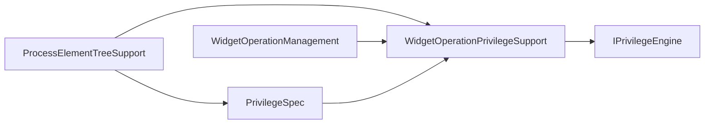

# 元素手动裁剪权限重映射（CLIP_ADD / CLIP_REMOVE）

> 将过程元素树上的手动裁入/裁出/重置从 `CLIP_EXECUTE`/`CLIP_RESET` 改为接入「裁剪添加」「裁剪移除」；过程级裁剪助手仍走「执行裁剪」「重置裁剪」。

## Decisions Log

| Date | Decision | Reasoning | Alternatives Considered |
|------|----------|-----------|------------------------|
| 2026-07-16 | 新建本锚点（修订过程元素树手动裁剪权限），引用过程操作权限与裁剪问答树权限文档 | 专项修订，避免淹没在两份已 implemented 文档里 | 直接改写 processes-operation-privilege-control（拒绝：历史决策保留） |
| 2026-07-16 | Level 1 Capabilities 批准 | 用户确认元素手动裁剪走 ADD/REMOVE；重置为二者任一；过程助手仍 EXECUTE/RESET | — |
| 2026-07-16 | 重置「CLIP_ADD ∨ CLIP_REMOVE」用 PrivilegeSpec `anyOf`（Option A） | Spec 保持唯一真相源，树过滤与写闸自动对齐 | Spec=null + 硬编码 OR（B，拒绝：易漏路径） |
| 2026-07-16 | 废止（对本特性）：「不启用 CLIP_ADD/CLIP_REMOVE」 | 用户明确要求元素手动裁剪接入该两类型 | 继续仅用 CLIP_EXECUTE（与角色配置及产品语义不符） |
| 2026-07-16 | Level 2 Components 批准 | 不新增组件；Spec anyOf + Support 评估；PES 去掉硬编码；写闸随 Spec | 硬编码 OR 于 PES（拒绝） |
| 2026-07-16 | 映射：IN→CLIP_ADD，OUT→CLIP_REMOVE，RESET→anyOf(ADD,REMOVE)；过程 EXECUTE/RESET 不变 | 对齐产品语义与角色模板权限名 | 重置仍绑 CLIP_RESET（拒绝：用户明确 OR） |
| 2026-07-16 | Level 3 Interactions 批准；批量写闸改走 hasDeclaredPrivileges（Option A） | anyOf 不能只取 requiredPrivilege 单类型，否则仅有 CLIP_REMOVE 时批量重置误拒 | 保留单类型 assert + 手写循环（B，拒绝） |
| 2026-07-16 | Level 4 Contracts 批准 | Spec anyOf + Support OR + 写闸入口兼容 required 为空的 anyOf；失败码 NO_PRIVILEGE_OPERATION | requiredPrivilege 伪造首项绕过（拒绝：语义含糊） |
| 2026-07-16 | Design approved at Level 4. Blueprint complete ready for implementation. | 四级齐全；可交 code-forge | — |
| 2026-07-16 | 实现完成：PrivilegeSpec.anyOf + 元素手动裁剪重映射 + Support/PES/写闸 + 单测 | 对齐 L4；filterScoped 对 anyOf 不再当 unguarded 放行 | — |

## Open Questions

无。

## Constraints

- 统一复用 `IPrivilegeEngine` + `WidgetOperationType.PrivilegeSpec`；禁止自建 ACL。
- 入口（树 `operations`）与写路径（Widget `assertWritePrivilege`）必须同一套 Spec 评估逻辑。
- 过程级 `TAILORING_PROCESS` / `RESET_PROCESS_TAILORING` 映射不变：`CLIP_EXECUTE` / `CLIP_RESET`。
- 本轮仅后端；前端继续消费既有 operation code。
- ~~不启用 CLIP_ADD/CLIP_REMOVE~~ → **已废止**（见 Decisions Log 2026-07-16）。

## Key Files

| 路径 | 角色 |
|------|------|
| `components/gf/sdk/.../enums/WidgetOperationType.java` | PrivilegeSpec 扩展 + 操作映射 |
| `components/gf/biz/.../WidgetOperationPrivilegeSupport.java` | anyOf / 单权限评估 |
| `components/gf/biz/.../ProcessElementTreeSupport.java` | 元素裁剪 op 下发改为走 Support |
| `components/gf/biz/.../WidgetOperationManagement.java` | 批量写闸改为按 Spec（含 anyOf）评估，不再只取 requiredPrivilege 单类型 |
| `components/gf/sdk/.../WidgetOperationTypeTest.java` 等 | Spec / 过滤 / 写闸单测 |

## Design: Level 1 -- Capabilities

**Status: Approved 2026-07-16**

1. **元素手动裁入** — 对过程元素有「裁剪添加」`CLIP_ADD(36)` 时，允许「添加（手动裁入）」及批量裁入。
2. **元素手动裁出** — 有「裁剪移除」`CLIP_REMOVE(37)` 时，允许「移除（手动裁出）」及批量裁出。
3. **元素手动裁剪重置** — 有裁剪添加 **或** 裁剪移除任一时，允许「重置单元素裁剪」及批量重置（展示条件仍：存在本地手动决策）。
4. **过程裁剪助手** — 根上「执行裁剪 / 重置裁剪」仍要过程实例 `CLIP_EXECUTE(34)` / `CLIP_RESET(35)`，本轮不改。
5. **入口与写闸一致** — 树过滤与 Widget 写路径同一映射，禁止 UI 有入口而写闸仍按旧 `CLIP_EXECUTE`。

**边界**：裁剪问答树关联/评论、Execute 视图按钮、前端隐藏逻辑 — 非本轮。

## Design: Level 2 -- Components

**Status: Approved 2026-07-16**

| 组件 | 分层 | DDD | 本轮职责 |
|------|------|-----|----------|
| `WidgetOperationType.PrivilegeSpec` | gf-sdk | 契约值对象 | 新增 `anyOf`；重映射元素手动裁剪族 |
| `WidgetOperationPrivilegeSupport` | gf-biz | 应用共享 | `hasDeclaredPrivileges` 支持 anyOf OR |
| `ProcessElementTreeSupport` | gf-biz | 装配器 | 元素裁剪 op 下发改走 Support |
| `WidgetOperationManagement` | gf-biz | 应用服务 | 批量写闸改走 Spec 评估（anyOf 兼容） |
| `IPrivilegeEngine` | infrastructure | 看门人 | 不变 |

**映射归属**

| 操作 | Spec |
|------|------|
| `TAILOR_IN` / `BATCH_TAILOR_IN` | `object(CLIP_ADD)` |
| `TAILOR_OUT` / `BATCH_TAILOR_OUT` | `object(CLIP_REMOVE)` |
| `RESET_ELEMENT_TAILORING` / `BATCH_RESET_ELEMENT_TAILORING` | `anyOf(CLIP_ADD, CLIP_REMOVE)` |
| `TAILORING_PROCESS` / `RESET_PROCESS_TAILORING` | 不变 |

## Design: Level 3 -- Interactions

**Status: Approved 2026-07-16**

### 1. 元素树单节点手动裁剪下发
候选仍由 `TailoringMenuPolicy.resolveElementTreeOperationTypes` 产生 → 逐 op 调 `hasDeclaredPrivileges`（IN→ADD，OUT→REMOVE，RESET→anyOf）→ 写入 `operations`。

### 2. 分类锚点批量裁剪下发
`DispatchPolicy` 追加 BATCH_* → `filterScopedOperationsByPrivilege` → 同一 `hasDeclaredPrivileges`。

### 3. Widget 写路径
- 单元素：既有 `assertPrivilegeOnTarget` → Support。
- 批量 `elementIds`：逐目标 `hasDeclaredPrivileges(operationType, element)`（不再 `hasPrivilege(required.getCode())`）。
- 过程级助手：不变。

### 4. 判定对照

| 场景 | 旧 | 新 |
|------|----|----|
| 元素 IN/OUT | CLIP_EXECUTE | CLIP_ADD / CLIP_REMOVE |
| 元素 RESET | CLIP_RESET | CLIP_ADD ∨ CLIP_REMOVE |
| 过程执行/重置 | EXECUTE / RESET | 不变 |

## Design: Level 4 -- Contracts

**Status: Approved 2026-07-16**

### PrivilegeSpec
- `anyOf(first, rest...)`：对象级 OR；不与 tableId / additionalPrivileges 混用。
- `getAnyOfPrivileges()` / `isAnyOf()`；anyOf 时 `getPrivilege()` 可为 null。

### WidgetOperationType
- `requiredPrivilege()`：anyOf → empty；单权限 → of(privilege)。
- `anyOfPrivileges()` / `isAnyOfPrivilege()`。
- 映射：IN/BATCH_IN→CLIP_ADD；OUT/BATCH_OUT→CLIP_REMOVE；RESET/BATCH_RESET→anyOf(ADD,REMOVE)；过程 EXECUTE/RESET 不变。

### WidgetOperationPrivilegeSupport
- `hasDeclaredPrivileges`：Spec null→true；anyOf→任一 hasPrivilege；否则既有单权限/页签逻辑。
- 过滤方法签名不变，内部吃 anyOf。

### ProcessElementTreeSupport
- `appendElementTailoringOperations`：删除 CLIP_EXECUTE/CLIP_RESET 硬编码，改 `hasDeclaredPrivileges`。

### WidgetOperationManagement
- 写闸入口：`required.isEmpty() && anyOf.isEmpty()` 才跳过。
- 批量 elementIds：`assertElementIdsDeclaredPrivilege` → 逐目标 `hasDeclaredPrivileges`。
- 失败：`ObjResultCode.NO_PRIVILEGE_OPERATION`。

### 测试契约
Spec 映射；anyOf 仅 ADD / 仅 REMOVE / 皆无；树下发；写闸单/批量；过程 EXECUTE/RESET 回归。

## Design Summary

**Status: Approved -- ready for implementation**

| 项 | 内容 |
|----|------|
| 组件 | PrivilegeSpec（sdk）+ PrivilegeSupport / PES / WidgetOperationManagement（biz）+ IPrivilegeEngine（不变） |
| 关键契约 | `anyOf` Spec；`hasDeclaredPrivileges` OR 评估；批量写闸 Spec 化；PES 去硬编码 |
| 架构约束 | Spec 唯一真相源；入口=写闸；仅后端；过程助手映射不变 |
| 领域 | 权限声明为操作契约 VO；鉴权对象仍为元素/过程实例 |
| 已关闭问题 | 重置 OR 建模（anyOf）；批量写闸评估方式 |
| 下一步 | `/code-forge` 按本蓝图实现 |

## Implementation Notes

**Status: Implemented 2026-07-16**

1. `PrivilegeSpec.anyOf` + `WidgetOperationType.anyOfPrivileges` / `isAnyOfPrivilege`；`requiredPrivilege()` 对 anyOf 返回 empty
2. 映射：IN/BATCH_IN→CLIP_ADD；OUT/BATCH_OUT→CLIP_REMOVE；RESET/BATCH_RESET→anyOf；过程助手不变
3. `hasDeclaredPrivileges` 优先评估 anyOf；`filterScoped` / `filterTailoringTree` 用 `isUnguarded`（required 空且 anyOf 空）避免 anyOf 被误放行
4. PES `appendElementTailoringOperations` 改走 Support
5. 写闸入口兼容 anyOf；批量 `assertElementIdsDeclaredPrivilege`
6. 单测：WidgetOperationTypeTest / PrivilegeSupportTest / ProcessElementTreeSupportTest / WidgetOperationManagementTest
