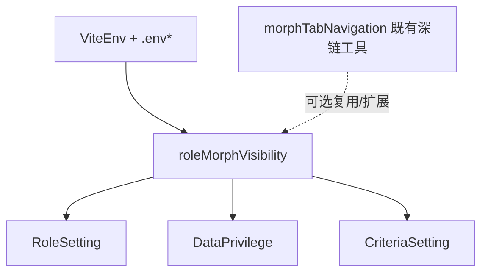

# Frontend Template / Instance Role Visibility

> 用两个前端环境变量控制管理端模板角色与实例角色相关 UI 的展示（角色 / 数据权限 / 条件三页形态 Tab）。

## Decisions Log

| Date | Decision | Reasoning | Alternatives Considered |
|------|----------|-----------|------------------------|
| 2026-07-27 | 功能锚点 `frontend-template-instance-role-visibility`；requirement_doc=null | 需求直接来自产品描述，无独立需求文档 | 合并进既有 template-role context（拒绝：范围是前端 env 开关，非后端禁用语义） |
| 2026-07-27 | 覆盖范围 A：仅管理端 RoleSetting / DataPrivilege / CriteriaSetting 形态 Tab 及相关表单入口 | 用户描述对准「全部/普通/模板/实例」切换；WorkspaceRoleManagement 未挂菜单 | B 含后台工作区角色管理页；C 再含前台角色团队 |
| 2026-07-27 | 未配置环境变量时默认**隐藏**（仅显式 `true` 开启） | 用户确认默认隐藏；此前默认开启导致本地未写 env 仍见 Tab | 默认开启（兼容现网） |
| 2026-07-27 | 改为参照 `IS_DEVELOP_SYSTEM_ONE`：`window.IS_SHOW_TEMPLATE_ROLE` / `IS_SHOW_INSTANCE_ROLE`（`== 1`），`docker/start.sh` 注入 | 用户现网以 window 运行时注入为准，Vite `VITE_*` 本地读不到 | Vite `.env` / `import.meta.env` |
| 2026-07-27 | Level 1 Capabilities 批准 | 与用户确认的行为矩阵一致 | — |
| 2026-07-27 | Level 2：ViteEnv + `roleMorphVisibility` 工具 + 三页面消费；工具落 `src/backend/utils/` | 管理端专用，不进 common；过滤内聚在工具内 | 拆独立 TabFilter 组件；放 common 供前台复用 |
| 2026-07-27 | Level 3 交互批准：启动解析 → Tab 过滤/隐藏 → 不可见态 clamp → 深链二次校验 | 三页共用行为矩阵；仅前端本地数据流 | — |
| 2026-07-27 | 「全部」在实例关闭时：仅藏 Tab，查询语义不变（方案 A） | 改动最小；权限「全部」本就默认排除实例；角色全部偶含实例可后续再收 | B：全部查询也排除实例 |
| 2026-07-27 | Level 4：`VITE_SHOW_TEMPLATE_ROLE` / `VITE_SHOW_INSTANCE_ROLE` + `RoleMorphVisibility` / `filterMorphTabs` / `clampMorphTab` | Vite 构建期开关；缺省与非法值均按 true | 运行时远程配置；`VITE_FEATURE_*` 命名 |
| 2026-07-27 | Design approved at Level 4. Blueprint complete ready for implementation. | L1–L4 均已用户确认并写入锚点 | — |
| 2026-07-27 | 实现：增加 `resolveRoleMorphVisibility` / `parseShowFlag` 供单测注入；`getRoleMorphVisibility` 在无 Vite env 时回退全开 | Node 单测无 `import.meta.env` | 仅 mock import.meta |
| 2026-07-27 | `resolveRoleTabFromQuery` / `resolveCriteriaTabFromQuery` 末尾 clamp；三页按 `filterMorphTabs` 空则不渲染 Tabs | 对齐 L3 深链二次校验 | 仅页面层 clamp |

## Open Questions

None.

## Constraints

- 仅前端展示开关；不改后端鉴权、数据模型、REST
- 不含 WorkspaceRoleManagement、不含前台角色团队
- 实例开关仅在模板开关开启时生效
- 模板关闭时去掉形态切换条，页面固定普通形态

## Key Files

| Path | Role |
|------|------|
| `web/types/global.d.ts` | Window 上声明 `IS_SHOW_*_ROLE` |
| `web/src/utils/env/index.ts` | `IS_SHOW_TEMPLATE_ROLE` / `IS_SHOW_INSTANCE_ROLE`（`== 1`） |
| `web/docker/start.sh` | 部署注入 `window.IS_SHOW_*_ROLE` |
| `web/src/backend/utils/roleMorphVisibility.ts` | 解析开关 + Tab 过滤 + 默认形态 |
| `web/src/backend/utils/roleMorphVisibility.test.ts` | 工具层单测 |
| `web/src/backend/pages/RolePrivilege/RoleSetting/index.tsx` | 角色形态 Tab 消费 |
| `web/src/backend/pages/RolePrivilege/DataPrivilege/index.tsx` | 权限形态 Tab 消费 |
| `web/src/backend/pages/CriteriaSetting/index.tsx` | 条件形态 Tab 消费 |
| `web/src/backend/utils/morphTabNavigation.ts` | 深链解析后 clamp |
| `web/src/backend/utils/morphTabNavigation.test.ts` | 深链 clamp 单测 |
| `web/src/backend/index.html` | 本地调试注释示例 |

## Implementation Notes

- 已实现：与 `IS_DEVELOP_SYSTEM_ONE` 同模式（window + docker/start.sh + `@/utils/env`）；三页形态 Tab 条件渲染；深链 clamp。
- 部署容器环境变量：`IS_SHOW_TEMPLATE_ROLE=1`、`IS_SHOW_INSTANCE_ROLE=1`（未设或非 1 = 隐藏）。
- 本地调试：取消 `src/backend/index.html` 内注释脚本并设为 `'1'`。
- 实现状态：**complete — recommend `/review`**

## Design: Level 1 -- Capabilities

1. **模板展示开关**：可配置是否展示模板角色相关内容（模板角色、模板权限、条件模板）。关闭后上述内容一并不可见。
2. **实例展示开关**：可配置是否展示实例角色相关内容（角色实例、权限实例、条件实例）。仅在模板展示开启时生效；模板关闭时该开关无效果。
3. **模板关闭时的形态**：去掉顶端「全部 / 普通 / 模板 / 实例」（及条件页对应形态 Tab），页面直接以普通形态呈现，无形态切换条。
4. **模板开 + 实例关**：保留形态切换，但隐藏实例相关 Tab（如「实例」「权限实例」「条件实例」）。
5. **非目标**：不改后端鉴权/数据模型；不隐藏工作区角色管理页；不隐藏前台角色团队。

## Design: Level 2 -- Components

### Architectural / DDD notes

- 层归属：类型/构建配置 → 工具层 → 页面层；符合 Web 架构依赖方向。
- 无新后端聚合；前端值对象 `RoleMorphVisibility { showTemplate, showInstance }`（`showInstance` 受 `showTemplate` 约束）。
- 不引入领域事件或跨聚合通信。

### Component diagram



### Component responsibilities

| Component | Layer | Responsibility |
|-----------|-------|----------------|
| Vite Env 声明 / `.env*` | 类型层 + 构建配置 | 声明两个 `VITE_*` 变量；各环境可覆盖 |
| `roleMorphVisibility` 工具 | 工具层 `src/backend/utils/` | 读 env → 解析布尔（未配置=开）；强制「实例依赖模板」；提供形态 Tab 过滤与默认形态 |
| RoleSetting / DataPrivilege / CriteriaSetting | 页面层 | 消费 visibility：渲染/隐藏形态 Tab；模板关时无 Tab 条并锁定普通形态；页内模板/实例表单入口同步收敛 |

## Design: Level 3 -- Interactions

### 行为矩阵

| showTemplate | showInstance（有效） | Tab 条 | 默认形态 |
|---|---|---|---|
| false | false（强制） | 不渲染 | 锁定 `normal` |
| true | false | 去掉 instance 类 Tab | 当前若为 instance → clamp 到可见默认 |
| true | true | 全量 Tab | 现有深链逻辑不变 |

### 1. 启动解析

1. 页面调用 `getRoleMorphVisibility()`（读 env，未配置=true；`showInstance = envInstance && showTemplate`）。
2. `filterMorphTabs` 得到可见 Tab；模板关则列表为空 → 不渲染 Tabs。
3. 若 `activeTab` 不在可见集 → clamp。

### 2. 模板关闭

- 无形态 Tab 条；强制 `normal`；列表按普通形态请求；隐藏模板/实例相关表单入口。

### 3. 模板开 + 实例关

- 过滤 `instance` Tab；保留 `all`/`normal`/`template`（条件页无 `all`）。
- 「全部」查询语义不变（不额外排除实例行）。

### 4. 深链

- `morphTabNavigation` 解析后用 visibility 二次校验，不可见则回落。

### 5. 边界

- 仅 Env → Util → Page；不新增后端 API。

## Design: Level 4 -- Contracts

### Env（`web/types/env.d.ts`）

```ts
declare interface ViteEnv {
  /** 是否展示模板角色相关内容；未配置视为 'true' */
  readonly VITE_SHOW_TEMPLATE_ROLE?: 'true' | 'false';
  /** 是否展示实例角色相关内容；仅当模板开启时生效；未配置视为 'true' */
  readonly VITE_SHOW_INSTANCE_ROLE?: 'true' | 'false';
}
```

### 工具（`web/src/backend/utils/roleMorphVisibility.ts`）

```ts
export interface RoleMorphVisibility {
  showTemplate: boolean;
  showInstance: boolean; // 已应用 showInstance &= showTemplate
}

export function getRoleMorphVisibility(): RoleMorphVisibility;

export type MorphTabKey = 'all' | 'normal' | 'template' | 'instance';

export function filterMorphTabs<T extends { key: string }>(
  tabs: T[],
  visibility?: RoleMorphVisibility,
): T[];

export function clampMorphTab(
  tab: string,
  visibility?: RoleMorphVisibility,
): MorphTabKey;
```

### 页面消费约定

| 页面 | 契约 |
|------|------|
| RoleSetting / DataPrivilege / CriteriaSetting | `filterMorphTabs` 为空 → 不渲染形态 Tabs，锁定 normal |
| 同上 | clamp 后同步 state（及必要时 URL tab） |
| BaseInfo / 选角色类型等 | `!showTemplate` 隐藏模板创建/选项；`!showInstance` 隐藏实例入口 |

### 失败 / 边界

- env 非法值 → 按 true；纯同步，无异步失败面。

## Design Summary

### Components and layer assignments

- ViteEnv / `.env*` — 类型层 + 构建配置
- `roleMorphVisibility` — 工具层 `src/backend/utils/`
- RoleSetting / DataPrivilege / CriteriaSetting — 页面层消费

### Key contracts and interfaces

- `window.IS_SHOW_TEMPLATE_ROLE` / `window.IS_SHOW_INSTANCE_ROLE`（部署 `docker/start.sh` 注入，`== 1` 为开）
- `RoleMorphVisibility`、`getRoleMorphVisibility`、`filterMorphTabs`、`clampMorphTab`

### Architectural constraints

- 仅前端展示；不改后端鉴权/模型/REST
- 范围 A：三页形态 Tab + 相关表单入口
- 实例依赖模板；模板关 → 无 Tab 条 + 锁定 normal
- 「全部」查询语义不因实例关而改变

### Domain model decisions

- 值对象 `RoleMorphVisibility`；无新聚合 / 无领域事件

### Open questions resolved

- 覆盖范围 → A
- 默认未配置 → **隐藏**
- 「全部」+ 实例关 → 仅藏 Tab（方案 A）
- 环境变量命名 → `VITE_SHOW_*_ROLE`

### Design status

**Implemented — recommend `/review`**
