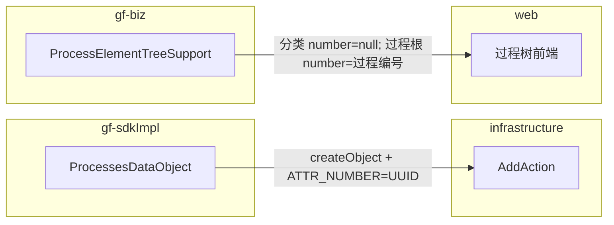

# 过程分类文件夹 UUID 编号

> 过程创建时自动生成的分类文件夹（`ROOT_ELEMENT_SUB_TYPE`，如「工作流和活动」）使用 UUID 作为编号，不占用过程元素自动编号序列；树上不展示这些编号。过程根继续使用过程自动编号并照常下发，展示由前端判断。

## Decisions Log

| Date | Decision | Reasoning | Alternatives Considered |
|------|----------|-----------|------------------------|
| 2026-08-11 | 范围仅限分类文件夹 UUID（选项 A）；过程根不改编号生成 | 「不占用过程元素编号」对应分类节点；过程根属过程对象编号空间 | B 只改过程根；C 两者都改 UUID |
| 2026-08-11 | 存量不迁移（A1） | 改动面小；仅保证新建过程不再占号 | A2 Flyway/脚本迁移存量 |
| 2026-08-11 | 后端对分类节点响应清空 `number`（B1）；分类相关 API 同步（D2 分类侧） | 展示干净；隐藏逻辑集中后端 | B2 仅前端隐藏分类编号 |
| 2026-08-11 | 过程根 `createProcessNode` **保留** `setNumber(process.getNumber())`，展示由前端判断 | 过程根继续走过程编号，不是 UUID | 后端对过程根 number 置 null |
| 2026-08-11 | Level 1–4 全部批准；蓝图完成可进入实现 | 用户逐级确认 | — |
| 2026-08-11 | Design approved at Level 4. Blueprint complete ready for implementation. | design-blueprint Step 3 | — |
| 2026-08-11 | 抽出 `CategoryFolderNumberSupport`（gf-sdk）统一 UUID 生成与展示掩码 | biz/sdkImpl 多处读路径复用；符合「树操作策略放 gf-sdk」既有模式 | 各处内联 if |
| 2026-08-11 | 模块补齐分类节点 `ProcessModuleServiceImpl.ensureCategoryNode` 同步写 UUID | 与过程创建初始化路径一致，避免模块路径仍占号 | 仅改 ProcessesDataObject |
| 2026-08-11 | 选择器 `ProcessServiceImpl.mergePickerElements` 同步掩码分类 number | 对齐 D2 分类侧全读路径 | 仅元素树 |
| 2026-08-11 | D2 补齐 Index/Assoc/Graph/裁剪/合规等展示读路径统一 `toDisplayNumber` | Review medium：列表/图/关联仍可能露出 PEA*/UUID | 仅主树掩码 |
| 2026-08-11 | `putPersistedNumberAttr` + 测试 `testInitCategoryNodes_UsesUuidNumber_DoesNotConsumeAutoNumber` | Review medium：创建路径契约未断言 | 仅测 Support 工具 |

## Open Questions

（无）

## Constraints

- UUID 编号生成：仅分类文件夹（`elementSubType = ROOT_ELEMENT_SUB_TYPE`）；真实过程元素仍走自动编号
- 过程根：持久化与响应均使用过程自动编号（非 UUID）；是否展示由前端控制
- 展示掩码（后端）：仅分类节点响应 `number` 置空
- 显式传入 `ATTR_NUMBER` 须满足 `AddAction` 编号字符校验（`^[a-zA-Z0-9·\\-_]+$`，UUID 带连字符合法）
- 存量分类节点不迁移编号
- 不新增 SDK 接口；不改 AddAction

## Key Files

- `backend/components/gf/sdk/.../tree/CategoryFolderNumberSupport.java` — UUID 生成 / `putPersistedNumberAttr` / 展示掩码（gf-sdk）
- `backend/components/gf/sdkImpl/.../ProcessesDataObject.java` — 初始化分类节点写 UUID
- `backend/components/gf/sdkImpl/.../ProcessModuleServiceImpl.java` — ensureCategoryNode 写 UUID
- `backend/components/gf/biz/.../ProcessElementTreeSupport.java` — convertToTreeResp 掩码分类 number；createProcessNode 保留过程 number
- `backend/components/gf/sdkImpl/.../ProcessVersionCompareServiceImpl.java` — 比对树分类 number 掩码
- `backend/components/gf/sdkImpl/.../ProcessServiceImpl.java` — 选择器分类 number 掩码
- `backend/components/gf/sdkImpl/.../IndexHandler.java` / `AssociationsDataSourceHandler.java` / `ProcessGraphServiceImpl.java` — 列表/关联/图展示掩码
- `backend/components/gf/biz/.../TailoringManagement.java` 等裁剪/合规组装 — 展示掩码
- `backend/infrastructure/sdkImpl/.../AddAction.java` — 显式 number 跳过自动编号（只读依赖，不改）
- 前端过程树 — 过程根是否展示 number

## Design: Level 1 -- Capabilities

1. **分类文件夹不占号**：新建过程时自动创建的分类文件夹不再消耗过程元素自动编号序列。
2. **分类文件夹有稳定内部编号**：分类节点仍有唯一 `number`（UUID），满足框架约束。
3. **树上不展示分类编号**：过程元素树中分类文件夹只显示名称，不出现编号前缀（后端对分类 `number` 置空）。
4. **真实元素编号不受影响**：用户创建的过程元素仍按原自动编号规则递增。
5. **过程根编号照常下发**：`createProcessNode` 仍设置过程 `number`（过程自动编号，非 UUID）；是否展示由前端判断；存量分类编号不迁移。

## Design: Level 2 -- Components

| 组件 | 层 | 职责 |
|------|-----|------|
| ProcessesDataObject（分类初始化路径） | gf-sdkImpl | 创建分类节点时显式写入 UUID 到 `ATTR_NUMBER` |
| ProcessElementTreeSupport（分类展示掩码） | gf-biz | 分类节点响应 `number` 置空；过程根仍 `setNumber(process.getNumber())` |
| 前端过程树 | web | 过程根是否展示 number |
| AddAction / AutoNumber（既有） | infrastructure-sdkImpl | 收到显式 number 后不消耗编号序列（不改） |



## Design: Level 3 -- Interactions

### Flow 1：新建过程 → 分类节点 UUID 编号

1. 用户创建过程 → `ProcessesDataObject` afterCreate 初始化缺失分类节点
2. 对每个分类节点：生成 UUID → `attrMap.put(ATTR_NUMBER, uuid)` → `createObject`
3. `AddAction` 收到显式 number，不调用自动编号引擎 → 落库

### Flow 2：读路径 → 分类隐藏编号；过程根照常下发过程编号

1. 组装分类节点响应：`ROOT_ELEMENT_SUB_TYPE` → `number = null`
2. `createProcessNode`：`number = process.getNumber()`（过程自动编号，保留）
3. 前端自行决定过程根是否展示 number；真实过程元素 number 原样返回

## Design: Level 4 -- Contracts

### 1. 分类节点创建编号（写入）

```java
CategoryFolderNumberSupport.putPersistedNumberAttr(attrParamMap);
// 等价：ATTR_NUMBER = UUID.randomUUID().toString()
```

- 仅 `ROOT_ELEMENT_SUB_TYPE`；跳过自动编号序列

### 2. 展示掩码策略（读取，后端）

```java
/** 仅分类文件夹：响应中不应展示 number。过程根不在此掩码范围。 */
boolean shouldSuppressElementNumber(String elementSubType);
// ROOT_ELEMENT_SUB_TYPE → true；其他 → false
```

### 3. 组装点契约

| 组装入口 | 契约 |
|---------|------|
| `ProcessElementTreeSupport.createProcessNode` | **保留** `setNumber(processObject.getNumber())`（过程编号非 UUID）；展示由前端判断 |
| `ProcessElementTreeSupport.convertToTreeResp` | 分类节点 `number = null` |
| `ProcessVersionCompareServiceImpl` / 选择器等 | 分类 `number` suppress |
| `IndexHandler` / `AssociationsDataSourceHandler` / `ProcessGraphServiceImpl` | 分类 `number` suppress（D2） |
| 裁剪预览/选择器、合规引用、接口查询等展示组装 | 同等 `toDisplayNumber` |

**不变**：过程/分类 DB `number` 仍存在；真实元素 number 原样；不改 AddAction

### 4. 测试契约

```java
void testInitCategoryNodes_UsesUuidNumber_DoesNotConsumeAutoNumber();
void testCreateProcessNode_NumberPreservedFromProcess();
void testConvertToTreeResp_CategoryNode_NumberIsNull();
void testConvertToTreeResp_BusinessElement_NumberPreserved();
```

## Design Summary

- **Components / layers**：`ProcessesDataObject`（gf-sdkImpl）写 UUID；`ProcessElementTreeSupport`（gf-biz）掩码分类 number；过程根仍下发过程编号；前端控制过程根展示
- **Key contracts**：分类创建显式 `ATTR_NUMBER=UUID`；`shouldSuppressElementNumber` 仅对 `ROOT_ELEMENT_SUB_TYPE`；`createProcessNode` 保留过程 number
- **Architectural constraints**：不新增 SDK 接口；不改 AddAction；存量不迁移
- **Domain**：分类文件夹为过程元素聚合内置节点；UUID 为编号生成策略，非新聚合
- **Open questions**：全部已关闭
- **Design status**：**Approved -- ready for implementation**

## Design Checkpoint

- Current: Implementation complete
- Approved: Level 1, Level 2, Level 3, Level 4
- Impl status: Code + tests landed; review medium（D2 读路径 + 创建路径断言）已修复 (2026-08-11)
