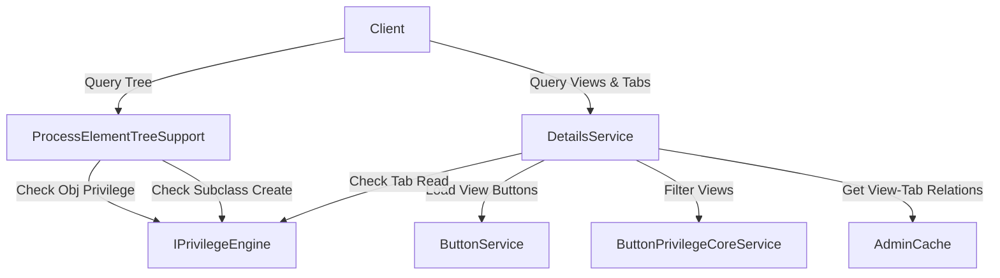
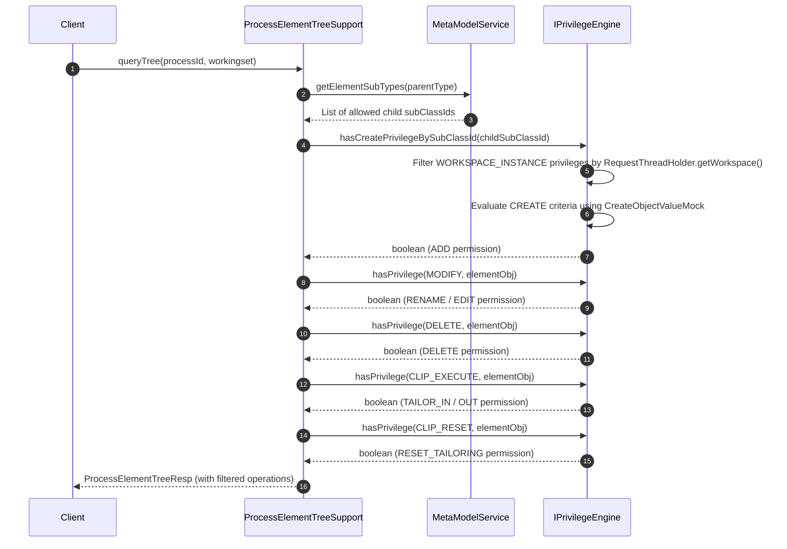
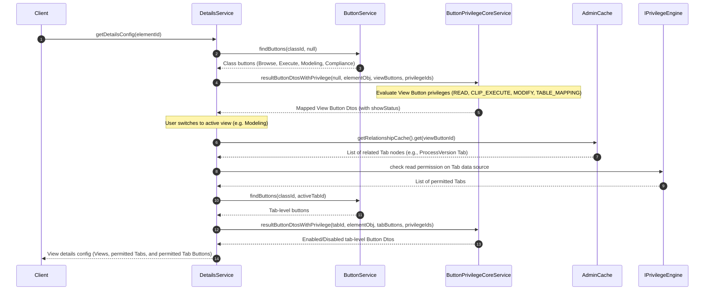

# 过程操作与权限控制

> 为 GateFlow 过程中的左侧元素树建立基于权限的操作控制，并为右侧详情视图（浏览、执行、建模、合规）建立视图级页签控制。同时解决产品空间下角色分配后，创建权限及视图按钮的权限溢出与控制失效问题。

## 决策日志

<!-- 新增决策放在底部。绝不删除。 -->

| 日期 | 决策 | 决策原因 | 曾考虑的其他方案 |
|------|----------|-----------|------------------------|
| 2026-07-08 | 方案设计在 Level 4 获得批准。蓝图已完成，准备进行代码开发。 | 满足所有的业务和架构规范，复用系统已有框架，保证安全过滤的正确性。 | 无。 |
| 2026-07-08 | 使用 `IPrivilegeEngine` 过滤左侧树操作 | 避免重复编写权限校验逻辑。标准化 CREATE、MODIFY、DELETE、CLIP_EXECUTE 和 CLIP_RESET 的映射校验。 | 直接在 SQL 中关联查询角色，或者自定义 ACL 解析（被拒绝：过于复杂，且绕过了现有的数据对象 ACL 控制）。 |
| 2026-07-08 | 将右侧 4 个视图（浏览、执行、建模、合规）建模为类级的 RIGHT 按钮 | 复用 `ROOT_BUTTON_NODE` (9051) 下已有的按钮配置节点（类型 40）。可以借此直接复用 `ButtonPrivilegeCoreService` 的 Criteria SQL 动态数据权限过滤。 | 在类配置（Class）上添加新的硬编码视图字段（被拒绝：过于僵硬，且需要修改数据库结构）。 |
| 2026-07-08 | 使用 `air_sys_relation_ships` 建立视图与页签的绑定关系 | 极具灵活性。将视图按钮（View Button）节点作为 parent，将页签（Tab）节点作为 value/target。从而能够充分复用 `AdminCache` 的内存关系缓存。 | 在 Java 代码中硬编码视图与页签的映射（被拒绝：限制了后续的自定义配置能力）。 |
| 2026-07-08 | 在 `collectCurrentDataObjectButtonsPrivilege` 中增加空间实例权限过滤 | 解决分配角色后，当前用户在 Workspace A 的创建/修改权限外溢到其他工作区的问题。基于 `RequestThreadHolder.getWorkspace()` 进行活跃工作区硬匹配过滤。 | 在所有业务逻辑中硬编码工作区匹配（被拒绝：无法覆盖全，且工作量大且易错）。 |
| 2026-07-08 | 引入 `CreateObjectValueMock` 并在 `CreatePrivilegeCoreService` 中评估 CREATE Criteria | 解决新建操作时因对象不存在导致 Criteria (如所属空间过滤条件 `{workspaceId}`) 无法正常匹配评估的问题。通过构造模拟对象，将工作区属性动态返回为当前活跃工作区 ID，并调用 `matchCriteria` 验证条件。 | 不使用 Criteria，仅校验权限节点（被拒绝：无法支持基于条件模板/工作区隔离的精细化创建控制）。 |
| 2026-07-08 | 将视图按钮 (Browse/Execute/Modeling/Compliance) 关联至标准 `privilegeType` | 解决因视图按钮无所需权限导致所有人都拥有查看所有视图权限的问题。Browse 关联 READ(5)，Execute 关联 CLIP_EXECUTE(34)，Modeling 关联 MODIFY(6)，Compliance 关联 TABLE_MAPPING(79)。 | 针对视图按钮独立开发权限逻辑（被拒绝：破坏系统按钮/权限矩阵的统一设计，增加维护成本）。 |

## 开放性问题

无。

## 约束

- **兼容性**: 不得修改已有的页签内部按钮鉴权逻辑（即 `ButtonPrivilegeCoreService.resultButtonDtosWithPrivilege`）。
- **性能**: 查询左侧树时必须尽量减少数据库联查，应尽量使用批量权限评估或 `batchHasPrivilege` 评估。

## 设计：Level 1 -- 能力

### 1. 左侧元素树操作鉴权
根据当前用户的角色和数据权限，动态过滤对左侧树元素（如阶段 Stage、活动 Activity、任务 Task 等）允许执行的右键上下文操作：
- **ADD (新增子节点)**: 仅当用户对目标的子类元 ID 拥有 `CREATE` (1) 权限时才允许。
- **EDIT / RENAME / SORT (编辑、重命名、排序)**: 仅当用户对该特定的元素实例（`DataObject`）拥有 `MODIFY` (6) 权限时才允许。
- **DELETE (删除)**: 仅当用户对该特定的元素实例拥有 `DELETE` (2) 权限时才允许。
- **TAILOR_IN / TAILOR_OUT (手动裁入/裁出)**: 仅当用户对该元素实例拥有 `CLIP_EXECUTE` (34) 权限时才允许。
- **RESET_ELEMENT_TAILORING (重置元素裁剪)**: 仅当用户对该元素实例拥有 `CLIP_RESET` (35) 权限时才允许。

### 2. 右侧详情面板视图级控制
控制右侧详情面板上四个视图选择器的显示与隐藏：**浏览 (Browse)**、**执行 (Execute)**、**建模 (Modeling)** 和 **合规 (Compliance)**。
- 每一个视图选项在数据库中被配置为类元（ProcessesBaseClass）级按钮，且 `displayLocation` = `2` (RIGHT)。
- 用户能看到并切换到该视图，前提是其拥有该视图按钮绑定的权限类型（通过 `IPrivilegeEngine` 鉴权通过）。

### 3. 视图与页签联动过滤
当右侧某个详情视图处于激活状态时，只显示该视图关联的、且当前用户有权查看的页签（Tabs）：
- 每个视图按钮与一组页签节点在关系表 `air_sys_relation_ships` 中关联。
- 切换视图时，系统获取该视图关联的页签列表，校验用户对页签底层数据源的 `READ` (5) 权限，取两者的交集进行显示。

### 4. 页签内部按钮鉴权
在每一个已展示 of 页签内部，按钮（例如“过程版本”页签下的“创建版本”、“发起流程”按钮）根据 `ButtonPrivilegeCoreService` 的标准动态 Criteria 数据权限校验结果，控制其可用或禁用状态。

## 设计：Level 2 -- 组件

| 组件名 | 物理分层 | DDD 角色 | 职责 |
|---|---|---|---|
| `ProcessElementTreeSupport` | 业务层 (Biz) | 服务 / 装配器 (Service / Assembler) | 构建过程元素树节点，并调用权限引擎过滤各个节点的可用操作列表。 |
| `IPrivilegeEngine` | 基础设施层 (rolepriv) | 领域服务 / 看门人 (Domain Service / Gatekeeper) | 权限校验的核心引擎，提供实例级 Read、Modify、Delete 校验，以及类级 Create 校验。 |
| `ButtonPrivilegeCoreService` | 基础设施层 (rolepriv) | 领域服务 / 看门人 (Domain Service / Gatekeeper) | 对按钮进行权限评估，并执行其关联的 Criteria SQL 条件语句判定实例权限。 |
| `AdminCache` | 基础设施层 (objectframework) | 仓储缓存 (Repository Cache) | 基于内存的元数据及关系缓存，快速提供视图-页签关联（relationships）数据。 |
| `CreateObjectValueMock` | 业务/分层辅助 | 模拟值对象 (Mock Value Object) | 实现 `IObjectValue` 接口，用于在 CREATE (新建) 阶段模拟未创建的数据实例以支持 Criteria 条件评估。 |



## 设计：Level 3 -- 交互

### 1. 左侧树节点操作过滤交互时序


### 2. 右侧视图与页签解析交互时序


## 设计：Level 4 -- 契约

### 1. 操作 (WidgetOperationType) 到权限类型码的映射契约
左侧树操作所对应的 `PrivilegeTypeEnum` 权限定义如下：
- `WidgetOperationType.ADD` -> `PrivilegeTypeEnum.CREATE` (code = 1)，调用以下方法进行评估：
  ```java
  privilegeEngine.hasCreatePrivilegeBySubClassId(targetSubClassId)
  ```
- `WidgetOperationType.RENAME` -> `PrivilegeTypeEnum.MODIFY` (code = 6)
- `WidgetOperationType.EDIT` -> `PrivilegeTypeEnum.MODIFY` (code = 6)
- `WidgetOperationType.DELETE` -> `PrivilegeTypeEnum.DELETE` (code = 2)
- `WidgetOperationType.TAILOR_IN` / `WidgetOperationType.TAILOR_OUT` -> `PrivilegeTypeEnum.CLIP_EXECUTE` (code = 34)
- `WidgetOperationType.RESET_ELEMENT_TAILORING` -> `PrivilegeTypeEnum.CLIP_RESET` (code = 35)
- `WidgetOperationType.SORT_OPTIONS` -> `PrivilegeTypeEnum.MODIFY` (code = 6)

对于实例级的 MODIFY / DELETE / CLIP_EXECUTE / CLIP_RESET 行为校验：
```java
privilegeEngine.hasPrivilege(privilegeCode, elementDataObject)
```

### 2. CREATE 权限下的 `IObjectValue` 模拟契约 (`CreateObjectValueMock`)
为了使创建权限能关联 Criteria 条件进行匹配评估（如工作区隔离过滤 `{workspaceId}`）：
- 新增 `CreateObjectValueMock` 类：
  ```java
  public class CreateObjectValueMock implements IObjectValue {
      private final AirObjectID airObjectID;
      private final Long workspaceId;

      public CreateObjectValueMock(Long subclassId, Long workspaceId) {
          IInnerAdmin admin = SpringContextUtils.getBean(IInnerAdmin.class);
          IInnerAirClass airClass = admin.getAirClass(subclassId);
          this.airObjectID = new AirObjectID(-1L, airClass.getBaseClass().getId(), subclassId);
          this.workspaceId = workspaceId;
      }

      @Override
      public IObjectValue getObjectForAtt(long attributeId) {
          return this;
      }

      @Override
      public String[] getValueByAttForCriteria(long attributeId) {
          // 1000000023L 是产品空间 (WorkSpace) 属性节点的ID
          if (attributeId == 1000000023L) {
              return new String[]{workspaceId == null ? null : workspaceId.toString()};
          }
          BaseNode node = AdminCache.getNodeById(attributeId);
          if (node != null && "workSpace".equalsIgnoreCase(node.getAPIID())) {
              return new String[]{workspaceId == null ? null : workspaceId.toString()};
          }
          return new String[]{null};
      }

      @Override
      public IAirObjectID getObjectID() {
          return airObjectID;
      }
  }
  ```
- 在 `CreatePrivilegeCoreService.getCreateButtonsPrivileges` 中使用该类评估 Criteria：
  ```java
  Long currentWorkspaceId = RequestThreadHolder.getWorkspace();
  for (PrivilegeNode privilegeNode : list) {
      if (privilegeNode.getCriteriaId() != null) {
          BaseNode criteriaNode = AdminCache.getNodeById(privilegeNode.getCriteriaId());
          if (criteriaNode instanceof AdminCriteria adminCriteria) {
              Long targetClassId = privilegeNode.getClassId() != null ? privilegeNode.getClassId() : privilegeNode.getBaseClassId();
              IObjectValue mockObj = new CreateObjectValueMock(targetClassId, currentWorkspaceId);
              if (!adminCriteria.matchCriteria(mockObj)) {
                  continue; // Criteria 评估不匹配，跳过此新建权限
              }
          }
      }
      classIds.add(privilegeNode.getClassId());
  }
  ```

### 3. 视图与页签关系绑定契约
要将某页签绑定到指定视图下，请在 `air_sys_relation_ships` 表中插入关系数据：
- `parent_id` = 视图按钮 ID (例如 `310000001439` 代表 浏览, `310000001440` 代表 执行)
- `relation_type` = `BUTTON_TO_TAB` (自定义关系类型编码，如 901)
- `value` = 页签 ID (例如 `420425` 代表 过程版本)

在 Java 后端，通过以下方式快速获取视图绑定的页签列表：
```java
List<SysRelationship> relations = AdminCache.getInstance().getRelationshipCache().get(viewButtonId);
List<Long> tabIds = relations.stream().map(SysRelationship::getValue).toList();
```

## 核心文件

| 物理路径 | 角色与职责 |
|---|---|
| backend/components/gf/biz/src/main/java/com/airedgesoft/gf/biz/process/management/ProcessElementTreeSupport.java | 构建左侧树节点及其关联的 context-menu 操作。 |
| backend/components/gf/sdk/src/main/java/com/airedgesoft/gf/sdk/enums/WidgetOperationType.java | 定义操作原语（ADD、EDIT、DELETE、TAILOR_IN、TAILOR_OUT 等）。 |
| backend/infrastructure/sdk/src/main/java/com/airedgesoft/plm/sdk/rolepriv/IPrivilegeEngine.java | 权限校验引擎接口。 |
| backend/infrastructure/sdkImpl/src/main/java/com/airedgesoft/plm/sdkimpl/service/rolepriv/corelogic/ButtonPrivilegeCoreService.java | 对按钮及页签关系进行基于 Criteria 的数据权限判定。 |
| backend/infrastructure/sdkImpl/src/main/java/com/airedgesoft/plm/sdkimpl/service/rolepriv/corelogic/CreatePrivilegeCoreService.java | 对 CREATE 创建按钮/新建菜单进行鉴权与判定。 |
| backend/infrastructure/sdkImpl/src/main/java/com/airedgesoft/plm/sdkimpl/service/rolepriv/corelogic/IPrivilegeCoreService.java | 提供当前用户角色权限节点过滤与收集（`collectCurrentDataObjectButtonsPrivilege`）。 |

## 设计总结

### 1. 组件与物理分层划分
- **业务层 (Biz)**: `ProcessElementTreeSupport` 负责组装左侧树节点，并管理右侧详情视图的初始化下发。
- **基础设施/权限层 (rolepriv)**: `IPrivilegeEngine` 与 `ButtonPrivilegeCoreService` 负责用户角色的关联过滤，校验类级新增权，以及解析对象实例上的 Criteria SQL 条件规则。
- **基础设施/元数据层 (objectframework)**: `AdminCache` 提供树形结构配置（Nodes）、属性配置（Properties）以及关联关系配置（Relationships）的内存态驻留，避免频繁请求 DB。

### 2. 核心契约与接口
- **WidgetOperationType 映射关系**:
  - `ADD` -> `PrivilegeTypeEnum.CREATE` (code = 1, 调用 `hasCreatePrivilegeBySubClassId`)
  - `RENAME` / `EDIT` / `SORT_OPTIONS` -> `PrivilegeTypeEnum.MODIFY` (code = 6, 调用 `hasPrivilege`)
  - `DELETE` -> `PrivilegeTypeEnum.DELETE` (code = 2, 调用 `hasPrivilege`)
  - `TAILOR_IN` / `TAILOR_OUT` -> `PrivilegeTypeEnum.CLIP_EXECUTE` (code = 34, 调用 `hasPrivilege`)
  - `RESET_ELEMENT_TAILORING` -> `PrivilegeTypeEnum.CLIP_RESET` (code = 35, 调用 `hasPrivilege`)
- **视图与页签关系映射**:
  - `parent_id` = 视图按钮 ID
  - `value` = 页签 ID
  - `relation_type` = `BUTTON_TO_TAB` (自定义关系类型编码)

### 3. 架构级约束
- 左侧树操作鉴权必须统一复用 `IPrivilegeEngine` 的实例或类级检测，杜绝重新实现 ACL。
- 右侧元素详情面板的 4 个视图选项作为 Class-level 的 RIGHT 按钮维护，保证支持多维 ACL/Criteria 的灵活扩展。
- 用户能够展示的页签是当前激活视图关联的页签与用户有权 Read 的页签的交集。
- 空间实例权限（`WORKSPACE_INSTANCE`）在收集用户权限时，必须限制 `workspaceId == RequestThreadHolder.getWorkspace()`。

### 4. 设计中已解决的问题
- **如何描述视图与页签的归属映射？** 决定通过在关系配置表 `air_sys_relation_ships` 中，让视图按钮节点指向各个页签节点。从而无需修改元数据字段，并保证加载时可以利用 `AdminCache` 二级索引，提升在高并发下的性能表现。
- **左侧树新增节点（ADD）操作及创建权限如何进行空间隔离和条件匹配？**
  1. 通过在权限收集时进行 `RequestThreadHolder.getWorkspace()` 的活跃工作区强制比对，实现隔离。
  2. 针对新建时的 Criteria 条件评估，引入 `CreateObjectValueMock` 动态返回活跃工作区 ID 作为模拟数据，使得所属空间 `{workspaceId}` 变量替换能在 `matchCriteria` 评估中正常起效。
- **视图按钮无权限控制导致大范围溢出问题？**
  为 Browse 关联 READ(5)，Execute 关联 CLIP_EXECUTE(34)，Modeling 关联 MODIFY(6)，Compliance 关联 TABLE_MAPPING(79)，使其进入标准的权限校验体系。

### 5. 设计状态
**Approved -- ready for implementation**

## 设计附录：统一 CREATE 权限与系统特例分析

### 1. CREATE 权限的 UI Criteria 配置
为了消除例外，将权限表达式统一为 $\text{Action} + \text{Criteria}$，我们在 UI 上使用标准 Criteria 模板为 `CREATE` 权限进行配置：
- **模板设定**：为 `ProcessesElementClass` 的 `CREATE` 权限挂接 `BelongingWorkspace`（所属工作空间）Criteria 模板（包含 `{workspaceId}` 变量）。
- **实例化解析**：在分配工作区角色时，该模板被解析替换为具体的 Criteria 条件（如 `workspace_id = 123`）。
- **评估判定**：`CreatePrivilegeCoreService` 通过 `CreateObjectValueMock` 模拟对象，调用 `adminCriteria.matchCriteria(mockObj)` 评估该 Criteria，确保 CREATE 操作被安全地绑定在当前活跃工作区范围内。这也为未来配置更高级的新建规则（例如：基于过程生命周期状态限制新建行为）提供了灵活性。

### 2. 系统中不符合 Action + Criteria 模型的特例
以下场景在系统中绕过了标准的实例级 Action + Criteria 评估：
1. **工具级权限 (TOOL Privileges)**：如 `LOGIN_CONSOLE` 等操作缺乏实例级的目标 DataObject，仅基于角色是否拥有该 Action 进行评估（`findToolButtons`）。
2. **文件夹/附件权限 (`FolderPermissionPrivilegeCoreService`)**：附件的预览和下载控制使用自定义缓存机制（`FolderTabPermissionCacheService`），而非对每个文件执行数据库 Criteria 评估。
3. **跟踪器权限 (`TrackerPermissionPrivilegeCoreService`)**：绕过标准的数据库 Criteria，使用跟踪器专用的角色和文件夹配置（`TrackerPermissionDTO`）进行校验。
4. **关联页签实例权限 (`TabRelatedInstancePrivilegeCoreService`)**：通过拉取并评估关联目标实例的对象权限，来间接解析关系页签中各行数据的权限。
