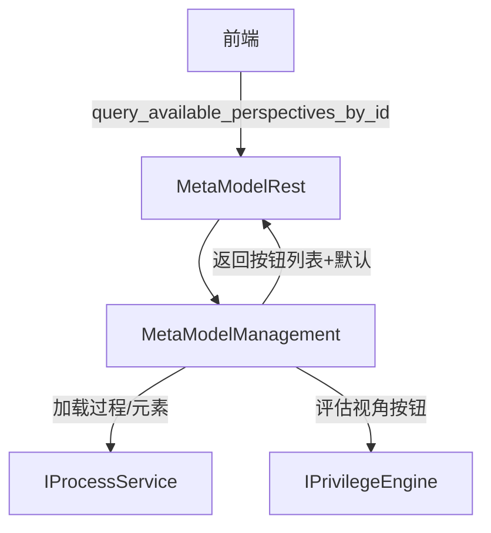
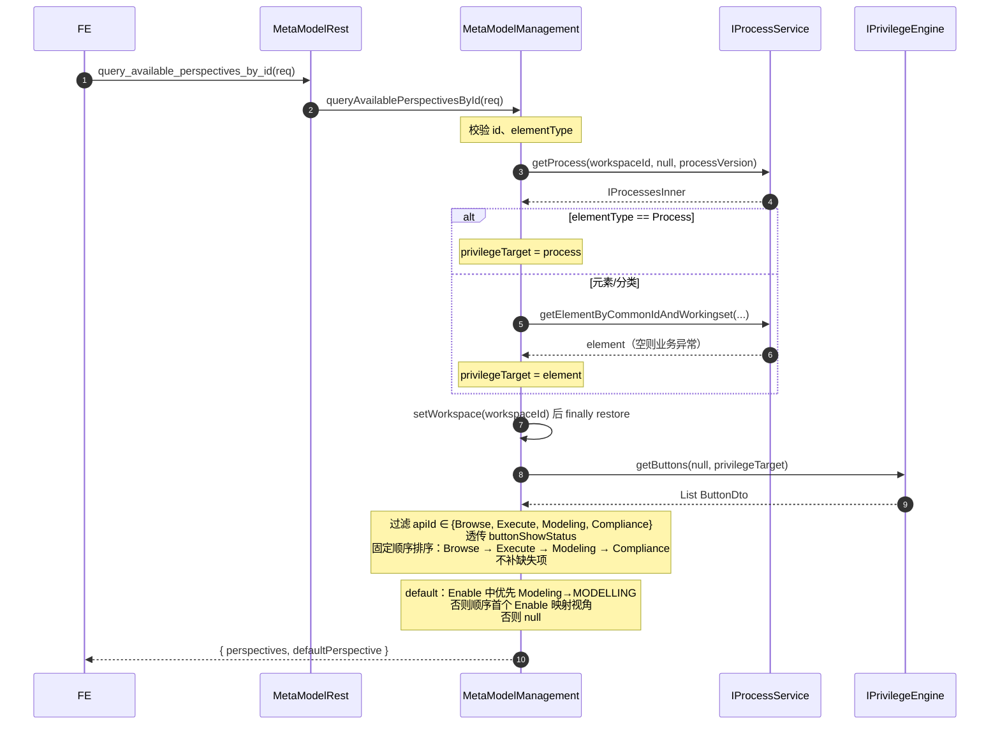

# Query Available Perspectives

> 提供 `query_available_perspectives_by_id`，按按钮形态下发当前用户在当前过程/元素下的视角按钮（含状态与国际化信息）及默认视角，供前端按配置逻辑展示切换器。

## Decisions Log

| Date | Decision | Reasoning | Alternatives Considered |
|------|----------|-----------|------------------------|
| 2026-07-14 | 新建独立 feature context，不回写已实现的 privilege-control 蓝图 | 接口增量，避免污染已封闭设计文档；背景通过 related_context 关联 | 直接 Enrich `processes-operation-privilege-control.md` |
| 2026-07-14 | 从 Level 2 进入设计；Level 1 按需求隐含确认 | 能力边界已由用户明确，无需再对齐 | 从 Level 1 完整走一遍 |
| 2026-07-14 | 无任何 Enable 视角时 `defaultPerspective` 返回 null | 前端可据此兜底，而非后端抛错打断进入 | 抛业务异常 |
| 2026-07-14 | Level 2 组件划分获批：Rest + Management + 既有 SDK/权限引擎，不新增 Support | 范围小、复用现有元模型查询入口，避免纯委托 Support | 独立 PerspectivePrivilegeSupport |
| 2026-07-14 | 鉴权选 Option A：`IPrivilegeEngine.getButtons` + 视角按钮 API ID 过滤 | 与「视角=类级 RIGHT 按钮」配置模型一致，完整走按钮+Criteria 流水线 | Option B：`hasPrivilege` 硬映射权限码 |
| 2026-07-14 | 出参改为按钮形态：`perspectives: List<ButtonDto>` + `defaultPerspective` | 前端复用既有按钮展示逻辑（国际化名称、Enable/Disable/Hide） | 仅返回枚举列表 |
| 2026-07-14 | 只返回 `getButtons` 命中的视角按钮，不补缺失槽位为 Hide | 与引擎结果一致，避免伪造未配置/未返回的按钮 | 始终返回 4 个槽位并补 Hide |
| 2026-07-14 | `defaultPerspective` 仍由后端计算并返回 | 默认策略（优先建模）集中在服务端，前后端一致 | 前端自行从 Enable 集合推算 |
| 2026-07-14 | Level 4 契约获批；蓝图完成，可进入实现 | 四级设计已对齐并写入 context | — |
| 2026-07-14 | 实现采用 Full autonomy；定位上下文抽取为 `resolveQueryContext` 供视图查询与视角查询共用 | 避免重复加载过程/元素逻辑 | 视角查询内单独复制加载代码 |
| 2026-07-14 | 视角按钮鉴权目标固定为过程实例（非元素） | 按钮 nodeId=ProcessesBaseClass(2104)，对元素 `getButtons` 命中为空 | 用 privilegeTarget（元素）评估 |

## Open Questions

无。

## Constraints

- 复用既有视角按钮权限模型（Browse/Execute/Modeling/Compliance → RIGHT 类级按钮），不另造 ACL。
- 请求入参参考 `ProcessElementMetaModelViewQueryReq`，去掉用不到的属性（至少去掉 `perspective`；`processId` 现有实现未用，本接口不收）。
- 默认视角：在 `buttonShowStatus == Enable` 的视角中优先 `MODELLING`；否则取固定顺序中第一个 Enable；若无一 Enable，则 `defaultPerspective = null`。
- 只读查询：无事务。
- 鉴权必须经 `IPrivilegeEngine.getButtons`，按视角按钮 API ID 过滤；状态透传引擎结果，不改写 Enable/Disable/Hide 语义。
- 不补全未命中的视角按钮。

## Key Files

| 路径 | 角色 |
|------|------|
| `backend/components/gf/sdk/.../GateflowConstants.java` | 视角按钮 API ID 常量与固定顺序 |
| `backend/components/gf/biz/.../req/AvailablePerspectivesQueryReq.java` | 查询入参 |
| `backend/components/gf/biz/.../resp/AvailablePerspectivesResp.java` | 出参：`perspectives` + `defaultPerspective` |
| `backend/components/gf/biz/.../MetaModelManagement.java` | 编排：加载目标、`getButtons` 过滤、默认视角 |
| `backend/components/gf/biz/.../MetaModelRest.java` | `POST .../query_available_perspectives_by_id` |
| `backend/components/gf/biz/.../MetaModelManagementBusinessTest.java` | 单元测试（参数/缺元素/默认策略/排序过滤） |
## Design: Level 1 -- Capabilities

1. **下发视角按钮**：前端传入过程/元素定位信息后，获得命中的视角按钮（`ButtonDto`：名称/国际化、图标、`apiId`、`buttonShowStatus` 等），按配置逻辑展示。
2. **计算默认视角**：在状态为 `Enable` 的视角中优先建模（`MODELLING`）；否则取固定顺序中第一个 Enable；若无一 Enable，返回 `null`。

## Design: Level 2 -- Components

| 组件 | 分层 | DDD 角色 | 职责 |
|------|------|----------|------|
| `MetaModelRest` | gf-biz REST | 适配器 | 新增 `POST .../query_available_perspectives_by_id` |
| `MetaModelManagement` | gf-biz | 应用服务 | 加载过程/元素、工作区上下文、过滤视角按钮、计算默认视角 |
| `IProcessService` | gf-sdk | 过程仓储门面 | 按 workspace/version/elementId 加载过程与元素 |
| `IPrivilegeEngine` | infrastructure-sdk | 领域服务 | `getButtons` 评估实例级按钮可见性与状态 |
| Req / Resp DTO | gf-biz rest | 契约载体 | 精简入参；`perspectives`（`ButtonDto`）+ `defaultPerspective` |



## Design: Level 3 -- Interactions



**数据传递**

| 步骤 | 数据 |
|------|------|
| FE → Rest | `id`, `elementType`, `processVersion?`, `modelingWorkspaceId?` |
| Management → PrivilegeEngine | `tableId=null` + `privilegeTarget` |
| PrivilegeEngine → Management | 实例按钮列表（含 `apiId`、`name`、`icon`、`buttonShowStatus` 等） |
| Management → FE | 过滤后的 `perspectives` + `defaultPerspective` |

**API ID → MetaPerspective**

| `apiId` | `MetaPerspective` |
|---------|-------------------|
| `Browse` | `VIEWING` |
| `Execute` | `EXECUTE` |
| `Modeling` | `MODELLING` |
| `Compliance` | `COMPLIANCE` |

## Design: Level 4 -- Contracts

### REST

`POST /api/gate_flow/metamodel/query_available_perspectives_by_id`  
`MetaModelRest` 直接返回 Resp，不包 `Result`。

### Request — `AvailablePerspectivesQueryReq`

```java
@Data
@Schema(description = "查询当前用户可用视角按钮请求")
public class AvailablePerspectivesQueryReq {
    @Schema(description = "ID：elementType 为 Process 时为过程 ID，否则为过程元素 ID",
            requiredMode = Schema.RequiredMode.REQUIRED)
    private Long id;

    @Schema(description = "元模型元素类型：Process 或其他元素类型",
            requiredMode = Schema.RequiredMode.REQUIRED)
    private String elementType;

    @Schema(description = "过程版本：不传代表工作版本，可为 _wv、_vv 或具体版本 ID")
    private String processVersion;

    @Schema(description = "建模工作空间 ID")
    private Long modelingWorkspaceId;
}
```

### Response — `AvailablePerspectivesResp`

```java
@Data
@Schema(description = "可用视角按钮响应")
public class AvailablePerspectivesResp {
    @Schema(description = "视角按钮列表（getButtons 命中且 apiId 属于视角集合）")
    private List<ButtonDto> perspectives;

    @Schema(description = "默认视角；无 Enable 时为 null")
    private MetaPerspective defaultPerspective;
}
```

复用 `com.airedgesoft.plm.sdk.rolepriv.dto.ButtonDto`。

### Management

```java
public AvailablePerspectivesResp queryAvailablePerspectivesById(AvailablePerspectivesQueryReq req);
```

| 规则 | 约定 |
|------|------|
| 参数校验 | `id` / `elementType` 缺失 → `PARAMETER_MISSING` |
| 元素不存在 | → `PROCESS_ELEMENT_NOT_FOUND` |
| 视角 API ID | `Browse` / `Execute` / `Modeling` / `Compliance`（`GateflowConstants`，禁魔法字符串） |
| 过滤 | `getButtons(null, privilegeTarget)` 中 apiId ∈ 视角集合；不补缺失 |
| 排序 | Browse → Execute → Modeling → Compliance |
| 默认视角 | Enable 中优先 Modeling→`MODELLING`；否则顺序首个 Enable；否则 `null` |
| 工作区 | 评估前 `setWorkspace`，`finally` restore |

### 失败语义

| 场景 | 行为 |
|------|------|
| 参数缺失 / 元素不存在 | 抛 `AppException` |
| 无 Enable 视角 | 非失败：`defaultPerspective = null` |

## Design Summary

### Components & layers
- **gf-biz**：`MetaModelRest` + `MetaModelManagement` + Req/Resp
- **gf-sdk**：`IProcessService`（加载）、`GateflowConstants`（视角按钮 API ID）、`MetaPerspective`
- **infrastructure-sdk**：`IPrivilegeEngine.getButtons`、`ButtonDto`

### Key contracts
- `POST .../query_available_perspectives_by_id`
- 入参：`id` / `elementType` / `processVersion?` / `modelingWorkspaceId?`
- 出参：`perspectives: List<ButtonDto>` + `defaultPerspective: MetaPerspective | null`

### Architectural constraints
- 只读、无事务；鉴权必走 `getButtons`；状态透传；不补未命中按钮；workspace 上下文可还原

### Domain decisions
- 视角 = 类级按钮配置（继承 privilege-control）
- 默认视角策略集中在后端（优先建模）

### Open questions resolved
- 空 Enable → `defaultPerspective = null`
- 鉴权 Option A（按钮流水线）
- 出参按钮形态；仅返回命中项；默认由后端返回

### Design status
**Approved -- ready for implementation**
