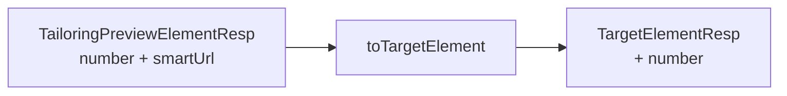
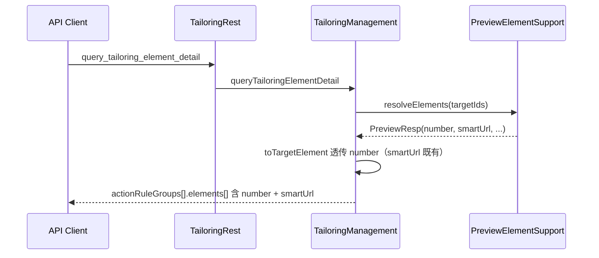

# 裁剪元素详情关联元素编号

> `query_tailoring_element_detail` 关联目标补齐 `number`（与既有 `smartUrl` 一并可供前端使用）。本需求**仅改后端**，前端不改动。

## Decisions Log

| Date | Decision | Reasoning | Alternatives Considered |
|------|----------|-----------|------------------------|
| 2026-07-13 | 从 Level 2 进入设计；Level 1 视为已约定 | 单端点、单 DTO 字段透传，能力边界清晰 | 从 Level 1 完整走一遍（过重）；直接 Level 4（跳过组件边界确认） |
| 2026-07-13 | 字段名使用 `number` | 与 `TailoringPreviewElementResp`、`TailoringElementTreeResp`、`AssociationInfoDto`、选择器等一致 | `elementNumber`（与现有契约不一致） |
| 2026-07-13 | 跳转复用既有 `smartUrl`，不新增 URL 字段 | 目标 DTO 与预览装配已透传 `smartUrl` | 新增 `url`/`jumpUrl`（与现有命名冲突） |
| 2026-07-13 | Level 1/2 曾纳入前端 `TypeGroupItem` | 当时要求点击编号跳转 | — |
| 2026-07-13 | **范围收窄：仅后端**；前端不做改动 | 用户明确：保证接口有 `number`（及既有 `smartUrl`）即可 | 同步改 TypeGroupItem（本次不做） |
| 2026-07-13 | Level 3/4 按「仅后端」重新对齐 | 前端交互不在本需求交付范围 | 保留前端呈现契约（与最新范围冲突） |
| 2026-07-13 | Level 4 Contracts 通过；Design approved at Level 4. Blueprint complete ready for implementation. | 范围、组件、交互、契约已对齐且仅后端 | — |
| 2026-07-13 | 实现：DTO 增 `number`；`toTargetElement` 透传；单测断言 number+smartUrl | 对齐 L4 契约，无额外查询 | 另开 SDK API（违反约束） |

## Open Questions

（无）

## Constraints

- 字段名必须为 `number`，与既有接口保持一致
- 跳转 URL 字段名必须为 `smartUrl`，不新增并行 URL 字段
- 不新增 SDK 捷径 API；复用 `buildAnswerActionRuleGroups` 已加载的 `TailoringPreviewElementResp`
- 只读查询路径，无 schema / 事务变更
- **本需求不修改前端代码**

## Key Files

| Path | Role |
|------|------|
| `backend/.../tailoring/rest/resp/TailoringAnswerActionTargetElementResp.java` | 关联目标元素响应 DTO（待加 `number`） |
| `backend/.../tailoring/management/TailoringManagement.java` | `toTargetElement` 透传 `preview.getNumber()` |
| `backend/.../tailoring/rest/resp/TailoringPreviewElementResp.java` | 已有 `number` + `smartUrl` 的预加载来源 |
| `backend/.../tailoring/management/TailoringManagementTest.java` | 详情接口单测断言 |

## Design: Level 1 -- Capabilities

1. 裁剪答案详情的每个关联目标返回 `number`
2. 关联目标继续返回既有 `smartUrl`（不新增 URL 字段；供调用方自行用于跳转）
3. 问题 /「不知道」等无动作规则行为不变
4. 其它关联字段语义不变
5. 前端 UI 不在本需求范围内变更

## Design: Level 2 -- Components

| 组件 | 分层 | 职责 | DDD |
|------|------|------|-----|
| `TailoringAnswerActionTargetElementResp` | Biz REST DTO | 新增 `number`；`smartUrl` 已存在 | 读模型 VO |
| `TailoringManagement.toTargetElement` | Biz 应用编排 | 从 `TailoringPreviewElementResp` 透传 `number` | Application Service 映射 |
| `TailoringPreviewElementSupport`（既有） | Biz Support | 批量解析目标元素（已含 number/smartUrl） | 读侧装配；不改 |



**不改**：SDK / SDKImpl、DB、`listAnswerActions`、`smartUrl` 字段名、**任何前端文件**。

## Design: Level 3 -- Interactions



| 步骤 | 传递内容 |
|------|----------|
| 预加载 → 映射 | `number`、`smartUrl`、`elementId`、`elementName`、`metamodelSubType` |
| 响应 → 调用方 | 关联目标列表（含 `number` + `smartUrl`） |

**不新增交互**：不改关联增删、预加载查询；无前端点击流。

## Design: Level 4 -- Contracts

### 后端 DTO（增量）

```java
// TailoringAnswerActionTargetElementResp — 新增字段
@Schema(description = "元素编号")
private String number;

// 既有，不改名、不改语义
// Long associationRowId;
// Long elementId;
// String elementName;
// String metamodelSubType;
// String smartUrl;
// String pickerBizId;
```

### 映射契约

```java
// TailoringManagement.toTargetElement
// 必传：preview.getNumber() → resp.number
// 既有：preview.getSmartUrl() → resp.smartUrl（保持）
```

### 测试契约

```java
// TailoringManagementTest#queryTailoringElementDetail_answer_*
// preview mock 含 number / smartUrl 时：
// assertEquals(expectedNumber, target.getNumber());
// assertEquals(expectedSmartUrl, target.getSmartUrl());
```

### 失败 / 边界

| 情况 | 行为 |
|------|------|
| preview 为 null | 保持现状：抛 `TAILORING_ELEMENT_ID_REQUIRED` |
| number 为 null | 字段返回 null |
| smartUrl 为空 | 保持现状（字段可为空） |

**不在契约内**：前端改动、新 REST 路径、新 SDK 方法；OpenAPI 前端类型由后续 `pnpm openapi` 刷新（非本需求必须交付）。

## Design Summary

- **组件与分层**：`TailoringAnswerActionTargetElementResp`（Biz DTO）+ `TailoringManagement.toTargetElement`（Biz 映射）；复用既有 `TailoringPreviewElementSupport`
- **关键契约**：目标元素新增 `String number`；`smartUrl` 保持既有透传；字段名与预览/树/关联 DTO 一致
- **架构约束**：仅 Biz 读路径；无 SDK 捷径、无 schema/事务、无前端改动
- **领域模型**：读模型 VO  enrichment；不新增聚合/仓储
- **已关闭问题**：字段名=`number`；URL 用既有 `smartUrl`；前端本期不做
- **Design status**: **Approved -- ready for implementation**

## Implementation Notes

- 已落地：`TailoringAnswerActionTargetElementResp.number`、`toTargetElement` 透传、`TailoringManagementTest` 断言
- 验证：`./run_unit_tests.sh TailoringManagementTest#queryTailoringElementDetail_answer_shouldReturnActionsAndDescription` 通过
