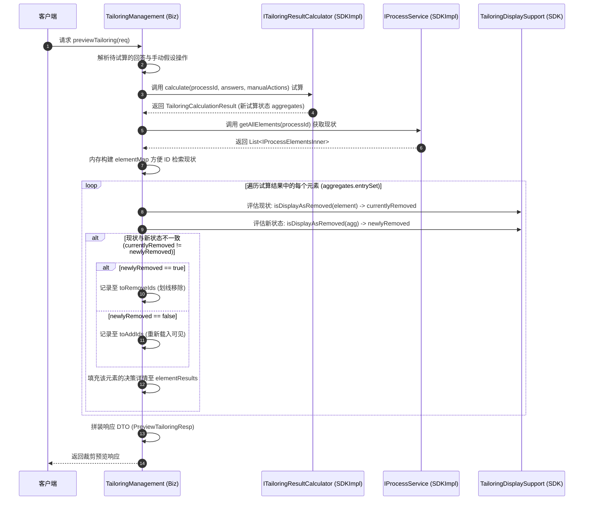

# 裁剪预览一致性提升与代码简化

> 通过对比元素在数据库中的现状裁剪展示状态（Status Quo）与试算后的假设展示状态（Simulated State），计算出实际发生裁剪变更 of the element，简化原有的条件过滤逻辑，提升一致性。

## Decisions Log

| Date | Decision | Reasoning | Alternatives Considered |
|------|----------|-----------|------------------------|
| 2026-07-23 | 以 `currentlyRemoved != newlyRemoved` 为核心检测裁剪状态变更 | 用户明确要求预览列表表达“哪些元素的裁剪结果相对于现状发生了什么样的变化” | 沿用原有的 explicitConclusion 与 hasHypotheticalManual 条件过滤组合（过于繁琐且不一致） |
| 2026-07-23 | 仅在状态变更时将元素结果填充至 `elementResults` | 保持 elementResults 的大小与 toRemoveElements/toAddElements 集合对齐，避免返回无关元素的决策详情 | 返回所有具有显式结论的元素的详情 |
| 2026-07-23 | 对 `processService.getAllElements` 结果为空时提供优雅兜底，默认 `currentlyRemoved = false` | 确保在没有 mock 该服务的单测中，测试仍能正常运行，避免大量单测重写 | 强行要求所有相关测试必须 stub 该方法 |
| 2026-07-23 | 设计批准进入 Level 4，状态变更为 approved | Level 1-4 设计均与用户确认，并获得明确认可 | — |

## Open Questions

无。

## Constraints

- 必须通过 `TailoringDisplaySupport.isDisplayAsRemoved` 判断元素展示划线状态。
- 未发生划线状态变更的元素不能出现在 `toRemoveElements`、`toAddElements` 或 `elementResults` 中。
- API 响应 DTO 结构保持不变。

## Key Files

- `components/gf/biz/.../tailoring/management/TailoringManagement.java` — 裁剪预览映射逻辑
- `components/gf/biz/src/test/java/com/airedgesoft/gf/biz/tailoring/management/TailoringManagementTest.java` — 相关单元测试

## Design: Level 1 -- Capabilities

1. **现状状态解析**：查询该过程下的所有业务元素，并使用 `TailoringDisplaySupport.isDisplayAsRemoved(element)` 解析每个元素当前的实际裁剪展示状态（是否已划线移除）。
2. **试算状态解析**：使用 `TailoringDisplaySupport.isDisplayAsRemoved(agg)` 统一解析试算结果中各元素的新展示状态。
3. **基于 Diff 的变更检测**：通过对比新旧状态，计算出哪些元素从“可见”变为了“移除”（进入 `toRemoveElements`），哪些从“移除”变为了“可见”（进入 `toAddElements`）。
4. **决策详情关联**：仅针对发生状态变化的元素填充 `elementResults` 中的决策行（rules）和生效决策（effective decision）等理由详情。

## Design: Level 2 -- Components

| # | 组件 | 架构分层 | DDD 角色 | 职责 |
|---|------|---------|---------|------|
| 1 | `TailoringManagement` | `gf-biz / management` | 应用服务 / 编排器 | 加载过程元素、执行裁剪计算、根据新旧状态进行 Diff 比较，并映射为响应 DTO。 |
| 2 | `TailoringDisplaySupport` | `gf-sdk / tailoring` | 领域服务 (无状态) | 统一提供是否划线移除的展示判定逻辑（分别支持从数据库实体 `element` 和计算结果 `agg` 判定）。 |
| 3 | `IProcessService` | `gf-sdk / gateflow` | 仓储接口 | 提供加载过程下所有业务元素的能力 (`getAllElements`)。 |

```
TailoringManagement (Biz)
       │
       ├─► IProcessService (SDK - 加载现状元素)
       │
       └─► TailoringDisplaySupport (SDK - 统一划线状态评估)
```

## Design: Level 3 -- Interactions

### 裁剪预览核心交互数据流



## Design: Level 4 -- Contracts

### 裁剪映射方法重构

修改 `components/gf/biz/src/main/java/com/airedgesoft/gf/biz/tailoring/management/TailoringManagement.java` 中 `mapEngineResult`：

- 核心判定从原有复杂的 explicitConclusion 与 hasHypotheticalManual 条件过滤逻辑改为：
  ```java
  boolean currentlyRemoved = element != null && TailoringDisplaySupport.isDisplayAsRemoved(element);
  boolean newlyRemoved = TailoringDisplaySupport.isDisplayAsRemoved(agg);
  ```
- 移除不再需要的变量 `parentMap`、`explicitConclusion`、`hasHypotheticalManual` 及其相关条件检查。
