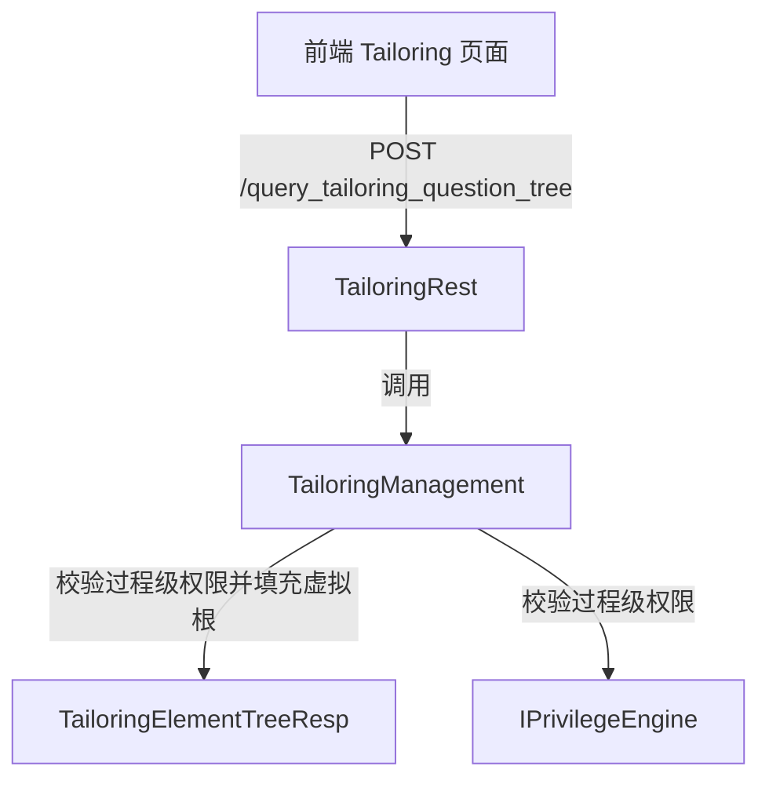
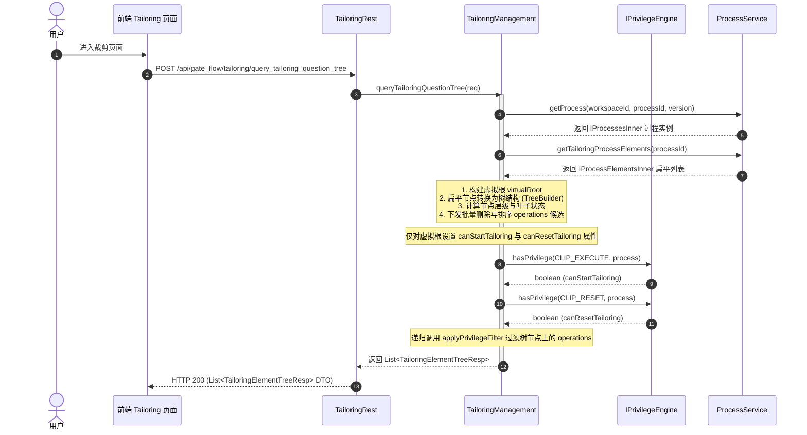

# 裁剪问答树 — 开始裁剪与重置裁剪权限控制

> 裁剪问答树响应中新增过程级权限标识，用于表明当前用户对当前过程是否具备“开始裁剪”及“重置裁剪”权限。

## Decisions Log

<!-- Add new at bottom. Never remove. -->

| Date | Decision | Reasoning | Alternatives Considered |
|------|----------|-----------|------------------------|
| 2026-07-15 | 新增裁剪问答树返回包装对象并包含过程级裁剪权限字段 | 包装对象有利于未来的 API 属性扩展，同时直接提供 `canStartTailoring` 和 `canResetTailoring` 权限标识极大地降低了前端权限判定的复杂度。 | 将权限放在树的虚拟根节点（缺点是增加了前端解析节点层次的深度）。 |
| 2026-07-15 | 废弃 API 包装响应方案，改用在根节点挂载权限字段并保持 List 返回 | 经客户指出，返回对象与在根节点上直接添加权限字段，在消费上并无区别。通过在树节点 DTO 上新增字段并仅在虚拟根（bizId="0"）填充权限（子节点为 null），同时保持既有 API `List<TailoringElementTreeResp>` 契约不变，可以最大限度缩小接口变更的影响范围，免去前端大范围升级 OpenAPI 类型的改动。 | 新增 `TailoringQuestionTreeResp` 包装响应方案（已废弃）。 |
| 2026-07-15 | 设计在 Level 4 获批，蓝图修改完成，准备实现 | 蓝图设计已完成，确认不改动前端文件，定案由 `TailoringElementTreeResp` 的虚拟根节点携带过程级权限布尔标识。 | 无 |

## Design: Level 1 -- Capabilities

1. **API 契约保持不变**：裁剪问答树查询接口 of 返回值依然保持为 `List<TailoringElementTreeResp>`。
2. **挂载点规约**：在 `TailoringElementTreeResp` 响应 DTO 中新增 `canStartTailoring` 与 `canResetTailoring` 字段。
3. **按节点过滤下发**：这两个权限仅在虚拟根节点（`bizId="0"`，即裁剪助手的树根节点）上进行评估与填充。其余子节点（裁剪问题、答案等）这两个字段恒为 `null`（保持默认值），以规避冗余的权限查询。
4. **过程级“开始裁剪”权限判定**：虚拟根节点上的 `canStartTailoring` 对应过程实例上的 `CLIP_EXECUTE` (34) 权限评估结果。
5. **过程级“重置裁剪”权限判定**：虚拟根节点上的 `canResetTailoring` 对应过程实例上的 `CLIP_RESET` (35) 权限评估结果。

## Design: Level 2 -- Components

### 1. 结构与层级划分

| 组件 (Component) | 物理模块/分层 | 职责描述 | DDD 角色类型 |
| :--- | :--- | :--- | :--- |
| `TailoringRest` | `components/gf/biz` | 查询裁剪问答树 REST 入口。入参校验、调用 Management 并返回 `List<TailoringElementTreeResp>`。 | API Port / Controller |
| `TailoringManagement` | `components/gf/biz` | 树构建与权限组装的编排中心。调用 Service 加载数据，构造树，并通过 `PrivilegeEngine` 判断当前过程的裁剪权限，仅在虚拟根上设置权限标识后返回列表。 | Application Service / Orchestrator |
| `TailoringElementTreeResp` | `components/gf/biz` | 裁剪问答树节点响应 DTO。新增两个布尔属性。 | Value Object / DTO |
| `IPrivilegeEngine` | `infrastructure/sdk` | 平台核心鉴权引擎。用于校验用户在特定过程/工作区下的 `CLIP_EXECUTE` (34) 和 `CLIP_RESET` (35) 权限。 | Port (External Service) |

### 2. 组件关系图



## Design: Level 3 -- Interactions

### 1. 查询裁剪问答树与权限获取交互流程



## Design: Level 4 -- Contracts

### 1. Java API DTO 契约 (`TailoringElementTreeResp.java` 变更)

```java
    @Schema(description = "当前用户对当前过程实例是否具备开始裁剪的权限（仅在虚拟根节点填充，其余节点为 null）")
    private Boolean canStartTailoring;

    @Schema(description = "当前用户对当前过程实例是否具备重置裁剪的权限（仅在虚拟根节点填充，其余节点为 null）")
    private Boolean canResetTailoring;
```

### 2. REST 控制器契约 (`TailoringRest.java` 保持不变)

```java
    @PostMapping("/query_tailoring_question_tree")
    @Operation(summary = "查询裁剪问题树")
    public List<TailoringElementTreeResp> queryTailoringQuestionTree(
        @RequestBody QueryTailoringQuestionTreeReq req) {
        req.validate();
        return tailoringManagement.queryTailoringQuestionTree(req);
    }
```

### 3. 应用服务层接口契约 (`TailoringManagement.java` 保持不变)

```java
    public List<TailoringElementTreeResp> queryTailoringQuestionTree(QueryTailoringQuestionTreeReq req) {
        return privilegeWorkspaceContextSupport.withPrivilegeContext(req.getWorkspaceId(),
            () -> doQueryTailoringQuestionTree(req));
    }
```

## Open Questions

None.

## Constraints

1. **仅限后端修改**：本特性开发中，绝对不修改任何 `web/` 下的前端文件。前端 API 消费、界面交互控制由其他同事负责。

## Key Files

| Path | Role |
|---|---|
| `backend/components/gf/biz/src/main/java/com/airedgesoft/gf/biz/tailoring/rest/resp/TailoringElementTreeResp.java` | 问答树响应 DTO，新增权限属性 (修改) |
| `backend/components/gf/biz/src/main/java/com/airedgesoft/gf/biz/tailoring/management/TailoringManagement.java` | 树逻辑构建，在虚拟根填充权限标识 (修改) |
| `backend/components/gf/biz/src/test/java/com/airedgesoft/gf/biz/tailoring/management/TailoringManagementTest.java` | 单元测试，补充开始与重置裁剪权限的验证 (修改) |

## Design Summary

### 1. 组件与层级分配
+- **DTO 层 (`TailoringElementTreeResp`)**：扩展 DTO 结构承载 `canStartTailoring` 与 `canResetTailoring`。
+- **业务逻辑层 (`TailoringManagement`)**：在查询裁剪树方法末尾，利用 `privilegeEngine` 评估过程实例权限，并仅在虚拟根上填充对应的布尔值。

### 2. 核心接口与契约
+- API 响应类型：`List<TailoringElementTreeResp>` (完全保持老版本兼容)
+- 权限判定核心依赖：`IPrivilegeEngine.hasPrivilege` (校验 `CLIP_EXECUTE`/`CLIP_RESET` 权限)

### 3. 架构约束与判定
+- **零破坏性升级**：通过保留接口返回 `List` 类型，排除了前端编译失败和类型冲突的所有隐患。
+- **职责隔离**：不改动 `web/` 下的前端文件，将前端适配工作移交至其他同事。

