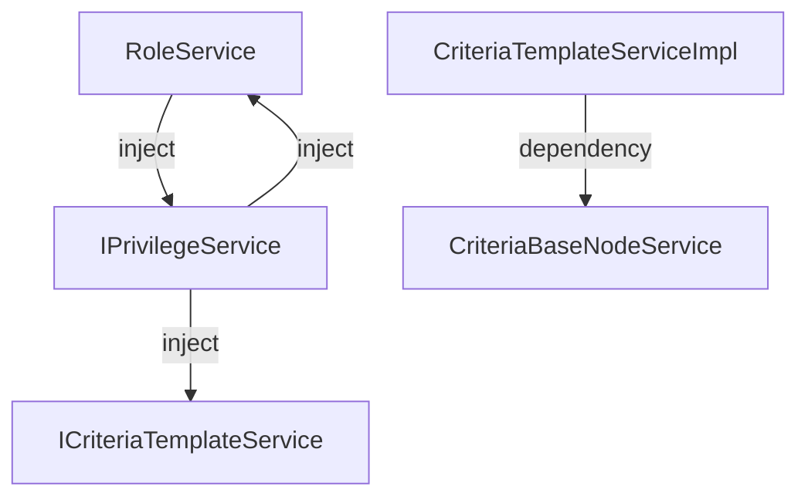

# Template Instance Synchronous Update

> Synchronously propagate updates from Role templates (`WORKSPACE_TEMPLATE`), Privilege templates (`NORMAL`), and Condition/Criteria templates (`isTemplate() == true`) to their respective instantiated workspace instances (`WORKSPACE_INSTANCE`).

## Decisions Log

<!-- Add new at bottom. Never remove. -->

| Date | Decision | Reasoning | Alternatives Considered |
|------|----------|-----------|------------------------|
| 2026-07-15 | Init design at Level 1 | Establish initial capabilities for Role/Privilege/Criteria templates sync update | None |
| 2026-07-15 | Design approved at Level 4 | Design approved at Level 4. Status set to approved — ready for implementation. | None |
| 2026-07-15 | Eager caching in RoleService | Resolved a transactional caching issue where new role nodes were not found in the cache during relation validations before commit. Eagerly populated AdminCache inside refreshRoleNodeCache. | None |

## Open Questions

None.

## Constraints

None.

## Key Files

| Path | Role |
|---|---|
| backend/infrastructure/sdkImpl/src/main/java/com/airedgesoft/plm/sdkimpl/service/rolepriv/service/RoleService.java | Role template update & privilege relations management |
| backend/infrastructure/sdkImpl/src/main/java/com/airedgesoft/plm/sdkimpl/service/rolepriv/service/PrivilegeService.java | Privilege template update & workspace resolution |
| backend/infrastructure/sdkImpl/src/main/java/com/airedgesoft/plm/sdkimpl/service/criteria/service/CriteriaBaseNodeService.java | Criteria template update & instance modification |
| backend/components/gf/biz/src/test/java/com/airedgesoft/gf/biz/productspace/WorkspaceRoleTeamE2ETest.java | E2E integration test for workspace roles and privilege templates |

## Design: Level 1 -- Capabilities

### 1. Role Template Update Sync (`WORKSPACE_TEMPLATE`)
* **Capability 1.1 (Metadata Propagation)**: When a role template's name, description, API ID, enabled status, or applicable scope codes are modified via `updateRole`, these updates should automatically propagate to all corresponding `WORKSPACE_INSTANCE` roles. Suffix naming conventions (`-ws-{workspaceId}` for name, `_ws_{workspaceId}` for apiId) must be preserved.
* **Capability 1.2 (Privilege Association Sync)**: When privileges are added to or removed from a role template via `addRolePrivileges` or `deleteRolePrivileges`, the privilege bindings on all workspace instances of that role must be updated. Any new privileges must be resolved/instantiated for each workspace (creating or reusing privilege instances and condition instances), and deleted privileges must be unbound.

### 2. Privilege Template Update Sync
* **Capability 2.1 (Metadata and Criteria Propagation)**: When a template privilege is modified via `updatePrivilege`, all its corresponding `WORKSPACE_INSTANCE` privileges must be updated:
  * Name and API ID are updated following the workspace instance suffix naming convention.
  * Standard fields (`description`, `classId`, `baseClassId`, `tableId`, `workflowId`, `enabled`) are updated to match.
  * The `criteriaId` must be re-evaluated for each workspace (e.g. if the template's `criteriaId` changes, the privilege instance's `criteriaId` must point to the newly resolved/instantiated criteria for that workspace).

### 3. Condition (Criteria) Template Update Sync
* **Capability 3.1 (Criteria Rows and Metadata Propagation)**: When a template criteria is modified via `updateCriteriaNodeWithRow` / `updateCriteriaExpression`, all its corresponding `WORKSPACE_INSTANCE` criteria must be updated:
  * Name and API ID are updated following the workspace instance suffix naming convention.
  * Description, classId, and case-sensitivity are updated to match.
  * Criteria rows must be re-instantiated for each workspace by replacing parameter placeholders (such as `{workspaceId}`) with the actual workspace ID.

## Design: Level 2 -- Components

### 1. Architectural Layers and Aggregates
All target classes reside in `backend/infrastructure/sdkImpl`. No new classes are added to prevent unnecessary complexity. The aggregate boundaries for `Role`, `Privilege`, and `Criteria` are strictly respected.

### 2. Component Dependency Diagram


### 3. Component Responsibilities

| Component | Layer | Core Responsibility | Synchronization Role |
|---|---|---|---|
| `RoleService` | Infrastructure / SDKImpl | Role node, member assignments & privilege associations | Synchronizes Role Template properties updates (`updateRole`) and privilege relations additions/deletions (`addRolePrivileges`/`deleteRolePrivileges`) to all workspace instance roles. |
| `PrivilegeService` | Infrastructure / SDKImpl | Privilege definition & workspace resolution | Synchronizes Privilege Template updates (`updatePrivilege`) by re-instantiating metadata & workspace criteria pointers to all corresponding privilege instances. |
| `CriteriaBaseNodeService` | Infrastructure / SDKImpl | Criteria definition, rules & expression evaluation | Provides instance-level criteria updates (`updateWorkspaceInstanceCriteriaNode`) and propagates Criteria Template updates (`updateCriteriaExpression`) to all corresponding criteria instances. |

## Design: Level 3 -- Interactions

### 1. Role Template Update Sync Flow

#### 1.1 Role Template Metadata Update (`RoleService.updateRole`)
* Updates the role template properties.
* If the role type is `WORKSPACE_TEMPLATE`, lists all workspace instances (`WORKSPACE_INSTANCE`) referencing this template.
* For each instance:
  * Extracts `workspaceId`.
  * Regenerates name and API ID using `WorkspaceInstanceNamingSupport`.
  * Propagates `name`, `apiId`, `description`, `enabled`, `applicableScopeCodes` to the instance.
  * Saves the instance and refreshes cache.

#### 1.2 Role Template Privileges Update (`RoleService.addRolePrivileges`/`deleteRolePrivileges`)
* Adds/deletes the privilege relationships on the template role.
* If the role type is `WORKSPACE_TEMPLATE`, lists all workspace instances.
* For each instance:
  * Extracts `workspaceId`.
  * Traverses the template's updated list of privileges:
    * Resolves criteria for each privilege under the target `workspaceId`.
    * Resolves or provisions the privilege instance under the target `workspaceId`.
  * Invokes `bindWorkspaceInstancePrivileges` on the role instance with the new list of privilege instances.

### 2. Privilege Template Update Sync Flow (`PrivilegeService.updatePrivilege`)
* Updates the privilege template properties.
* If the privilege is a template, queries all workspace privilege instances (`templateSourceId` matching template ID).
* For each instance:
  * Extracts `workspaceId`.
  * Regenerates name and API ID using `WorkspaceInstanceNamingSupport`.
  * If the template has a `criteriaId`, re-evaluates and resolves it for the target `workspaceId` using `criteriaTemplateService.resolveForWorkspaceInstance`.
  * Propagates `description`, `classId`, `baseClassId`, `tableId`, `workflowId`, `enabled`, `criteriaId` to the privilege instance.
  * Updates the instance node and refreshes cache.

### 3. Criteria Template Update Sync Flow (`CriteriaBaseNodeService.updateCriteriaExpression`)
* Updates the criteria template properties and criteria rows.
* If the criteria is a template, queries all workspace criteria instances (`templateSourceId` matching template ID).
* For each instance:
  * Extracts `workspaceId`.
  * Regenerates name and API ID using `WorkspaceInstanceNamingSupport`.
  * Re-instantiates criteria rows based on the template's new rows and `workspaceId` parameters.
  * Invokes `updateWorkspaceInstanceCriteriaNode` to update the instance metadata and rows, and refreshes cache.

## Design: Level 4 -- Contracts

### 1. Criteria Instance Update API
Added in `CriteriaBaseNodeService.java`（参数收敛为 `WorkspaceInstanceCriteriaUpdate`）:
```java
    @Transactional(rollbackFor = Exception.class)
    public void updateWorkspaceInstanceCriteriaNode(WorkspaceInstanceCriteriaUpdate update);
```

### 2. Internal Synchronization Helper Signatures
To encapsulate the synchronization logic cleanly:

* In `RoleService.java`:
```java
    private void syncWorkspaceInstancesMetadata(RoleNode template);
    private void syncWorkspaceInstancesPrivileges(RoleNode template, List<Long> newPrivilegeIds);
```

* In `PrivilegeService.java`:
```java
    private void syncWorkspaceInstances(PrivilegeNode template);
```

* In `CriteriaBaseNodeService.java`:
```java
    private void syncWorkspaceInstances(AdminCriteria template);
```

## Design Summary

### Components and Layer Assignments
* `RoleService` (`backend/infrastructure/sdkImpl`)
* `PrivilegeService` (`backend/infrastructure/sdkImpl`)
* `CriteriaBaseNodeService` (`backend/infrastructure/sdkImpl`)

### Key Contracts and Interfaces
* `CriteriaBaseNodeService.updateWorkspaceInstanceCriteriaNode`: Updates workspace instance criteria rows and properties without the config-only kind validation.
* Helper synchronization methods in `RoleService`, `PrivilegeService`, and `CriteriaBaseNodeService` to find and propagate updates to `WORKSPACE_INSTANCE` target nodes.

### Architectural Constraints
* No direct cross-workspace data access: instance updates are always bounded by the `workspaceId` property.
* Suffix naming convention: must enforce naming conventions (`-ws-{workspaceId}` for name, `_ws_{workspaceId}` for apiId) during sync propagation.

### Domain Model Decisions
* We treat Role templates, Privilege templates, and Criteria templates as source templates. All instances are updated strictly unidirectionally (Template -> Instances).

### Open Questions Resolved
* Re-instantiation of Criteria rows: Criteria instance rows are completely deleted and recreated with parameter replacements when their templates are updated.
