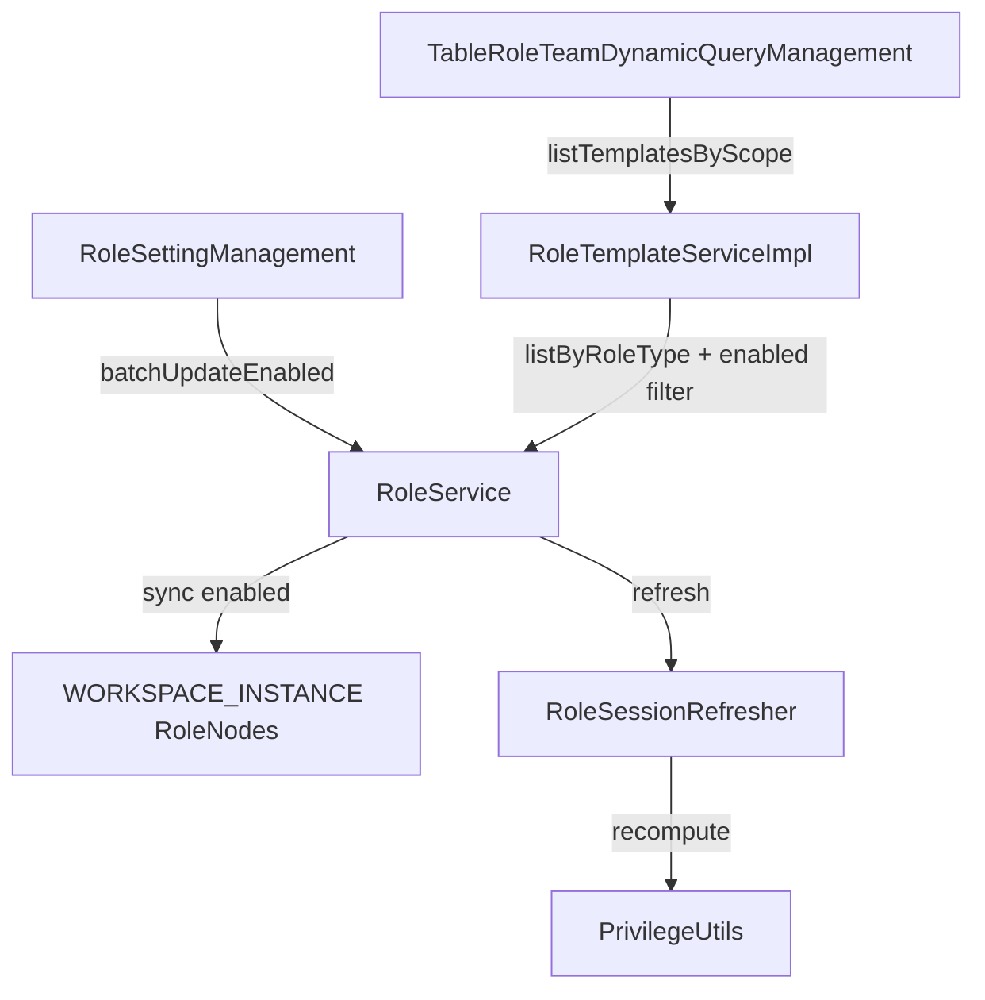
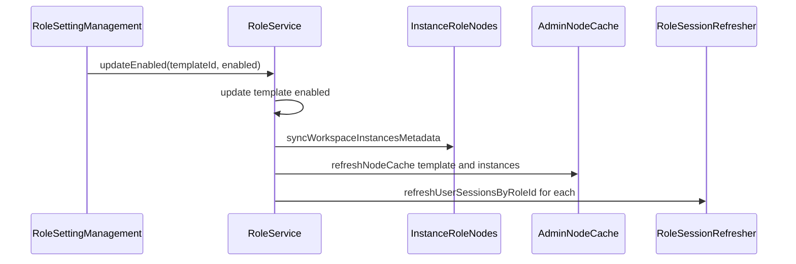
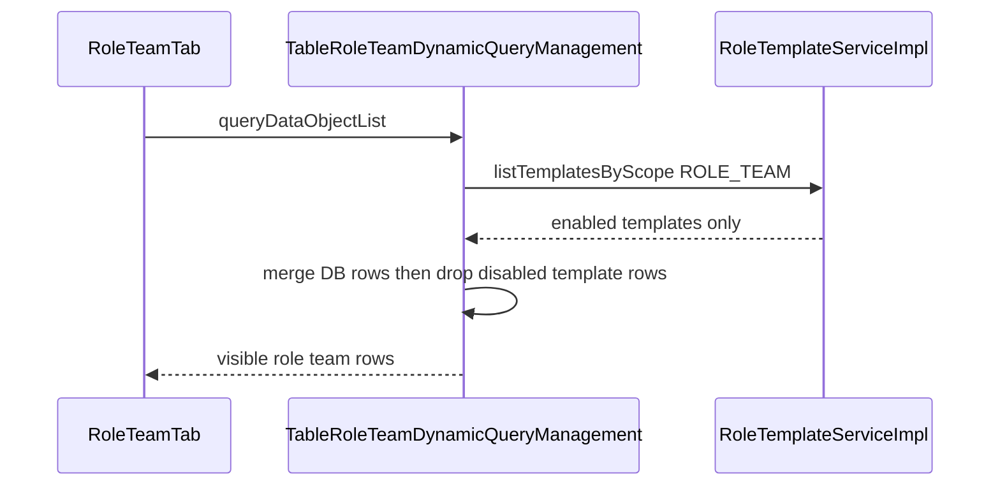

# Template Role Disable — Hide from Role Team

> 模板角色禁用后，前台角色团队不再展示该角色；对应用户不再拥有该角色权限。恢复启用后展示与权限对称恢复；保留 RBAC 参与人分配。

## Decisions Log

| Date | Decision | Reasoning | Alternatives Considered |
|------|----------|-----------|------------------------|
| 2026-07-24 | 功能锚点独立为 `template-role-disable-hide-from-team`；requirement_doc=null（禅道 #15116） | 与 `template-instance-synchronous-update` 边界不同：本票补齐 `updateEnabled` + 前台展示过滤 + session 失效 | 合并进 template-instance-synchronous-update（拒绝：范围与入口不同） |
| 2026-07-24 | 禁用语义 1A：模板 + 全部 WORKSPACE_INSTANCE 标 disabled；保留工作区 RBAC 参与人 | 恢复启用后无需重配；权限失效依赖实例角色 enabled + PrivilegeUtils | 禁用时清空参与人（1B，用户否决） |
| 2026-07-24 | 展示收敛在后端：`listTemplatesByScope` 仅返回 enabled；角色团队查询剔除落库但模板已禁用的行 | 前/后端一致；管理端角色列表仍可管禁用模板 | 仅前端过滤；删除页签落库行 |
| 2026-07-24 | `updateEnabled` 复用 `syncWorkspaceInstancesMetadata` + 刷节点缓存 + 刷受影响用户 session | `updateRole` 已同步 enabled；缺口在独立 enabled 入口 | 新建专用 sync API；仅改查询不过滤实例 enabled |
| 2026-07-24 | Design approved at Level 4. Blueprint complete ready for implementation. | 计划内 Level 1–4 草案已随计划批准落地 | None |
| 2026-07-24 | 实现：`listTemplatesByScope` 过滤 `isEnabled`；`updateEnabled` 同步实例 metadata + `refreshNodeCaches` + 按模板/实例 `refreshUserSessionsByRoleId`；角色团队查询剔除不在启用模板集的落库行 | 对齐蓝图 L3/L4；参与人保留（1A） | 清空参与人；仅查库不过滤 |

## Open Questions

None.

## Constraints

- 不删除实例角色、不清空参与人、不改权限绑定结构
- 不新增 REST / 新表 / 新聚合
- 后台角色列表仍可看到并操作已禁用模板（仅前台角色团队隐藏）
- 不与工作区 WIP PrivilegeCache 刷新顺序改动混入同一实现

## Key Files

| Path | Role |
|------|------|
| `backend/infrastructure/sdkImpl/.../rolepriv/service/RoleService.java` | `updateEnabled`：写模板 enabled、同步实例、刷缓存与 session |
| `backend/infrastructure/sdkImpl/.../rolepriv/service/RoleTemplateServiceImpl.java` | `listTemplatesByScope`：仅返回 enabled 模板 |
| `backend/infrastructure/biz/.../productspace/management/TableRoleTeamDynamicQueryManagement.java` | 角色团队查询：以启用模板集为权威，剔除禁用模板落库行 |
| `backend/infrastructure/sdk/.../rolepriv/PrivilegeUtils.java` | 既有：缓存用户权限时跳过 disabled 角色 |
| `backend/infrastructure/sdkImpl/.../rolepriv/service/RoleSessionRefresher.java` | 既有：按角色/用户刷新 session 权限 |
| `backend/infrastructure/biz/.../rolesetting/admin/management/RoleSettingManagement.java` | 既有入口：`batchUpdateEnabled` |
| `backend/infrastructure/sdk/.../rolepriv/IRoleService.java` | 契约：`updateEnabled` 语义扩展（签名不变） |
| `backend/infrastructure/sdk/.../rolepriv/IRoleTemplateService.java` | 契约：`listTemplatesByScope` 仅 enabled（签名不变） |

## Design: Level 1 -- Capabilities

1. **前台隐藏**：模板角色禁用后，建模/产品空间「角色团队」页签不再出现该模板行（含虚拟行与已落库行）。
2. **权限失效**：禁用后，已分配到该模板对应工作区实例角色的用户，不再拥有该角色下权限（即时生效，含已登录 session）。
3. **恢复对称**：重新启用后，页签再次展示；保留的参与人自动恢复对应权限。
4. **管理端可管**：后台角色列表仍可看到并操作已禁用模板（仅前台角色团队隐藏）。
5. **非目标**：不删除实例角色、不清空参与人、不改权限绑定结构。

## Design: Level 2 -- Components

### Architectural / DDD notes

- 落在 **infrastructure** Biz（页签动态查询编排）与 **infrastructure** SDK / SDKImpl（角色聚合 `RoleNode`、模板服务）；无新聚合。
- 聚合根：`RoleNode`（模板与实例）；参与人分配属既有 workspace assignment，本票只读/不删。
- 依赖方向：Biz → `IRoleTemplateService` / `IWorkspaceRoleAssignmentService`（SDK）；不新增 Biz→sdkImpl 依赖。
- 不引入领域事件；模板→实例同步为既有单向编排（与 template-instance-synchronous-update 一致）。

### Component diagram



### Component responsibilities

| Component | Layer | Responsibility |
|-----------|-------|----------------|
| `RoleService.updateEnabled` | infrastructure sdkImpl | 写模板 enabled；若为 `WORKSPACE_TEMPLATE` 则 `syncWorkspaceInstancesMetadata`；刷新节点缓存；刷新受影响用户 session |
| `RoleTemplateServiceImpl.listTemplatesByScope` | infrastructure sdkImpl | 按 scope 过滤且 **仅返回 enabled** 模板 |
| `TableRoleTeamDynamicQueryManagement` | infrastructure biz | 以过滤后的模板集合为权威；剔除「落库行 templateId 不在启用模板集」的行 |
| `PrivilegeUtils` / `RoleSessionRefresher` | 既有 SDK / sdkImpl | 鉴权与 session 重算；不改契约 |

## Design: Level 3 -- Interactions

### 1. Disable / Enable flow

1. Admin → `RoleSettingManagement.batchUpdateEnabled(ids, enabled)`。
2. 对各 id 调用 `RoleService.updateEnabled(id, enabled)`。
3. 校验参数与可变性；若 enabled 未变则 no-op 返回。
4. 更新模板角色 `enabled` 并写历史。
5. 若角色为 `WORKSPACE_TEMPLATE`：调用既有 `syncWorkspaceInstancesMetadata(template)`，将 name/apiId/description/**enabled**/applicableScopeCodes 同步到全部 `WORKSPACE_INSTANCE`。
6. 刷新 Admin 节点缓存（模板 + 各实例）。
7. 对模板及各实例角色调用 `refreshUserSessionsByRoleId`（或收集受影响 userIds 批量 `refreshSessionByUserIds`），使 `PrivilegeUtils.cacheUserPrivileges` 跳过 disabled 角色后重算权限。



### 2. Role team query flow

1. `TableRoleTeamDynamicQueryManagement.queryDataObjectList` 调用 `listTemplatesByScope(ROLE_TEAM)`（已仅含 enabled）。
2. 按启用模板拼虚拟行、合并落库行、回填参与人。
3. **Drop** 落库行中 templateId 不在启用模板集的行。
4. 返回前台；禁用模板不可见。



## Design: Level 4 -- Contracts

### `IRoleService`（签名不变，语义扩展）

```java
/**
 * 更新角色启用状态。
 * 当角色为 WORKSPACE_TEMPLATE 时：同步全部 WORKSPACE_INSTANCE 的 metadata（含 enabled），
 * 刷新相关节点缓存，并刷新受影响用户 session，使权限即时生效/失效。
 */
boolean updateEnabled(Long id, Long enabled);
```

错误语义沿用：`id`/`enabled` 空 → `ParamException`；角色不存在 / 不可改 → 既有异常。

### `IRoleTemplateService`（签名不变，契约收紧）

```java
/**
 * 按适用范围列出工作区角色模板；仅返回 enabled 的 WORKSPACE_TEMPLATE。
 * 调用方：角色团队页签查询、工作区角色候选列表等。
 */
List<RoleNode> listTemplatesByScope(String requiredScopeCode);
```

### Internal reuse（不新增公共 API）

```java
// RoleService — 既有 private
private void syncWorkspaceInstancesMetadata(RoleNode template);
```

Session 刷新走既有：

```java
void refreshUserSessionsByRoleId(Long roleId);
void refreshSessionByUserIds(Collection<Long> userIds);
```

无新 DTO；无新 REST。

## Design Summary

### Components and layer assignments

- `RoleService.updateEnabled` — infrastructure sdkImpl
- `RoleTemplateServiceImpl.listTemplatesByScope` — infrastructure sdkImpl
- `TableRoleTeamDynamicQueryManagement` — infrastructure biz
- 复用 `PrivilegeUtils`、`RoleSessionRefresher`

### Key contracts and interfaces

- `IRoleService.updateEnabled`：模板禁用/启用时同步实例 + 刷缓存/session
- `IRoleTemplateService.listTemplatesByScope`：仅 enabled 模板
- 签名均不变

### Architectural constraints

- Biz → SDK only；无新事务边界要求超出既有 `updateEnabled` / Management 入口
- 不删分配、不删实例、不新增 REST/表
- 与 PrivilegeCache WIP 改动隔离

### Domain model decisions

- `RoleNode` 模板→实例单向同步 enabled；参与人 assignment 保留作恢复路径
- 权限生效依赖实例角色 `enabled` + `PrivilegeUtils` 过滤，非删除关系

### Open questions resolved

- 禁用后是否清空参与人 → **否（1A）**
- requirement_doc → **null（禅道 #15116）**

### Design status

**Approved -- ready for implementation**

实现入口：`/code-forge`，锚点路径 `.lattice/context/template-role-disable-hide-from-team.md`。

## Implementation Notes

- 已实现（2026-07-24）：SDK/sdkImpl/biz 三处改动 + `RoleTemplateServiceImplTest` / `RoleServiceTest` 覆盖。
- `Node.update()` 在属性缓存为空时可能不刷节点缓存；模板路径另对实例 ID 显式 `adminNode.refreshNodeCaches`。
- 未改 PrivilegeCache WIP 相关文件。

实现状态：**complete — recommend `/review`**
