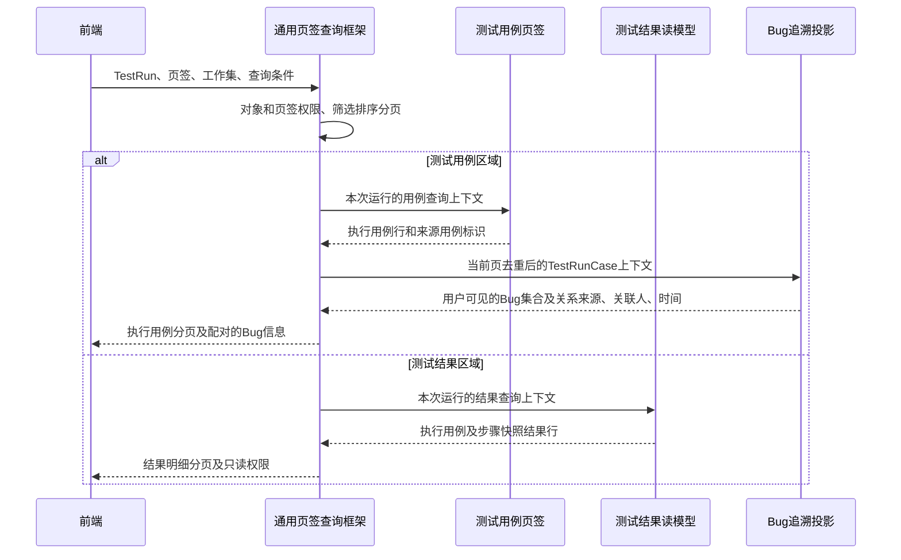
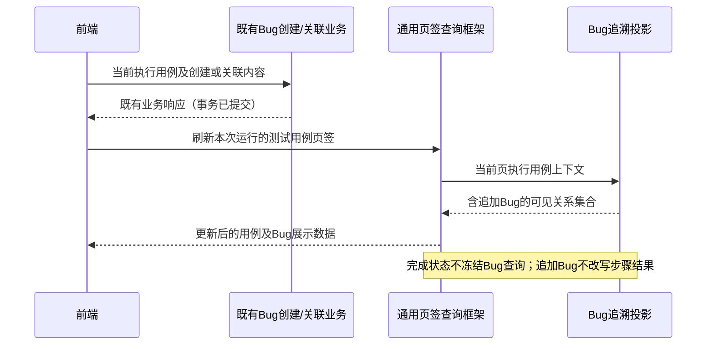

# 测试运行概览：测试用例与测试结果展示

> 为测试运行概览中的“测试用例”和“测试结果”页签提供后端查询与展示数据，呈现执行用例、步骤结果及其 Bug 追溯信息。

## Design Summary

本实现复用 `POST /api/dynamic_tab_object/query_tab_data_object_list` 查询入口，在 TestRunCases 页签结果的 `DataObjectDto.extendData.bugTraceability` 中补充当前执行用例的 Bug 追溯数据。Bug 数据合并来源 TestCase Association 与当前 TestRunCase 的 `AllBugs` 逗号分隔 ID，Association 优先去重；TestRun 仍通过 `ReportBug` Reference 保存运行级 Bug，并为文本来源提供关联审计；测试结果页签保持现有只读查询模型，不新增 REST 接口。

设计已批准；实现包括 SDK 批量追溯查询、Biz 页签后处理器及对应单元测试。测试结果页签复用既有只读视图。

## Decisions Log

<!-- Add new at bottom. Never remove. -->

| Date | Decision | Reasoning | Alternatives Considered |
|---|---|---|---|
| 2026-10-19 | 本设计仅覆盖 TestRun 概览中的“测试用例”和“测试结果”两个页签的后端能力 | 用户指定以截图中的两个页签为目标，并要求只考虑后端 | 扩展到 TestRun 创建、执行、重跑或前端页面实现 |
| 2026-10-19 | TestRun 完成后仍允许追加 Bug，需保留关联人和关联时间 | 用户此前已确认完成后可以继续追加 Bug，结果展示需要覆盖该生命周期 | 完成后冻结全部 Bug 关联 |
| 2026-10-19 | Level 1 五项能力已确认，继续 Level 2 组件设计 | 用户确认测试用例、步骤结果、状态辨识、Bug 追溯及完成后追加 Bug 的范围 | 本轮即开始实现（暂不采用，先完成蓝图设计） |
| 2026-10-19 | Level 2 复用现有测试用例页签、测试结果只读视图和通用页签查询框架；Bug 追溯合并逻辑集中在查询侧组件 | 现有代码已覆盖执行用例、步骤结果、筛选排序分页和只读约束；集中合并可避免两个页签重复实现关系读取，也避免一对多 Bug 连接造成结果行膨胀 | 在每个 TabQuery 中各自实现 Bug 关系合并；新增独立写模型（均增加重复逻辑或错误边界） |
| 2026-10-19 | TestRun/TestRunCase/TestCase/Bug 保持独立对象边界，结果视图是只读查询投影 | 跨对象仅需引用和展示，不要求将对象状态放在同一聚合内；现有结果页签已经是只读视图 | 将结果视图作为可写聚合；在 TestRun 聚合内加载完整用例、步骤和 Bug 对象树 |
| 2026-10-19 | Level 3 交互已确认：用例页签按执行用例分页并批量补充本次执行 Bug；结果页签返回步骤快照，追加 Bug 后刷新查询 | 用户回复“认可，继续”；两个区域沿用通用页签入口，避免 Bug 一对多关系扩大主行及分页总数 | 合并来源 TestCase 的全部历史 Bug；把运行级 Bug 分摊给全部用例；为每条步骤重复展开 Bug |
| 2026-10-19 | 用例区域的 Bug 以当前 TestRunCase 有效 BugReferences 为准，历史 TestCase Association 和纯运行级 Reference 不混入该集合 | 采用 Level 3 已建议并获认可的展示口径；相同来源用例在不同运行或重复执行时保持隔离 | 三种来源不加区分地合并展示 |
| 2026-10-19 | 对外继续复用 `POST /api/dynamic_tab_object/query_tab_data_object_list`；Bug 追溯通过 `DataObjectDto.extendData` 返回，不新增独立 REST | 当前页签查询已具备权限、筛选、排序、分页和统一响应；新增接口只会形成平行查询协议 | 新增 TestRun 概览专用查询接口；把 Bug 展开成额外主行 |
| 2026-10-19 | 新增查询处理器仅作为通用动态查询的 Biz 适配器，Bug 追溯服务契约放 `links-sdk`，实现放 `links-sdkImpl` | `AbstractDynamicQueryProcessor.postQueryHook` 是现有分页结果扩展点，Biz 不依赖 sdkImpl，符合组件边界 | 在 `links-sdkImpl` 直接改写 REST 响应；让 Biz 直接访问关系表 DAO |
| 2026-10-19 | Bug 追溯字段本版本只用于展示，不加入 `conditionParams`/`orderParams` 的筛选排序语义 | 需求和截图只要求展示；把一对多 Bug 关系纳入分页前筛选会改变主查询和总数口径 | 本版本同步实现按 Bug 编号/描述筛选和排序 |
| 2026-10-19 | 关联人和关联时间取 `air_inst_tab_reference` 关系记录的 `created_by/created_time`，不取 Bug 对象审计字段 | 关系记录的审计字段表示“本次运行用例何时由谁关联”，能正确覆盖完成后追加 Bug | 用 Bug 的创建人/创建时间；用 TestRun 或 TestRunCase 更新时间 |
| 2026-10-19 | 已核实 Reference/Association 持久化记录继承通用审计字段，但本页签 Bug 展示只采用 TestRunCase 的 Reference 记录 | `InstTabReferencePO` 与 `AirInstTabAssociationPO` 均继承 `BaseEntity`；本功能查询口径仍按 Level 3 决策隔离 TestCase Association | 通过 Bug 对象或页签视图的创建时间推断关联时间 |
| 2026-10-19 | 最终采用现有视图口径：测试用例页签合并来源 TestCase Association Bug 与当前 TestRunCase BugReferences Reference Bug；同一 Bug 按现有视图规则去重 | 用户确认“沿用现有视图：合并 TestCase Association 与 TestRunCase Reference” | 只展示 TestRunCase Reference；把 TestRun 运行级 Reference 分摊给每个执行用例 |
| 2026-10-19 | 上一条“只采用 TestRunCase Reference”的决定被本决定替代；该历史记录保留用于审计 | 保持上下文决策日志 append-only，同时避免实现继续遵循已变更口径 | 删除或改写旧决定 |
| 2026-10-19 | 开始按已批准蓝图实现：新增 links SDK 内部 Bug 追溯契约、sdkImpl 批量关系读取实现及 links-biz 动态查询后处理器 | 用户确认开始实现；复用通用动态查询，避免新增对外 REST | 新增 TestRun 概览专用接口 |
| 2026-10-19 | 内部查询直接返回 `Map<Long, List<BugTraceabilityItem>>`，权限使用当前会话；不引入额外查询上下文或 includeDeleted 开关 | 页签入口已经完成运行及主行权限校验；批量 Bug 加载默认排除删除对象，再校验对象行及字段权限 | 额外包装 DTO 和调用方可切换的删除查询策略 |
| 2026-10-19 | 按每批 500 个 ID 查询关系和 Bug，只补充当前页；结果按 Bug ID 升序，Association 优先，保留所选关系的审计信息 | 控制 IN 集合大小，避免 N+1；稳定输出顺序且不改变主查询分页 | 按每个执行用例独立查询；将 Bug JOIN 到主行 |
| 2026-10-20 | Run 完成后仍可随时新增 Bug 并追加引用关联，不受测试运行执行守卫限制 | 用户明确该引用能力独立于执行状态；BugReferences 落在 air_inst_tab_reference，不属于 Run 普通实体字段修改，不能因完成态冻结而阻止关联 | 将 Bug 关联归入概览普通属性冻结；要求执行令牌或当前游标才能追加引用 |
| 2026-10-20 | 最终关系模型为 TestCase-Bug Association、TestRun-Bug `ReportBug` Reference、TestRunCase-Bug `AllBugs` 长文本 ID；迁移旧 TestRunCase BugReferences 引用到文本列但保留旧关系行 | 产品确认 TestRunCase 只存逗号分隔 ID，TestRun 继续 Reference，TestCase 继续 Association；完成运行仍允许追加，运行级引用审计用于文本来源展示 | 继续为 TestRunCase 创建引用关系；删除历史引用数据 |
| 2026-10-20 | TestRunCase 文本 Bug 展示的关联人和时间从唯一所属 TestRun 对同一 Bug 的 `ReportBug` Reference 读取；缺少或无法唯一确定时返回 null | 用户确认同一运行中的关联操作使用同一个人和时间；运行级审计不能分摊给未出现在 TestRunCase 文本中的 Bug | 将审计落到 TestRunCase 单独关系或 TestRun 普通更新时间 |
| 2026-10-20 | 更正最终模型：TestRunCase 与 Bug 不创建 Reference/Association 行；文本列为唯一的执行用例关系数据，旧 Reference 行只用于迁移回填并保留作历史数据 | 用户明确关系应以 TestRunCase 长文本逗号分隔 Bug ID 表示；关联人/时间由对应 TestRun `ReportBug` 引用审计提供 | 删除旧关系行；继续将 TestRunCase 描述为 Reference 关系 |

## Design: Level 2 -- Components

### 2026-11-06：两个页签默认排序一致性修复

- 问题：`TestRunCases` 默认按来源编号 `number` 排序，`TestResults` 默认按挂载 `rank` 排序，编号与挂载顺序不同时两页显示不一致。
- 决策：将 `TestRunTestRunCaseTabQuery` 的默认排序统一为 `rank ASC NULLS LAST, id ASC`，与结果页签及执行游标的挂载顺序一致；显式列排序仍交由框架处理。
- 写入核查：`TestRunCaseRepositoryImpl.toRelRow` 已保存挂载 rank；结果视图直接投影同一挂载关系的 rank 和 id，无需修改写入或迁移数据。
- 回归保护：`TestRunTestResultsTabQueryTest.testDefaultOrder_CasesAndResultsUseSameMountOrder` 修复前因 number/rank 不一致失败，修复后要求两个页签默认排序完全相同。

### 2026-11-06：测试集来源顺序保留

- 补充根因：测试集页签默认按 Type、Number 升序展示，`TestSetQueryRepositoryImpl` 原先却按成员 rank 读取。两者相反时，新运行虽保留了读取顺序，却与来源展示顺序颠倒。
- 修复：来源仓储通过平台会话批量加载源用例，按 Type、Number 升序排列成员，同值再按关系 rank、id 稳定排序；创建逻辑仍按结果顺序写入递增 rank，因此后续来源变动不会重排已有运行。
- 保留：已发布过滤、重复成员策略、子测试集处理和测试用例来源的子项展开规则。
- 回归：`TestSetQueryRepositoryImplTest.testFindOrderedMembers_PreservesSourceDisplayOrderWhenRanksAreReversed` 修复前返回 2、1，预期为来源编号顺序 1、2。
- 第二种来源确认：测试用例带子项树运行按深度优先前序展开（1、1.1、1.1.1、1.2、1.3），未发布节点及其整棵后代子树丢弃。现有展开算法已满足该规则；新增 `TestRunCreationServiceHierarchyTest.testGenerate_SubItemPreorderBecomesIncreasingMountRanks` 串联展开与写入，保证源 id 大小不改变树顺序，挂载 rank 为 1 至 5。

| Component | Layer | Status | Responsibility |
|---|---|---|---|
| `TestRunCasesTab` | `links/sdkImpl` 页签表与 `TabQuery` | Existing, reuse/extend | 查询 TestRun 下执行用例挂载行、来源 TestCase 信息和智能链接；不负责步骤展开或跨来源 Bug 合并 |
| `TestRunResultsReadModel` | `links/sdkImpl` + Flyway read-only view | Existing, reuse/extend | 以 TestRunCase 和步骤快照组成结果行，保留无步骤用例，提供步骤顺序、结果、测试人和时间；不承担写入 |
| `TestRunCasesBugTraceabilityProcessor` | `links/biz` 通用动态查询扩展 | New adapter | 在 TestRunCases 查询的分页结果返回前后调用 SDK 追溯契约，将当前页 TestRunCase 的 Bug 集合写入 `DataObjectDto.extendData`；不改变主行分页 |
| `ITestRunBugTraceabilityService` | `links/sdk` 内部查询契约 | New | 定义按 TestRunCase 批量取得 Bug 展示数据的类型、去重和错误边界；不暴露 REST |
| `TestRunBugTraceabilityServiceImpl` | `links/sdkImpl` query side | New | 批量读取来源 TestCase Association、TestRunCase AllBugs 文本和 TestRun ReportBug 审计引用，按现有视图规则合并去重并加载可见 Bug |
| `DynamicTabQueryFramework` | `infrastructure` | Existing, reuse | 提供权限、筛选、排序、分页、字段翻译和通用页签查询入口；不新增平行 REST 查询栈 |

```text
TestRun overview
├── TestRunCasesTab ── TestRunCasesBugTraceabilityProcessor ── ITestRunBugTraceabilityService
├── TestRunResultsReadModel
└── DynamicTabQueryFramework

TestRunBugTraceabilityServiceImpl
├── source TestCase Association
├── TestRunCase AllBugs text IDs
└── TestRun ReportBug Reference (audit for text-origin Bugs)
```

### Level 2 architectural and domain checks

- 查询处理器适配器位于 `links/biz`，只依赖 `links-sdk` 契约；关系读取实现位于 `links/sdkImpl`，不新增事务边界、跨组件 Maven 依赖或 Biz → SDKImpl 依赖。
- `TestRun`、`TestRunCase`、`TestCase`、`Bug` 是独立对象/聚合，跨对象只传 ID 和关系元数据。
- `TestRunResultsReadModel` 是查询投影，不是领域聚合，不提供增删改。
- Bug 关系合并属于查询侧编排，不创建新的关系聚合；本次没有需要领域事件协调的写入副作用。
- 两个页签可复用同一 Bug 追溯投影，关系展开采用批量读取，避免按行 N+1 查询。
- 追溯只在当前页的 TestRunCase ID 集合上批量执行；Bug 关系作为行扩展数据返回，不改变主查询的分页粒度。

## Design: Level 1 -- Capabilities

1. **查看测试运行中的测试用例**：用户可以在 TestRun 概览中查看本次运行包含的测试用例及其执行上下文。
2. **查看测试结果明细**：用户可以查看测试用例下各测试步骤的执行结果、操作/预期/实际结果、测试人和执行时间等信息。
3. **区分执行状态和结果内容**：用户可以识别测试用例及步骤当前的执行结果，并在没有步骤时仍能看到对应测试用例。
4. **追溯测试用例与 Bug**：用户可以从测试运行及其执行用例结果中看到关联 Bug，并保留 TestCase、TestRunCase、TestRun 之间的追溯关系。
5. **查看历史运行结果并支持追加 Bug**：测试运行完成后，用户仍可查看既有结果并追加 Bug 关联，关联信息包含关联人和关联时间。

## Design Progress

- Level 1：已确认并归档。
- Level 2：已确认并归档。
- Level 3：已确认并归档。
- Level 4：已批准，已同步最终实现契约。
- Level 5：已实现，验证记录见文末。

## Design: Level 3 -- Interactions

### A. 测试用例页签查询

1. 前端向通用页签查询入口提交 TestRun、工作集、页签和查询条件。
2. 框架校验对象与页签权限；用例页签根据本次运行的挂载关系提供执行用例行，保留挂载行和 TestRunCase 身份。
3. 对当前页涉及的 TestRunCase 去重后，先解析各执行用例的来源 TestCase，再批量取得来源 TestCase Association、当前 TestRunCase AllBugs 文本、所属 TestRun 的 ReportBug 审计引用，以及用户可见的 Bug 信息。
4. 用例行补充合并后的 Bug 集合，每项同时带编号、描述、关系来源、关联人和关联时间；同一 Bug 的编号与描述保持配对，不生成用例与 Bug 的笛卡尔行，去重口径与现有 `air_inst_view_testcase_tab_bugs` 一致。
5. 通过通用页签响应返回；分页总数保持用例行粒度。Bug 字段若参与筛选/排序，必须在分页前按同一可见性和关系口径处理，不能分页后过滤。

### B. 测试结果页签查询

1. 前端仍通过通用页签查询入口请求测试结果页签。
2. 框架完成权限和查询条件处理，结果读模型提供本次运行的执行用例及其步骤快照结果。
3. 返回用例身份/编号/描述/版次、步骤身份/顺序/关键标记、动作、预期/实际结果、结果、测试人和时间。
4. 无步骤用例仍保留一行，步骤字段为空；重复的来源 TestCase 必须按 TestRunCase 区分。
5. 截图中的结果区域没有 Bug 列，因此主查询不要求重复补充 Bug；如结果行需要追溯，则复用同一 Bug 投影并传递该行 TestRunCase 上下文。不能把用例级 Bug 解释为某个具体步骤发现的 Bug。



图中的分页阶段为主行查询阶段；Bug 字段筛选/排序若启用，其关系条件须在主行分页之前参与查询。图中的批量补充只承担当前页展示，不承担分页后筛选。

### C. Bug 追溯与完成后追加

- 本次执行用例的 Bug 以现有 TestCase Bugs 视图口径为准：合并来源 TestCase 的有效 Association Bug 与当前 TestRunCase `AllBugs` 文本中有效的 Bug ID。
- TestRun 的引用只表示运行级 Bug；只有 TestRun 引用、没有 TestRunCase 文本 ID 的 Bug 不分摊给每个执行用例。
- 展示集合按执行用例与 Bug 去重，Association 优先于文本来源；文本来源的审计从唯一所属 TestRun 对同一 Bug 的 ReportBug 引用读取。TestRunCase 没有独立审计行。
- 不使用 Bug 创建人或创建时间代替关联审计。若 TestRun 归属缺失/多条，或该运行没有同一 Bug 的 ReportBug 引用，`relatedBy`、`relatedTime` 返回 null。
- 已有创建/关联业务完成并提交事务后，前端刷新用例页签即可读到追加的 Bug；结果读模型不复制 Bug 内容，也不修改执行结果和执行时间。
- Run 完成后仍可创建 Bug 并追加：更新 TestRunCase 的 AllBugs 长文本 ID，同时确保 TestRun ReportBug 引用和来源 TestCase Association 存在。TestRunCase 与 Bug 不产生关系行；长文本更新不受测试运行执行守卫、执行令牌或游标限制。运行级引用审计存储于 `air_inst_tab_reference`，平台既有认证和权限规则保持不变。



## Design: Level 4 -- Contracts

### 4.1 对外查询契约（复用现有接口）

两个区域都继续调用：

```http
POST /plm/api/dynamic_tab_object/query_tab_data_object_list
Content-Type: application/json
```

请求体沿用现有 `TabListQueryDto`，至少包含 `pageNum`、`pageSize`、`instanceType`、`instanceId`、`tabId`、`workingsetId`、`conditionParams`、`orderParams`。TestRun 用例页签使用 `TableTestRunCases.ID`；测试结果页签使用 `TableTestRunTestResults.ID`。不新增 TestRun 专用 REST URL。

响应仍为 `PagingData<DataObjectDto>`：

```java
interface TabDataObjectQueryContract {
    PagingData<DataObjectDto> queryTabDataObjectList(TabListQueryDto request);
}
```

测试用例行的 Bug 追溯放在既有 `DataObjectDto.extendData.bugTraceability.bugs`：

```java
record BugTraceabilityItem(
        Long bugId,
        Long bugType,
        String bugNumber,
        String bugName,
        String bugDescription,
        String relationSource, // TEST_CASE_ASSOCIATION 或 TEST_RUN_CASE_TEXT
        String relatedBy,       // 关系记录 created_by
        Long relatedTime        // 关系记录 created_time，毫秒时间戳
) {}
```

`bugs` 为空时返回空数组，不返回 `null`；Bug 详情仅返回用户有查看权限的对象。编号、名称、描述分别校验字段读取权限，不可读时为 `null`。Bug 编号与描述必须来自同一 Bug 记录，不能拆成两个并行数组。`DataObjectDto` 的主行 `id`、`relatedInstanceId`、分页 `total` 保持现有语义。

测试结果页签不新增 Bug 字段；继续返回现有 `DataObjectDto.cellDataList`，每行表示一个步骤快照，步骤为空时保留用例行。

### 4.2 Biz 查询扩展契约

```java
class TestRunCasesBugTraceabilityProcessor extends AbstractDynamicQueryProcessor {
    protected void postQueryHook(BaseQueryContext context, PagingData<DataObjectDto> result);
}
```

该处理器只在 `instanceType` 为 TestRun、`tabId` 为 TestRunCases 且当前页存在执行用例行时触发；调用结束必须保留原分页元数据和原有单元格。若追溯读取失败，按查询错误边界抛出框架异常，不能静默把关系当成空集合。

### 4.3 SDK 查询契约

```java
interface ITestRunBugTraceabilityService {
    Map<Long, List<BugTraceabilityItem>> findByTestRunCaseIds(Collection<Long> testRunCaseIds);
}
```

契约要求：

1. 输入 ID 去重，空集合直接返回空 Map。
2. 返回 Map 必须覆盖输入 ID；无 Bug 的执行用例映射为空数据。
3. 合并来源 TestCase 的有效 Association 与当前 TestRunCase `AllBugs` 文本 ID；不把仅存在于 TestRun 的运行级引用自动分摊到执行用例。
4. Association 来源使用关系行的 `createdBy/createdTime`；文本来源只从唯一所属 TestRun 对同一 Bug 的 `ReportBug` Reference 取审计，缺失或归属不唯一返回 null。去重时 Association 优先于文本来源。
5. Bug 对象按批量方式加载并进行可见性/删除状态过滤；单条 Bug 缺失不导致其他行丢失，按项目查询框架的对象可见性规则处理。

### 4.4 错误与边界

| 场景 | 契约行为 |
|---|---|
| TestRun 或页签不存在 | 沿用通用查询接口现有错误 |
| 当前页无执行用例 | 返回原始空分页，不调用追溯服务 |
| 关系记录不存在 | 对应 `bugTraceability.bugs = []` |
| Bug 已删除或无查看权限 | 不返回该 Bug，不泄露其编号、描述或关系审计信息 |
| 关系读取异常 | 抛出 `AppException`/框架查询异常，避免返回不完整的“无 Bug”结果 |
| 测试运行已完成 | 查询契约不区分运行状态，仍允许读取追加后的关系 |

### 4.5 契约到现有实现的映射

| 契约 | 现有落点/改造点 |
|---|---|
| 外部 REST | `TabDataObjectRest` + `GenericQueryManagement.queryTabDataObjectList`，不新增 URL |
| 结果分页 | `BaseCommDynamicQuery` 的 `postQueryHook`，只扩展当前页 DTO |
| 用例页签查询 | `TestRunCasesTable` 与 `TestRunTestRunCaseTabQuery`，保持现有主行和排序 |
| 测试结果查询 | `TestRunTestResultsTable`、`TestRunTestResultsTabQuery` 和现有 Flyway 视图 |
| Bug 关系写入 | 既有 `BugReportManagement` 写 TestCase Association、TestRun `ReportBug` Reference 和 TestRunCase `AllBugs` 文本 ID |
| Bug 关系读取 | 新增 `links-sdk` 契约及 `links-sdkImpl` 批量实现，合并 TestCase Association 与 TestRunCase 文本 ID，并从 TestRun Reference 读取文本来源审计；Biz 处理器负责 DTO 扩展 |

本层不定义实现类内部 SQL、缓存、事务或新增数据库视图；这些属于 Level 5。

## Open Questions

无。

## Constraints

- 后端沿用项目 Biz → SDK → SDKImpl 分层及 DataObjectFramework，避免在设计未确认前引入独立持久化路径。
- 本设计不覆盖前端页面实现。
- TestRun 与 Bug 使用 `ReportBug` Reference；TestRunCase 与 Bug 仅通过 `AllBugs` 长文本 ID 表示；TestCase 与 Bug 使用 Association 关系（最终技术评审结论）。
- 已完成 TestRun 允许追加 Bug，并记录关联人和关联时间。
- 追加 Bug 引用不属于 Run 普通实体字段编辑，不受执行态 guard 管控；不得为其引入生命周期、当前执行用例或执行权令牌前提。
- 本版本不设计创建/关联操作幂等机制（既有技术评审结论）。

## Key Files

| Path | Role |
|---|---|
| `backend/components/links/sdkImpl/src/main/java/com/airedgesoft/links/sdkimpl/service/testmanagement/tables/TestRunCasesTable.java` | TestRun 测试用例页签实现 |
| `backend/components/links/sdkImpl/src/main/java/com/airedgesoft/links/sdkimpl/service/testmanagement/tables/TestRunTestResultsTable.java` | TestRun 测试结果视图实现 |
| `backend/components/links/sdkImpl/src/main/java/com/airedgesoft/links/sdkimpl/service/testmanagement/query/TestRunTestResultsTabQuery.java` | 结果视图页签查询扩展 |
| `backend/upgrade/src/main/resources/flyway/migration/versionupdates.v3.8/V3.8.0.26__testrun_result_details_view.sql` | 测试结果视图定义 |
| `backend/components/links/biz/src/test/java/com/airedgesoft/links/biz/testmanagement/rest/TestRunTestResultsAcceptanceTest.java` | 测试结果验收测试 |
| `docs/plans/backend-create-bug-implementation-plan.md` | Bug 创建与关系设计背景 |
| `backend/components/links/sdk/src/main/java/com/airedgesoft/links/sdk/testmanagement/dto/BugTraceabilityItem.java` | Bug 追溯项契约 |
| `backend/components/links/sdk/src/main/java/com/airedgesoft/links/sdk/testmanagement/service/ITestRunBugTraceabilityService.java` | 内部批量查询接口 |
| `backend/components/links/sdkImpl/src/main/java/com/airedgesoft/links/sdkimpl/service/testmanagement/query/TestRunBugTraceabilityServiceImpl.java` | 批量关系合并及可见 Bug 加载 |
| `../../backend/components/links/biz/src/main/java/com/airedgesoft/links/biz/testmanagement/management/processor/TestRunCasesBugTraceabilityProcessor.java` | 当前页执行用例扩展数据适配 |
| `backend/components/links/sdkImpl/src/test/java/com/airedgesoft/links/sdkimpl/service/testmanagement/query/TestRunBugTraceabilityServiceImplTest.java` | 关系、隔离、权限和异常单元测试 |
| `backend/components/links/biz/src/test/java/com/airedgesoft/links/biz/testmanagement/management/process/TestRunCasesBugTraceabilityProcessorTest.java` | 分页扩展与适用范围单元测试 |

## Design: Level 5 -- Implementation

1. 处理器以 `TestRun.BASE_API_ID + TableTestRunCases.API_ID` 注册。通用查询完成后保留行号生成逻辑，从当前页挂载行的 `relatedInstanceId` 收集 TestRunCase ID。
2. SDKImpl 使用现有测试管理持久化接口，批量取得 TestRunCase 的 `source_test_case` 与 `AllBugs` 文本 ID，再读取来源 TestCase 的双向 Association。仅对文本列中的 Bug ID 查询唯一所属 TestRun 的 `ReportBug` 审计引用；不把仅在 TestRun 出现的 Bug 分摊到用例。
3. 通过当前会话 `getObjectsByInstanceIds` 批量加载 Bug（框架带权限且默认排除已删除对象），再过滤 `row.canView()`；编号、名称和富文本描述使用 `getIInnerCell()` 检查字段是否配置，再按单元格 `hasReadPrivilege()` 返回。未配置或不可读的字段返回 null，不调用其值加载方法；Bug 未配置 `Name` 不应使整页查询失败。
4. 每个执行用例独立按 Bug ID 去重，Association 优先。关联人/时间使用所选 Association 或 TestRun 引用的 `createdBy/createdTime`，按 Bug ID 升序返回。两次执行共享来源用例时只共享来源 Association，不共享执行用例文本 ID；复用已有运行引用时展示其首次关联审计，无法恢复每次执行用例追加的独立审计。
5. 查询处理器复制原 `extendData` 后加入 `bugTraceability: { bugs: [...] }`。无有效执行用例 ID 或无 Bug 时返回空数组，主行、单元格及分页不变。
6. 查询失败直接传播现有框架异常，不伪装成“无 Bug”。不新增 REST、事务或数据表；49 迁移补齐 AllBugs 长文本元数据、回填旧引用 ID 并更新 Bugs 视图。测试结果页签沿用步骤快照查询和现有只读视图。

### 前端对接示例

仍调用 `POST /plm/api/dynamic_tab_object/query_tab_data_object_list`。用例页签 `instanceType = 15040101`、`tabId = 420654`、`instanceId = 当前 TestRun ID`。每行新增的数据形状为：

```json
{
  "extendData": {
    "bugTraceability": {
      "bugs": [
        {
          "bugId": 301,
          "bugType": 15020101,
          "bugNumber": "BUG-301",
          "bugName": "示例错误",
          "bugDescription": "描述展示值，富文本沿用平台展示契约",
          "relationSource": "TEST_RUN_CASE_TEXT",
          "relatedBy": "关联人标识",
          "relatedTime": 1792396800000
        }
      ]
    }
  }
}
```

示例 ID 均为占位值，`bugType` 以实际 Bug 子类为准。`relatedBy` 保留关系记录的创建人原值，由前端按现有用户展示机制显示。该集合本版本只用于展示，不支持作为主行筛选或排序字段。

### 验证记录（2026-10-19）

- `links-biz -am compile`：12 个模块构建成功。
- `TestRunBugTraceabilityServiceImplTest`：6 项通过，覆盖多来源合并、Association 优先、执行用例隔离、反向关联、对象/字段权限及异常传播。
- `TestRunCasesBugTraceabilityProcessorTest`：6 项通过，覆盖注册范围、分页与行身份保留、扩展数据合并、空页及异常传播。
- 已核对两份 Surefire XML：共 12 项，失败 0、错误 0、跳过 0。
- 本次新增的 6 个 Java 文件定向 `spotless:check` 全部通过。
- 未执行真实数据库、REST 或前端页面联调；测试结果页签沿用既有实现，本轮未重跑其数据库验收测试。
- 2026-10-20 改为 TestRunCase `AllBugs` 文本 ID（无关系行）、TestRun `ReportBug` Reference、TestCase Association；相关后端单测 43 项通过，49 脚本在本地数据库事务回滚验证。
