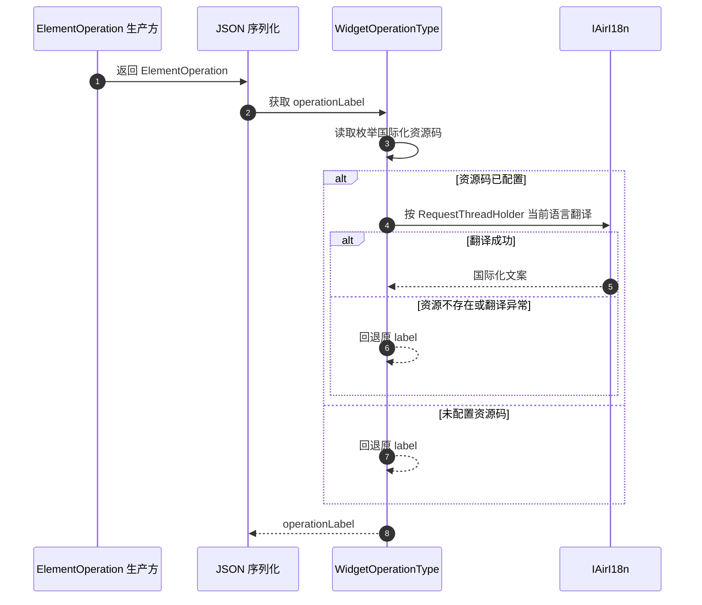

# Tree Operation Dispatch (Process Element & Tailoring Q&A)

> 在过程元素树与裁剪问答树查询响应中，按节点结构条件向 `operations` 字段下发 `BATCH_DELETE` 与 `DRAG_ELEMENT`，供前端展示批量删除与拖拽排序入口。执行仍走既有 `execute_widget_operation` Handler。

## Decisions Log

| Date | Decision | Reasoning | Alternatives Considered |
|------|----------|-----------|------------------------|
| 2026-06-16 | 裁剪问答树排序复用 `DRAG_ELEMENT` | 裁剪问答节点本质是过程元素，与过程元素树统一契约，复用已有 Handler 与 rank 排序语义 | `MOVE_TAILORING_ELEMENT`（裁剪专用单节点移动） |
| 2026-06-16 | 过程元素分类文件夹不下发 `DRAG_ELEMENT` | 分类节点子级保持元模型定义顺序、不参与 rank 排序，与 `sortTreeChildrenByRank` 语义一致 | 严格按「非根且有子」原则下发，由前端禁用 |
| 2026-06-16 | 操作下发在树构建完成后二次遍历 | 扁平 `convertToTreeResp` 阶段 `children` 为空，无法判断是否有子节点；须在 `buildListToTree` + `setIsLeaf` 之后追加 | 在扁平阶段根据 parentId 反查子节点集合 |
| 2026-06-16 | 下发与执行校验分离 | 树 `operations` 仅控制 UI 入口；Handler 保留禁删根/分类、禁环拖拽等硬校验 | 在下发层重复全部 Handler 校验 |
| 2026-06-16 | 下发挂载在查询入口而非 `buildFinalTree` 内部 | `buildFinalTree` 被裁剪选择器等复用，无条件下发会污染轻量场景 | 在 `buildFinalTree` 末尾统一追加 |
| 2026-06-16 | 裁剪问答树补齐 `setTreeLevelsAndLeafNodes` | 与过程树统一 `hasChildren`/`isLeaf` 判定来源，Policy 输入一致 | 仅用 `children` 非空判断 |
| 2026-06-17 | 过程根节点下发 `EXPORT_MMP` | 过程元素根节点是 MMP 导出的主要入口，不论是否有子节点都下发以保持一致性 | — |
| 2026-06-17 | 过程根节点移除 `BATCH_DELETE` | 过程树的首层子节点是不可删除的分类节点，因此根节点不支持批量删除子节点 | 仅在 Handler 校验，下发层仍显示批量删除按钮 |
| 2026-06-17 | 设计在 Level 4 获批，蓝图修改完成，准备实现 | 结合新增导出MMP及防止根节点批量删除的逻辑，完善树操作下发设计并获批 | — |
| 2026-07-17 | 所有 `ElementOperation.operationLabel` 改为按当前语言翻译枚举内配置的国际化资源码 | 直接读取 `WidgetOperationType.label` 会固定返回中文；资源码可复用对应按钮文案且无需运行时查询按钮配置 | 查询按钮配置并按权限类型/API ID 匹配 |
| 2026-07-17 | `RESET_ELEMENT_TAILORING` 与 `BATCH_RESET_ELEMENT_TAILORING` 复用 `ResetTailor` 按钮国际化资源 | 用户确认两个重置操作统一使用既有重置裁剪文案 | 分别新增资源；复用 Add/Remove 文案 |
| 2026-07-17 | 操作文案国际化 Level 1 Capabilities 获批 | 范围覆盖所有返回 `ElementOperation` 的场景，保持现有响应契约兼容 | 仅覆盖过程树新增操作 |
| 2026-07-17 | 操作文案国际化 Level 2 Components 获批：仅修改 `WidgetOperationType`，`ElementOperation` 及所有生产方保持不变 | 枚举统一翻译可自动覆盖所有返回场景，避免在多个树装配入口重复处理 | 新增 Label Resolver；各 Biz 生产方注入国际化服务 |
| 2026-07-17 | 操作文案国际化 Level 3 Interactions 获批：序列化时由枚举按当前请求语言翻译，失败回退原 label | 保持生产方无感、响应结构不变，且翻译故障不影响树查询 | 在 Biz 装配阶段预先翻译 |
| 2026-07-17 | 操作文案国际化 Level 4 Contracts 获批：资源码映射 + `getLabel()` 兜底合约 | 映射表覆盖所有需翻译的操作；null/空/异常三阶段兜底；不新增响应字段 | 翻译失败抛异常；运行时动态权限匹配按钮资源 |
| 2026-07-17 | `ADD` 使用 Create 标准资源码 `3910000000005`（创建） | V3.3 过程元素 Create/View 种子属性曾配反；标准 Create 均为 `3910000000005` | 误用 `3910000000008`（查看） |
| 2026-07-17 | `COPY_TAILORING_ELEMENT` 曾映射 SaveAs `3910000000006`（另存） | 当时按另存按钮对齐 | Create / 独立 Copy |
| 2026-07-17 | `TAILOR_OUT` / `BATCH_TAILOR_OUT` 曾暂不配资源码 | Remove 与 Delete 重名顾虑；后确认有独立「裁剪移除」码 | 共用 Delete |
| 2026-07-17 | Design approved at Level 4（操作文案国际化增量）. Blueprint complete ready for implementation. | 四级齐全且已批准 | — |
| 2026-07-17 | Impl: `WidgetOperationType` 增 `labelI18nResCode` + 重写 `getLabel()`；构造器链式兼容既有无资源码常量 | 对齐 `DataObjectTreeButtonEnum.getName()`；最小改动面 | 新增 Label Resolver 组件 |
| 2026-07-21 | 修正树操作文案错配：MOVE→移动、COPY→复制、TAILOR_IN→裁剪添加、TAILOR_OUT→裁剪移除 | 15010 裁剪树「两个排序」；`3910000000123/0124/0062/0066` 已存在 | 继续复用 Sort/SaveAs/Add |
| 2026-07-25 | **撤销过程根节点下发 `EXPORT_MPP`**（废止 2026-06-17 决策与 Level 1 §2a） | 导出 MPP 入口已迁移至版本控制页（`Versions/index.tsx` 按 `ExportMPP` 按钮权限直调 `/export_mpp`），树上重复入口无价值 | 保留树入口做双入口 |
| 2026-07-25 | 仅改 `ElementTreeOperationDispatchPolicy`：`treeRoot` 分支改为返回空列表，**保留** `treeRoot` 字段与判定 | `treeRoot` 仍承担「阻止根节点获得 `BATCH_DELETE`/`DRAG_ELEMENT`」职责，不可一并删除 | 删除 `treeRoot` 上下文字段 |
| 2026-07-25 | 保留 `WidgetOperationType.EXPORT_MPP`、`MppExportManagement`、`POST /api/gate_flow/process/export_mpp` | 版本控制页仍在使用；枚举承载 `TABLE_EXPORT_MPP` 权限声明与国际化资源码 | 一并删除枚举与执行链路 |
| 2026-07-25 | 前端 `ProcessTree` 的 `exportMpp()` 与 `case EXPORT_MPP` 本次不清理 | 用户确认本轮只收敛后端下发；无下发即无入口，死代码不影响行为 | 同步删除前端死代码 |
| 2026-07-25 | 单测保留为回归断言而非直接删除 | 防止后续再度把 `EXPORT_MPP` 加回树根 | 删除三个 `EXPORT_MPP` 用例 |
| 2026-07-25 | 修复本文档历史损坏（251 行残留 `N:M:` 行号前缀 + 2 行锚点标记），恢复 frontmatter | 前缀污染导致 frontmatter 失效、文档不可解析 | 保持原样另建新文档 |

## Open Questions

- （已关闭 2026-07-21）`TAILOR_OUT` / `BATCH_TAILOR_OUT` 使用 `3910000000124`（裁剪移除）。
- 前端 `ProcessTree` 死代码（`exportMpp()` / `case EXPORT_MPP` / `exportToMpp` import）何时清理 —— 本轮明确不做，待后续任务。

## Constraints

- 批量删除、排序执行必须走 `POST /api/gate_flow/process/execute_widget_operation`，不新增 REST 端点
- Biz 层不得依赖 `gf-sdkimpl`；策略规则放 `gf-sdk`，树遍历与追加放 `gf-biz`
- 关联选择器、导入预览等 `convertToTreeResp(..., false)` 场景默认不追加批量/排序操作（保持轻量）
- 操作文案国际化仅改 `WidgetOperationType`（资源码 + `getLabel()`）；不改 `ElementOperation` 生产方与响应字段
- 不运行时查询按钮；资源码静态写入枚举
- 翻译失败必须回退枚举 `label`，不得中断树接口
- 过程元素树不得再下发 `EXPORT_MPP`；导出 MPP 的唯一入口是版本控制页
- 移除下发不得改动 `/export_mpp` 执行链路与 `TABLE_EXPORT_MPP` 权限声明

## Key Files

| Path | Role |
|------|------|
| `components/gf/biz/.../ProcessElementTreeSupport.java` | 过程元素树构建与操作下发 |
| `components/gf/biz/.../ProcessManagement.java` | `queryElementTree` 入口，触发下发 |
| `components/gf/biz/.../TailoringManagement.java` | 裁剪问答树构建与操作下发 |
| `components/gf/sdk/.../ElementOperation.java` | 操作 DTO（既有） |
| `components/gf/sdk/.../WidgetOperationType.java` | 操作类型 + `labelI18nResCode` + `getLabel()` 国际化 |
| `components/gf/sdk/.../WidgetOperationTypeTest.java` | getLabel 兜底与资源码映射单测 |
| `components/gf/sdk/.../tree/ElementTreeOperationDispatchPolicy.java` | 操作下发策略 |
| `components/gf/sdk/.../tree/ElementTreeOperationContext.java` | 节点判定上下文 |
| `components/gf/sdk/.../tree/ElementTreeOperationMergeSupport.java` | 操作 merge 工具 |

## Design: Level 1 -- Capabilities

### 1. 过程元素树 — 批量删除操作下发
- 查询过程元素树（`queryElementTree`）时，对**拥有子节点且非过程根节点**的节点，在 `operations` 中追加 `BATCH_DELETE`
- 前端据此展示「批量删除子元素」入口；执行仍走 `execute_widget_operation` + `BatchDeleteElementsDataModificationHandler`

### 2. 过程元素树 — 排序操作下发
- 对**非过程根节点**且**拥有子节点**的节点，追加 `DRAG_ELEMENT`
- **例外**：内置分类文件夹（`parentId=0` 且 `subType=RootElement`）仅下发 `BATCH_DELETE`，不下发 `DRAG_ELEMENT`
- 过程根节点（`elementId == processId`）不下发 `DRAG_ELEMENT` 与 `BATCH_DELETE`

### 2a. ~~过程元素树 — 导出 MPP 操作下发~~（已废止 2026-07-25）
- ~~对过程根节点（`treeRoot = true`），始终在 `operations` 中追加 `EXPORT_MPP`~~
- **现行能力**：过程根节点**不下发任何树级操作**（`BATCH_DELETE` / `DRAG_ELEMENT` / `EXPORT_MPP` 均无）
- `buildProcessRootNode` 中既有的 `COMPARE_PROCESS`、`SHOW_REMOVED_TAILORING`、`TAILORING_PROCESS`、`RESET_PROCESS_TAILORING`、`DELETE` 不受影响
- 导出 MPP 入口移交版本控制页：`Versions/index.tsx` 按 `OperateButtonEnum.EXPORT_MPP` 按钮权限渲染，直调 `exportToMpp`

### 3. 裁剪问答树 — 批量删除操作下发
- 查询裁剪问答树（`queryTailoringQuestionTree`）时，对**拥有子节点**的节点追加 `BATCH_DELETE`
- 虚拟根（`bizId="0"`）若有子问题，也下发 `BATCH_DELETE`
- 系统固定「不知道」答案叶子节点保持 `operations=[]`

### 4. 裁剪问答树 — 排序操作下发
- 对**非虚拟根**且**拥有子节点**的节点，追加 `DRAG_ELEMENT`（复用过程元素拖拽 Handler）
- 虚拟根不下发 `DRAG_ELEMENT`

### 5. 可见性与执行校验分离
- 树下发只声明 UI 可用操作；能否成功执行由 Handler 校验（禁删根/分类、禁环、同过程限制等）

### 6. 操作文案国际化（2026-07-17 增量）

1. **操作文案国际化**：所有返回 `ElementOperation` 的场景，`operationLabel` 按当前语言显示，不再固定返回枚举中文文案。
2. **与按钮文案对齐**：`WidgetOperationType` 保存对应按钮的国际化资源码，复用按钮多语言文案。
3. **翻译失败兜底**：资源缺失或未配置时回退枚举现有 `label`，保证 `operationLabel` 可读。
4. **契约兼容**：不新增响应字段、不修改 API 结构；前端继续读取 `operationLabel`。

## Design: Level 2 -- Components

### 1. 组件与分层架构映射

| 组件名称 | 所在分层 | 职责描述 | 依赖关系 | DDD 分类 |
| :--- | :--- | :--- | :--- | :--- |
| **ElementTreeOperationDispatchPolicy** | SDK 层 (gf-sdk) | 纯策略：根据节点上下文判定应下发 `BATCH_DELETE` / `DRAG_ELEMENT` | 无依赖 | 领域策略 (Domain Policy) |
| **ElementTreeOperationContext** | SDK 层 (gf-sdk) | 节点判定上下文值对象 | 无依赖 | 值对象 (Value Object) |
| **ElementTreeOperationMergeSupport** | SDK 层 (gf-sdk) | 将 Policy 输出 merge 进既有 `operations` 列表（去重） | 无依赖 | 领域工具 |
| **ProcessElementTreeSupport** | Biz 层 (gf-biz) | 过程元素树构建；`appendBatchAndSortOperations` 递归遍历 | gf-sdk | 应用服务（树装配） |
| **TailoringManagement** | Biz 层 (gf-biz) | 裁剪问答树构建；`appendBatchAndSortOperations` 递归遍历 | gf-sdk | 应用服务（编排） |
| **ProcessManagement** | Biz 层 (gf-biz) | `queryElementTree` 入口，在 `buildFinalTree` 后触发下发 | ProcessElementTreeSupport | 应用服务 |
| **TailoringRest** | Biz 层 (gf-biz) | `queryTailoringQuestionTree` 入口 | TailoringManagement | REST 适配器 |
| **ElementOperation** | SDK 层 (gf-sdk) | 操作 DTO（既有） | — | 值对象 |
| **BatchDeleteElementsDataModificationHandler** | SDKImpl 层 | 批量删除执行 | — | 领域处理器 |
| **DragElementDataModificationHandler** | SDKImpl 层 | 拖拽排序执行 | — | 领域处理器 |

### 2. 依赖关系与依赖防线

- **Biz 层隔离**：Biz 仅依赖 `gf-sdk` 策略与 DTO，不 import `gf-sdkimpl` Handler
- **无循环依赖**：Biz (gf-biz) → SDK (gf-sdk) ← SDKImpl (gf-sdkimpl)
- **只读路径无事务**：树下发为查询后处理，不新增 `@Transactional`
- **选择器场景隔离**：关联选择器 / 裁剪元素选择器不触发下发

### 3. 组件关系图

```
ProcessRest / TailoringRest
        │
        ▼
ProcessManagement          TailoringManagement
        │                          │
        ▼                          ▼
ProcessElementTreeSupport    (树构建 + 后处理)
        │                          │
        └──────────┬───────────────┘
                   ▼
    ElementTreeOperationDispatchPolicy  (gf-sdk)
                   │
                   ▼
         ElementOperation[] → 树节点 operations 字段

执行路径（既有，不变）:
Frontend → execute_widget_operation → Handler (sdkimpl)
```

### 4. 核心挂载点

| 树类型 | 挂载方法 | 触发时机 |
| :--- | :--- | :--- |
| 过程元素树 | `ProcessElementTreeSupport.appendBatchAndSortOperations` | **`ProcessManagement.queryElementTree`** 在 `buildFinalTree` 返回后调用 |
| 裁剪问答树 | `TailoringManagement.appendBatchAndSortOperations` | `queryTailoringQuestionTree` 内，`appendSystemFixedUnknownAnswers` + `setTreeLevelsAndLeafNodes` 之后 |

### 5. 操作 merge 规则

- 不覆盖既有 `ADD` / `RENAME` / `EDIT` / `DELETE` / `MOVE_TAILORING_ELEMENT` 等
- 仅追加 `BATCH_DELETE`、`DRAG_ELEMENT` 与批量裁剪系列（Policy 判定为 true 且尚未存在时）
- 同一 `WidgetOperationType` 不重复添加
- （2026-07-25 起）`EXPORT_MPP` 不再由 Policy 追加

### 6. 下发规则矩阵（Policy 真值表，2026-07-25 更新）

| 场景 | hasChildren | BATCH_DELETE | DRAG_ELEMENT | EXPORT_MPP |
| :--- | :---: | :---: | :---: | :---: |
| 过程根节点 | any | ✗ | ✗ | ✗（原 ✓，已撤销） |
| 分类文件夹 | ✓ | ✓ | ✓ | ✗ |
| 普通非根节点 | ✓ | ✗ | ✓ | ✗ |
| 叶子节点 (非根) | ✗ | ✗ | ✗ | ✗ |
| 裁剪虚拟根 | ✓ | ✓ | ✓ | ✗ |
| 系统固定「不知道」 | ✗ | ✗ | ✗ | ✗ |

> 批量删除/批量裁剪仅在「批量操作锚点」（分类文件夹或裁剪虚拟根）下发，普通父节点不再下发批量操作 —— 此为既有实现现状，本次一并勘正表格。

### 7. 领域模型决策 (DDD)

- **聚合根**：`ProcessElementsDataObject`（删除/排序执行实体，Handler 层不变）
- **值对象**：`ElementTreeOperationContext`、`ElementOperation`
- **领域策略**：`ElementTreeOperationDispatchPolicy`（无状态、可单测）
- **应用服务**：树后处理遍历（Biz 层装配关注点）

### 8. 操作文案国际化组件（2026-07-17 增量）

| 组件 | 分层 | 职责 | 变更 |
|------|------|------|------|
| `WidgetOperationType` | gf-sdk | 操作类型与展示文案元数据 | 保存对应按钮国际化资源码；`getLabel()` 按当前语言翻译并以原 `label` 兜底 |
| `ElementOperation` | gf-sdk DTO | 对外操作响应契约 | 不变；`getOperationLabel()` 继续调用 `operation.getLabel()` |
| 按钮配置 / Flyway 数据 | 配置来源 | 提供可复用的国际化资源码 | 仅作设计期资源码来源，不参与运行时查询 |

**组件边界**：
- 不修改 `ProcessElementTreeSupport`、`TailoringManagement` 等 `ElementOperation` 生产方。
- 不引入按钮查询、权限匹配或额外数据库 IO。
- 不新增组件、REST 接口或响应字段。
- DDD 定位不变：`ElementOperation` 仍为契约值对象；国际化属于其展示标签解析，不改变过程元素聚合。

## Design: Level 3 -- Interactions

### 1. 过程元素树查询 + 操作下发

```
[前端]
   │ POST /api/gate_flow/process/query_element_tree
   │ { workspaceId, processId, version }
   ▼
[ProcessRest] → [ProcessManagement.queryElementTree]
   │ 1. 加载过程 + 元素列表
   │ 2. convertToTreeResp（扁平，children=[]，写入 ADD/RENAME/EDIT/DELETE 等）
   │ 3. buildFinalTree(allNodes)
   │      ├─ buildListToTree
   │      ├─ sortTreeChildrenByRank
   │      └─ setTreeLevelsAndLeafNodes → isLeaf 确定
   │ 4. appendBatchAndSortOperations(tree)  ← 仅 queryElementTree 触发
   ▼
[ProcessElementTreeSupport.appendBatchAndSortOperations]（递归）
   │ 对每个节点:
   │   a. 构建 ElementTreeOperationContext
   │   b. Policy.resolve(ctx) → [BATCH_DELETE?, BATCH_TAILOR_*?, DRAG_ELEMENT?]
   │      过程根节点（treeRoot）→ 空列表（2026-07-25 起不再含 EXPORT_MPP）
   │   c. merge 进 operations（去重，不覆盖既有操作）
   ▼
[前端] 渲染树；有子节点的节点显示批量删除/排序入口
```

**边界**：只读路径，无事务；Biz 仅调用 gf-sdk Policy，不触碰 Handler。

### 2. 裁剪问答树查询 + 操作下发

```
[前端]
   │ POST /api/gate_flow/tailoring/query_tailoring_question_tree
   ▼
[TailoringRest] → [TailoringManagement.queryTailoringQuestionTree]
   │ 1. 加载过程 + getTailoringProcessElements
   │ 2. buildVirtualRoot + convertTailoringElement（扁平 operations）
   │ 3. TreeBuilder.buildListToTree
   │ 4. normalizeVirtualRootParentFields
   │ 5. appendSystemFixedUnknownAnswers
   │ 6. setTreeLevelsAndLeafNodes(root)        ← 新增
   │ 7. appendBatchAndSortOperations(root)   ← 新增
   ▼
[TailoringManagement.appendBatchAndSortOperations]（递归）
   │ 跳过 systemFixedAnswer==true
   │ Policy.resolve → merge operations
   ▼
[前端]
```

### 3. 批量删除执行（既有 Handler，不变）

```
[前端] 多选子节点
   │ POST /api/gate_flow/process/execute_widget_operation
   │ { operationType: "BATCH_DELETE",
   │   operationParam: { elementIds: [...] },
   │   workspaceId, processId, version, elementId(上下文父节点) }
   ▼
[ProcessRest] → [WidgetOperationManagement] (@Transactional)
   → [BatchDeleteElementsDataModificationHandler]
   ▼
[前端] 成功后重新 query_element_tree / query_tailoring_question_tree
```

详见 `.lattice/context/process-element-batch-delete-and-sort-design.md`。

### 4. 拖拽排序执行（既有 Handler，不变）

```
[前端] 在父节点子级区域拖拽
   │ POST /api/gate_flow/process/execute_widget_operation
   │ { operationType: "DRAG_ELEMENT",
   │   operationParam: { dragId, dragType: BEFORE|AFTER|CHILD, referenceId } }
   ▼
[DragElementDataModificationHandler]
   ▼
[前端] 刷新树
```

裁剪问答树与过程元素树共用 `DRAG_ELEMENT` Handler。

### 5. 数据流与边界

| 阶段 | 数据流向 | 边界 |
|------|----------|------|
| 树查询 | DB → IProcessService → Biz 树装配 → Policy → Resp | Biz 不 import sdkimpl |
| 操作下发 | Policy → `ElementOperation` DTO | 纯内存，无 IO |
| 操作执行 | Rest → Management(事务) → SDK → Handler | 与树下发解耦 |

**无跨聚合领域事件**：本次为查询响应增强，结构变更副作用仍在既有 Handler 内同步处理。

### 6. 范围外

| 接口 | 说明 |
|------|------|
| `query_element_tree_with_compare` | 走 `compareProcessTree` 独立组装，本次不覆盖；后续可在 `toTreeWithCompareRespList` 后复用同一 Policy |
| 关联选择器 / 裁剪元素选择器 | 明确排除，保持轻量 |

### 7. 操作文案国际化交互（2026-07-17 增量）



**交互边界**：
- 不查询按钮配置，不根据权限动态匹配。
- 翻译失败不得中断树接口响应。
- 所有 `ElementOperation` 生产方无需感知国际化过程。

### 8. 操作文案国际化合约（2026-07-17 增量）

**Status: Approved 2026-07-17**

#### 8.1 `WidgetOperationType` 资源码映射

| 操作 | 对应按钮 | 资源码 | 资源码中文 | 枚举兜底 label |
|------|----------|--------|------------|----------------|
| `ADD` | Create | `3910000000005` | 创建 | 添加 |
| `COPY_TAILORING_ELEMENT` | Copy | `3910000000062` | 复制 | 复制 |
| `EDIT` | Edit | `3910000000009` | 编辑 | 编辑 |
| `RENAME` | Rename | `3910000000131` | 重命名 | 重命名 |
| `DELETE` | Delete | `3910000000002` | 删除 | 删除 |
| `BATCH_DELETE` | Delete | `3910000000002` | 删除 | 删除 |
| `DRAG_ELEMENT` | Sort | `3910000000132` | 排序 | 排序 |
| `MOVE_TAILORING_ELEMENT` | Move | `3910000000066` | 移动 | 移动 |
| `COMPARE_PROCESS` | Comparison | `3910000000133` | 版本对比 | 版本对比 |
| `SHOW_REMOVED_TAILORING` | DisplaySettings | `3910000000134` | 显示设置 | 显示设置 |
| `TAILORING_PROCESS` | ExecuteTailor | `3910000000121` | 执行裁剪 | 执行裁剪 |
| `RESET_PROCESS_TAILORING` | ResetTailor | `3910000000122` | 重置裁剪 | 重置裁剪 |
| `RESET_ELEMENT_TAILORING` | ResetTailor | `3910000000122` | 重置裁剪 | 重置单元素裁剪 |
| `BATCH_RESET_ELEMENT_TAILORING` | ResetTailor | `3910000000122` | 重置裁剪 | 批量重置元素裁剪 |
| `TAILOR_IN` | AddTailor | `3910000000123` | 裁剪添加 | 裁剪添加 |
| `BATCH_TAILOR_IN` | AddTailor | `3910000000123` | 裁剪添加 | 裁剪添加 |
| `TAILOR_OUT` | RemoveTailor | `3910000000124` | 裁剪移除 | 裁剪移除 |
| `BATCH_TAILOR_OUT` | RemoveTailor | `3910000000124` | 裁剪移除 | 裁剪移除 |
| `EXPORT_MPP` | ExportMPP | `3910000000128` | 导出MPP | 导出 |
| 其余未列出操作 | — | null | — | 保持原 label |

> 资源码来自按钮名称国际化属性（设计期静态写入枚举），不参与运行时按钮查询。
> Create 使用标准码 `3910000000005`（创建），勿用过程元素 V3.3 配反脏数据中的 `3910000000008`（查看）。

#### 8.2 `getLabel()` 契约

```java
// WidgetOperationType：新增 labelI18nResCode（或 i18nKey）字段；getLabel() 签名不变
public String getLabel() {
    if (labelI18nResCode == null || labelI18nResCode.isBlank()) {
        return this.label;
    }
    try {
        IAirI18n airI18n = SpringContextUtils.getBean(IAirI18n.class);
        I18nRes res = airI18n.getI18nRes(labelI18nResCode, RequestThreadHolder.getLanguageApiId());
        if (res != null && res.getLabel() != null && !res.getLabel().isBlank()) {
            return res.getLabel();
        }
    } catch (Exception e) {
        // 翻译异常不抛出，不中断树接口响应
    }
    return this.label;
}
```

**兜底规则**：
1. 资源码为 null / 空 → 返回 `label`
2. `getI18nRes` 为空或 label 为空 → 回退 `label`
3. 任何异常 → 捕获并回退 `label`
4. 不得导致树接口返回异常

参考实现风格：`DataObjectTreeButtonEnum.getName()`。

#### 8.3 响应契约兼容性

- `ElementOperation.operationLabel` 字段保持不变，继续由 `getOperationLabel()` → `operation.getLabel()` 返回
- 序列化后 JSON 结构不变，前端无需修改
- 行为变化：同一接口对不同语言请求返回不同 `operationLabel` 值

#### 8.4 测试契约

- 配置资源码的操作：中/英环境返回对应 `air_sys_i18n_resource.label`
- `TAILOR_OUT` / `BATCH_TAILOR_OUT`：映射 `3910000000124`（裁剪移除）
- 资源缺失 / Spring 未启动 / 异常：回退原 `label`
- 不调用 `IButtonService` / `IPrivilegeEngine.getButtons`

## Design: Level 4 -- Contracts

### 1. 新增 SDK 值对象：`ElementTreeOperationContext`

**包路径**：`com.airedgesoft.gf.sdk.tree.ElementTreeOperationContext`

```java
@Getter
@Builder
public class ElementTreeOperationContext {

    private Long processId;
    private Long elementId;
    private Long parentId;
    private String bizId;
    private boolean hasChildren;
    private boolean treeRoot;
    private boolean categoryFolder;
    private boolean virtualRoot;
    private boolean systemFixedAnswer;
    private String metamodelIdent;
    private String metamodelType;
    private String metamodelSubType;
}
```

**Biz 层构建规则**：

| 字段 | 过程元素树来源 | 裁剪问答树来源 |
|------|----------------|----------------|
| `hasChildren` | `Boolean.FALSE.equals(node.getIsLeaf())` | `children != null && !children.isEmpty()` |
| `treeRoot` | `Objects.equals(processId, elementId)` | 恒 `false` |
| `categoryFolder` | `isCategoryNode(parentId, subType)` | 恒 `false` |
| `virtualRoot` | 恒 `false` | `VIRTUAL_ROOT_BIZ_ID.equals(bizId)` |
| `systemFixedAnswer` | 恒 `false` | `Boolean.TRUE.equals(systemFixedAnswer)` |

### 2. 新增 SDK 策略：`ElementTreeOperationDispatchPolicy`

**包路径**：`com.airedgesoft.gf.sdk.tree.ElementTreeOperationDispatchPolicy`

**目标契约（2026-07-25 更新，`treeRoot` 分支返回空列表）**：

```java
public final class ElementTreeOperationDispatchPolicy {

    public static List<WidgetOperationType> resolve(ElementTreeOperationContext context) {
        if (context == null || context.isSystemFixedAnswer()) {
            return List.of();
        }
        // 过程根节点不下发任何树级操作；导出 MPP 已迁移至版本控制页
        if (context.isTreeRoot()) {
            return List.of();
        }
        if (!context.isHasChildren()) {
            return List.of();
        }
        List<WidgetOperationType> operations = new ArrayList<>(5);

        boolean batchOpsAnchor = context.isCategoryFolder() || context.isVirtualRoot();
        if (batchOpsAnchor) {
            operations.add(WidgetOperationType.BATCH_DELETE);
            if (context.isBatchTailoringEnabled()) {
                operations.addAll(TailoringMenuPolicy
                        .resolveBatchElementTreeOperationTypes(context.isAnyChildHasLocalManualElementTailoring()));
            }
        }
        operations.add(WidgetOperationType.DRAG_ELEMENT);
        return List.copyOf(operations);
    }
}
```

**不变量**：`ElementTreeOperationContext.treeRoot` 字段与 `ProcessElementTreeSupport` 中的 `treeRoot(Objects.equals(processId, elementId))` 构建逻辑保持不变；`WidgetOperationPrivilegeSupport.filterScopedOperationsByPrivilege` 传入空 `dispatched` 集合时为空操作，无需改动。

### 3. 测试契约（2026-07-25 增量）

| 测试 | 目标断言 |
|------|----------|
| `ElementTreeOperationDispatchPolicyTest.resolve_processRoot_*` | 根节点（有/无子节点）均返回空列表；方法名从 `returnsExportMmpOnly` 改为表意「不下发」 |
| `ProcessElementTreeSupportTest` 两个 `EXPORT_MPP` 用例 | 合并为一条回归用例：无论 `TABLE_EXPORT_MPP` 权限为 true 或 false，根节点 `operations` 均不含 `EXPORT_MPP` |
| `WidgetOperationTypeTest` `EXPORT_MPP` 相关用例 | **不改** —— 枚举、权限声明、资源码 `3910000000128` 全部保留 |
| `ProcessRestMppExportTest` | **不改** —— `/export_mpp` 执行链路不变 |

## Design Summary

### Components and layer assignments
- `ElementTreeOperationDispatchPolicy` / `ElementTreeOperationContext` / MergeSupport（gf-sdk）：树操作下发（既有）
- `WidgetOperationType`（gf-sdk）：静态 `labelI18nResCode` + `getLabel()` 国际化（本轮增量）
- `ElementOperation`（gf-sdk）：契约不变，`operationLabel` 委托 `getLabel()`
- Biz 树装配生产方：本轮不改

### Key contracts and interfaces
- `WidgetOperationType.getLabel()`：按 `RequestThreadHolder` 语言翻译；null/空/异常回退 `label`
- 资源码映射见 §8.1（含 `TAILOR_IN`/`TAILOR_OUT` 裁剪添加/裁剪移除）

### Architectural constraints
- 不运行时查按钮；不新增 API/字段/组件
- 翻译失败不得中断树查询
- Create 资源用 `3910000000005`，勿用脏数据 `3910000000008`

### Open questions resolved during design
- 简化为枚举内资源码，不做权限查按钮
- `COPY_TAILORING_ELEMENT` → SaveAs；重置类 → ResetTailor
- `MOVE_TAILORING_ELEMENT` / `COPY_TAILORING_ELEMENT` 分别映射移动/复制，与 `DRAG_ELEMENT`（排序）区分

### Design status
**Implemented**（操作文案国际化增量：`WidgetOperationType` 已落地；`WidgetOperationTypeTest` 54 用例通过）

实现入口：`/code-forge`，设计文档 `.lattice/context/tree-operation-dispatch-design.md` § Design Level 1 §6 / Level 2 §8 / Level 3 §7 / Level 4 §8。

---

## Design Summary（2026-07-25 增量：撤销树根 EXPORT_MPP 下发）

### Components and layer assignments
- `ElementTreeOperationDispatchPolicy`（gf-sdk）：**唯一改动点**，`treeRoot` 分支由「返回 `EXPORT_MPP`」改为「返回空列表」
- `ElementTreeOperationContext`（gf-sdk）：不变，`treeRoot` 字段继续用于阻断根节点的批量/排序操作
- `ProcessElementTreeSupport`（gf-biz）：不变
- `WidgetOperationType` / `MppExportManagement` / `ProcessRest#export_mpp`：不变
- 前端 `ProcessTree`：本轮不动（死代码待后续清理）；`Versions/index.tsx` 为导出 MPP 的唯一入口

### Key contracts and interfaces
- `resolve(ctx)`：`ctx.isTreeRoot()` → `List.of()`
- 响应契约不变；过程根节点 `operations` 少 `EXPORT_MPP` 一项
- `/api/gate_flow/process/export_mpp` 与 `TABLE_EXPORT_MPP` 权限声明完全保留

### Architectural constraints
- 过程元素树不得再下发 `EXPORT_MPP`
- 不得删除 `treeRoot` 上下文字段
- 不得触碰导出执行链路与权限声明

### Open questions resolved during design
- 前端死代码本轮不清理（用户确认）
- 单测改为回归断言而非删除（用户确认）
- 枚举与 REST 端点保留（版本控制页在用）

### Design status
**Implemented**（2026-07-25）

### Implementation verification
- `ElementTreeOperationDispatchPolicy`：过程根节点返回空列表，不再下发 `EXPORT_MPP`
- `ElementTreeOperationDispatchPolicyTest`：根节点有/无子节点均断言空列表
- `ProcessElementTreeSupportTest`：合并为「过程根节点不再下发 `EXPORT_MPP`」回归用例
- `ElementTreeOperationDispatchPolicyTest`：9 tests，0 failures，0 errors
- `ProcessElementTreeSupportTest`：15 tests，0 failures，0 errors
- 两个 Maven reactor 均 `BUILD SUCCESS`