## 一、全局类图
https://bluevector.feishu.cn/wiki/I4hhwucAdifRgXk2UzwcyQ5sn4f

## 二、具体场景

### 一）创建对象（物料）
#### 1.  类图
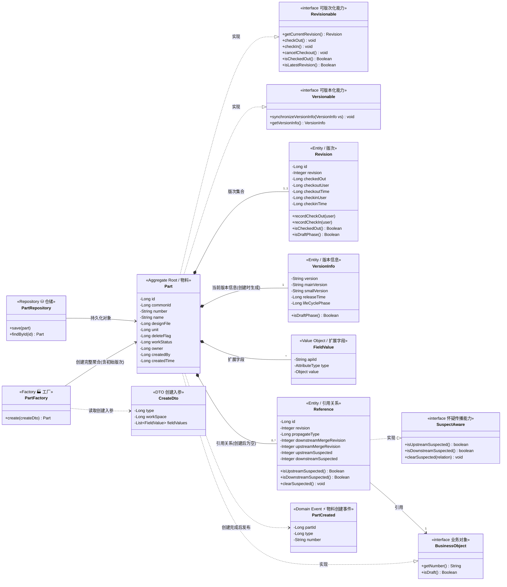

![[Pasted image 20260818092412.png]]

#### 2. 时序图

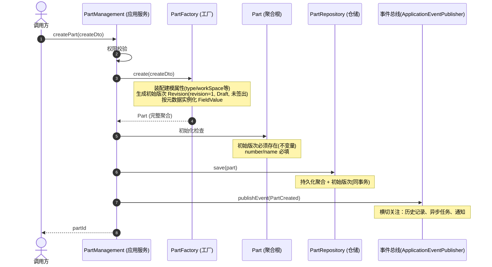

#### 3. 总结
- **创建流程**：`PartManagement.createPart`（应用服务）→ `PartFactory.create(createDto)`（装配建模属性 + 初始版次 + FieldValue）→ `PartRepository.save(part)`（持久化，含初始版次同事务）→ **发布 `PartCreated` 事件**（横切：历史/异步/通知，不用于跨聚合一致性，`[项目] §5`）
- **能力接口**：`Revisionable`（签出签入）、`Versionable`（版本同步）、`SuspectAware`（怀疑传播）——跨聚合复用，Part/文档等实现
- **Revision ≠ Version**：Revision 是版次（每次签出/签入产生的工作记录，聚合内实体）；Version 是正式版本（发布产物）
- **Reference**：`<<Entity / 引用关系>>`（非扩展字段），创建物料时为空集合，挂载后才有；实现 `SuspectAware` 传播怀疑

#### 4.  遗留的思考

- 思考1：创建对象时，会一并创建**引用**，这个本身没有问题。引用的里面有个**怀疑传播**，其实在Association也要使用。后续思考需要将其细化思考 现在这个引用的entity 是不是还合适。
![[ReferenceAndAssociation.excalidraw]]

### 二）物料属性修改
####  1.  类图（仅时序图相关类）
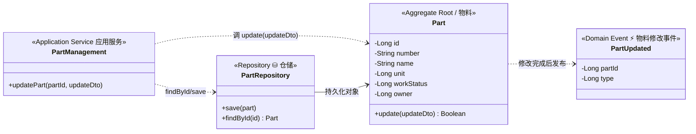

####  2. 时序图

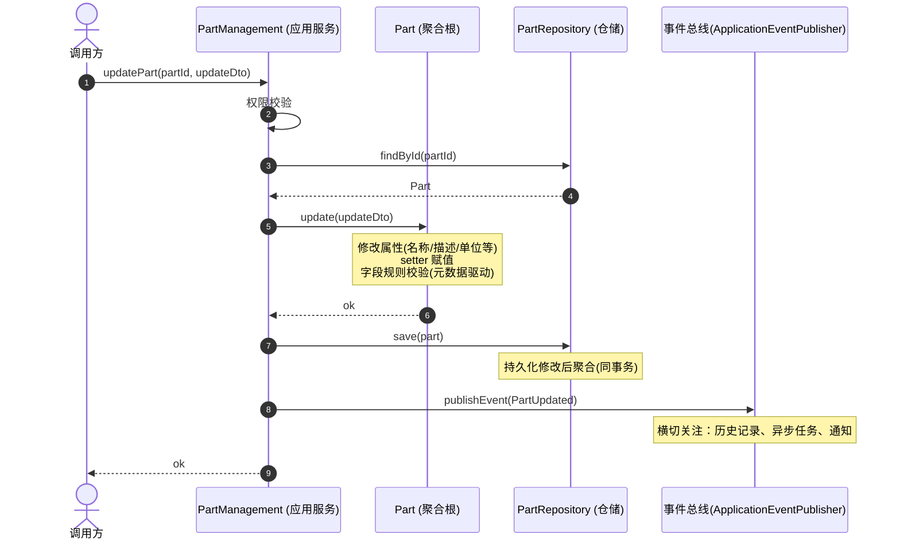

####  3. 总结
- **修改流程**：`PartManagement.updatePart`（应用服务）→ 权限校验 → `PartRepository.findById` 加载 → `Part.update(updateDto)`（属性 setter + 规则校验）→ `PartRepository.save(part)`（同事务持久化）→ **发布 `PartUpdated` 事件**（横切）
- **Part.update()**：聚合根方法承载字段规则校验（元数据驱动），纯赋值走 setter——实体方法只在承载规则时存在
- **事件**：`PartUpdated`（修改后发布，横切关注，不用于跨聚合一致性，`[项目] §5`）

### 三） 删除物料
### 四） 物料的签出
####  1.  类图（仅时序图相关类）
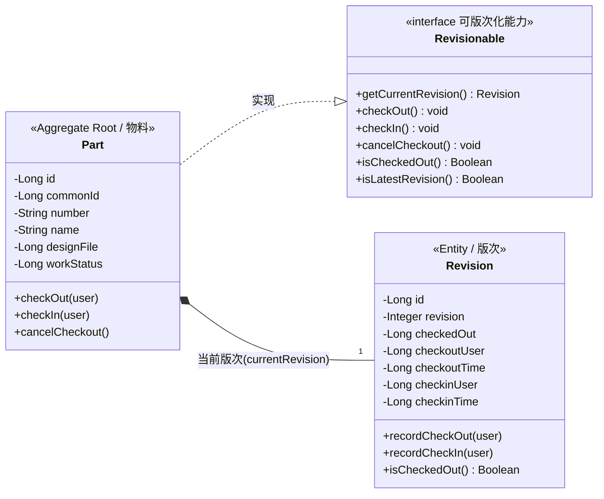

#### 2. 时序图

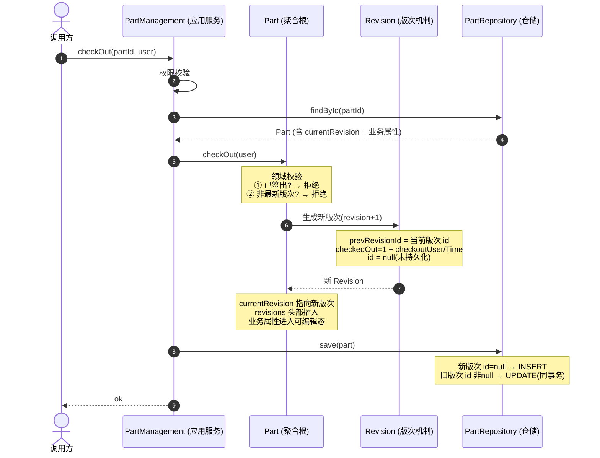

#### 3. 思考

- **决策点1（签出是否产生副本）**：签出时生成新版次（copy-on-checkout）——业务已确认"签出必改"，签出即开新工作版次（revision+1，id=null 待持久化），修改直接写入该版次；取消签出清理未修改版次
- **决策点2（属性放哪）**：业务属性（number/name/designFile）放在 **Part**（与创建场景一致），`Revision` 只含**版次机制**（id/revision/prevRevisionId/签出状态）——签出生成新版次 Revision 并切换 `currentRevision`，Part 业务属性随当前版次变化；"每次只查一个版次"通过加载 `currentRevision` 对应数据实现。`Revision` 通用（不塞业务属性），跨业务对象复用（`Revisionable` 接口 + 通用 Revision 实体）
### 五）物料的签入

### 六）物料列表化的呈现 （查询建模）

## 二、BOM

### 一）添加 BOM（BomTab 聚合根）

#### 1. 查询：按版次加载 BomTab
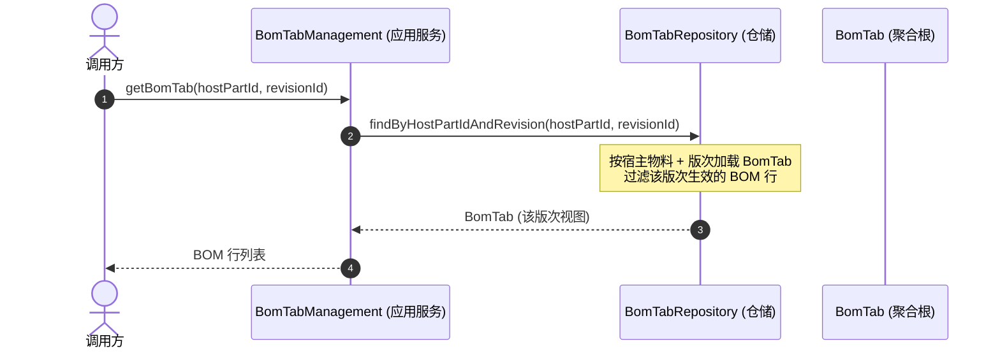

**要点**：BomTab 按 `(hostPartId, revisionId)` 复合键加载——只查该版次生效的行（多版次物料每次只查一个版次，对齐"每次只查一个版次"决策）。

#### 2. 类图（仅时序图相关类）
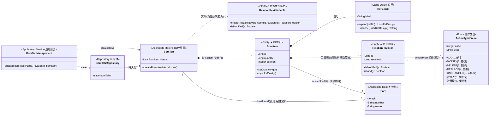

#### 3. 添加时序图
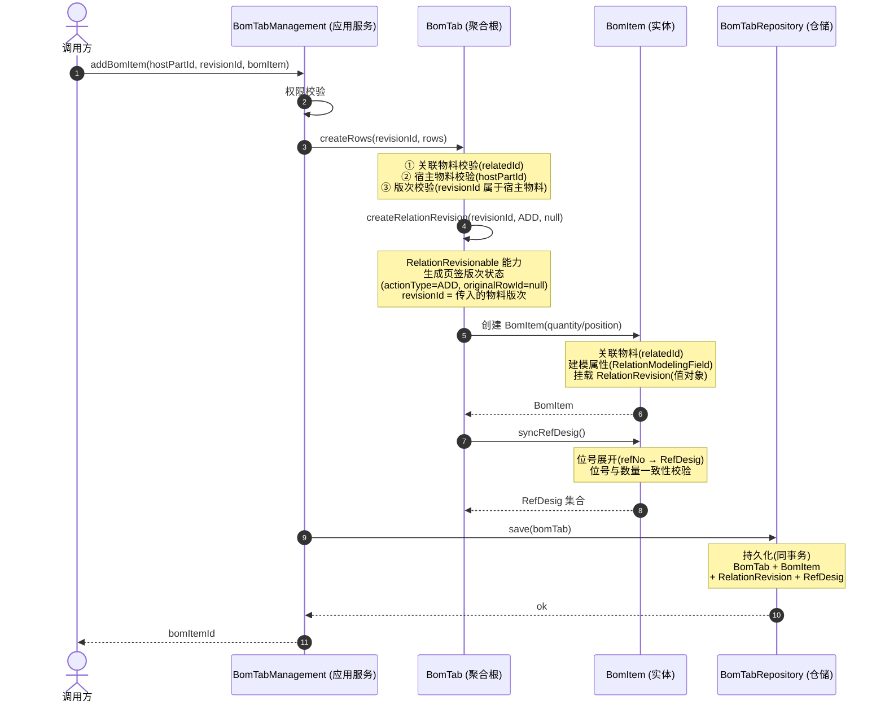

**要点**：`BomTab` 独立聚合根（数据量大）；`createRows` 聚合内编排——校验关联物料 → `RelationRevisionable.createRelationRevision(ADD)` 生成页签版次状态 → 创建 BomItem 挂载 → 位号展开（`syncRefDesig`）→ 同事务持久化。

### 二）修改 BOM（BomTab 聚合根）

#### 1. 类图（仅时序图相关类）
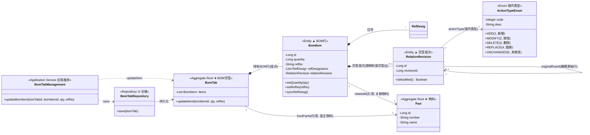

#### 2. 时序图
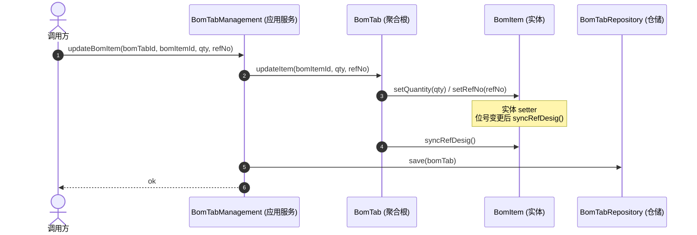

**要点**：修改经 BomTab 聚合根编排 → BomItem setter + 位号重同步；独立仓储持久化。

### 三） 删除BOM

### 四) 替换

### 五） 签出的事件同步

## 三、替代料

## 四、 关联关系

## 三、物料的变更

