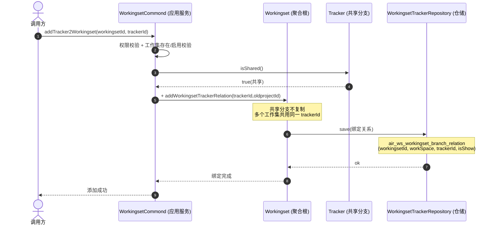
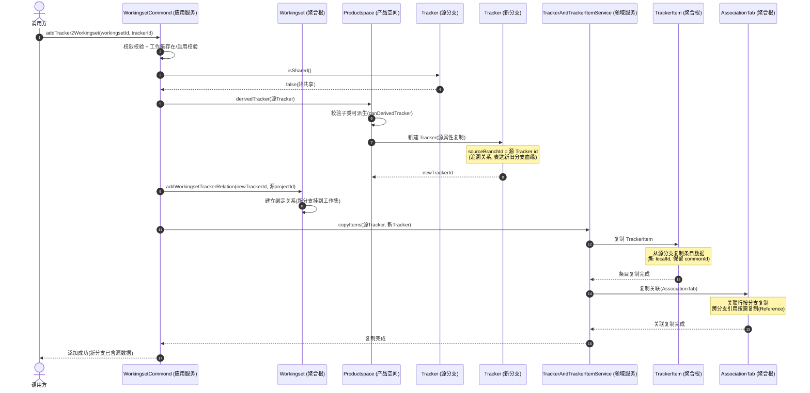

## 一、Tracker 场景
Tracker 领域
├── 创建 Tracker        ← Use Case   只能在**默认工作集**创建
├── 收藏 Tracker        ← Use Case
├── 删除 Tracker        ← Use Case
├── 创建基线            ← Use Case
├── 发送至基线          ← Use Case
├── 添加至工作集        ← Use Case     ⭐⭐相对比较复杂的
├── 发送至同行评审      ← Use Case
└── 分配权限               ← Use Case
└── 创建快照                ← Use Case

## 二、取 添加至工作集 做分析

### 一）流程分析
【Add Tracker to Workingset】

选择目标 Workingset
        ↓
校验 Workingset 是否存在、是否启用....
        ↓
判断当前 Tracker 是否共享
        │
        ├── **共享**
        │     ↓
        │   建立 Workingset 绑定关系
        │     ↓
        │   END
        │
        └── **非共享**
              ↓
          新建 Tracker
              ↓
          建立新旧 Tracker 追溯关系
              ↓
          建立 Workingset 绑定关系
              ↓
          复制 TrackerItem
              ↓
          处理关联 / 引用
              ↓
             END

### 二） 职责和变化，共性抽取

| 业务行为                              | 第一个候选负责人                                                                       | 可能会变化吗？      |
| --------------------------------- | ------------------------------------------------------------------------------ | ------------ |
| 【**校验**】判断 Workingset 是否存在/启用.... | `AddTracker2WorkingsetSpeciation`                                              | 校验一般来说都是调整大的 |
| 判断 Tracker 是否共享                   | `Tracker`  isShared()                                                          |              |
| 建立绑定关系                            | `Workingset`  addTracker(trackerId,oldprojectId)                               |              |
| 新建 Tracker                        | `TrackerFactory` devideTracker()  ==[Factory,Tracker]==                        |              |
| 建立新旧 Tracker 追溯关系                 | Tracker 属性sourceId 即可以表达追溯关系  ==[`Tracker`？还是关系对象？>]==                      |              |
| 复制 TrackerItem                    | TrackerAndTrackerItemService,跨聚合用领域服务[`Tracker`？还是专门的复制逻辑？]                    |              |
| 处理关联、引用                           | TrackerItem聚合根 处理对应**引用**复制。 关联聚合根处理对应*AssociationTab*  **关联**复制。==独立service== |              |

 ### 三）绘制出初略的模型
https://bluevector.feishu.cn/wiki/I4hhwucAdifRgXk2UzwcyQ5sn4f
### 四）时序图

#### 1. 共享 Tracker：添加至工作集（简单路径）

**要点**：共享 Tracker **不新建分支**，仅建立绑定关系——多个工作集共用同一 Tracker，数据天然可见。

#### 2. 非共享 Tracker：添加至工作集（复杂路径）

**要点**：
- **追溯关系**：`NewTracker.sourceBranchId = 源Tracker.id`——表达新旧分支血缘（合并/差异比较的依据）
- **复制内容**：TrackerItem 条目 + 关联/引用，**新分支拥有独立副本**（数据隔离，后续可独立修改）
- **绑定**：新分支挂到目标工作集（relation 表），与共享路径共用同一绑定机制

#### 3. 时序图与源码对应

| 时序图步骤 | 源码实现 | 说明 |
|---|---|---|
| 新建 Tracker(派生) | `WorkingsetBranchService` 分支创建（`newTracker.setSourceBranchId(parentTracker.getId())`） | sourceBranchId 追溯 |
| 同步 TrackerItem | `syncTrackersToInstanceTable` | 条目复制到实例表 |
| 复制引用 | `WorkingsetReferenceService`（insertTempHeadReferenceDataForOneBranch 等） | 引用按分支复制 |
| 复制关联 | `TransferAssociationTabDataStep`（job 步骤） | 关联数据迁移 |
| 绑定关系 | `air_ws_workingset_branch_relation` | 共享/非共享共用 |

