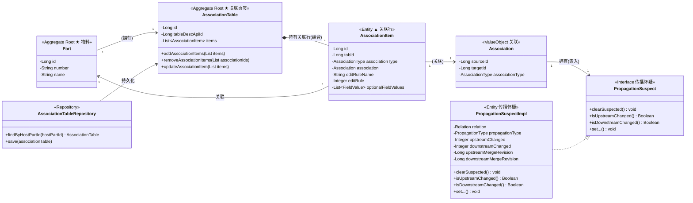
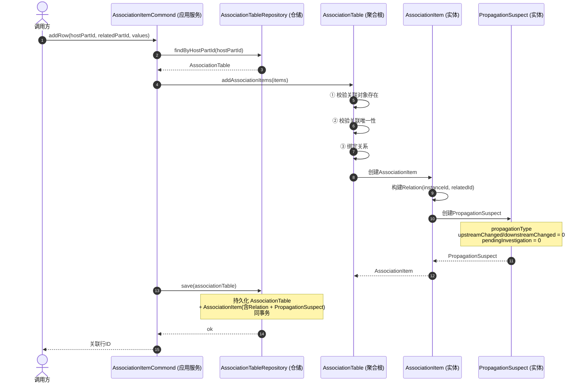
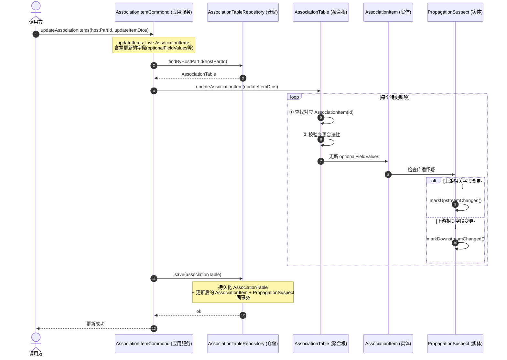
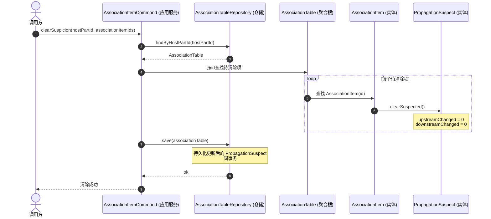

## 一、Tracker 场景
关联关系 聚合根
├── 添加 关联关系        ← Use Case  ===>  ├── 新建传播关系        ← Use Case ✅ 
├── 修改 关联关系        ← Use Case  ===>  ├── 修改传播关系        ← Use Case ✅ 
├── 删除 关联关系        ← Use Case  ===>  ├── 删除传播关系        ← Use Case ✅ 
├── 清除传播标记         ← Use Case                                                                     ✅ 

 
├── 上游对象属性变更了，更新传播的标记 ← Use Case 领域事件

`可以利用领域服务，根据sourceId 和targetId，PropagationSuspect 可以有独立仓储实现的`
 
## 二、 添加关联关系的场景

### 一）流程分析
选择Part 和 关联的Part ,并且填入关联上属性
        ↓
 根据页签的定义规则，校验属性
        ↓
处理绑定关系
        ↓
        入库

### 二）类图

### 三）时序图：添加关联关系

## 四） 时序图：更新关联关系

`问题？ 其实我只更新部分，现在也要全局更新会不会损耗性能？`

## 五）时序图：清除标记

