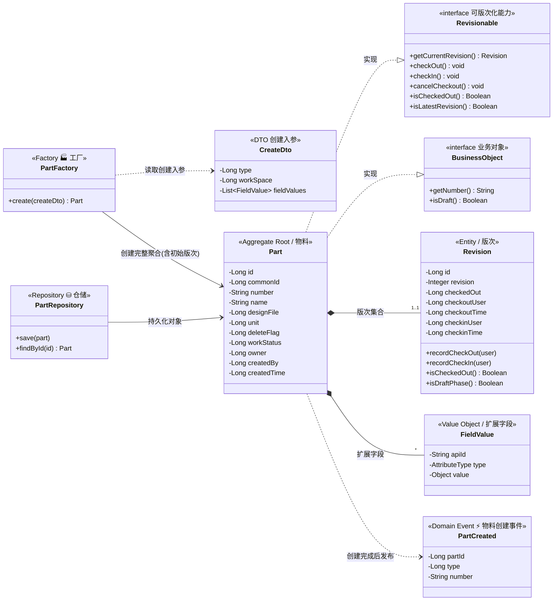

## 场景 

关联关系 聚合根 
├── 新增 多版次对象        ← Use Case  ===>  
├── 修改 多版次对象        ← Use Case ✅  
├── 对多版次对象签出        ← Use Case  ===>  
├── 对多版次对象签入       ← Use Case ✅  
├── 对多版次对象取消签出       ← Use Case  ===>  
├── 删除多版次对象        ← Use Case ✅  

## 类图

