# Knowledge Level - 类定义模型

## 聚合根与实体关系

```mermaid
classDiagram
    class ObjectDefinition {
        <<interface>>
        +ClassId getId()
        +ApiId getApiId()
        +String getName()
        +ClassType getClassType()
        +boolean isEnabled()
        +ClassId getParentClassId()
        +ClassId getBaseClassId()
        +List~TableId~ getTableDescIds()
        +List~LifecycleDefinition~ getLifecycleDefinitions()
        +update(ObjectDefinition)
    }

    class BaseClassDefinition {
        <<aggregate root>>
        +List~ClassGroup~ getClassGroups()
        +ClassGroup createClassGroup(name, apiId)
        +void removeClassGroup(ClassGroupId)
    }

    class ClassDefinition {
        <<aggregate root>>
        +List~AttributeOverride~ getAttributeOverrides()
        +List~LifecycleOverride~ getLifecycleOverrides()
        +List~TableDescOverride~ getTableDescOverrides()
        +CreateAttributeOverride(TableId,AttributeId,EnabledValueObject,NameValueObject)
        +updateAttributeOverride(TableId,AttributeId,EnabledValueObject,NameValueObject)
    }

    class SubClassDefinition {
        <<aggregate root>>
        +NumberingRuleId getNumberingRule()
        +VersionRuleId getVersionRule()
        +WorkflowId getWorkflowId()
        +boolean getAddFileRequired()
        +boolean getCadMappingRequired()
        +Integer getTabDisplay()
        +List~AttributeOverride~ getAttributeOverrides()
        +List~LifecycleOverride~ getLifecycleOverrides()
        +List~TableDescOverride~ getTableDescOverrides()
        +boolean hasGlobalTracker()
        +TrackerId getGlobalTracker()
    }

    class TableDescDefinition {
        <<aggregate root>>
        +TableId getId()
        +ApiId getApiId()
        +String getName()
        +DisplayLocation getDisplayLocation()
        +boolean isChangeControlled()
        +boolean isEditable()
        +boolean isVisible()
        +boolean isRowNotEmpty()
        +List~AttributeDefinition~ getColumns()      
    }

    class AttributeDefinition {
        <<entity>>
        +AttributeId getId()
        +ApiId getApiId()
        +String getName()
        +String getDbName()
        +AttributeType getAttributeType()
        +DataType getDataType()
        +Visibility getVisibility()
        +ValidationRule getValidationRule()
        +ListReference getListReference()
        +Long getTextRule()
        +Long getEnumList()
        +boolean isBuildIn()
        +boolean isReference()
        +ValidationResult validate(Object value)
        +String convertToDisplayValue(Object value)
    }

    class LifecycleDefinition {
        <<entity>>
        +LifecycleId getId()
        +ApiId getApiId()
        +Long getEnabled()
    }

    class ClassGroup {
        <<entity>>
        +ClassGroupId getId()
        +String getName()
        +ApiId getApiId()
        +List~ClassId~ getAttachedSubClassIds()
    }

    class AttributeOverride {
        <<entity>>
        +OverrideId getId()
        +AttributeId getAttributeId()
        +TableId getTableId()        
        +Visibility getNameOverride()
        +Boolean getEnabledOverride()
    }

    class LifecycleOverride {
        <<entity>>
        +OverrideId getId()
        +LifecycleId getLifecycleId()
        +Boolean getEnabledOverride()
    }

    class TableDescOverride {
        <<entity>>
        +OverrideId getId()
        +TableId getTableId()
        +Boolean isChangeControlledOverride()
        +Boolean isEditableOverride()
        +Boolean isVisibleOverride()
        +Boolean isRowNotEmptyOverride()
    }

    class ClassHierarchyService {
        <<interface>>
        +List~AttributeDefinition~ getInheritedMergedAttributes(ClassId, TableId)
        +List~TableDescDefinition~ getInheritedMergedTableDescs(ClassId)
        +List~LifecycleDefinition~ getInheritedMergedLifecycles(ClassId)
        +SubClassId createSubClass(SubClassDefinition)
        +void updateAttributeDefinition(ClassId, TableId, AttributeDefinition)
        +void updateLifeCycleDefinition(ClassId, LifeCycleDefinition)
        +void updateTableDescDefinition(ClassId, TableId, TableDescDefinition)
        +void overrideLifecycle(ClassId, LifecycleId, Boolean)
        +void overrideTableDesc(ClassId, TableId, TableDescConfig)
    }

    class BaseClassDefinitionRepository {
        <<interface>>
        +BaseClassDefinition findById(ClassId)
        +void save(BaseClassDefinition)
    }

    class ClassDefinitionRepository {
        <<interface>>
        +ClassDefinition findById(ClassId)
        +void save(ClassDefinition)
    }

    class SubClassDefinitionRepository {
        <<interface>>
        +SubClassDefinition findById(ClassId)
        +SubClassDefinition save(SubClassDefinition)
    }

    class TableDescDefinitionRepository {
        <<interface>>
        +TableDescDefinition findById(TableId)
        +List~TableDescDefinition~ findByIds(List~TableId~)
        +void save(TableDescDefinition)
    }

    ClassHierarchyService --> BaseClassDefinitionRepository : uses
    ClassHierarchyService --> ClassDefinitionRepository : uses
    ClassHierarchyService --> SubClassDefinitionRepository : uses
    ClassHierarchyService --> TableDescDefinitionRepository : uses

    ObjectDefinition <|-- BaseClassDefinition : extends
    ObjectDefinition <|-- ClassDefinition : extends
    ObjectDefinition <|-- SubClassDefinition : extends

    BaseClassDefinition "1" --> "*" ClassGroup : contains
    ObjectDefinition "1" --> "*" TableDescDefinition : references by ID
    ObjectDefinition "1" --> "*" LifecycleDefinition : has

    
    ClassDefinition "1" --> "*" AttributeOverride : overrides
    ClassDefinition "1" --> "*" LifecycleOverride : overrides
    ClassDefinition "1" --> "*" TableDescOverride : overrides

 
    SubClassDefinition "1" --> "*" AttributeOverride : overrides
    SubClassDefinition "1" --> "*" LifecycleOverride : overrides
    SubClassDefinition "1" --> "*" TableDescOverride : overrides

    TableDescDefinition "1" --> "*" AttributeDefinition : columns
```



---

## 聚合根判断依据

### TableDescDefinition 作为聚合根的理由

| 判断标准 | 结论 | 说明 |
|---------|------|------|
| **有独立身份？** | ✅ 是 | `TableId`，被多方引用 |
| **有独立事务边界？** | ✅ 是 | 修改页签的配置（如改版次控制、可见性）不需要加载 ClassDefinition |
| **有独立生命周期？** | ✅ 是 | 页签可以被创建、修改、禁用、删除，独立于 ClassDefinition |
| **有自己的数据资产？** | ✅ 是 | 拥有 `AttributeDefinition` 列表（列），这些是核心数据 |
| **删除父容器后仍有意义？** | ❌ 否 | 删除 ClassDefinition 后，其引用的 TableDesc 理论上失去意义。但实际场景中，TableDesc 可以被多个 Class 引用（共用页签场景），且独立管理 |

**结论：TableDescDefinition 是聚合根。**

主要依据是**事务独立性**和**内容所有权**：

- **事务独立性**：修改页签的配置（如 `isChangeControlled`、`isEditable`）是一个独立的事务操作，不需要同时修改 ClassDefinition 的任何字段。如果 TableDesc 是 ClassDefinition 的实体，每次修改页签都要先加载整个 ClassDefinition，事务边界过宽。
- **内容所有权**：`AttributeDefinition` 是 `TableDescDefinition` 的列，属性唯一性只在 `TableDescDefinition` 内有意义。同一个属性（如 `description`）可以在不同页签中出现，它们是不同的 `AttributeDefinition`，各自有独立的 `AttributeId`。

### 引用关系

```
ClassDefinition（聚合根）
  └── 引用 TableDescDefinition（通过 ID，不持有）
        ├── 类定义新建时，选择已有的 TableDesc 或新建
        ├── 类定义删除时，TableDesc 单独管理
        └── 事务：修改 Class 不锁 TableDesc，修改 TableDesc 不锁 Class

TableDescDefinition（聚合根）
  └── 持有 AttributeDefinition（列）
        ├── 属性唯一性：一个 TableDesc 内不能有同名属性
        ├── 属性跨页签可复用（不同 TableDesc 可以有不同的 description 属性）
        └── 事务：修改 TableDesc 的列是独立事务
```

### ClassDefinition 作为聚合根的理由

| 判断标准 | 结论 | 说明 |
|---------|------|------|
| 有独立身份？ | ✅ 是 | `ClassId` |
| 有独立事务边界？ | ✅ 是 | 修改类的基本信息（名称、apiId）独立 |
| 有独立生命周期？ | ✅ 是 | 基类/类不可删除，子类可创建删除 |
| 有自己的数据资产？ | ✅ 是 | `AttributeOverride`（轻量覆盖配置） |
| 引用 TableDesc？ | ✅ 通过 ID 引用 | 不持有，不锁表 |

### 三类聚合根的对比

| 聚合根 | 数据库表 | 实体 | 独立性 |
|--------|---------|------|--------|
| `BaseClassDefinition` | class 表（base_class 类型） | `ClassGroup`, `LifecycleDefinition` | 高 |
| `ClassDefinition` | class 表（class 类型） | `AttributeOverride` | 高 |
| `SubClassDefinition` | class 表（sub_class 类型） | `AttributeOverride` | 高 |
| `TableDescDefinition` | tab 表 | `AttributeDefinition` | 高 |

### 继承逻辑的归属

**继承逻辑不放在聚合根上，而是放在 `ClassHierarchyService` 中。** 聚合根只负责自己层级的数据，不负责跨层级的合并。`ClassHierarchyService` 是查询和更新的统一入口。

```
查询路径：
ClassHierarchyService.getInheritedMergedAttributes(subClassId)
  ├── resolveChain → BaseClass → Class → SubClass
  ├── 通过仓储查询各层级引用的 TableDesc 和 AttributeDefinition
  ├── 通过仓储查询各层级的 AttributeOverride
  ├── InheritanceMergeService 合并
  └── 返回结果

更新路径：
ClassHierarchyService.overrideAttribute(subClassId, tableId, attrId, override)
  ├── resolveChain → 确定该属性属于哪个层级
  ├── 在对应层级创建/更新 AttributeOverride
  └── 事务：只操作该层级聚合根

修改路径（不涉及继承）：
ClassHierarchyService.addAttribute(tableId, attrInfo)
  ├── 直接操作 TableDescDefinition
  └── 事务：只操作 TableDescDefinition
```