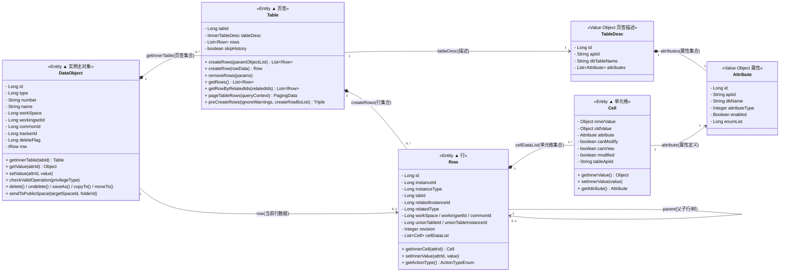

# ObjectFramework 模型（DataObject / Row / Cell / Table）

> 现网对象框架核心模型：DataObject（实例主对象）— 持有 Table（页签）— Table 持有 Row（行）— Row 持有 Cell（单元格）。数据流：`DataObject → Table → Row → Cell`（`[项目] §1` 页签行是聚合内从属实体）。

## 类图



## 对象职责

| 对象 | 角色 | 职责 | 现网类 |
|---|---|---|---|
| **DataObject** | 实例主对象（聚合根载体） | 业务行为入口（签出/删除/另存/发送），持有页签集合，是 `Row` 的宿主 | `DataObject`/`RevisionDataObject`/`PartDataObject` |
| **Table** | 页签（聚合内从属） | 行集合容器，行 CRUD（`createRows`/`removeRows`/`getRowByRelatedIds`/`pageTableRows`），`preCreateRows` 校验钩子 | `Table`/`PartAlternateTab`/`TabBom` |
| **Row** | 行（聚合内实体） | 一行数据，持单元格集合；带关联信息（`relatedInstanceId`/`relatedType`）、union 定位（局部替代料）、版次 | `Row`（extends `RowData`） |
| **Cell** | 单元格（聚合内实体） | 一个属性的值 + 权限标记（canModify/canView/modified），双向绑定 `Attribute` | `Cell`（extends `CellData`） |

## 关键机制

**1. 数据访问链**
```
DataObject.getValue(attrId)
  → row.getInnerCell(attrId)     // 从当前行取单元格
  → cell.getInnerValue()          // 取单元格值
```

**2. 挂载（创建行）**
```
Table.createRows(paramObjectList)
  → preCreateRows(校验钩子)       // 子类 override（如 PartAlternateTab 三校验）
  → super.createRows()            // 框架落库
```

**3. 关联行（挂载其他对象）**
- `relatedInstanceId`/`relatedType`：行指向关联对象（BOM 行指向子物料、替代料行指向替代物料）
- `getRowByRelatedIds(relatedIds)`：按关联对象 ID 反查行（挂载去重用）

**4. union 定位（局部替代料）**
- `unionTableId`/`unionTableInstanceId`：行归属哪个页签的哪行（局部替代料定位到 BOM 行）
- 现网 `PartLocalAlternateTable.init(unionTableId, unionTableInstanceId)` 设置后过滤行

**5. 父子树**
- `Row.parent` + `children`：树形页签（如需求层级）
- `getAllChildrenDataObjects`（DataObject 层）：PostgreSQL 递归查询

**6. 页签描述（元数据）**
- `Table.tableDesc → TableDesc`：页签元数据（dbTableName/apiId/attributes）
- `TableDesc.attributes → Attribute`：属性定义（apiId/dbName/attributeType/enabled）
- `Cell.attribute`：单元格绑定属性定义——**Cell 是"属性 + 值"的实例化**

## 与领域模型的关系

| 框架对象 | 领域模型映射 |
|---|---|
| DataObject | 聚合根载体（Part/Document），行为在领域层封装 |
| Table | 页签聚合（BomTab）/聚合内实体（AlternateTab）——见 [tabs.md](./tabs.md) |
| Row | 聚合内实体（BomItem/Alternate/AssociationItem）的数据载体 |
| Cell | 属性值载体（FieldValue 的实例化：apiId + value） |

**分界**：框架对象（Row/Cell/Table）是**持久化/数据载体**，领域模型（Part/Alternate/BomItem）是**行为封装**——领域实体包装 Row/Cell 暴露意图方法，不直接把框架结构暴露给业务层（`[项目] §1` 页签行是聚合内从属实体，不单独暴露为公共聚合根）。
