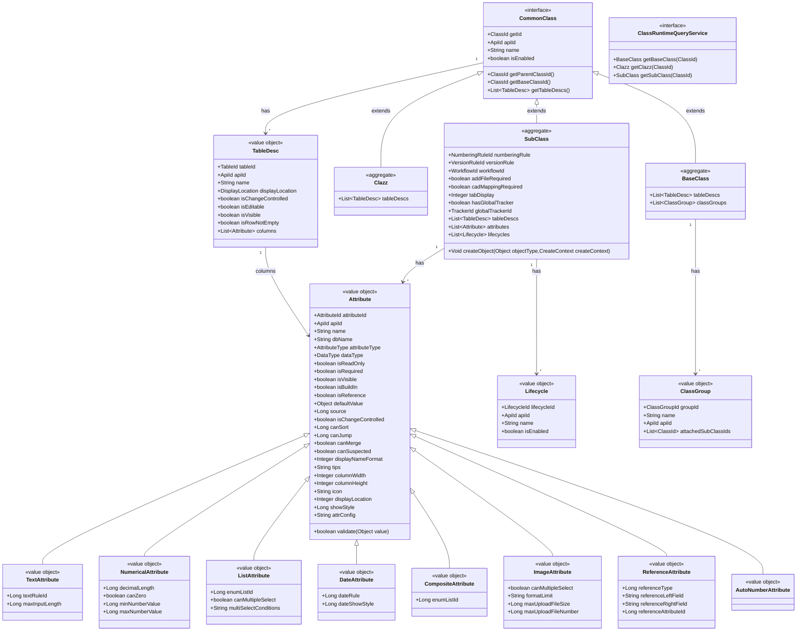
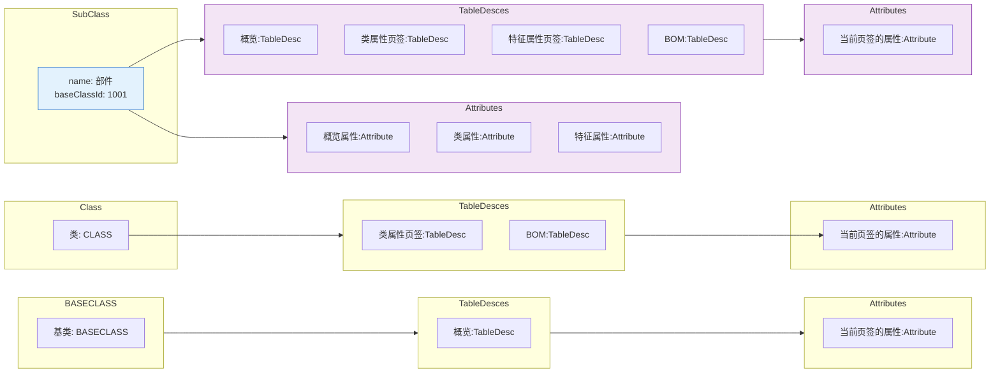
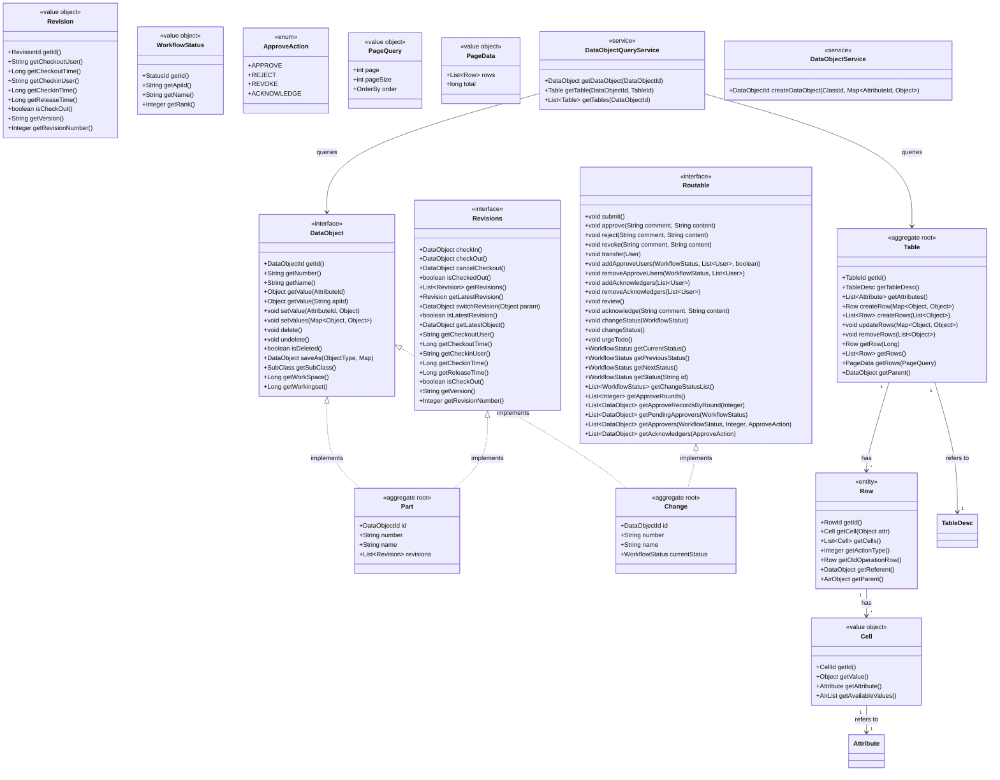

# Operational Level - 运行时模型

## 说明

运行时模型是**继承已合并后的只读快照**，没有修改、新增、删除操作，没有继承逻辑。

三个聚合根各自持有完整的、已合并的数据：`SubClass` 的页签、属性、生命周期已经是继承合并后的结果，不需要再走 `ClassHierarchyService`。

---

## 运行时元数据

### 类图



---

### 简略的对象图



**说明：** 部件 SubClass 的概览页签（名称、编号）继承自 BaseClass，属性页签（材料）继承自 Class，特征页签（重量）是 SubClass 自己的。三个页签在运行时已合并为扁平快照，不再需要走继承链。

## 运行时的实例化

运行时实例模型是数据对象在运行时的快照，包含属性值、页签行、版次、工作流等状态。



### 接口与实现分离

```
                    ┌─────────────────────────┐
                    │   DataObjectQueryService│  ← 领域服务
                    │   getTable()            │
                    │   getCell()             │
                    │   getRow()              │
                    └────────┬────────────────┘
                             │ 跨聚合根查询
          ┌──────────────────┼──────────────────┐
          ▼                  ▼                  ▼
 ┌─────────────────┐ ┌─────────────────┐ ┌─────────────────┐
 │   DataObject    │ │    Revisions    │ │    Routable     │  ← 接口
 └────────┬────────┘ └────────┬────────┘ └─────────────────┘
          │ 实现              │ 实现
 ┌────────┴────────┐ ┌────────┴────────┐
 │     Part        │ │    Table        │  ← 聚合根
 │  + attributes   │ │  + rows         │
 │  + revisions    │ │  + createRow()  │
 └─────────────────┘ └─────────────────┘
```


**说明：** 部件 SubClass 的概览页签（名称、编号）继承自 BaseClass，属性页签（材料）继承自 Class，特征页签（重量）是 SubClass 自己的。三个页签在运行时已合并为扁平快照，不再需要走继承链。

---

## 与 Knowledge Level 的对比

| 维度 | Knowledge Level | Operational Level |
|------|---------------|-------------------|
| 角色 | 定义层 | 运行时 |
| 继承 | 由 ClassHierarchyService 处理 | 无需处理，已合并 |
| 操作 | 增删改查 | 只读查询 |
| 关系 | 实体（有身份）+ 引用 by ID | 值对象（无身份，快照） |
| 仓储 | 有 | 直接查缓存 |
| 事务 | 有 | 无 |
| 覆盖 | AttributeOverride 等 | 已合并进属性值 |
| 数据来源 | DB | 运行时缓存 |
