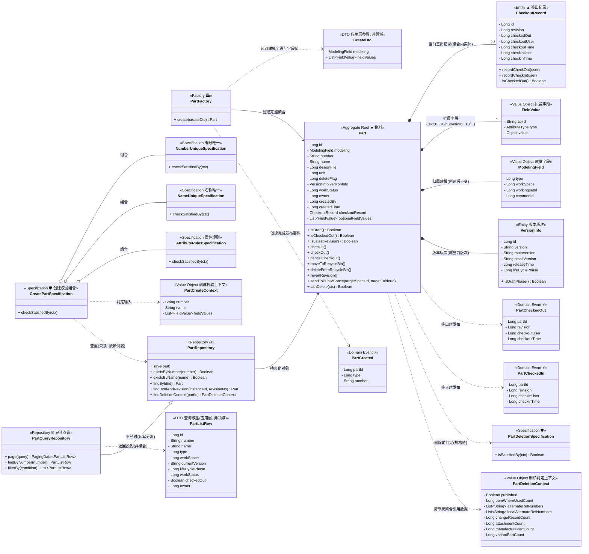
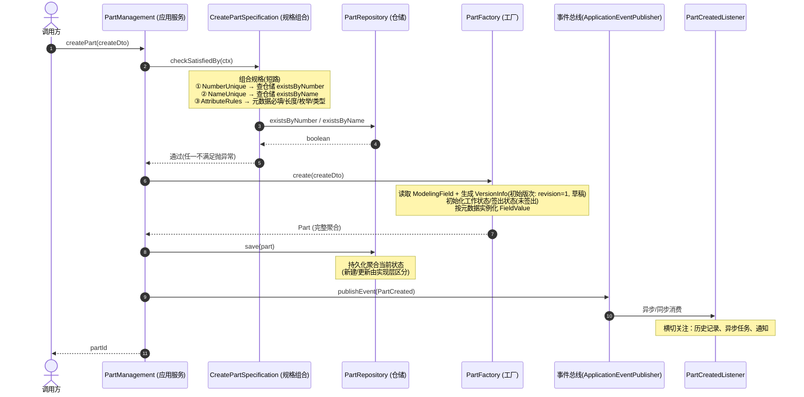
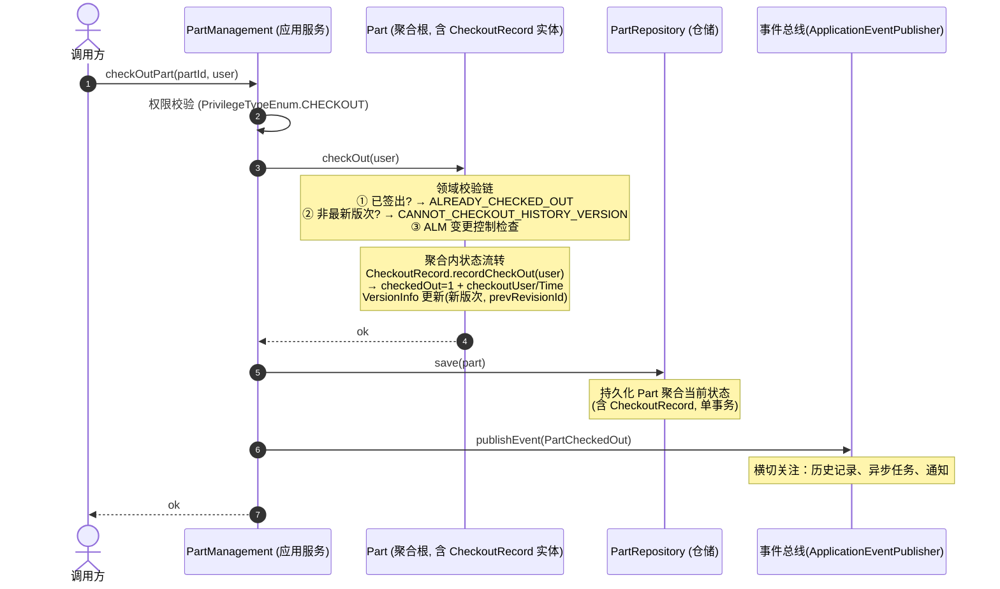
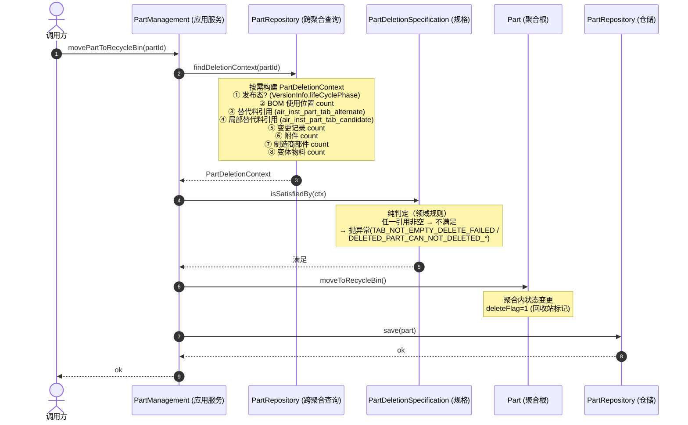
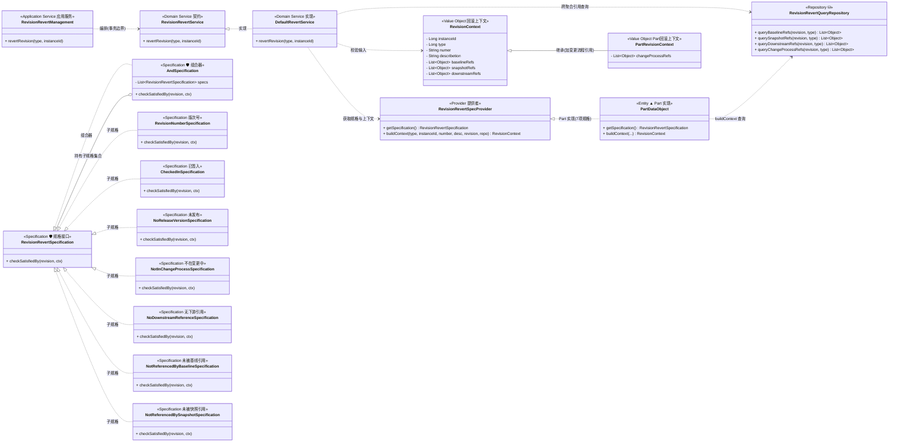
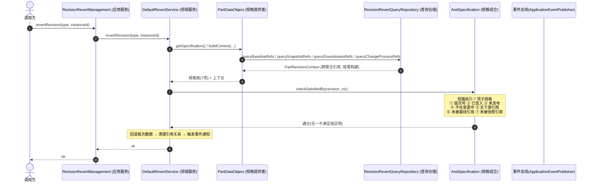
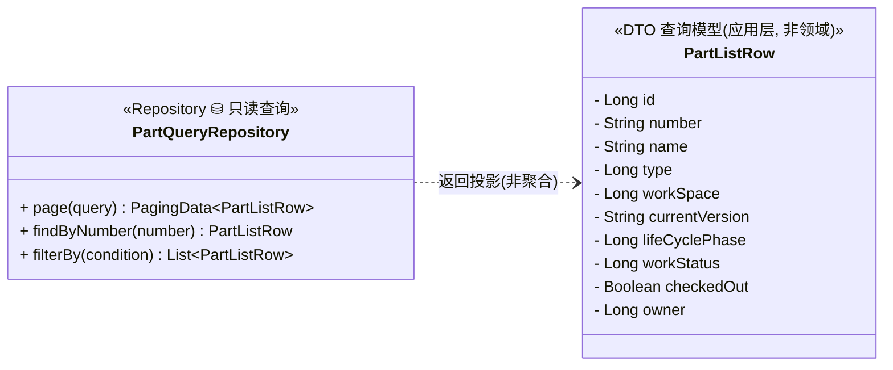
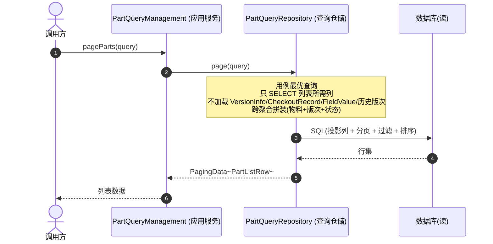

# 物料领域模型（Part）

> 聚合设计：`Part`（物料）为聚合根。物料 ID 跨版次共享（`instanceId` 关联），`air_inst_part_rev` 每版次一行；**当前版次状态内联在 `Part` 上**（签出/版本/设计文件），历史版次经 `PartRepository.findByIdAndRevision` 按需查（读模型），不进入聚合。
>
> 替代料（GlobalAlternate）建模暂移除，待物料模型稳定后另行补充。

## 一、整体类图

## 二、属性设计

### 一）决策要点

#### 值对象判据（逐条对照，全中才建模）

| # | 判据 | 说明 |
|---|---|---|
| 1 | 无独立身份 | 不靠 id 区分两个实例；丢了 id 仍能判断是否相等 |
| 2 | 按值相等 | `equals` 比较属性值，而非引用/身份 |
| 3 | 不可变 | 创建后不可修改；变化用「整体替换」表达，而非 setter |
| 4 | 无独立生命周期 | 是其他对象的属性，不单独增删改查 |
| 5 | 成组出现 | 多个字段永远一起读写，组合成一个完整概念 |
| 6 | 携带行为/约束 | 有校验、判定或计算逻辑，收拢后避免散落判断 |

**反模式**：
- 纯 ID/外键（`workSpace`、`trackerId`、`owner`）→ 原生 `Long`（遵循 DDD 规范 §2，不建 Typed ID）
- 枚举型字段（`lifeCyclePhase`、`workStatus`）→ 原生 `Long`，语义由枚举类承载
- 只有不可变、没有行为/成组性的单字段 → 不值得拆

#### 为什么 CheckoutState 是 Entity 而不是值对象/聚合根

签出/签入状态**不是 Part 的一个属性值，而是有身份的版次级记录**——现网每次签出在 `air_inst_part_rev` **插入新行**（`insertBuilder.buildInsertRev()`，checked_out=1），签入更新该行（checkin_user/time）。记录有身份（版次 ID）、有生命周期（签出→签入流转），值对象装不下（无身份判据不满足）。

**但也不是聚合根**——聚合边界 = 一致性边界。现网 `checkOut()` 在**同一事务**内"插版次行 + 更新 Part 状态"（`insertBuilder` + `updateBuilderRev.genSqlUpdateFlas1BySiteAndId`），签出记录与 Part 当前版本状态必须**原子变更**。若独立成聚合，签出就变成跨聚合同事务变更，违反 DDD"一个事务只改一个聚合"；改为最终一致性又无法满足 `isCheckedOut()` 的即时一致性。

| 判据 | 值对象? | 聚合根? | Entity |
|---|---|---|---|
| 有身份（版次 ID） | ❌ | ✅ | ✅ |
| 有生命周期（签出→签入） | ❌ | ✅ | ✅ |
| 与 Part 同事务变更 | — | ❌ 跨聚合 | ✅ |
| 归属 Part 聚合 | — | ❌ | ✅ |
| 业务规则属 Part | — | ❌ | ✅（权限/已签出/历史版次在 Part.checkOut） |

#### 为什么 designFile 是外键而不是值对象

| 判据 | 结论 | 证据 |
|---|---|---|
| 无独立身份 | ✅ | 单字段，无对象身份 |
| 成组出现 | ❌ | 现网仅 `AirConstants.Part.ATTR_DESIGN_FILE` **一个属性**，存 draw revisionId（`Long`）；`DrawDto` 的 `id/type` 是查询返回 DTO，不是 Part 上的字段 |
| 携带行为 | ❌ | 无；关联读取经 `DrawService.getDrawByPartId(partId, revisionId)` |

**要点**：`designFile` 是跨聚合 **ID 引用（外键）**——`Part.ATTR_DESIGN_FILE` 存设计文件版次 ID，符合 DDD "reference by identity" 原则与项目规范 §2（ID 用原生 `Long`，不建 Typed ID）。跨聚合状态判断（`Draw.isCheckedOut()`）由 `Draw` 聚合根提供，`Part` 经 `DrawService` 加载后调用，不导航。

#### 各值对象判据对照

**ModelingField（建模字段）**

| 判据 | 结论 | 证据 |
|---|---|---|
| 无独立身份 | ✅ | 归属建模值，无 id |
| 按值相等 | ✅ | type + workSpace + workingsetId + commonId 比较 |
| 不可变 | ✅ | **创建时确定、之后不变**——归属关系在创建后不修改 |
| 无独立生命周期 | ✅ | 依附 Part |
| 成组出现 | ✅ | 四字段共同定义"对象归属哪个分类/空间/工作集"，成组出现 |
| 携带行为 | ❌ 刻意去除 | 无行为，纯归属描述 |

**VersionInfo（版本版次）**

| 判据 | 结论 | 证据 |
|---|---|---|
| 无独立身份 | ✅ | 版本版次描述值，无 id |
| 按值相等 | ✅ | 七字段比较 |
| 不可变 | ⚠️ 建模可行 | 版次随签入变化，以替换实例表达（签入生成新 VersionInfo）；`lifeCyclePhase` 随生命周期流转替换 |
| 无独立生命周期 | ✅ | 依附 Part（当前版次） |
| 成组出现 | ✅ | `RevisionDto` 七字段连续声明；版次/父版次/版本/生效时间/生命周期共同描述一个版次 |
| 携带行为 | ✅ | `isDraftPhase()`（`lifeCyclePhase` 是否为 Draft——现网 `resultWorkStatusAndLifeCyleWhenAdd` 查找 Draft 生命周期） |

**FieldValue（扩展字段）**

| 判据 | 结论 | 证据 |
|---|---|---|
| 无独立身份 | ✅ | 一个字段一个实例，无 id |
| 按值相等 | ✅ | apiId + type + value 比较 |
| 不可变 | ⚠️ 建模可行 | 字段值会随版本变化，以替换实例表达 |
| 无独立生命周期 | ✅ | 依附 Part/页签，不单独增删改查 |
| 成组出现 | ✅ | `apiId`+`type`+`value` 三要素成组；表列 text01~10 等物理成列 |
| 携带行为 | ❌ 刻意去除 | 无业务行为；字段是否启用由元数据配置决定，**出现即有效**（被关闭的字段不会实例化），无需 `isEnabled()` |

### 二）总结

**类型决策说明**

| 类型 | 处理 | 理由 |
|---|---|---|
| `id` / `owner` / `createdBy` / `unit` | 原生 `Long` | 纯标识/外键，无行为；遵循 DDD 规范 §2「不使用自定义 Typed ID」 |
| `lifeCyclePhase` / `workStatus` / `deleteFlag`（Part）；`versionType`（历史版次 RevisionDto） | 原生 `Long` | 枚举型列表字段，持久化值为 `item_key`，语义由枚举类承载而非类型 |
| `number` / `name` | `String` | 业务文本，无独立行为 |
| `createdTime` | `Long` | 毫秒时间戳，框架原生类型 |
| checkedOut + checkoutUser + checkoutTime + checkinUser + checkinTime + revision | `CheckoutRecord` Entity | 签出记录是**有身份的版次级记录**（现网 air_inst_part_rev 每版次一行，签出插行/签入更新）；与 Part 同事务变更（现网 `checkOut()` 单事务插行+更新状态）——不建模为值对象（有身份）、不独立成聚合（同一致性边界）；Part 聚合内实体，经 `PartRepository.save` 持久化 |
| type + workSpace + workingsetId + commonId | `ModelingField` 值对象 | 建模字段：定义对象归属（分类/空间/工作集），**创建时确定、之后不变**；成组出现，无独立行为——仅创建场景出现 |
| revision + prevRevisionId + version + mainVersion + smallVersion + releaseTime + lifeCyclePhase | `VersionInfo` 值对象 | 版本版次：七字段成组描述当前版次（版次号/父版次/版本/生效时间/生命周期阶段），有 `isDraftPhase()` 行为 |
| number + name + fieldValues | `PartCreateContext` 值对象 | 创建校验上下文：规格判定输入（与 `CreateDto` 职责不同——DTO 承载装配数据，Context 承载校验所需最小数据） |
| `designFile` | 原生 `Long`（外键） | 跨聚合 ID 引用：`ATTR_DESIGN_FILE` 存 draw revisionId；无成组、无行为——符合 DDD "reference by identity" 与规范 §2，不建值对象 |
| text01~10 / largetext01~05 / numeric01~10 / list01~10 / multilist / date / composite / richtext | `FieldValue` 值对象集合 | 字段值：`apiId`+`type`+`value` 三要素成组；**无行为值对象**——系统在元数据（`Attribute.getEnabled()`）关闭字段后不实例化，出现即有效；视图展示逻辑归属视图层 |
| 历史版次全状态 | `RevisionDto`（读模型，图外） | 现网 `getObjectRevisions` 返回类型；只读 DTO 非领域值对象——历史版次是查询结果，不进入聚合模型 |

**Part 属性对照（代码溯源）**

| 属性 | 类型 | 代码来源 |
|---|---|---|
| id | Long | `AirObjectData.id` |
| modeling | ModelingField | `type`=`PartRevPO.type`（子分类）；`workSpace`=`PartRevPO.workSpace` + `DataObjectData.workSpace`；`workingsetId`=`DataObjectData.workingsetId`；`commonId`=`DataObjectData.commonId`（跨工作集公共 ID） |
| number / name | String | `PartRevPO.number/name` |
| designFile | Long（外键） | `AirConstants.Part.ATTR_DESIGN_FILE` 存 draw revisionId；关联读取经 `IDrawService.getDrawByPartId(partId, revisionId)` → `DrawDto` |
| unit | Long | `PartRevPO.unit` |
| deleteFlag | Long | `PartRevPO.deleteFlag`（回收站标记） |
| versionInfo | VersionInfo | `revision`/`version`/`mainVersion`/`smallVersion`/`releaseTime`/`lifeCyclePhase` = `RevisionDto` + `PartRevPO`（**当前版次内联**，随 Part 加载成本恒定）；`prevRevisionId` = `RevisionDto.lastRevisionId`（版本链：当前版次基于的父版次） |
| workStatus / owner / createdBy / createdTime | 裸字段（当前版次） | `RevisionDto` + `PartRevPO` |
| checkoutRecord | CheckoutRecord（聚合内实体） | 当前签出记录：`PartRevPO.checkedOut`（1=签出）所在 `air_inst_part_rev` 行；随 Part 同事务加载与持久化 |
| 历史版次 | Part（按需加载） | `RevisionDataObject.revisionList` 全量；**按需查**——`PartRepository.findByIdAndRevision(instanceId, revisionNo)`，复合键 `(instance_id, revision)` |
| text01~10 / numeric01~10 / list01~10 / largetext01~05 / multilist / date / composite / richtext | **FieldValue** 集合 | `AirConstants.ATTR_TEXT01` 等 + `air_inst_part_rev` 表列；系统关闭字段（元数据 `Attribute.getEnabled()`，`air_sys_node`/`air_sys_property` 配置）后不实例化，出现即有效 |

> **版次与物料的关系**：物料 ID 跨版次共享（`instanceId` 关联），`air_inst_part_rev` 每版次一行；**当前版次状态内联在 Part 上**（随 Part 加载），历史版次经 `PartRepository.findByIdAndRevision(instanceId, revisionNo)` 按需加载——避免"加载 Part = 全量版次"的性能陷阱。

## 三、行为设计

### 一）决策要点

- **权限校验在应用层**：`PartManagement` 校验 `PrivilegeTypeEnum.CHECKOUT`——权限是应用/安全关注点，不属于领域规则（领域不感知"谁能签出"，只保证"什么状态能签出"）
- **领域校验在聚合根**：`Part.checkOut()` 内已签出/历史版次/ALM 变更控制——本聚合状态判定归聚合根
- **跨聚合校验用规格**：删除/回滚依赖跨聚合引用数据，走 Specification 模式（判定无 IO、上下文按需构建），不做聚合常驻属性
- **事务边界单一**：仓储写操作唯一入口是应用服务（biz `*Management` 允许 `@Transactional`），工厂/规格/实体都不碰仓储写
- **面向持久化仓储**：MyBatis 无工作单元，聚合修改后必须显式 `save`；`save` 覆盖新建与更新（实现层按 id 有无区分 insert/update），**不新增 `update` 方法**
- **领域事件用于横切**：`PartCreated`/`PartCheckedOut`/`PartCheckedIn` 发布后供历史/异步/通知消费，不用于跨聚合一致性（项目规范 §5）
- **命名对齐 Ubiquitous Language**：撤销语义拆为 `cancelCheckout`（取消签出）/`revertRevision`（版次回滚）/`Unmark`（取消标记），不叫通用 `undo`

### 二）总结

| 行为 | 现网实现 |
|---|---|
| `isLatestRevision()` | `RevisionDataObject.getCurrentRev()`（revisionList 首项，现网由 `getObjectRevisions` 全量查后取首项；建模层内联当前版次 + 历史按需查） |
| `canDelete(ctx)` | `PartDataObject.preDeleted` 11 项守卫——**规格模式**：`PartDeletionSpecification.isSatisfiedBy(ctx)` 判定（发布态/使用位置/变更记录/附件/制造商部件/变体/替代料/基线/快照），`ctx` 由查询仓库按需构建（成本仅在删除动作时付出，不对齐每次加载）；对齐 `revertRevision` 的 `RevisionRevertSpecification` 规格链 |
| `checkIn()/checkOut()/cancelCheckout()` | `PartDataObject` 重写（**作用于当前版次**）：签出联动局部替代料 red-line 处理 + 设计文件同步签出/签入/取消（`checkOutDraw`/`getRelatedDraw`） |
| `isDraft()` | `PartDataObject.isDraft`——经 `VersionInfo.isDraftPhase()`（`lifeCyclePhase` 为 Draft）判定 |
| `isCheckedOut()` | `RevisionDto.checkedOut == 1`（经当前 `CheckoutRecord.isCheckedOut()`，跨聚合加载） |
| `moveToRecycleBin()` | `TabDataObjectRest.delete_rows_to_recycle` → `GenericTabManagement.deleteTableRowsToRecycle`（删除进回收站） |
| `deleteFromRecycleBin()` | `PartDataObject.preDeleted` 11 项守卫 + `preDeleted2` 物理删除（BOM/替代料/关联文件清理） |
| `revertRevision()` | `RevisionRevertService.revertRevision(type, instanceId)`：规格链校验可回滚（`PartDataObject.getSpecification()` 7 项——版次号/已签入/未发布/不在变更中/无下游引用/未被基线引用/未被快照引用）→ 回滚版次数据 → 清理引用 → 触发事件通知 |
| `sendToPublicSpace(targetSpaceId, targetFolderId)` | `DataObjectManagement.sendToPublicSpace` → `object.sendToPublicSpace(...)`（发送到公共库） |

> 注：`preDeleted` 中的替代料/局部替代料引用守卫随 GlobalAlternate 一并暂移除，恢复替代料建模时补回规格链。

## 四、核心场景验证

### 一）决策要点

**场景1 创建**：
- 创建校验规格化：`CreatePartSpecification` 组合 `NumberUnique`/`NameUnique`/`AttributeRules`（短路执行，对齐 `AndSpecification`）——`PartValidationService` 不单独存在
- `PartFactory` 纯装配，不碰仓储；唯一写操作 `save` 由应用服务调用
- 创建不变量：初始版次必须生成（`revision=1`、Draft）、`number`/`name` 必填且唯一、`ModelingField` 必填、属性必填/规则校验（元数据驱动）

**场景2 签出**：
- 权限校验在应用层（`PrivilegeTypeEnum.CHECKOUT`）；领域校验在 `Part.checkOut()`（已签出/历史版次/ALM）
- **签出 = 产生记录**：`CheckoutRecord.recordCheckOut(user)`（checked_out=1）+ `VersionInfo` 更新——同聚合、同事务（现网单事务插行+更新 flags）
- `PartRepository.save(part)` 一次调用覆盖聚合全部变更；`PartCheckedOut` 事件在 save 后发布

**场景3 删除到回收站**：
- 上下文按需构建：`PartRepository.findDeletionContext(partId)` 一次查齐跨聚合引用，成本仅在删除动作时付出
- 判定纯领域：`PartDeletionSpecification.isSatisfiedBy(ctx)` 无 IO；异常码按引用类型区分
- 聚合内只做状态变更：`Part.moveToRecycleBin()`（`deleteFlag=1`）；本聚合判定（发布态）内联，上下文仅承载跨聚合数据

**场景4 版次回退**：
- 领域服务编排：`DefaultRevertService`（规格校验 → 回滚 → 清理引用 → 事件）
- `PartDataObject` 作为 `RevisionRevertSpecProvider`：聚合根提供自身回滚的规格（7 项）与上下文（`PartRevisionContext`）
- `AndSpecification` 短路组合，判定无 IO；上下文经查询仓储按需构建

### 二）总结

**场景1：创建 Part**

**时序**（应用服务 `PartManagement` 事务编排）：

**行为归属**：唯一性校验 → 规格（`NameUnique`/`NumberUnique`）；属性规则 → `AttributeRulesSpecification`；组合 → `CreatePartSpecification`；初始状态装配/初始版次/ModelingField/FieldValue → `PartFactory`；事件发布 → 应用服务。

**场景2：签出 Part（checkOut）**

**时序**（应用服务 `PartManagement` 事务编排）：

**行为归属**：权限 → 应用层；领域校验 → `Part.checkOut()`；记录流转 → `CheckoutRecord.recordCheckOut`；持久化 → `PartRepository.save(part)`；事件 → `PartCheckedOut`。

> 注：现网 `PartDataObject.checkOut` 还有局部替代料 red-line 处理与设计文件联动——两者随 GlobalAlternate/Draw 暂缓建模，恢复时补入时序。

**场景3：删除 Part 到回收站（规格模式）**

**时序**（应用服务 `PartManagement` 事务编排）：

**PartDeletionContext 构建（查询仓库职责，按需）**：

| 字段                         | 来源（现网）                                                     | 用途                                     |
| -------------------------- | ---------------------------------------------------------- | -------------------------------------- |
| `published`                | `VersionInfo.lifeCyclePhase`（本聚合，可内联判定）                    | 发布态不可删（`DELETED_PART_CAN_NOT_DELETED`） |
| `bomWhereUsedCount`        | `getBomWhereUsedCount(partId)`                             | 使用位置非空不可删                              |
| `alternateRefNumbers`      | `CheckAction.check(partId, "air_inst_part_tab_alternate")` | 被当替代料不可删（`USED_IN_ALTERNATE`）          |
| `localAlternateRefNumbers` | `CheckAction.check(partId, "air_inst_part_tab_candidate")` | BOM 局部替代料引用不可删                         |
| `changeRecordCount`        | `getChangeRecordsCount(partId)`                            | 变更记录非空不可删                              |
| `attachmentCount`          | `getAttachmentCount(partId)`                               | 附件非空不可删                                |
| `manufacturePartCount`     | `getManufactureCount(partId)`                              | 制造商部件非空不可删                             |
| `variantPartCount`         | `getVariantPartCount(partId)`                              | 变体物料非空不可删                              |

**行为归属**：上下文构建 → `PartRepository.findDeletionContext`；判定 → `PartDeletionSpecification.isSatisfiedBy`；状态变更 → `Part.moveToRecycleBin()`；持久化 → `PartRepository.save(part)`。

> 注：现网 `preDeleted` 的替代料/局部替代料引用守卫随 GlobalAlternate 暂缓，恢复时补回规格链；回收站内二次删除（物理清理 BOM/替代料/关联文件，现网 `preDeleted2`）属另一场景，另行设计。

**场景4：版次回退（revertRevision）**

**类图**：

**时序**（应用服务 `RevisionRevertManagement` 事务编排）：

**结构与职责**：

| 角色 | 类 | 职责 |
|---|---|---|
| 应用服务 | `RevisionRevertManagement` | 事务边界，调领域服务 |
| 领域服务契约 | `RevisionRevertService` | 回滚能力接口（SDK 层） |
| 领域服务实现 | `DefaultRevertService` | 编排：规格校验 → 回滚 → 清理引用 → 事件通知 |
| 规格接口 | `RevisionRevertSpecification` | 单规则判定契约（`checkSatisfiedBy(revision, ctx)`） |
| 组合器 | `AndSpecification` | 短路组合子规格（顺序执行，全部通过才满足） |
| 子规格 ×7 | `RevisionNumber/CheckedIn/NoReleaseVersion/NotInChangeProcess/NoDownstreamReference/NotReferencedByBaseline/NotReferencedBySnapshot` | 一规则一类，单 if + 自带异常码 |
| 提供者 | `RevisionRevertSpecProvider` | `getSpecification()`（规格链）+ `buildContext()`（上下文） |
| Part 实现 | `PartDataObject.getSpecification()` | 返回 7 项规格的 `AndSpecification` 组合 |
| 上下文 | `RevisionContext` / `PartRevisionContext` | 携带跨聚合引用数据（基线/快照/下游/变更流程） |
| 查询仓储 | `RevisionRevertQueryRepository` | sdkImpl 跨聚合只读查询（按需构建上下文） |

**关键设计**（对齐 DDD Specification 模式）：
- **判定无 IO**：子规格只消费上下文做判断，不查库
- **成本按需**：上下文由 `buildContext` 经查询仓储按需构建，仅回滚动作时付出
- **可组合复用**：`NotReferencedByBaselineSpecification` 等与删除保护的规格可共享；Part 通过 `getSpecification()` 提供本类特有组合
- **Part 作为 Provider**：`PartDataObject` 实现 `RevisionRevertSpecProvider`——聚合根提供自身回滚的规格与上下文（`PartRevisionContext` 含变更流程引用）

**场景5：批量查询（独立查询模型）**

> 列表/搜索/报表场景走**独立查询模型**，不加载 `Part` 聚合——聚合是写模型（一致性边界），查询模型是读模型（非规范化投影）。依据：IDDD ch12.3「用例最优查询」+ ch4.6 CQRS。

**查询模型（读模型，应用层）**：

**时序**（应用服务 `PartQueryManagement` 编排，无写事务）：

**要点**：
- **查询模型非规范化**：`PartListRow` 直接是列表视图所需列的扁平 DTO（物料 + 版次 + 状态投影），无领域行为
- **不加载聚合**：批量查询不经过 `PartRepository`（聚合仓储，管写），走 `PartQueryRepository`（只读）——避免加载 `CheckoutRecord`/`FieldValue`/历史版次
- **用例最优查询**：跨聚合拼装（IDDD ch12.3：结果动态放入专门为用例设计的 Value Object/DTO）
- **只读无事务**：查询模型无写操作，应用服务不开启写事务
- **分层**：`PartListRow` 在应用层（无行为 DTO），`PartQueryRepository` 接口在领域层契约，实现在基础设施层（SQL/MyBatis）
- **代码异味预警**（IDDD ch12.3）：若为批量查询创建大量跨仓储查找方法 → "Repository 掩盖了 Aggregate 设计不当"，先反思聚合边界，再考虑 CQRS

**行为归属**：
- 投影 DTO → `PartListRow`（应用层查询模型，非领域）
- 只读查询 → `PartQueryRepository.page/findByNumber/filterBy`（基础设施层实现）
- 编排 → `PartQueryManagement`（应用服务，无写事务）

## 五、[DDD设计元素决策summary](./DDD设计元素决策summary.md)

> 每次 DDD 决策讨论的经验沉淀：值对象/实体/聚合根/领域服务/规格的使用原则与决策顺序，见 [DDD设计元素决策summary](./DDD设计元素决策summary.md)。
