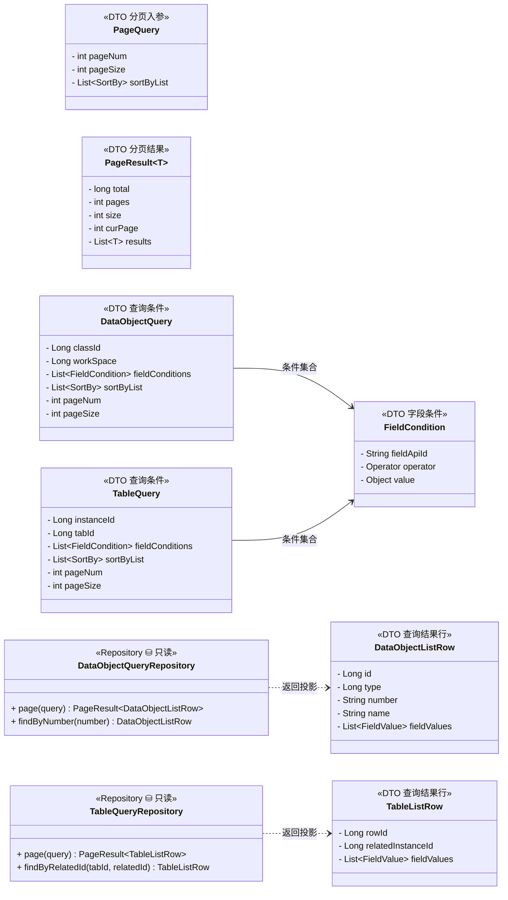
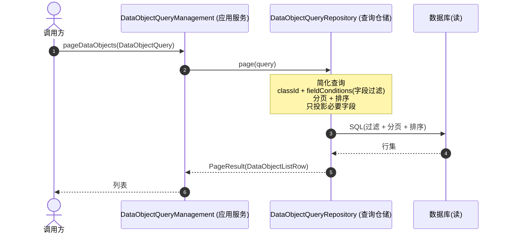
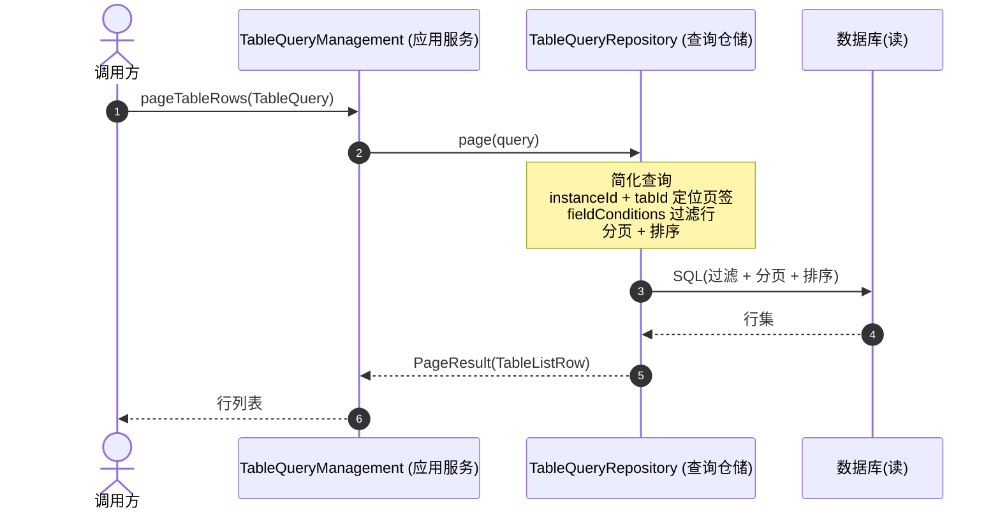
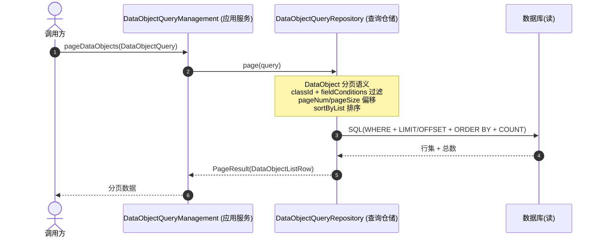
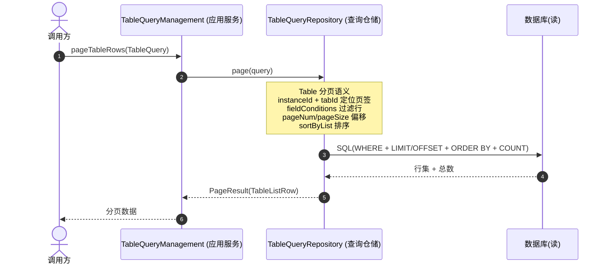

# 通用查询模型（批量查询 DataObject / Table）

> 针对页签领域（[tabs.md](./tabs.md)）的批量查询场景设计。对齐现网 `DynamicQueryProcessor`（DataObject 查询）+ `IInnerTable.pageTableRows(TabQueryContext)`（Table 查询），但**简化**——去掉框架的 `IInnerAttribute`/`AdminCache` 耦合，只保留查询语义。
>
> 查询模型是**读模型**（非规范化投影），不加载聚合——对齐 IDDD CQRS（ch12.3 用例最优查询），详见 [part.md](./part.md) 场景5 与 [DDD设计元素决策summary](./DDD设计元素决策summary.md)。

## 一、类图

## 二、场景1：批量查询 DataObject（如批量查物料）

**时序**（应用服务 `DataObjectQueryManagement` 编排，无写事务）：

**要点**：`DataObjectQuery` 承载 `classId`/`fieldConditions`（按 apiId 过滤，等价现网 `apiIdWheres`）/分页排序；`DataObjectListRow` 是非规范化投影（id/type/number/name + fieldValues）——**不加载聚合**。

## 三、场景2：批量查询 Table（如批量查 BOM 行/替代料行）

**时序**（应用服务 `TableQueryManagement` 编排，无写事务）：

**要点**：`TableQuery` 承载 `instanceId`+`tabId`（定位页签，等价现网 `TabQueryContext.tabId`）+ `fieldConditions`/分页排序；`TableListRow` 投影 `rowId`/`relatedInstanceId` + fieldValues——批量查 BOM 行（`tabId=TABLE_BOM`）或替代料行（`tabId=TABLE_ALTERNATE`）共用此模型。

## 四、场景3：DataObject 分页

**时序**（应用服务 `DataObjectQueryManagement` 编排，无写事务）：

**要点**：DataObject 分页按 `classId` + `fieldConditions` 过滤，`PageResult<DataObjectListRow>` 返回——对应现网 `DynamicQueryProcessor.queryDataObjectList` 的分页形态。

## 五、场景4：Table 分页

**时序**（应用服务 `TableQueryManagement` 编排，无写事务）：

**要点**：Table 分页按 `instanceId`+`tabId` 定位页签 + `fieldConditions` 过滤，`PageResult<TableListRow>` 返回——对应现网 `IInnerTable.pageTableRows(TabQueryContext)` 的分页形态。BOM 行（`tabId=TABLE_BOM`）与替代料行（`tabId=TABLE_ALTERNATE`）共用此分页模型。

## 六、简化 vs 现网

| 概念 | 现网 | 简化模型 |
|---|---|---|
| 分页入参 | `BasePageQuery`（pageNum/pageSize/sortByList/scopeSubClassId） | `PageQuery`（去 scopeSubClassId） |
| 分页结果 | `PagingData<T>` | `PageResult<T>` |
| 查询条件 | `BaseQueryContext.apiIdWheres`（`Triple<AllOperatorEnum, String, Object>`） | `FieldCondition`（fieldApiId/operator/value） |
| 排序 | `attributeOrderBys`/`apiIdOrderBys` | `SortBy`（复用现网） |
| DataObject 查询 | `DynamicQueryProcessor.queryDataObjectList(BaseQueryParamsDto)` | `DataObjectQueryRepository.page(DataObjectQuery)` |
| Table 查询 | `IInnerTable.pageTableRows(TabQueryContext)` | `TableQueryRepository.page(TableQuery)` |

## 七、设计要点

- **查询模型不加载聚合**：`DataObjectListRow`/`TableListRow` 是非规范化投影，`fieldValues` 只含查询需要的字段——对齐 IDDD CQRS（ch12.3 用例最优查询）
- **查询仓储与聚合仓储分离**：`DataObjectQueryRepository`/`TableQueryRepository` 是只读查询接口（实现基础设施层），不经过 `PartRepository`/`BomTabRepository`（聚合仓储管写）
- **通用分页契约**：`PageQuery`/`PageResult` 跨 DataObject/Table 复用，分页语义（偏移/排序/COUNT）统一
- **条件表达简化**：`FieldCondition(fieldApiId, operator, value)` 替代框架的 `Triple` + `IInnerAttribute`——查询侧用 apiId（业务标识），不耦合框架属性对象
- **分层**：查询 DTO（`PageQuery`/`PageResult`/`*ListRow`/`FieldCondition`）在应用层（无行为），查询仓储接口在领域层契约，实现在基础设施层（SQL/MyBatis）——查询模型不属于领域层

## 八、[DDD设计元素决策summary](./DDD设计元素决策summary.md)

> 每次 DDD 决策讨论的经验沉淀，见 [DDD设计元素决策summary](./DDD设计元素决策summary.md)。
