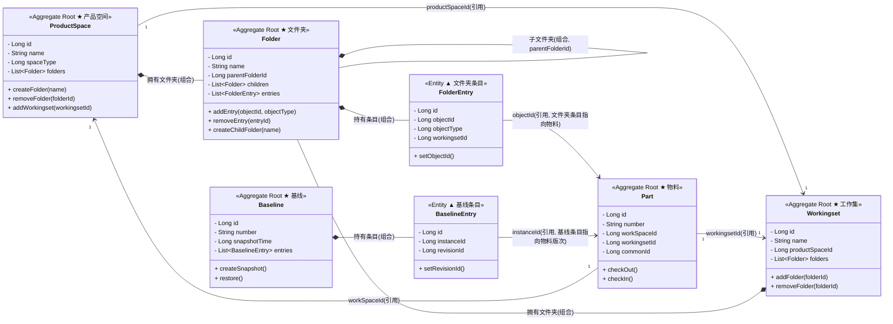

# 空间组织类图（产品空间 / 工作集 / 文件夹 / 基线 / Part）

> 展示产品空间、工作集、文件夹、基线、物料五个对象的聚合关系。依据 DDD 跨聚合规则：**聚合间用 ID 引用（`-->`），聚合内用组合（`*--`）**（`[IDDD-ch10]`）。

## 类图

## 设计说明

### 聚合划分依据

| 对象 | 建模 | 理由 |
|---|---|---|
| **ProductSpace** | 聚合根 | 产品空间是顶层容器，独立生命周期（创建/归档/删除） |
| **Workingset** | 聚合根 | 工作集独立于产品空间（可被产品空间引用），多产品空间/公共空间共用 |
| **Folder** | 聚合根 | 文件夹有层级结构（父/子），独立创建/移动/删除 |
| **Baseline** | 聚合根 | 基线是快照（`snapshotTime`），独立生命周期，条目指向物料版次 |
| **Part** | 聚合根 | 物料独立生命周期（签出/签入），被多个空间/工作集/文件夹/基线引用 |

### 跨聚合引用（ID 引用，非组合）

| 关系 | 方向 | 依据（现网） |
|---|---|---|
| `ProductSpace --> Workingset` | 产品空间持 `productSpaceId` | 工作集属于产品空间（`ProductSpace` 引用 `Workingset`） |
| `Part --> ProductSpace` | Part 持 `workSpaceId` | `DataObjectData.workSpace`（通用属性） |
| `Part --> Workingset` | Part 持 `workingsetId` | `DataObjectData.workingsetId` |
| `Part.commonId` | 跨工作集公共身份 | `DataObjectData.commonId`（同一物料多工作集副本共享） |
| `FolderEntry --> Part` | 文件夹条目 `objectId` 指向物料 | `FolderingPO`（tabId + workingsetId + objectId） |
| `BaselineEntry --> Part` | 基线条目 `instanceId` 指向物料版次 | `BaselineDataObject` + `SnapshotDto` |

### 组合关系（聚合内）

- `ProductSpace *-- Folder`：产品空间拥有文件夹（组合，删除级联）——但需确认业务是否允许文件夹独立存在；若文件夹可独立移动跨空间，则改为引用（见下）
- `Workingset *-- Folder`：工作集拥有文件夹
- `Folder *-- Folder`：文件夹自引用子文件夹（`parentFolderId`，层级树）
- `Folder *-- FolderEntry`：文件夹持有条目
- `Baseline *-- BaselineEntry`：基线持有条目

### 关键设计决策（评审点）

1. **Folder 归属争议**：现网 `FileFolderDataObject`/`FolderDataObject` 是独立 DataObject（`@RegisterDataObject`），文件夹可能被产品空间和工作集**共享**（FolderingPO 带 `workingsetId` 区分作用域）——若同一文件夹可被多空间/多工作集挂载，则 `ProductSpace *-- Folder` 应改为引用（`-->`），文件夹归属由 `FolderingPO` 关联表表达而非组合
2. **ProductSpace → Workingset 方向**：若工作集可跨产品空间（如公共工作集），则产品空间持 `productSpaceId` 引用成立；若工作集严格属于单一空间，可视为聚合内（`ProductSpace *-- Workingset`）——现网 `TrackerQueryManagement` 显示工作集按 `productSpaceType` 分类，倾向引用
3. **Part 反向"空间有多个物料"**：不在领域模型画 `ProductSpace *-- Part`——这是查询视角，走查询模型（`SpaceQueryRepository.findPartsBySpace(spaceId)`），对齐 IDDD CQRS

### 现网代码溯源

| 概念 | 现网类 | 关键字段 |
|---|---|---|
| ProductSpace | `AirConstants.ProductSpace`（PRODUCT_SPACE_SUB_CLASS_ID/PUBLIC_SPACE_SUB_CLASS_ID/REVIEW_SPACE_SUB_CLASS_ID） | spaceType 区分产品/公共/评审空间 |
| Workingset | `IWorkingset`/`IWorkingsetInner`（`DEFAULT_WORKINGSET_ID`） | productDefaultTrackerId(workSpace, subClassId) |
| Folder | `FolderDataObject`/`FileFolderDataObject`（`@RegisterDataObject`） | `FolderingPO`(tabId, workingsetId, objectId) 挂载条目 |
| Baseline | `BaselineDataObject`（`@RegisterDataObject`） | `SnapshotDto`(snapshotTime) 快照 |
| Part | `PartDataObject` | `DataObjectData.workSpace/workingsetId/commonId` |
