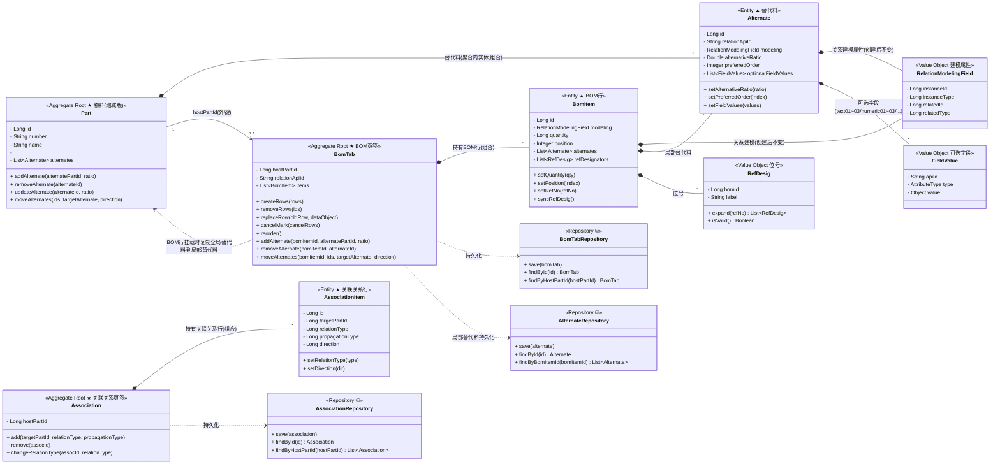
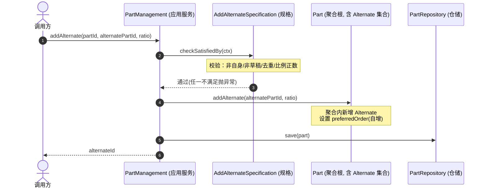
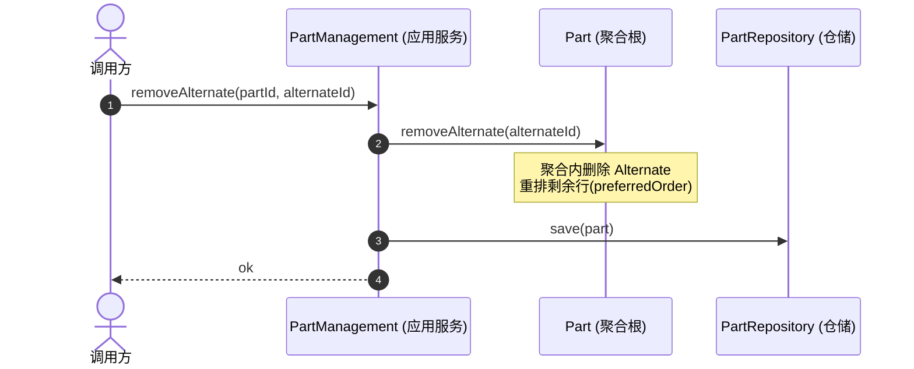
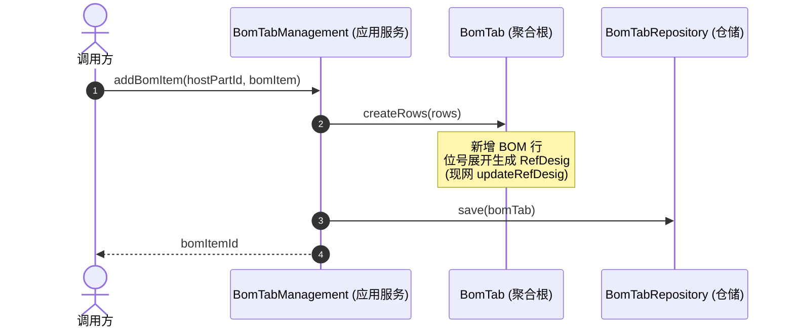
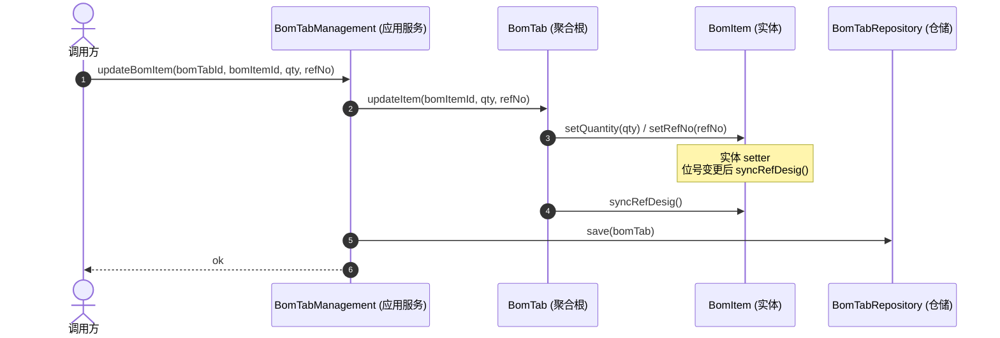
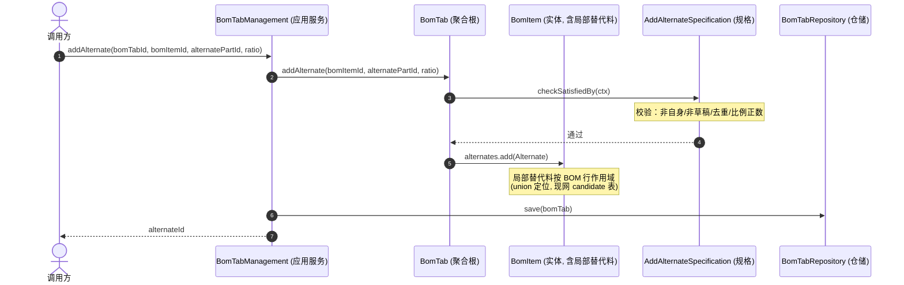
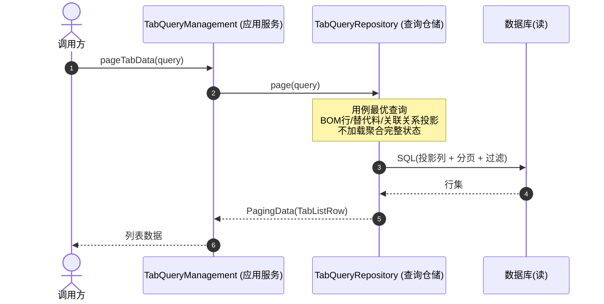

# 页签领域模型（BOM / 替代料 / 关联关系）

> 以**页签**为视角的聚合设计：**BOM** 与**关联关系**页签独立聚合根（数据量大/通用复用），**替代料**页签为 **Part 聚合内实体**（物料特有、数据量可控）；Part 只保留聚合内实体操作与删除保护（缩减版）。
>
> **页签建模依据**（见 [DDD设计元素决策summary](./DDD设计元素决策summary.md)「页签何时独立为聚合根」）：
> - 数据量足够大、操作足够复杂 → 独立聚合根（BomTab/Association）
> - 物料特有、数据量可控、与主对象同事务 → 聚合内实体（Alternate，对齐 CheckoutRecord）
> - IDDD ch10.3：大型集合作为聚合内实体导致"加载主对象 = 全量页签行"的性能噩梦

## 一、整体类图



## 二、页签建模依据

### 独立聚合根 vs 聚合内实体

| 页签 | 建模 | 理由 | 现网证据 |
|---|---|---|---|
| **BomTab** | 独立聚合根 | BOM 行数据量巨大（单物料数千行）；操作复杂（增删/替换/撤销/重排/红蓝线）——放 Part 会混淆 | `TabBom` 591 行实现 |
| **Alternate** | **Part 聚合内实体** | **物料特有页签、数据量可控**；与 Part 同事务变更（挂载校验/排序随物料操作）；对齐 `CheckoutRecord` 模式 | `PartAlternateTab` + `PartLocalAlternateTable` |
| **Association** | 独立聚合根 | 通用关联功能（多分类复用）；方向/传播/关系类型属性独立 | `AssociationManagement` + `TABLE_ASSOCIATIONS=420371` |
**替代料为何是实体而非聚合根**（与 BOM 的区别）：
- 数据量可控——不会出现"单物料数千替代料行"的加载噩梦
- 物料特有——不跨分类复用（区别于通用页签）
- 与 Part 同事务（挂载替代料 = 修改物料，现网 `PartAlternateTab` 挂在 Part 实例上）
- 符合 IDDD ch10.3「设计小型 Aggregates」：数据量小、与主对象一致性强 → 聚合内实体

### Part 方法取舍（关键决策）

| 方法 | 保留/删除 | 理由 |
|---|---|---|
| `addAlternate` / `removeAlternate` | ✅ 保留 | **聚合内实体操作**——`Alternate` 是 Part 内实体，挂替代料是物料自身的业务行为，不是转发 |
| `updateAlternate(alternateId, ratio)` | ✅ 保留 | **聚合根编排入口**——定位实体 → setter 修改（`setAlternativeRatio`），规则已外置到规格 |
| `moveAlternates(ids, targetAlternate, direction)` | ✅ 保留 | **聚合根编排重排**——涉及整个 `alternates` 集合顺序（上移/下移，`direction` 指示方向），属聚合内行为；对齐现网 `TableMoveDto(rowIds, direction, targetRowId)` |
| `addBomItem` / `addAssociation` | ❌ 删除 | **跨聚合转发**——BomTab/Association 是独立聚合，Part 上纯转发是贫血反模式（项目规范 §2） |
| `canDelete(ctx)` | ✅ 保留 | Part 聚合根的删除保护规则（跨页签引用校验，规格模式） |

**原则**：Part 门面方法**只有当操作属于 Part 聚合内**（替代料/签出记录）才保留；跨聚合操作（BOM/关联关系）由应用服务直接调对应页签聚合。

### 聚合内实体划分（每页签一个实体，控制规模）

- `BomItem`（BOM 行）：有身份（行 ID）、数量/顺序/版次区间
- `Alternate`（替代料行）：有身份（行 ID）、替代比例/优先顺序/版次区间
- `AssociationItem`（关联关系行）：有身份（行 ID）、关系类型/传播类型/方向

符合 IDDD ch10.3：「70% 聚合仅 1 根实体 + 值对象，其余 ≤2-3 实体」——每聚合 1 个实体 + 值对象。

### Alternate 属性设计（三分类，对齐物料模型）

| 分类 | 属性 | 建模 | 代码来源（`air_inst_part_tab_alternate`） |
|---|---|---|---|
| **建模属性**（创建后不变） | `instanceId`（宿主）、`instanceType`（宿主分类）、`relatedId`（关联物料）、`relatedType`（关联分类） | `RelationModelingField` 值对象（四字段成组定义关系两端） | `instance_id` / `instance_type` / `related_instance_id` / `related_type` |
| **必备属性**（有行为约束） | `alternativeRatio`（替代比例）、`preferredOrder`（优先顺序） | 裸 `Double` + 裸 `Integer` | `alternative_ratio` / `preferred_order` |
| **可选属性**（元数据驱动） | text01~03 / largetext01~03 / numeric01~03 / list01~05 / date01~03 / startdate01~03 | `FieldValue` 集合（复用物料机制） | 对应表列 |

**设计要点**：
- **建模属性值对象化**：`instanceId`/`instanceType`/`relatedId`/`relatedType` **四字段成组**共同定义"关系两端"（宿主 + 关联对象）——成组判据成立，建模为 `RelationModelingField` 值对象（创建后不变）；对齐物料 `ModelingField`（归属建模）的命名语义，但字段不同（关系建模 vs 归属建模）
- **替代比例裸 Double**：`alternativeRatio` 单字段无成组——不建 `Ratio` 值对象；"必须为正数"的约束移入 `AddAlternateSpecification`（挂载规格校验）
- **优先顺序裸 Integer**：`preferredOrder` 单字段无成组、无复杂行为——不建 `OrderIndex` 值对象；自增在挂载（`Part.addAlternate`）、重排在 `Part.moveAlternates(ids, targetAlternate, direction)`（聚合根），现网 `max(preferred_order)+1` 收拢为普通方法而非值对象
- **可选属性复用 `FieldValue`**：与物料同一套元数据机制（出现即有效、系统关闭不实例化）

**行为**（精简：实体无意图方法，规则外置）：
- **必备属性 setter**：`setAlternativeRatio(ratio)`（`alternative_ratio`）、`setPreferredOrder(index)`（`preferred_order`）——纯赋值，无独立规则
- **可选属性 setter**：`setFieldValues(values)`（`FieldValue` 集合）
- **Part 聚合根：`moveAlternates(ids, targetAlternate, direction)`**——替代料上移/下移：`ids` 为选中的替代料行，`targetAlternate` 为目标位置行，`direction` 指示上移/下移方向；聚合根编排重排（涉及整个 `alternates` 集合的顺序），对齐现网 `GenericTabManagement.move` → `TableMoveDto(rowIds, direction, targetRowId)` → `table.move(...)`
- **规则外置**：
  - 挂载校验（非自身/非草稿/去重/比例正数）→ `AddAlternateSpecification`
  - 重排逻辑 → `Part.moveAlternates`（聚合根，涉及整个集合）
  - 草稿判定（跨聚合）→ 规格，不在实体
  - 编号展示（读投影）→ 查询模型 `PartListRow`，不在实体

> **设计依据**：实体方法只在承载业务规则时存在；纯赋值用 setter（贫血转发反模式，项目规范 §2 同款逻辑）。`Alternate` 的规则全部外置到规格/聚合根后，实体只保留属性 + setter。

### BomItem 属性设计（对齐物料三分类）

| 分类 | 属性 | 建模 | 代码来源 |
|---|---|---|---|
| **建模属性**（创建后不变） | `instanceId`（宿主）、`instanceType`、`relatedId`（BOM 子物料）、`relatedType` | `RelationModelingField` 值对象（复用） | `air_inst_tab_bom` 关联列 |
| **必备属性** | `quantity`（数量）、`position`（行顺序）、`refNo`（位号原文） | 裸 `Long`/`Integer`/`String` | `ATTR_QTY` / 行序 / `ATTR_REF_NO` |
| **局部替代料** | `List<Alternate>`（该 BOM 行的局部替代料） | 聚合内实体集合 | 现网 `air_inst_part_tab_candidate`（union 定位到 BOM 行） |
| **位号** | `List<RefDesig>`（展开后的位号明细） | `RefDesig` 值对象 | `air_inst_ref_desig`（bomId + label） |

**位号（RefDesig）行为**（现网 `RefDesigHelper` + `AddRefNoValidator`/`UpdateRefNoValidator`）：
- `expand(refNo)`：位号原文展开（如 `R1-R10` → `R1,R2,...`）——现网 `RefDesigHelper.expand`
- `isValid()`：位号格式/合法性校验
- **位号与数量一致性校验**：`checkRefNoEqualsQty`（`REF_NO_BOTH_ERROR`——位号数与数量必须一致）
- **位号去重校验**：`checkDupRefNoFromMap`（新增/更新时与库内行比对）
- **同步**：`syncRefDesig()`——BOM 行位号变更后重新解析生成 `RefDesig` 明细（现网 `TabBom.updateRefDesig`：删旧 → 展开 → 批量插入）

**设计要点**：
- `BomItem` 携带**局部替代料**（`List<Alternate>`）——与 Part 的全局替代料区分：局部替代料按 BOM 行作用域（union 定位），现网 `PartLocalAlternateTable` 的 `union_table_instance_id` 指向 BOM 行
- **局部替代料操作在 BomTab 聚合根**：`addAlternate(bomItemId, alternatePartId, ratio)` / `removeAlternate(bomItemId, alternateId)` / `moveAlternates(bomItemId, ids, targetAlternate, direction)`——作用于指定 BomItem 的 `List<Alternate>`，聚合根编排（跨 BomItem 集合操作归根）
- **仓储层**：`BomTabRepository`（BOM 页签聚合）、`AlternateRepository`（局部替代料，`findByBomItemId` 按行定位）、`AssociationRepository`（关联关系聚合）——写操作唯一入口在应用服务
- `RefDesig` 是值对象（无身份，依附 BomItem 的位号明细行）——展开/校验行为收拢，避免散落 SQL
- 位号与数量一致性是**跨行校验**（涉及同批 BOM 行），应走规格（`AddRefNoValidator`/`UpdateRefNoValidator` 对应）而非实体方法——`BomItem` 只保留 `expand`/`syncRefDesig` 这类自身状态操作

## 三、核心场景验证

### 场景1：添加替代料（全局，Part 聚合内）

**时序**（应用服务 `PartManagement` 事务编排）：



**要点**：校验走规格（跨聚合：草稿判定、去重查询）；新增行在聚合内（`Part.addAlternate`）；随 Part 同事务持久化。

### 场景2：删除替代料（全局）

**时序**（应用服务 `PartManagement` 事务编排）：



**要点**：删除 + 重排在聚合根（`Part.removeAlternate` 涉及集合操作）；随 Part 同事务。

### 场景3：修改替代料（全局）

**时序**（应用服务 `PartManagement` 事务编排）：

```mermaid
sequenceDiagram
    autonumber
    actor Client as 调用方
    participant Mgmt as PartManagement (应用服务)
    participant Part as Part (聚合根)
    participant Alt as Alternate (实体)
    participant Repo as PartRepository (仓储)

    Client->>Mgmt: updateAlternate(partId, alternateId, ratio)
    Mgmt->>Part: updateAlternate(alternateId, ratio)
    Part->>Alt: setAlternativeRatio(ratio)
    Note over Alt: 实体 setter(纯赋值)<br/>规则(正数)已在挂载时校验
    Mgmt->>Repo: save(part)
    Mgmt-->>Client: ok
```

**要点**：修改是实体 setter（无独立规则）；聚合根方法编排 + 同事务 save。

### 场景4：添加 BOM（BomTab 聚合根）

**时序**（应用服务 `BomTabManagement` 事务编排）：



**要点**：`BomTab` 独立聚合根；新增行 + 位号同步在聚合内（`createRows`/`syncRefDesig`）；独立仓储持久化。

### 场景5：修改 BOM（BomTab 聚合根）

**时序**（应用服务 `BomTabManagement` 事务编排）：



**要点**：修改经 BomTab 聚合根编排 → BomItem setter + 位号重同步；独立仓储持久化。

### 场景6：BOM 添加替代料（局部替代料）

**时序**（应用服务 `BomTabManagement` 事务编排）：



**要点**：局部替代料挂在 `BomItem.alternates`（按 BOM 行作用域）；`BomTab.addAlternate(bomItemId, ...)` 聚合根编排；校验复用 `AddAlternateSpecification`。

### 场景7：查询相关数据（查询模型）

**时序**（应用服务 `TabQueryManagement` 编排，无写事务）：



**要点**：查询走独立查询模型（`TabListRow`/`TabQueryRepository`），不加载 `BomTab`/`Part` 聚合——读模型非规范化投影，对齐 IDDD CQRS（见 [part.md](./part.md) 场景5）。

## 四、[DDD设计元素决策summary](./DDD设计元素决策summary.md)

> 每次 DDD 决策讨论的经验沉淀，见 [DDD设计元素决策summary](./DDD设计元素决策summary.md)。
