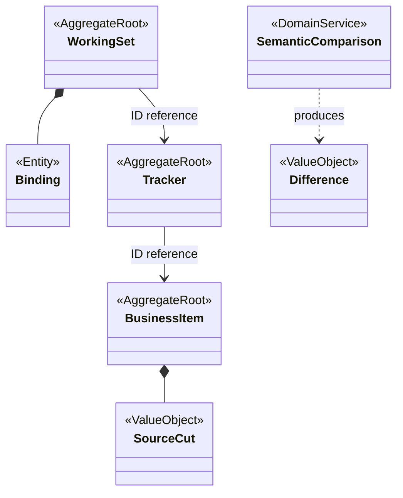
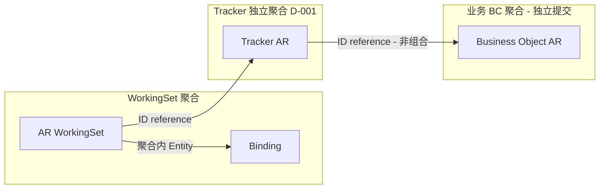
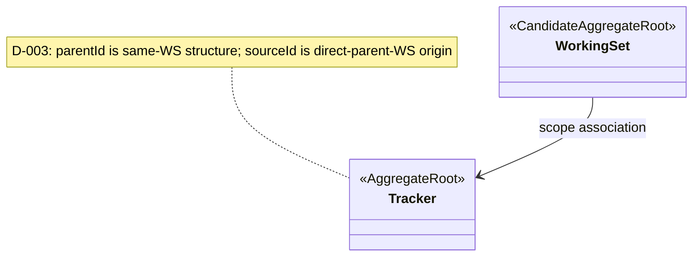
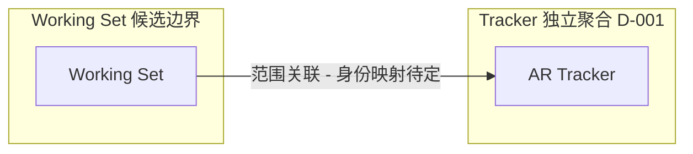

# 三套候选聚合模型（Historical）

**状态：Historical（方案比较已由 D-010 收敛，不再作为当前设计图）**

目的：保留 AP-001/002/003 的范围和谱系一致性比较，供重新评估时追溯。现行聚合见[聚合边界](../04-model.md)
，契约图见 [TrackerItem 契约与聚合](trackeritem-contract.md)
。依据 [方案比较](../archive/proposals/aggregate-boundary-options.md)、[场景](../09-scenarios.md)、[评审](../archive/reviews/2026-11-09-stage-3-architecture-review.md)
。不表达表、Java 类型或部署。

图中 AP-002 的独立 Branch 根与 D-001 不兼容，AP-003 的 Manifest/ItemVariant 已由 D-010 排除；仅保留历史论证，不得据此新增当前模型元素。

D-001（2026-11-10）已确认所有图中的 Tracker 是独立聚合，其余根与 Item 归属均为方案假设。AP-001/003 的 Item 独立根与 ID
引用只表达待评审选项，不是 D-001 的结论；D-002 已确认非共享派生为不同身份，D-003 已区分同工作集结构父与直接父工作集来源；D-004/D-005
已确认组织裁剪与创建前重组，D-006 已确认创建后 parentId 不可变，sourceId 可变性仍待裁定。

图例：AggregateRoot 除 Tracker 外为候选根；Entity 为聚合内实体；ValueObject 为值；DomainService 为纯业务计算。实心菱形仅表达聚合内组合，箭头标
ID reference 为跨聚合身份引用；flowchart 的 subgraph 是事务边界，框间边不是外键。业务内容始终属于各 BC。

## AP-001：Working Set 配置主导

## AP-002：去除失效 Branch 根后的最小修订草图

D-001 已排除原独立 Branch 根。此图不将原 BranchSource、BranchId 或 SourceCut 自动归入 Tracker；非共享派生新身份由 D-002
确认；D-003 双维指向已确认；Item 归属当时待定，现由 D-007 关闭。修订后是否仍构成与 AP-001 不同的方案已由 D-010 收敛为最小模型。

Item 归属与来源证据的责任划分在该图绘制时待确认（D-007 已关闭），故本图不再保留悬浮节点。

## AP-003：Manifest 发布指针（当前不采用，D-010）

**Historical，当前不采用。** D-010 排除 Manifest 与
ItemVariant。旧图已退出本页，保留 [AP-003 的权衡](../archive/proposals/aggregate-boundary-options.md)
和 [D-010 裁定](../archive/reviews/2026-11-09-stage-3-architecture-review.md#d-010)。旧 Merge Session
图已由 [T1 MergeEntry 生命周期](merge-entry-lifecycle.md)
取代。引用责任的开放问题见 [QUESTION-010](../08-plan.md)。

## D-002：非共享派生身份与追溯边界（Superseded 图）

**Superseded。** 字段未定的旧图已移除。D-002
的独立身份事实保留在[原裁定](../archive/reviews/2026-11-09-stage-3-architecture-review.md#d-002)
，现行关系见 [D-003 双维关系图](tracker-dual-relations.md)，未决项见 [QUESTION-002](../08-plan.md)。

D-004 补充：各候选的组织完整性/Manifest 封闭性均不得要求补派生未选的父
Tracker。合法裁剪终态与独立根见 [组织裁剪图](tracker-dual-relations.md#d-004-clipping)。此图不批准整批创建原子性或更改
Item 归属。
