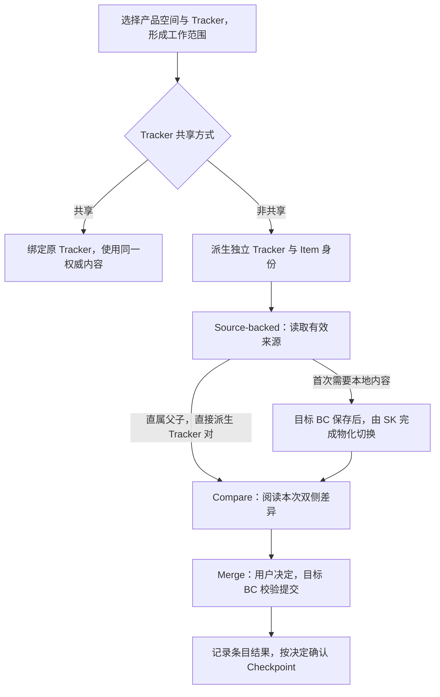

# Working Set 领域主线

**状态：Draft / Candidate（首版基线候选配套图；未发布为正式基线）**

目的：表达 Working Set 领域从创建到合并的业务主线。范围：主干流程，不表达数据库、部署或具体
API。依据：[首版基线候选](../archive/domain/model-baseline-candidate-v1.md)
、D-001～D-019。领域关系见 [契约与聚合图](trackeritem-contract.md)，生命周期/COW
时序见 [LightTrackerItem 生命周期](lighttrackeritem-lifecycle.md)。

绑定与扩展见 [T2](../05-contracts/t2-binding-deletion.md)
，物化见 [T3](../05-contracts/t3-lti-materialization.md)
，比较与合并见 [T1](../05-contracts/t1-merge-execution.md)。图表达工作路径及协作顺序。
