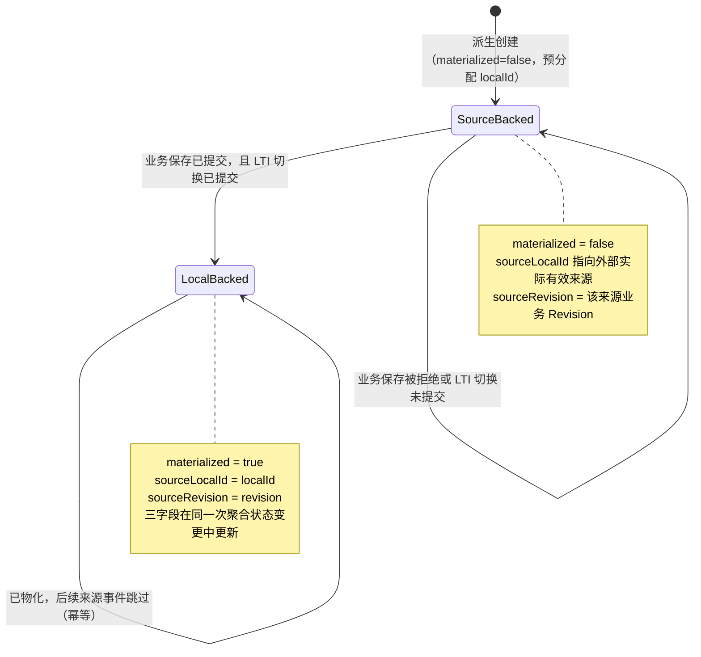
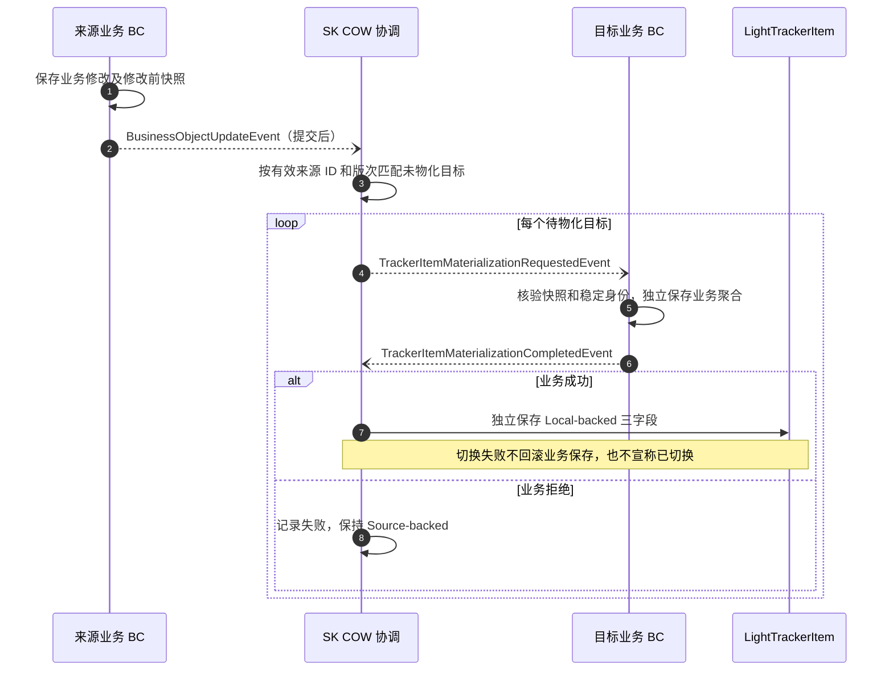

# LightTrackerItem 物化状态与首次物化时序

**状态：Draft / Candidate（T3 契约配套图；K1′～K3′ 已由用户 2026-11-11 确认；图本身未纳入正式基线）**

- 目的：表达 LightTrackerItem 的 `materialized` 状态字段、Source-backed / Local-backed 双态判定，以及首次物化（COW）在来源
  BC、事件、Handler、目标 BC 与 LightTrackerItem 之间的协作与失败处理。
- 适用范围：阶段 5 T3 物化协议契约（已冻结）；非共享派生变体的 COW 路径（含未物化目标被 Merge 修改的「物化与修改一体」情形）。
- 依据：[LightTrackerItem 物化协议契约 v1](../05-contracts/t3-lti-materialization.md)
  、D-008～D-019、INV-024～052/069～071、[ADR-0002](../06-decisions/adr-0002-lighttrackeritem-authoritative-aggregate.md)、[ADR-0003](../06-decisions/adr-0003-cow-event-driven-final-consistency.md)
  、SCN-019～049、SCN-066～068。
- 旧顺序与恢复验证见 [S4 历史证据](../archive/implementation/t5-s4-verification-result.md)
  ；当前交付缺口见 [实现边界](../07-implementation.md)。

**内容范围补充（2026-11-11 用户选择 A）**：图中来源快照用于普通字段；目标 BC 构建时须合入目标派生时固定的附件、关系，不能直接用来源快照覆盖它们。完整定义见
T3 §2.1、SCN-072。

## 图例

- `LightTrackerItem` 与业务 BC 聚合是**双事实**，按 ID 引用，不组合；**禁止跨聚合同一写事务**。
- `materialized` 是物化状态的**权威字段**；`sourceLocalId`/`sourceRevision` 是一致性约束。
- 「Materializing」是技术运行态，**不纳入领域枚举**。
- 虚线返回表示结果或回执，带开口箭头的虚线表示异步投递。

## 1. 双态与状态判定

状态判定与三字段一致性见 [T3 双态契约](../05-contracts/t3-lti-materialization.md#4-双态契约与状态判定)。

## 2. 首次物化时序（双事实）

图不承诺收据与请求当前已经原子提交，也不表示技术故障统一可重试。业务恢复入口已移除。

补充：未物化目标被 Merge 修改时，「构建业务聚合并 Save」由 Merge 执行（T1），保存成功后按**同一状态切换行为**
更新三字段（物化与修改一体，D-019），不新增第三条物化路径。

**2026-11-19 首次继承编辑补充**：用户直接编辑未物化目标时，ALM 在自身事务保存 Requirement，并发布
`BusinessObjectUpdateEvent`；SK 的 `TrackerItemLocalizedListener` 在独立事务把 LTI 切换为 Local-backed。该路径不先经
`TrackerItemMaterializationRequestedEvent`，因为业务内容已由编辑命令保存；它仍遵守“业务保存成功、LTI 切换独立收敛”，失败不回滚业务保存。原同步
`TrackerItemLifecyclePort.completeInheritedEdit` 已移除。
