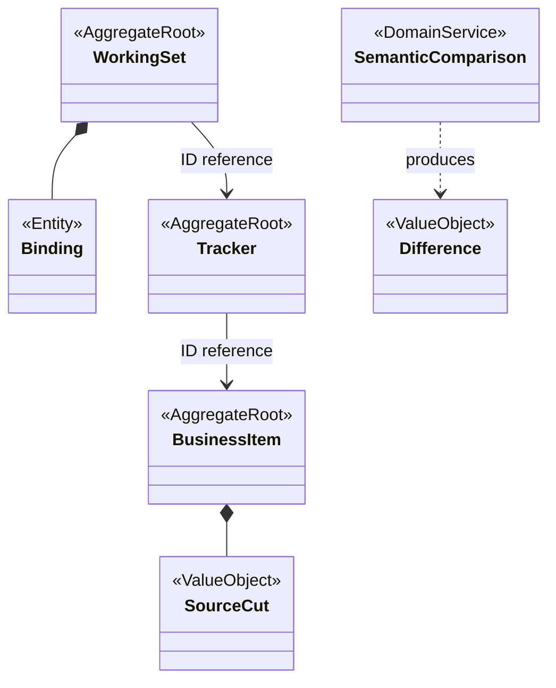
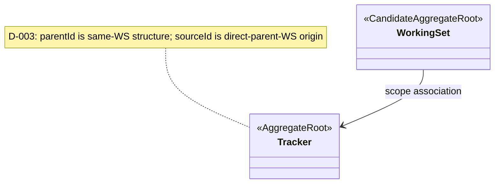
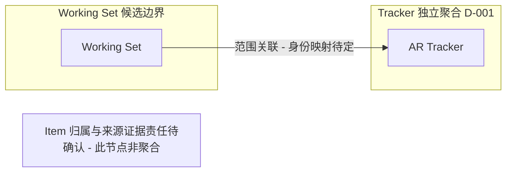
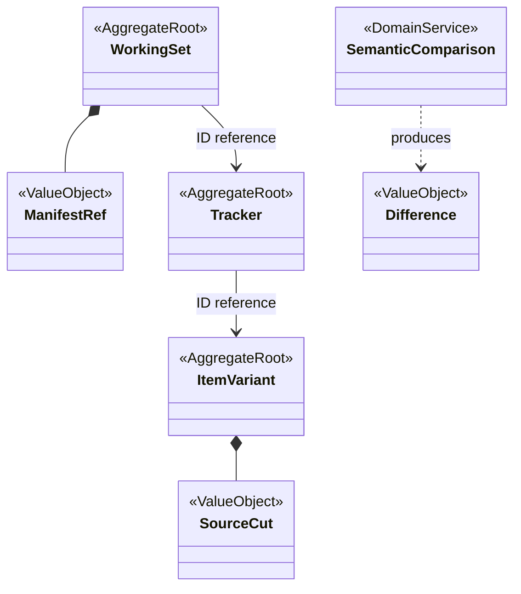
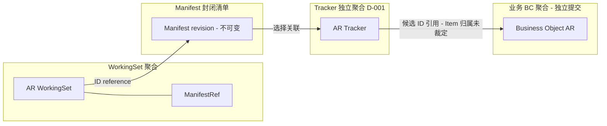
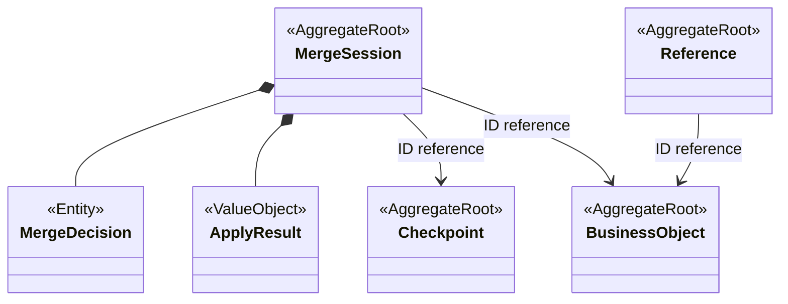
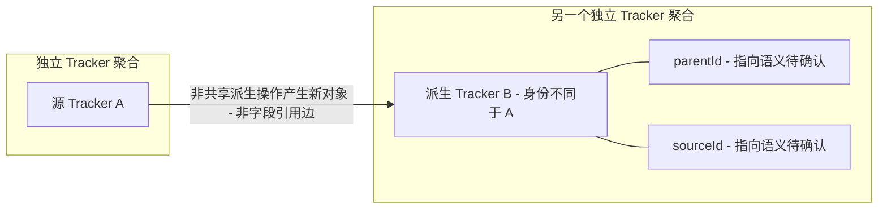

# 三套候选聚合模型

**状态：Draft / Candidate**

目的：比较 AP-001/002/003 的范围和谱系一致性边界；依据 [方案比较](../proposals/aggregate-boundary-options.md)、[逐概念审查](../domain/aggregate-model.md)、[场景](../scenarios/shared-kernel-boundary-scenarios.md)、[评审](../reviews/2026-11-09-stage-3-architecture-review.md)。假设稳定身份、保留历史与 BC 提交能力可兑现，均待确认。不表达表、Java 类型或部署。

D-001（2026-11-10）已确认所有图中的 Tracker 是独立聚合，其余根与 Item 归属均为方案假设。AP-001/003 的 Item 独立根与 ID 引用只表达待评审选项，不是 D-001 的结论；D-002 已确认非共享派生为不同身份，D-003 已区分同工作集结构父与直接父工作集来源；D-004/D-005 已确认组织裁剪与创建前重组，D-006 已确认创建后 parentId 不可变，sourceId 可变性仍待裁定。

图例：AggregateRoot 除 Tracker 外为候选根；Entity 为聚合内实体；ValueObject 为值；DomainService 为纯业务计算。实心菱形仅表达聚合内组合，箭头标 ID reference 为跨聚合身份引用；flowchart 的 subgraph 是事务边界，框间边不是外键。业务内容始终属于各 BC。

## AP-001：Working Set 配置主导

## AP-002：去除失效 Branch 根后的最小修订草图

D-001 已排除原独立 Branch 根。此图不将原 BranchSource、BranchId 或 SourceCut 自动归入 Tracker；非共享派生新身份由 D-002 确认；D-003 双维指向已确认，来源证据承载与 Item 归属仍待定。修订后是否仍构成与 AP-001 不同的方案待评审。

## AP-003：Manifest 发布指针

AP-001 的 Binding 为 Entity，Source Cut 在业务侧保存为读取依据的图示不规定内容存储实现；Variant 独立成根与否尚待身份权威裁定。AP-002 现仅展示 D-001 允许的最小关联，不承接原 Branch 的身份及来源模型。AP-003 ManifestRef 不组合可变 Binding；封闭 Manifest revision 的成员选择是冻结值；ItemVariant 与业务内容不同根及按 LocalId 协作仅为 AP-003 候选，不裁定 Item 是否属于 Tracker 聚合。

三者共同的 Merge Session、Decision、Apply Result、Checkpoint 与 Reference 见下图；Session 不拥有业务内容，巨大决定集合应冻结清单并拆执行项，是否提升独立根须规模证据。

## D-002：非共享派生身份与追溯边界（Superseded 图）

**图状态：Superseded；字段未定的历史图由 [D-003 双维关系图](tracker-dual-relations.md) 替代。D-002 身份事实继续有效。** 适用于非共享派生，不表达 Shared、不表达多级派生、不包含 Item。A/B 是示例身份，非根节点或初始来源的编码约定。派生箭头仅表示产生结果，绝不表示 parentId 或 sourceId 的具体指向。

图中不设 Lineage 聚合；这仅是当前候选表达，不代表“不设聚合”已经接受。Working Set 不拥有 Tracker 完整生命周期；未画删除级联或多级链。参见 [D-002 裁定与影响](../reviews/2026-11-09-stage-3-architecture-review.md#d-002)、[QUESTION-002 子问题](../domain/open-questions.md#question-002d-002-后保留的子问题)。

D-004 补充：各候选的组织完整性/Manifest 封闭性均不得要求补派生未选的父 Tracker。合法裁剪终态与独立根见 [组织裁剪图](tracker-dual-relations.md#d-004-clipping)。此图不批准整批创建原子性或更改 Item 归属。
