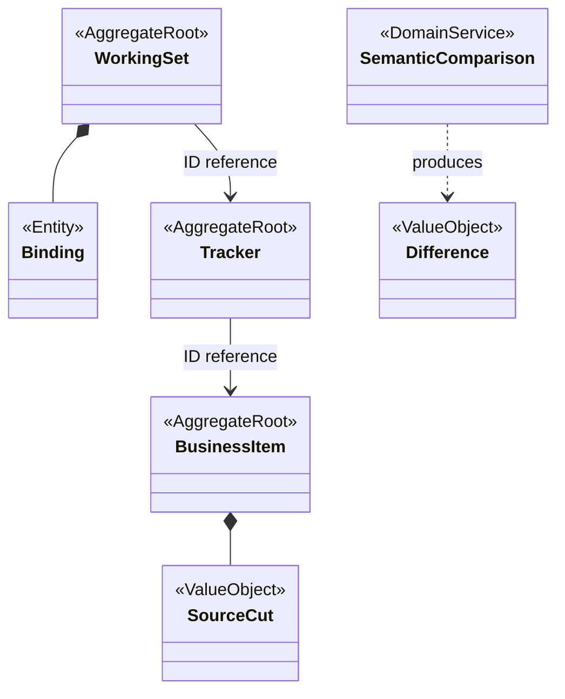
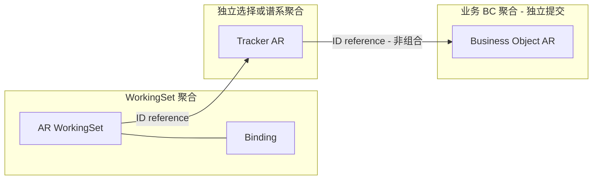
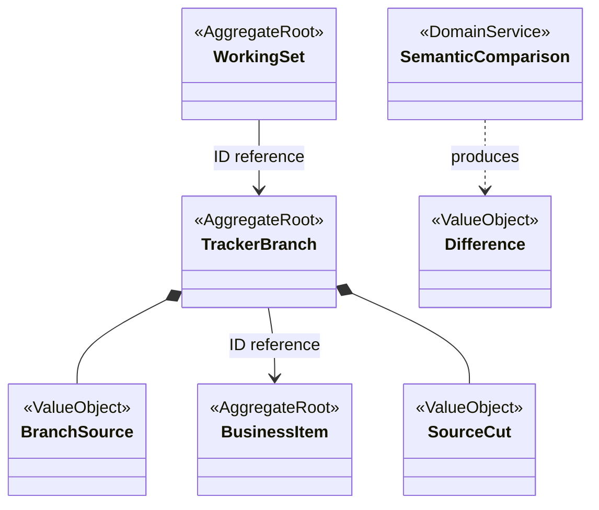
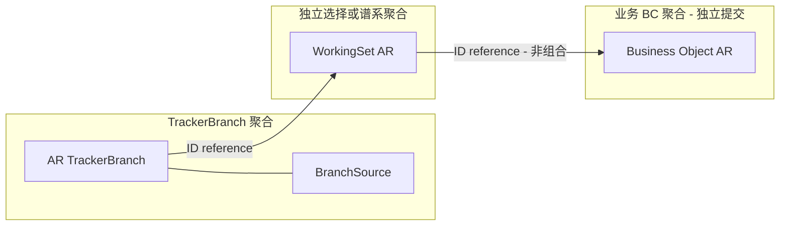
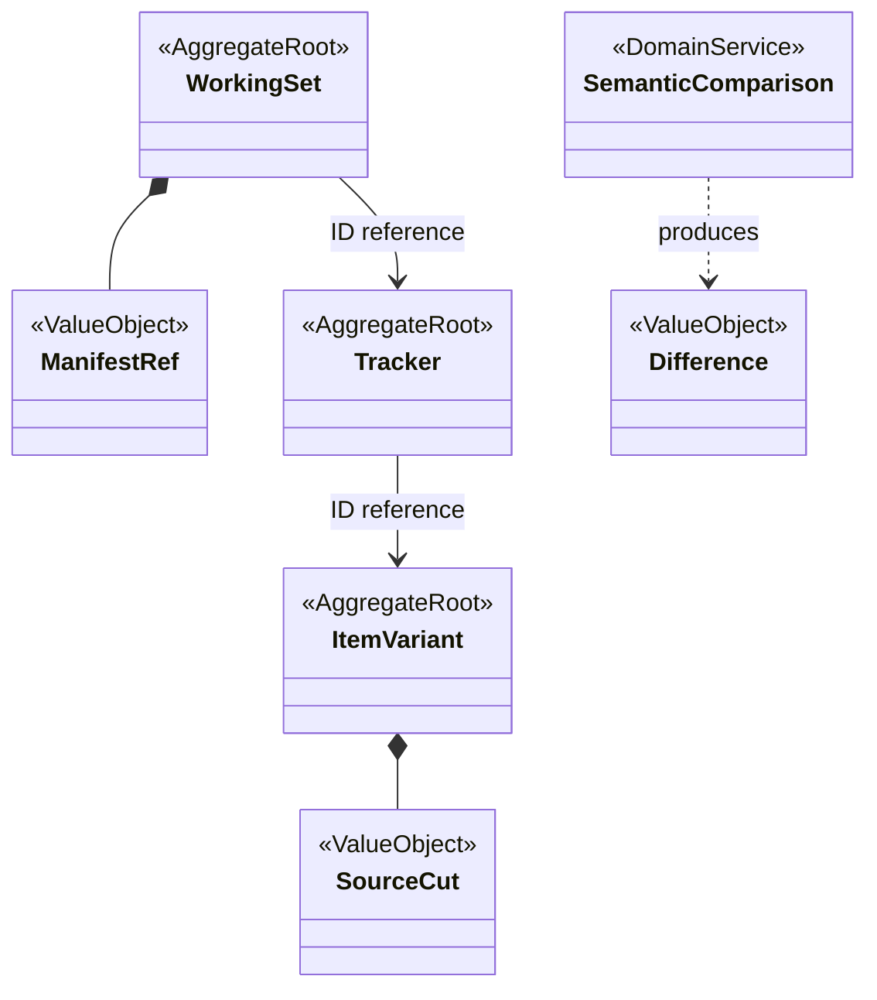
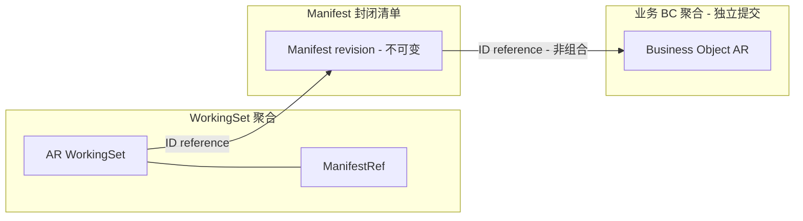
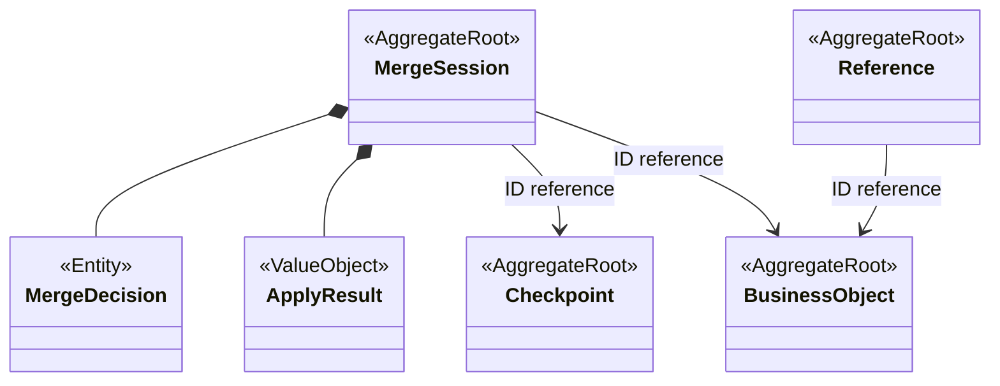

# 三套候选聚合模型

**状态：Draft / Candidate**

目的：比较 AP-001/002/003 的范围和谱系一致性边界；依据 [方案比较](../proposals/aggregate-boundary-options.md)、[逐概念审查](../domain/aggregate-model.md)、[场景](../scenarios/shared-kernel-boundary-scenarios.md)、[评审](../reviews/2026-11-09-stage-3-architecture-review.md)。假设稳定身份、保留历史与 BC 提交能力可兑现，均待确认。不表达表、Java 类型或部署。

图例：AggregateRoot 为候选根；Entity 为聚合内实体；ValueObject 为值；DomainService 为纯业务计算。实心菱形仅表达聚合内组合，箭头标 ID reference 为跨聚合身份引用；flowchart 的 subgraph 是事务边界，框间边不是外键。业务内容始终属于各 BC。

## AP-001：Working Set 配置主导

## AP-002：Tracker Branch 独立演进

## AP-003：Manifest 发布指针

AP-001 的 Binding 为 Entity，Source Cut 在业务侧保存为读取依据的图示不规定内容存储实现；Variant 独立成根与否尚待身份权威裁定。AP-002 WorkingSet 以 ID 选择 Branch，不表示 Branch 拥有 WorkingSet。AP-003 ManifestRef 不组合可变 Binding；封闭 Manifest revision 的成员选择是冻结值，ItemVariant 与业务内容是不同根，二者按 LocalId 协作，不属于共同事务。

三者共同的 Merge Session、Decision、Apply Result、Checkpoint 与 Reference 见下图；Session 不拥有业务内容，巨大决定集合应冻结清单并拆执行项，是否提升独立根须规模证据。

