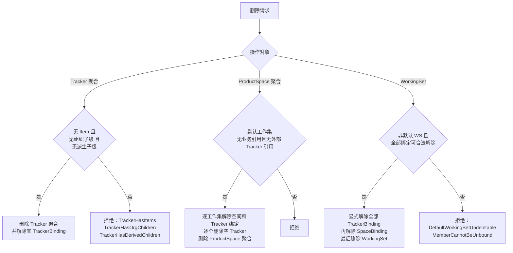
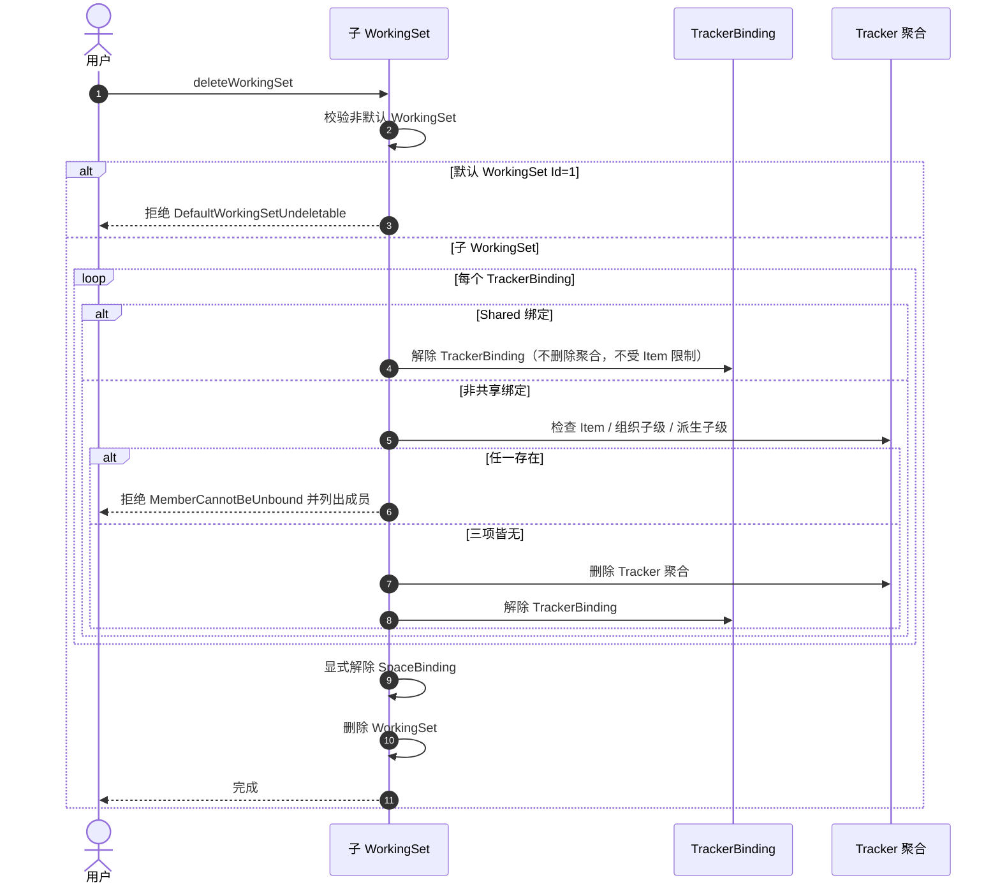
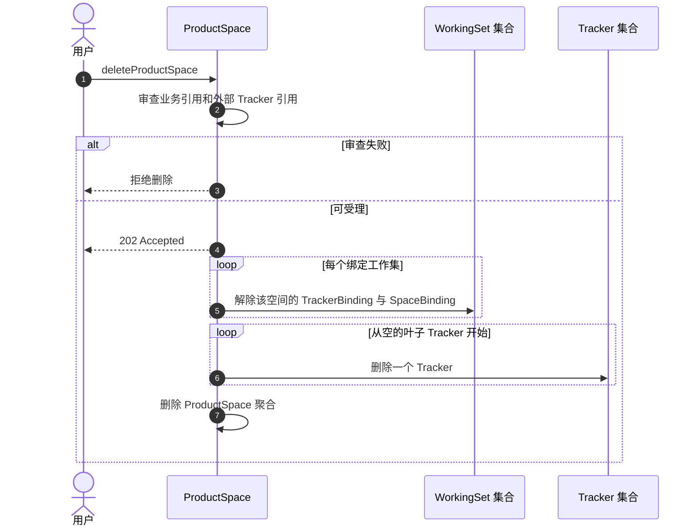
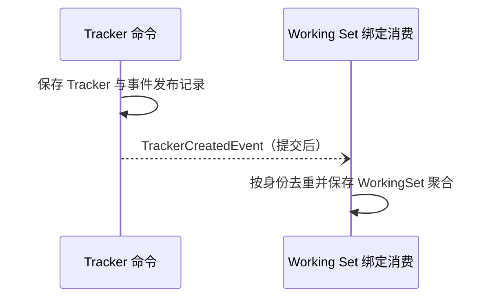

# 绑定与删除生命周期

**状态：Draft / Candidate（T2 契约配套图；语义依据 POL-012～016、INV-053～060、INV-064～068；K1～K3 已由用户 2026-11-11 确认；图本身未纳入正式基线）**

- 目的：展示 Tracker、ProductSpace、WorkingSet 删除及相关绑定的处理顺序。
- 适用范围：阶段 5 T2 绑定与删除契约（已冻结）；直接父子、非共享 Tracker 的常规路径。
- 依据：[绑定与删除契约 v1](../domain/binding-deletion-contract-v1.md)、POL-012～016、INV-053～060、INV-064～068、SCN-050～054、SCN-061～065、[ADR-0004](../adr/0004-productspace-independent-aggregate.md)。
- 不表达：数据库表结构、物理删除/清理策略、事务与锁、软删状态机（K1：不纳入本版契约）、停用生命周期（用户 2026-11-12 裁定不存在该概念）。

## 图例

- 方框＝领域操作；菱形＝前置判断；`拒绝` 分支列出契约级失败分类。
- 绑定（SpaceBinding／TrackerBinding）是 WorkingSet 聚合内的 Entity；Tracker、ProductSpace、WorkingSet 是聚合。图中箭头只表达操作流，不表达聚合包含或同事务。

## 1. 删除准入

## 2. 删除时序

### 2.1 子 WorkingSet 删除（K3）

### 2.2 ProductSpace 删除（引用完整性）

## 3. 规则索引

1. **删除子工作集**时，Shared Tracker 的 Item 不阻塞解除其关联。
2. **空产品空间删除**通过可靠事件清理空间绑定与空 Tracker。具体准入见[绑定与删除契约](../domain/binding-deletion-contract-v1.md#43-聚合删除)。
3. **删除 WorkingSet 是受成员关系约束的业务操作**：任一成员不可合法解除即整体阻止，不引入无条件级联解除；解除顺序为 TrackerBinding → SpaceBinding → WorkingSet。

## 4. 裁定与图表状态

K1～K3 的冻结范围与 2026-11-20 对产品空间删除的裁定见[契约 v1](../domain/binding-deletion-contract-v1.md)。

图本身仍为 `Draft / Candidate`：Mermaid 实际渲染未验证（环境无 `mmdc`），纳入正式基线与发布前须在可渲染环境复核。

## 事务边界补充

ProductSpace 删除按图中的顺序逐聚合提交。其余流程的事务现状见[实现边界](../implementation/current-boundaries.md)。

