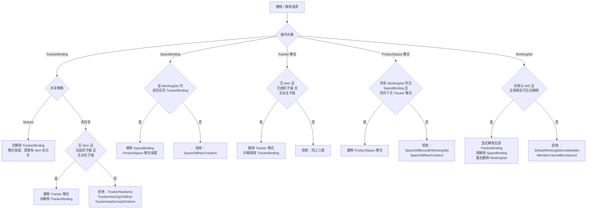
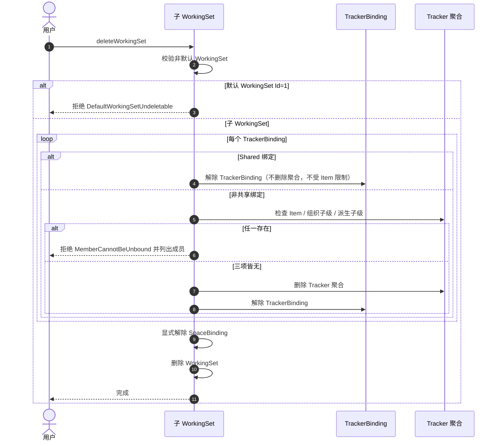
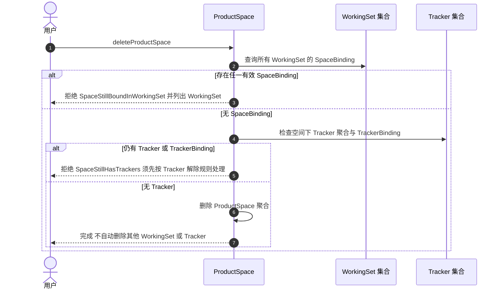

# 绑定与删除生命周期

**状态：Draft / Candidate（T2 契约配套图；语义依据 POL-012～016、INV-053～060、INV-064～068；K1～K3 已由用户 2026-11-11 确认；图本身未纳入正式基线）**

- 目的：区分四类操作——**绑定移除**、**Tracker 删除**、**ProductSpace 删除**、**WorkingSet 删除**，以及各自的前置、解除顺序与拒绝条件。
- 适用范围：阶段 5 T2 绑定与删除契约（已冻结）；直接父子、非共享 Tracker 的常规路径。
- 依据：[绑定与删除契约 v1](../domain/binding-deletion-contract-v1.md)、POL-012～016、INV-053～060、INV-064～068、SCN-050～054、SCN-061～065、[ADR-0004](../adr/0004-productspace-independent-aggregate.md)。
- 不表达：数据库表结构、物理删除/清理策略、事务与锁、软删状态机（K1：不纳入本版契约）、停用生命周期（用户 2026-11-12 裁定不存在该概念）。

## 图例

- 方框＝领域操作；菱形＝前置判断；`拒绝` 分支列出契约级失败分类。
- 绑定（SpaceBinding／TrackerBinding）是 WorkingSet 聚合内的 Entity；Tracker、ProductSpace、WorkingSet 是聚合。图中箭头只表达操作流，不表达聚合包含或同事务。

## 1. 四类操作的决策流程

## 2. 四类操作对比

| 操作 | 对象层级 | 是否删除聚合 | 关键前置 | 主要失败分类 |
| --- | --- | --- | --- | --- |
| 绑定移除（Shared） | WorkingSet 内 Entity | 否 | 存在有效 TrackerBinding 且为 Shared；具备解除权限（有 Item 也允许） | `TrackerBindingNotFound`、`NotSharedBinding`、`PermissionDenied` |
| 绑定移除（非共享） | Entity + Tracker 聚合 | 是（Tracker） | 无 Item、无组织子级、无派生子级 | `TrackerHasItems`、`TrackerHasOrgChildren`、`TrackerHasDerivedChildren` |
| 空间绑定移除 | WorkingSet 内 Entity | 否 | 该空间无 TrackerBinding（SB-4） | `SpaceStillHasTrackers` |
| Tracker 删除 | Tracker 聚合 | 是 | 无 Item、无组织子级、无派生子级 | 同非共享移除 |
| ProductSpace 删除 | ProductSpace 聚合 | 是 | 所有 WS 无 SpaceBinding；空间下无 Tracker；有 TrackerBinding 须先按其规则解除 | `SpaceStillBoundInWorkingSet`、`SpaceStillHasTrackers` |
| WorkingSet 删除 | WorkingSet 聚合 | 是 | 非默认 WS；全部绑定可合法解除；按 TrackerBinding → SpaceBinding 顺序解除 | `DefaultWorkingSetUndeletable`、`MemberCannotBeUnbound` |

## 3. 删除时序

### 3.1 子 WorkingSet 删除（K3）

### 3.2 ProductSpace 删除（引用完整性）

## 4. 三个易错点

1. **Shared 解绑不受 Item 限制**：Shared 解绑只是解除关系，不删除聚合；即使 Tracker 拥有 Item 也允许解除子工作集关联。「有 Item 不允许移除」只约束聚合删除（非共享解绑 / `deleteTracker`）。
2. **移除最后一个 Tracker 不删 SpaceBinding**（SB-3）：因此删除 ProductSpace 必须审查**所有 WorkingSet 的 SpaceBinding**，只查 TrackerBinding 会留下指向已删除空间的悬空绑定。
3. **删除 WorkingSet 是受成员关系约束的业务操作**：任一成员不可合法解除即整体阻止，不引入无条件级联解除；解除顺序为 TrackerBinding → SpaceBinding → WorkingSet。

## 5. 冻结状态（2026-11-11）

K1（仅删除不可恢复、软删/归档/恢复不纳入、不强制物理 DELETE）、K2（组织子级/派生子级/有 Item 禁止删除、不级联/不断链/重挂）、K3（子 WS 删除的成员关系约束与解除顺序）均已由用户正式确认，本图与[契约 v1](../domain/binding-deletion-contract-v1.md)同步冻结；WorkingSet 与 Tracker 不存在“停用”生命周期（用户 2026-11-12 裁定）。

图本身仍为 `Draft / Candidate`：Mermaid 实际渲染未验证（环境无 `mmdc`），纳入正式基线与发布前须在可渲染环境复核。
