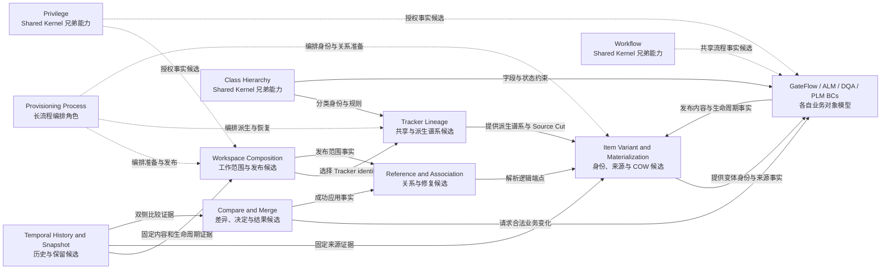

# Working Set 候选 Context Map

- **状态**：Draft / Candidate
- **设计阶段**：领域发现／战略设计候选
- **依据**：[候选 Context Map 文档](../domain/context-map.md)、[候选聚合分析](../domain/aggregate-model.md)、[阶段 2 审查](../reviews/2026-11-09-stage-2-domain-discovery-review.md)
- **用途**：展示 Working Set 能力内部的候选模型所有者与协作方向；企业 Shared Kernel 外框另见 [Shared Kernel Context Map](shared-kernel-context-map.md)。本图不表示微服务、Java 模块或已接受内部上下游关系。

## 未确认边界

- Workspace Composition 与 Tracker Lineage 可以同部署，但是否同一限界上下文未确认。
- Item Variant 可能是领域上下文，也可能只是技术索引；取决于稳定身份和 Source Cut 是否具有业务意义。
- History/Snapshot 是支撑能力还是用户可管理业务能力未确认。
- Reference 与 Association 是否属于同一上下文仍待关系类型和生命周期证据。
- Provisioning 当前只表示应用流程角色，不自动成为领域聚合或微服务。
- Privilege、Workflow、Class Hierarchy 与 Working Set 的精确合同尚未确认；同属 Shared Kernel 不等于共享同一对象模型或事务。
