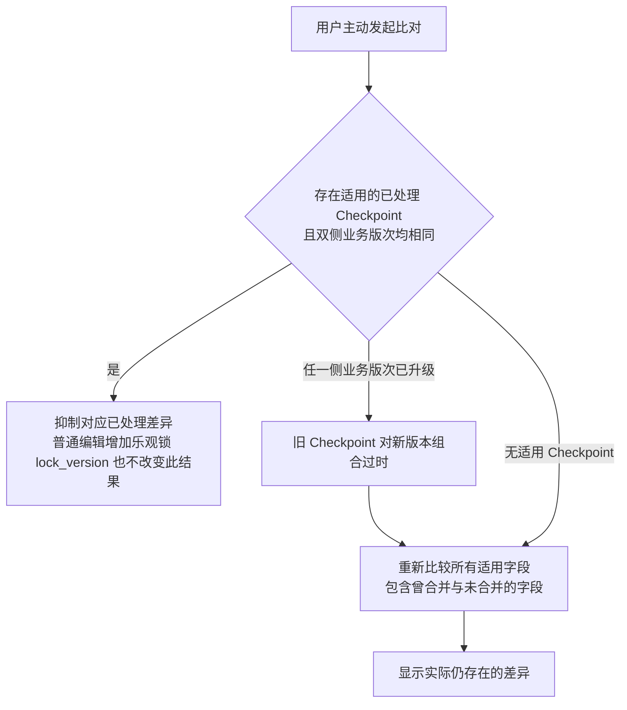
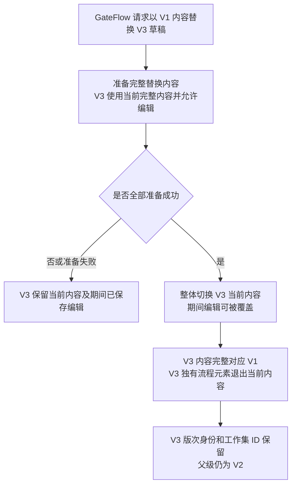

# Checkpoint 适用性与 GateFlow 内容切换

**状态：Draft / Candidate。** 业务结果与候选实施范围分别见下节。

早期 Merge Session 与 VIRTUAL 固定来源图已退出本页。当前合并时序见 [T1 MergeEntry 生命周期](merge-entry-lifecycle.md)，首次 COW 见 [T3 物化图](lighttrackeritem-materialization.md)。原场景、反例及裁定仍见 [B01～B12](../scenarios/shared-kernel-boundary-scenarios.md)和[阶段 3 评审](../reviews/2026-11-09-stage-3-architecture-review.md)。共享权威点查与列表投影时效仍见 [QUESTION-003](../domain/open-questions.md)。

## 用户主动比对与 Checkpoint 适用性

以下分支表达 SCN-009 已确认的业务规则。S7 中的 Checkpoint 映射及验证见 [S7 记录](../implementation/t5-s7-verification-result.md)。

## GateFlow 草稿内容整体切换

**业务结果已由用户确认，内部协议为 Candidate。** 目的为表达 V3 的可见内容与准备内容的区别。依据 [GateFlow 场景](../scenarios/shared-kernel-boundary-scenarios.md#gateflow-草稿版次内容替换) 和 [职责边界](../domain/shared-kernel-boundary.md#gateflow-process-与版次用户已确认)。此图不规定数据库事务或聚合组成。准备期间已确认允许编辑，切换时可覆盖期间编辑。内容范围已固定为过程元素业务对象、裁剪问题、裁剪答案、合规映射四类，不纳入共享 Tracker。内部业务细节属于 GateFlow 专项。切换瞬间的并发提交、重试和取消协议待设计。

