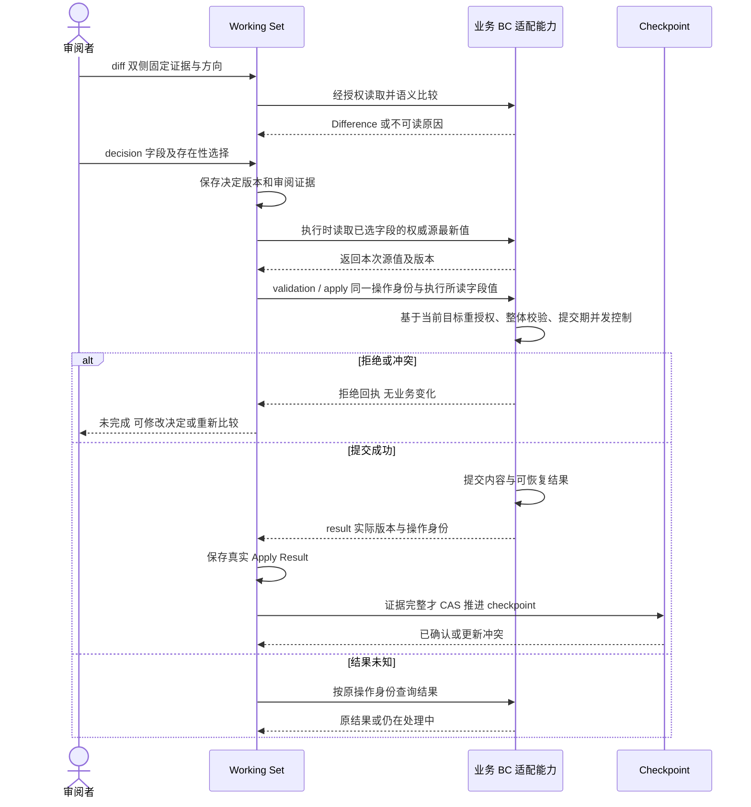
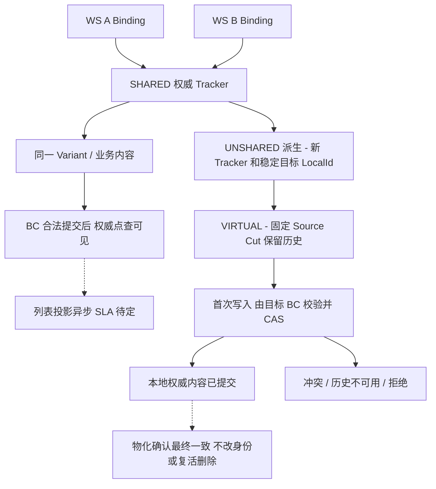

# 合并、共享与 COW 的候选行为

**状态：Draft / Candidate**

目的：验证提交、结果和确认的区分。依据 [责任与契约](../domain/shared-kernel-boundary.md)、[B01—B12](../scenarios/shared-kernel-boundary-scenarios.md)、[评审](../reviews/2026-11-09-stage-3-architecture-review.md)。假设 BC 支持提交去重和结果回读；不表示整轮事务、传输协议或最终接口。预校验不是提交许可；B09 已确认接受字段在执行时读取源最新值。目标同一接受字段在提交前被修改时，合法提交会覆盖该字段。若极端情况下某个已选源字段不可读，则本条 Requirement 保持未完成，批次继续下一条。图中展示源字段可读的执行路径，执行中竞态处理待定。

KEEP_TARGET 可不执行内容提交；仍需证据校验后才能确认。DEFER 保留未处理状态。部分对象失败不改变其他对象的成功事实。

派生箭头表示业务动作而非复制同步。源后续变/删不改变目标固定切点；若保留能力不可用，必须阻止依赖该切点的成功发布或写入。异步标记滞后时本地提交与墓碑优先，不能读取旧来源覆盖目标。
