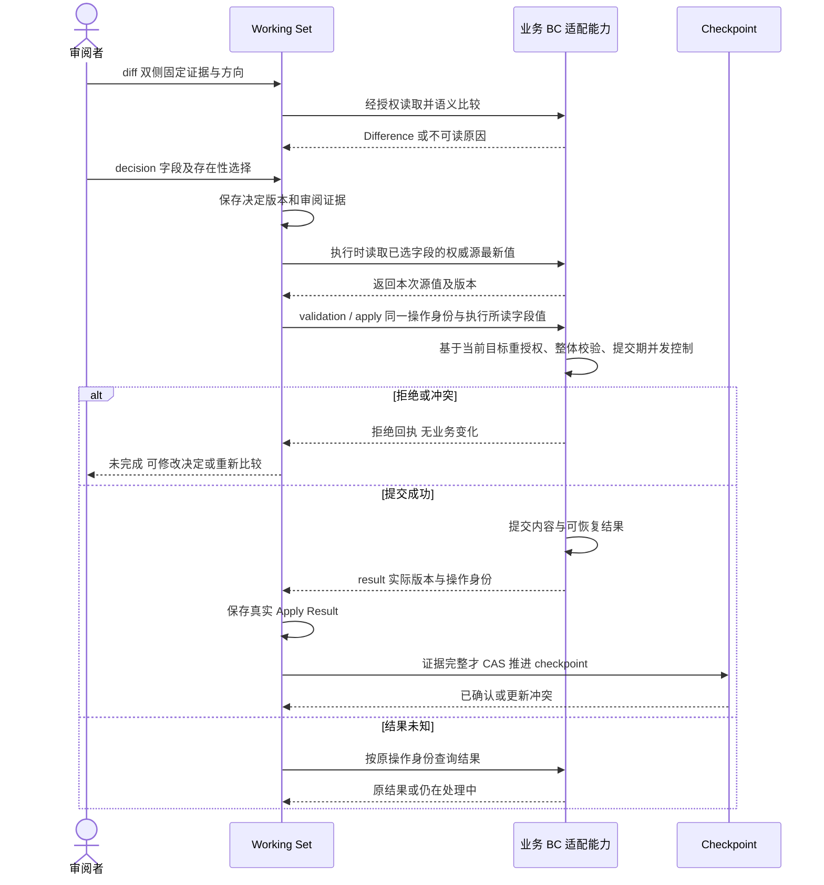
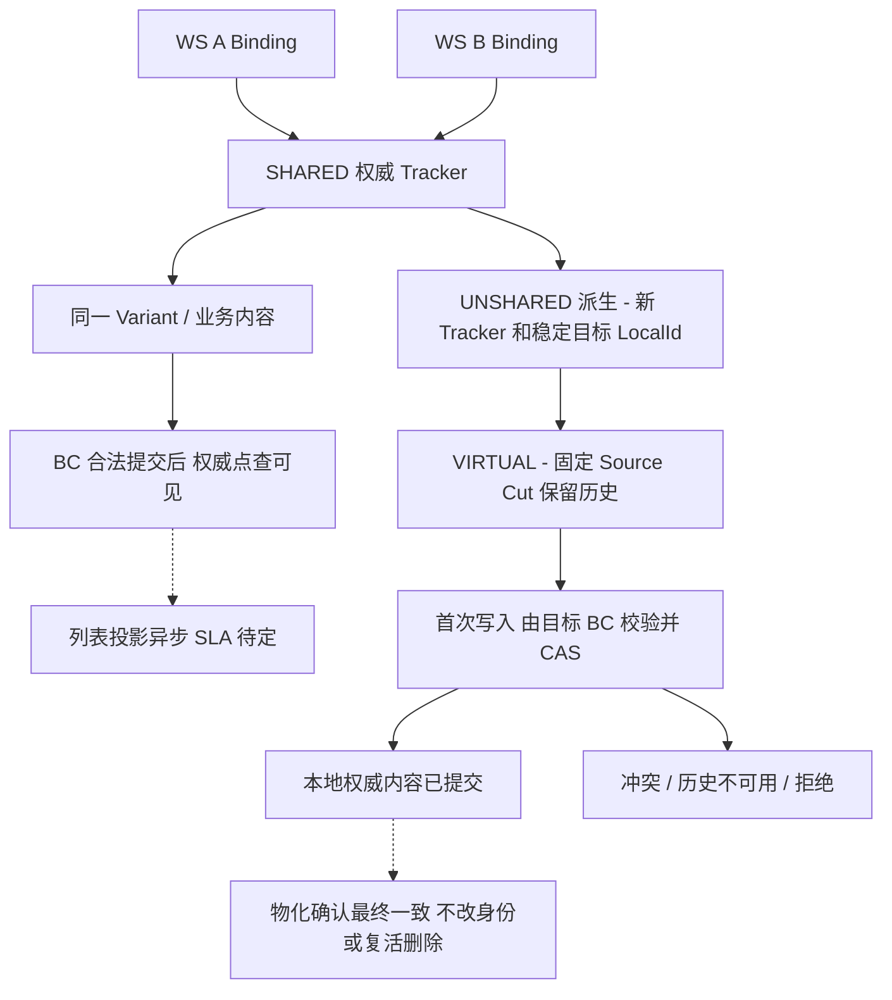
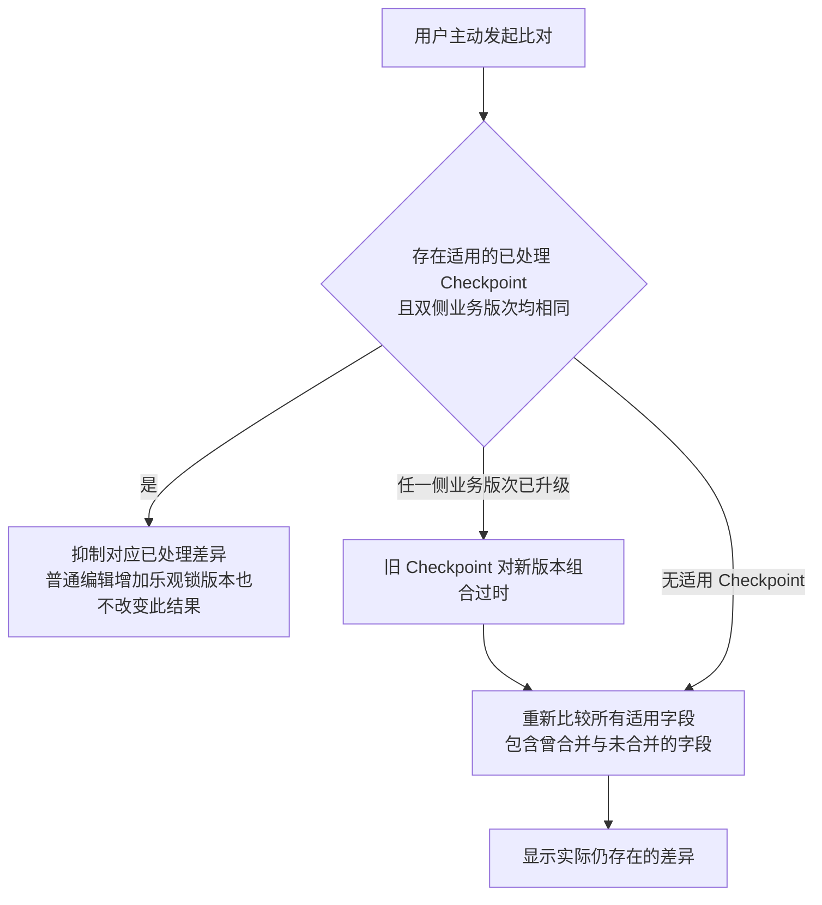
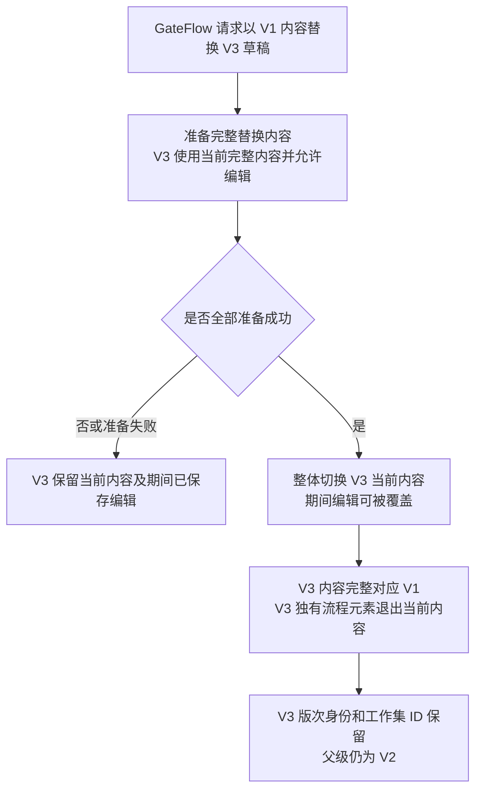

# 合并、共享与 COW 的候选行为

**状态：Draft / Candidate**

目的：验证提交、结果和确认的区分。依据 [责任与契约](../domain/shared-kernel-boundary.md)、[B01—B12](../scenarios/shared-kernel-boundary-scenarios.md)、[评审](../reviews/2026-11-09-stage-3-architecture-review.md)。假设 BC 支持提交去重和结果回读；不表示整轮事务、传输协议或最终接口。预校验不是提交许可；B09 已确认接受字段在执行时读取源最新值。目标同一接受字段在提交前被修改时，合法提交会覆盖该字段。若极端情况下某个已选源字段不可读，则本条 Requirement 保持未完成，批次继续下一条。图中展示源字段可读的执行路径，执行中竞态处理待定。

KEEP_TARGET 已确认可通过 markAsMerged 记录处理决定而保留目标内容，决定写入 MergeCheckpoint。双侧业务版次未变时下次比对不再显示该差异，普通编辑只增加乐观锁版本也继续隐藏。该无内容变更路径直接记录决定与确认，图中业务内容提交分支适用于存在数据变更的情况。DEFER 保留未处理状态。部分对象失败不改变其他对象的成功事实。

派生箭头表示业务动作而非复制同步。源后续变/删不改变目标固定切点；若保留能力不可用，必须阻止依赖该切点的成功发布或写入。异步标记滞后时本地提交与墓碑优先，不能读取旧来源覆盖目标。

B08 已确认批次允许部分成功。重试只进入未完成项的执行流程，已成功项保留结果并跳过，即使其源端再次变化。结果未知项先查回原提交结果的恢复协议仍为候选。

## 用户主动比对与 Checkpoint 适用性

以下分支表达 SCN-009 已确认的业务规则。图表文件的整体候选状态仍用于其余执行协议，Checkpoint 存储结构待设计。

## GateFlow 草稿内容整体切换

**业务结果已由用户确认，内部协议为 Candidate。** 目的为表达 V3 的可见内容与准备内容的区别。依据 [GateFlow 场景](../scenarios/shared-kernel-boundary-scenarios.md#gateflow-草稿版次内容替换) 和 [职责边界](../domain/shared-kernel-boundary.md#gateflow-process-与版次用户已确认)。此图不规定数据库事务或聚合组成。准备期间已确认允许编辑，切换时可覆盖期间编辑。内容范围已固定为过程元素业务对象、裁剪问题、裁剪答案、合规映射四类，不纳入共享 Tracker。内部业务细节属于 GateFlow 专项。切换瞬间的并发提交、重试和取消协议待设计。

