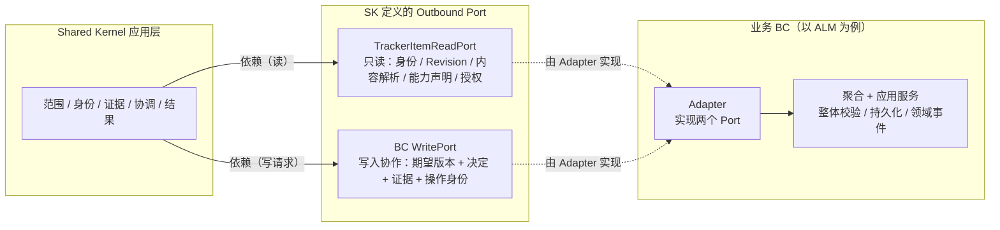
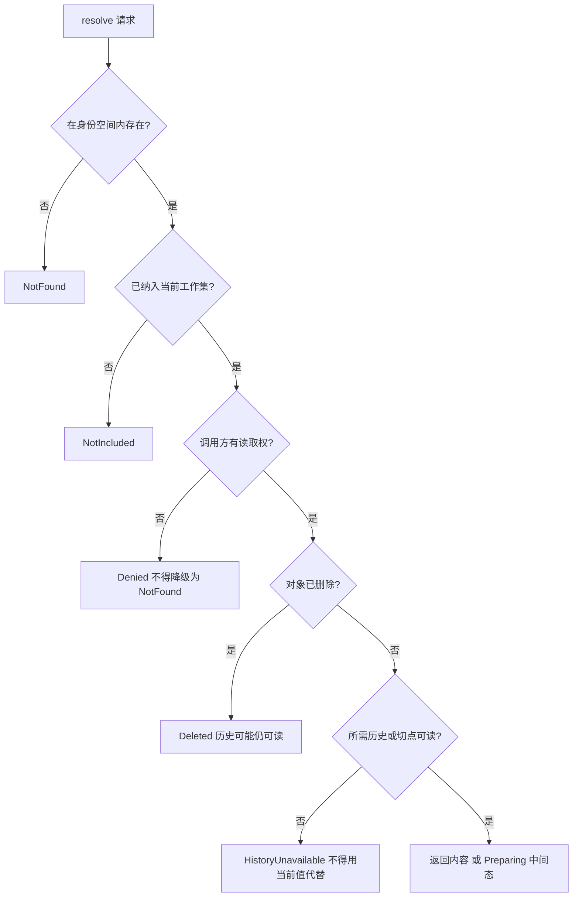
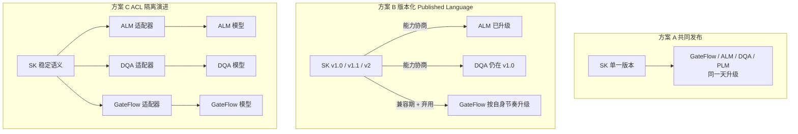
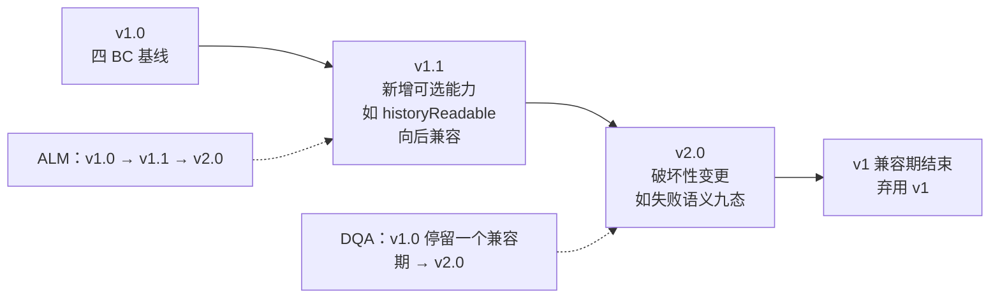
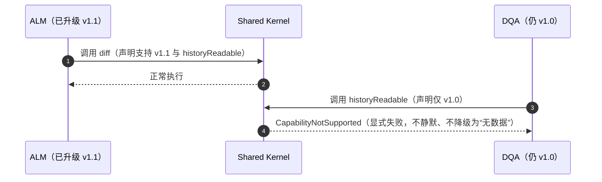

# 跨 BC 契约面与失败语义

**状态：Draft / Candidate（T4 契约配套图；K1″/K2″ 已由用户 2026-11-11 确认，K3″ 团队开放项；图本身未纳入正式基线）**

- 目的：表达**只读契约 + 写入协作 Port** 的依赖方向、能力声明，以及九分类公共失败语义在各用例上的适用范围。
- 适用范围：阶段 5 T4 跨 BC 公共契约（已冻结）；四 BC 接入范围以已确认边界为准。
- 依据：[跨 BC 公共契约 v1](../domain/cross-bc-contract-v1.md)、AC-001、D-007、FACT-011/012、QUESTION-013/014、POL-002/003/004/007/008、[Shared Kernel 边界](../domain/shared-kernel-boundary.md)、B01～B12、SCN-069～071。
- 不表达：具体 API 签名、包名、Maven 模块、Spring Bean 装配、传输协议、事务实现、权限缓存时效。

## 图例

- 实线＝依赖方向；虚线＝由 Adapter 实现的关系。
- SK 只依赖两个 Port（只读 + 写入协作），**不依赖 BC 内部聚合**。
- BC 内部（聚合构建、整体校验、持久化、领域事件）在图中只作汇总节点，不展开。

## 1. Port / Adapter 依赖方向（K1″）

2026-11-11 用户选择 B：图中 Adapter 实现应用层 Port；业务聚合另行实现领域公共接口 TrackerItem，两层同时保留。该实现关系见[领域契约图](trackeritem-contract.md)，职责定义见 T4 §3.1。

要点：`TrackerItemReadPort` **不含**整体校验、提交、删除等写入方法；写入只能经 `<BC>WritePort` 进入 BC 的聚合与应用服务。

## 2. 能力声明

| 标记 | Part / DQA | ALM / GateFlow | 不支持时的契约行为 |
| --- | --- | --- | --- |
| `comparable` | false | true | `CapabilityNotSupported`，不得报「无差异」 |
| `mergeable` | false | true | `CapabilityNotSupported`，不得假装已合并 |
| `derivable` | false | true | `CapabilityNotSupported`，不得走派生路径 |
| `creatable` | 按 BC 合同 | 按 BC 合同 | 共享 Tracker 下实际归默认工作集（POL-007） |
| `historyReadable` | 按对象 | 按对象 | `HistoryUnavailable`，不得用当前值代替 |

## 3. 九分类适用矩阵（K2″）

| 用例 | NotFound | NotIncluded | Denied | Deleted | HistoryUnavailable | Preparing | CapabilityNotSupported | DependencyUnavailable | Unknown |
| --- | --- | --- | --- | --- | --- | --- | --- | --- | --- |
| create 范围 | — | — | ✔ | — | — | ✔ | — | ✔ | ✔ |
| create 对象并纳入 | — | ✔ | ✔ | — | — | ✔ | ✔ | ✔ | ✔ |
| extend | — | ✔ | ✔ | — | ✔ | ✔ | ✔ | ✔ | ✔ |
| resolve | ✔ | ✔ | ✔ | ✔ | ✔ | ✔ | ✔ | ✔ | — |
| diff | — | — | ✔ | — | ✔ | ✔ | ✔ | — | ✔ |
| merge | — | — | ✔ | ✔ | ✔ | ✔ | ✔ | ✔ | ✔ |

`—` 表示该用例不应以该分类表达；**不要求每个接口统一返回九类**。

### 3.1 `resolve` 的判定顺序

## 4. 不得偷换（K2″ 要点）

1. **无权不得降级为不存在**（`Denied` ≠ `NotFound`）——B02、POL-008。
2. **未纳入不得降级为不存在**（`NotIncluded` ≠ `NotFound`）。
3. **已删除 ≠ 历史不可用**（`Deleted` 与 `HistoryUnavailable` 分开）。
4. **准备中 ≠ 已完成**（`Preparing` 是显式中间态）。
5. **能力不支持 ≠ 无差异/空结果**（`CapabilityNotSupported`）——B05。
6. **未知不得解释为未执行**（`Unknown`）——B10，须按幂等协议恢复或确认。
7. **不覆盖 T1/T3 既有语义**：`StaleEvidence`、`Rejected`、`Conflict`、`Deferred`、`Materializing` 等技术态与轮次终态保持不变；`LightTrackerItem` 切换失败不得解释为 BC `Save` 失败。

## 5. 裁定状态

- **K1″（只读契约 + BC 自管写入）**：用户已确认（2026-11-11）。
- **K2″（九分类公共失败语义）**：用户已确认（2026-11-11）。
- **K3″（版本治理）**：团队开放项，讨论稿见 §6，不作为当前实现重点、不阻塞 T5。

## 6. 契约版本治理讨论稿（K3″，待四 BC 确认）

> **状态：讨论材料，不构成裁定。** K3″ 需四 BC 参与（升级节奏、验证能力、变更审批人）才能定；当前不作为实现重点，不阻塞 T5。

### 6.1 三种耦合方式

### 6.2 方案 B 的版本演进时间线

### 6.3 能力协商时序

### 6.4 判据对比

| 判据 | A 共同发布 | B 版本化 PL（推荐候选） | C ACL 隔离 |
| --- | --- | --- | --- |
| 四 BC 独立演进 | ❌ 互相阻塞 | ✅ 各自节奏 | ✅ 各自节奏 |
| 跨 BC 语义一致 | ✅ 绝对一致 | ✅ 单一语义源 | ❌ 易漂移 |
| 治理成本 | 低 | 中（版本矩阵 + 兼容测试） | 高（适配层重复 + 漂移风险） |
| 与 AC-001 定位一致 | 弱（SK 成发布瓶颈） | 强（SK 提供公共能力） | 中（SK 变薄，语义责任下沉） |

### 6.5 若采纳 B，仍需四 BC 共同确认的三个参数

1. **兼容期长度**：破坏性变更后旧版本保留几个发布周期。
2. **破坏性变更审批人**：SK 团队 vs 四 BC 代表共同评审。
3. **能力协商形式**：BC 启动时声明支持版本，还是每次调用携带版本。

### 6.6 对当前工作的影响

- **不阻塞 T5**：首切片只涉及单一业务 BC 与 SK，可按 v1 契约推进。
- **不影响 K1″/K2″**：用例划分与失败语义分类与发布方式无关。
- 若四 BC 访谈后选择 A 或 C，本节图与结论需按新裁定更新。
