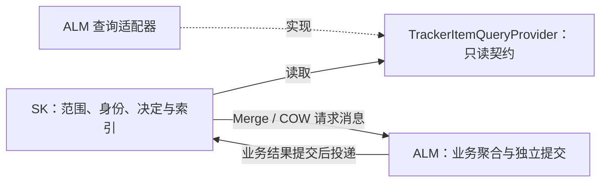
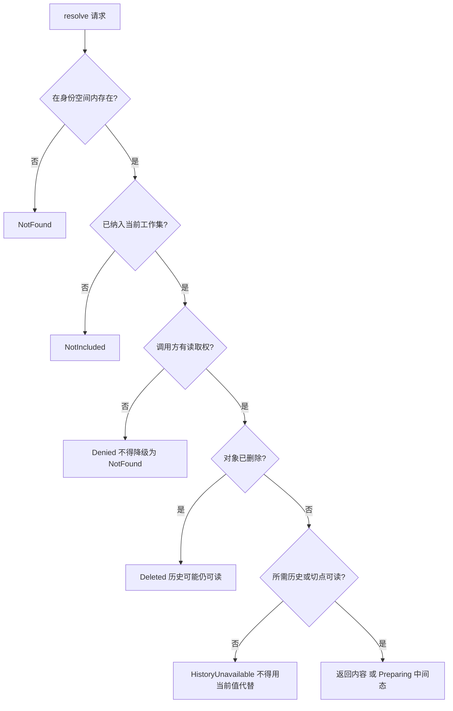

# 跨 BC 契约面与失败语义

**状态：Draft / Candidate（T4 契约配套图；K1″/K2″ 已由用户 2026-11-11 确认，K3″ 团队开放项；图本身未纳入正式基线）**

- 目的：表达**只读 Provider + 写入事件协作** 的依赖方向、能力声明，以及九分类公共失败语义在各用例上的适用范围。
- 适用范围：阶段 5 T4 跨 BC 公共契约（已冻结）；四 BC 接入范围以已确认边界为准。
- 依据：[跨 BC 公共契约 v1](../domain/cross-bc-contract-v1.md)、AC-001、D-007、FACT-011/012、QUESTION-013/014、POL-002/003/004/007/008、[Shared Kernel 边界](../domain/shared-kernel-boundary.md)、B01～B12、SCN-069～071。
- 不表达：具体 API 签名、包名、Maven 模块、Spring Bean 装配、传输协议、事务实现、权限缓存时效。

## 图例

- 实线＝依赖方向；虚线＝由 Adapter 实现的关系。
- SK 通过只读契约和消息与业务 BC 协作，不依赖其内部聚合。
- BC 内部（聚合构建、整体校验、持久化、领域事件）在图中只作汇总节点，不展开。

## 1. 读依赖与写入协作（K1″ / TC-002）

聚合实现领域公共接口，适配器实现只读契约；消息不传聚合实例。实现差距见 [当前实现边界](../implementation/current-boundaries.md)。

**2026-11-19 读取边界补充**：图中 `TrackerItemQueryProvider` 表达集合查询和读模型契约，不是唯一读取方式。业务 BC 也可只读使用 SK 的共享聚合与聚合仓储完成按 ID 的身份/来源校验；但不得调用保存、删除或修改 SK 聚合，跨聚合写入仍只走事件。单个查询方法不再新增同步 Port。该补充不改变 K1″/K2″。

## 2. 能力声明

| 标记 | Part / DQA | ALM / GateFlow | 不支持时的契约行为 |
| --- | --- | --- | --- |
| `comparable` | false | true | `CapabilityNotSupported`，不得报「无差异」 |
| `mergeable` | false | true | `CapabilityNotSupported`，不得假装已合并 |
| `derivable` | false | true | `CapabilityNotSupported`，不得走派生路径 |
| `creatable` | 按 BC 合同 | 按 BC 合同 | 共享 Tracker 下实际归默认工作集（POL-007） |
| `historyReadable` | 按对象 | 按对象 | `HistoryUnavailable`，不得用当前值代替 |

## 3. 九分类适用矩阵（K2″）

| 用例 | NotFound | NotIncluded | Denied | Deleted | HistoryUnavailable | Preparing | CapabilityNotSupported | DependencyUnavailable | Unknown |
| --- | --- | --- | --- | --- | --- | --- | --- | --- | --- |
| create 范围 | — | — | ✔ | — | — | ✔ | — | ✔ | ✔ |
| create 对象并纳入 | — | ✔ | ✔ | — | — | ✔ | ✔ | ✔ | ✔ |
| extend | — | ✔ | ✔ | — | ✔ | ✔ | ✔ | ✔ | ✔ |
| resolve | ✔ | ✔ | ✔ | ✔ | ✔ | ✔ | ✔ | ✔ | — |
| diff | — | — | ✔ | — | ✔ | ✔ | ✔ | — | ✔ |
| merge | — | — | ✔ | ✔ | ✔ | ✔ | ✔ | ✔ | ✔ |

`—` 表示该用例不应以该分类表达；**不要求每个接口统一返回九类**。

### 3.1 `resolve` 的判定顺序

## 4. 不得偷换（K2″ 要点）

1. **无权不得降级为不存在**（`Denied` ≠ `NotFound`）——B02、POL-008。
2. **未纳入不得降级为不存在**（`NotIncluded` ≠ `NotFound`）。
3. **已删除 ≠ 历史不可用**（`Deleted` 与 `HistoryUnavailable` 分开）。
4. **准备中 ≠ 已完成**（`Preparing` 是显式中间态）。
5. **能力不支持 ≠ 无差异/空结果**（`CapabilityNotSupported`）——B05。
6. **未知不得解释为未执行**（`Unknown`）——B10，须按幂等协议恢复或确认。
7. **不覆盖 T1/T3 既有语义**：`StaleEvidence`、`Rejected`、`Conflict`、`Deferred`、`Materializing` 等技术态与轮次终态保持不变；`LightTrackerItem` 切换失败不得解释为 BC `Save` 失败。

## 5. 裁定状态

- **K1″（只读契约 + BC 自管写入）**：用户已确认（2026-11-11）。
- **K2″（九分类公共失败语义）**：用户已确认（2026-11-11）。
- **K3″（版本治理）**：团队开放项，见 [T4 §6](../domain/cross-bc-contract-v1.md)，不作为当前实现重点、不阻塞 T5。

## 6. 版本治理（K3″）

K3″ 仍为团队开放项，不在本图展开；三种耦合方式、能力协商与版本矩阵见 [T4 §6](../domain/cross-bc-contract-v1.md)。
