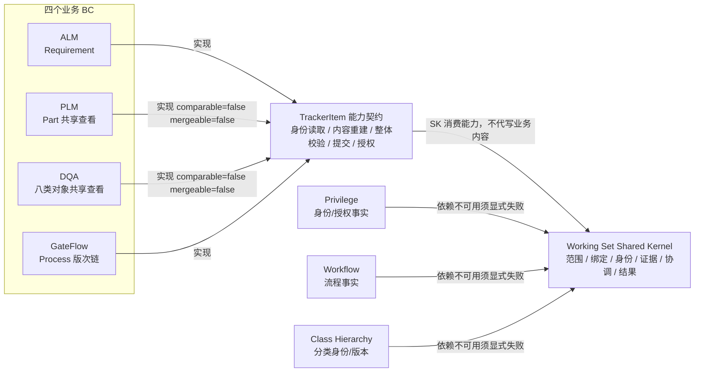
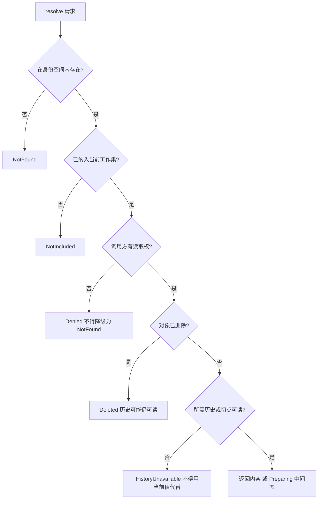

# 跨 BC 契约面与失败语义

**状态：Draft / Candidate（T4 契约配套图；语义依据 AC-001、D-007、QUESTION-013、B01～B12；图本身未纳入正式基线）**

- 目的：表达 Working Set Shared Kernel 与四个业务 BC 的契约面（`TrackerItem` 能力契约、能力标记、依赖服务），以及 `resolve` 等读取路径的统一失败语义。
- 适用范围：阶段 5 T4 跨 BC 公共契约；四个 BC（GateFlow、ALM、DQA、PLM）接入范围以已确认边界为准。
- 依据：[跨 BC 公共契约 v1](../domain/cross-bc-contract-v1.md)、AC-001、D-007、FACT-011/012、QUESTION-013/014、POL-002/003/004/007/008、[Shared Kernel 边界](../domain/shared-kernel-boundary.md)、B01～B12。
- 不表达：具体 API 签名、传输协议、事务实现、权限缓存时效、各 BC 的专有校验规则。

## 图例

- 实线＝契约/依赖方向；`实现` 表示业务对象实现 `TrackerItem` 公共契约。
- SK 只消费 `TrackerItem` 能力，**不代写业务内容**（QUESTION-013）。
- 能力标记为 `false` 时，对应能力必须显式失败（`CapabilityNotSupported`），不得返回「无差异/空结果」。

## 1. 契约面

## 2. 能力标记

| 标记 | Part / DQA | ALM / GateFlow | 不支持时的契约行为 |
| --- | --- | --- | --- |
| `comparable` | false | true | `CapabilityNotSupported`，不得报「无差异」 |
| `mergeable` | false | true | `CapabilityNotSupported`，不得假装已合并 |
| `derivable` | false | true | `CapabilityNotSupported`，不得走派生路径 |
| `creatable` | 按 BC 合同 | 按 BC 合同 | 共享 Tracker 下实际归默认工作集（POL-007） |
| `historyReadable` | 按对象 | 按对象 | `HistoryUnavailable`，不得用当前值代替 |

## 3. 读取路径的统一失败语义（以 `resolve` 为例）

## 4. 四条不得偷换

1. **无权不得降级为不存在**（`Denied` ≠ `NotFound`）——B02、POL-008。
2. **已删除 ≠ 历史不可用**（`Deleted` 与 `HistoryUnavailable` 分开）。
3. **准备中 ≠ 已完成**（`Preparing` 是显式中间态）。
4. **能力不支持 ≠ 无差异/空结果**（`CapabilityNotSupported`）——B05。

## 5. 待裁定项

K1″（能力集边界：只读 + BC 自管写入 vs 统一写端口）、K2″（失败语义九分类 vs 仅四态）、K3″（版本治理 B vs A/C）见[契约第 9 节](../domain/cross-bc-contract-v1.md)。
