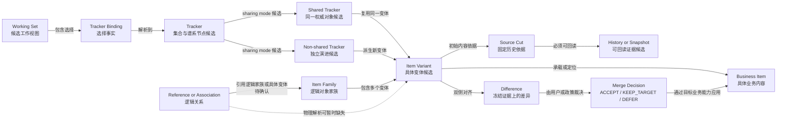

# Working Set 候选领域概念关系图

- **状态**：Draft / Candidate
- **设计阶段**：领域发现
- **依据**：[候选统一领域语言](../domain/glossary.md)、[事实与假设](../domain/facts.md)、[开放问题](../domain/open-questions.md)
- **用途**：暴露概念关系、身份层次和当前歧义，不表达最终聚合边界、事务边界或部署结构。

## 需要图表帮助裁定的问题

- Working Set 是工作视图、发布范围还是业务分支；
- Tracker 与 Tracker Branch 是否是同一概念；
- Item Family、Item Variant、Item Revision 的身份边界；
- Reference 指向逻辑家族还是具体变体；
- Source Cut、业务 Snapshot、Merge Base 与仓库 Design Baseline 的不同含义。

这些问题未确认前，不从本图推导聚合或数据库结构。
