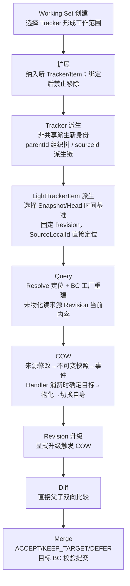

# Working Set 领域主线

**状态：Draft / Candidate（首版基线候选配套图；未发布为正式基线）**

目的：表达 Working Set 领域从创建到合并的业务主线。范围：主干流程，不表达数据库、部署或具体 API。依据：[首版基线候选](../domain/model-baseline-candidate-v1.md)、D-001～D-019。领域关系见 [契约与聚合图](trackeritem-contract.md)，生命周期/COW 时序见 [LightTrackerItem 生命周期](lighttrackeritem-lifecycle.md)。

## 领域主线

说明：主线表达业务动作顺序，不表示单事务或强一致。COW 为异步最终一致；未物化期间允许暂时读到来源修改后内容。业务 BC 拥有完整业务内容与提交权。三类核心聚合（Working Set/Tracker/LightTrackerItem）按 ID reference 关联，不组合、不跨 BC 事务。
