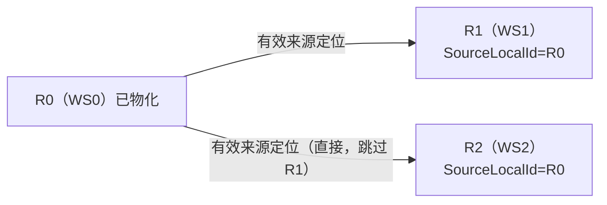
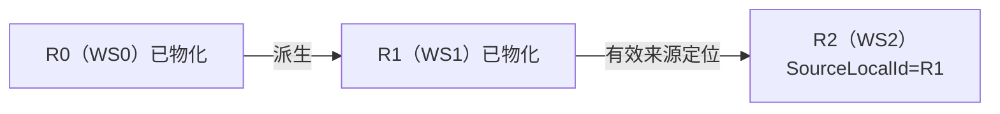
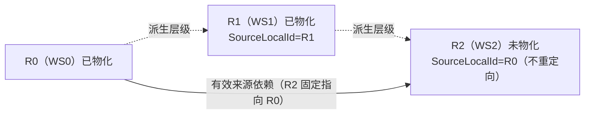
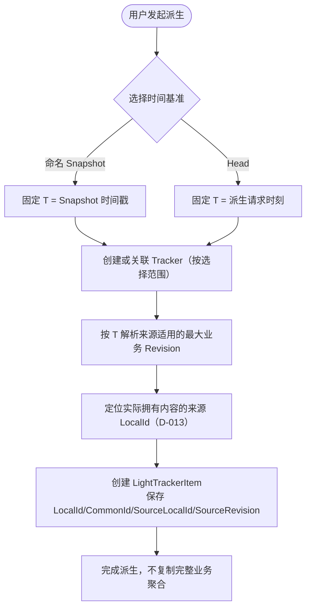

# LightTrackerItem 派生与多级有效来源

**状态：Draft（D-008、D-012～D-015 配套图）**

本页展示派生身份、有效来源及多级依赖。双态切换和消费时匹配见 [T3 物化图](lighttrackeritem-materialization.md)，单实例乱序和失败恢复证据见 [S4 验证](../implementation/t5-s4-verification-result.md)。

派生分配 LocalId、继承 CommonId 并记录实际内容来源。读路径和写入责任见 [T4](../domain/cross-bc-contract-v1.md)。

## 直接有效来源定位与依赖者扇出（D-013）

已确认：SourceLocalId 直接指向实际拥有完整业务内容的变体，不逐级递归解析未物化中间变体。

场景 A（仅 R0 物化，R1/R2 未物化）：R1.SourceLocalId=R0、R2.SourceLocalId=R0，R0 修改触发 R1、R2 都 COW 物化。

场景 B（R0/R1 已物化，R2 未物化）：R2.SourceLocalId=R1；R0 修改不物化 R2，R1 修改才物化 R2。

## 派生层级与有效来源依赖的区分（D-014）

已确认：R1 物化后，已有下游 R2 的 SourceLocalId 不自动重定向；派生层级（虚线）与有效来源依赖（实线）是两个不同维度。

## 派生主流程（D-015 时间基准）

已确认：派生不复制完整业务数据，只生成 LightTrackerItem 建立身份与有效来源引用；时间基准（命名 Snapshot 或 Head）只用于选 Revision，普通字段仅选定版次，附件与关系的派生时固定范围见 [T3 §2.1](../domain/lighttrackeritem-materialization-contract-v1.md)。

说明：Derivation Time Basis（T）不等于 BeforeSnapshot；命名 Snapshot 不是完整业务内容快照。同一 Revision 内时间基准与具体内容状态的关系保持 Open（SCN-044）。

## 历史追溯

逐级内容解析由 D-013 排除，派生完成时间门槛由 D-017 的消费时匹配替代。原时序、备选协议与反例见[阶段 3 评审](../reviews/2026-11-09-stage-3-architecture-review.md)及 Git 版本 `404a356:docs/working-set/diagrams/lighttrackeritem-lifecycle.md`。仍待裁定的并发与历史回读边界见[开放问题](../domain/open-questions.md)。
