# LightTrackerItem 派生、解析与物化生命周期

**状态：Draft / Candidate；派生与身份分配由 D-008 确认，物化协议与并发仍候选。**

目的：表达 LightTrackerItem 从派生（Derive）到解析（Resolve）与物化（Materialize）的生命周期，以及未物化状态下经 Query 与工厂重建业务聚合、首次 COW 并发。依据：[D-008](../reviews/2026-11-09-stage-3-architecture-review.md#d-008)、[术语](../domain/glossary.md)、[候选不变量](../domain/invariants.md)、[聚合分析](../domain/aggregate-model.md)。

## 派生 → 未物化 → 物化（生命周期）

已确认：派生创建 LightTrackerItem 并分配 LocalId、保留 CommonId、记录来源，不立即物化业务内容；未物化（VIRTUAL）是合法状态。物化由首次本地写入触发，其完成标志与内容指针候选。

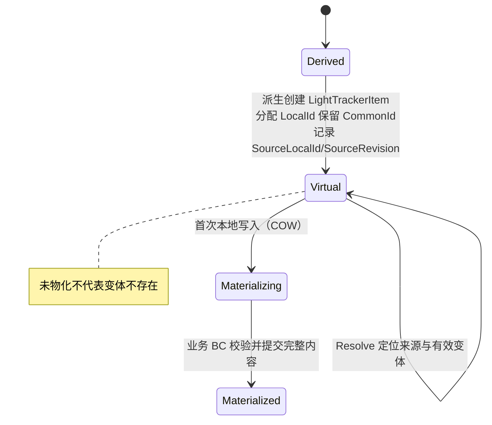

## 未物化经 Query 与工厂重建（时序）

已确认：业务调用方不感知底层是否已物化，业务 BC 通过 CQRS Query 路径与工厂重建完整业务聚合。Working Set 只负责身份定位，不拥有或重建业务 BC 完整状态。

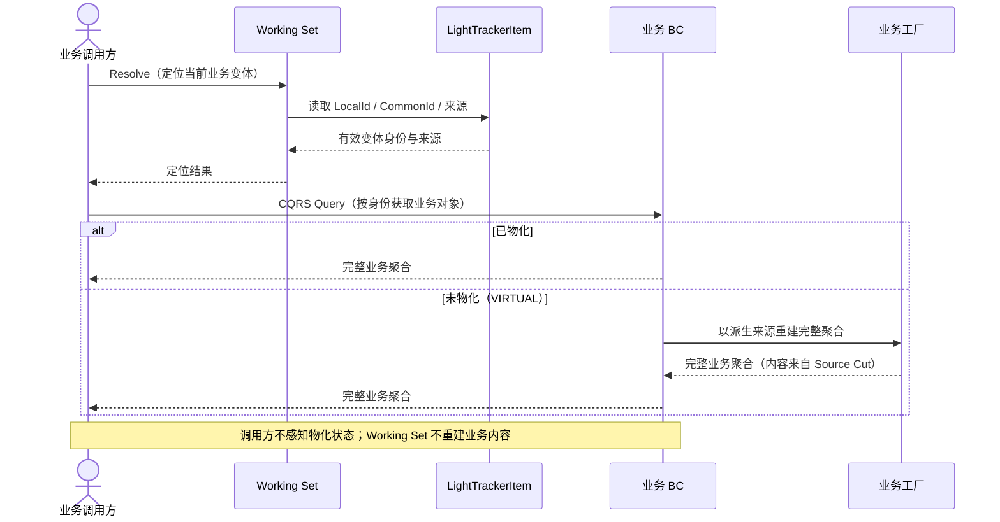

## 首次 COW 并发反例（候选）

候选：同一 LightTrackerItem 首次物化并发时，最多一个业务对象物化获胜，身份保持不变；物化完成标志与有效内容指针、LocalId 是否等同业务聚合变体身份均待裁定。

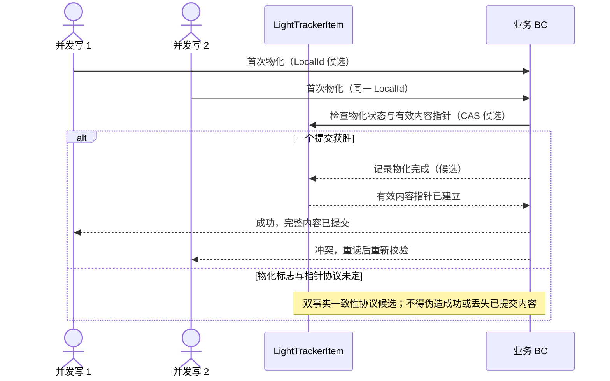

说明：此图不承诺跨 BC 事务或物化原子性；业务对象内部不变量仍由业务 BC 负责。

## Source-backed 与 Local-backed 有效内容切换（D-009）

已确认：物化前变体为 Source-backed（依赖来源解析内容），物化后切换为 Local-backed（本地物化内容成为有效来源）；Derivation Origin 保留用于追溯谱系，不被有效内容切换覆盖。

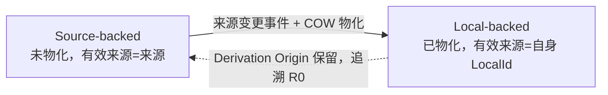

## 来源变更触发 COW 物化（D-009 事件时序）

已确认：来源普通修改不升级 Revision；修改前先 Query 获得修改前完整业务事实，修改保存后发来源变更事件触发 COW 物化；物化 Handler 据修改前事实形成派生变体自身内容并保存，成功后发物化完成事件；LightTrackerItem 索引 Handler 标记已物化，有效来源切换到自身。事件与事务的准确可见性协议未裁定。

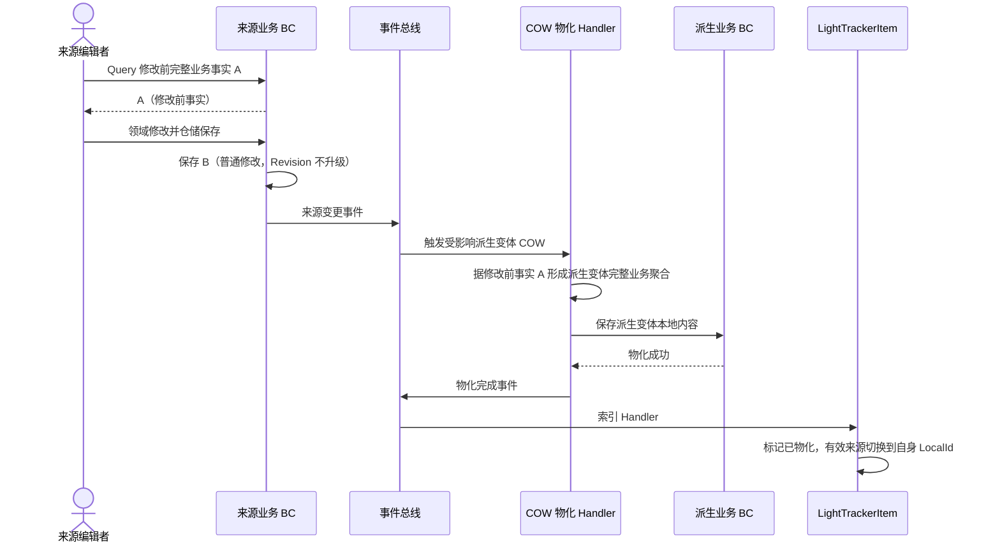

注意：修改前事实 A 的可靠保存/稳定引用（反例二）、物化完成前的查询可见性（反例一）、连续修改的多事件乱序与幂等（反例四）均候选。图不承诺跨 BC 事务。

## D-010 收敛：不可变快照与查询可见性

D-010 确认：修改前事实 A 作为事件关联的不可变内容快照与来源变更事件一起传递（反例二关闭）；来源修改已保存、COW 尚未完成期间，允许派生工作集暂时读取到修改后内容 B，物化完成后以修改前事实形成独立内容（反例一关闭）。连续修改的多事件乱序与「首次快照」业务选择规则仍候选（反例四）。

LightTrackerItem 主状态收敛为 Source-backed 与 Local-backed 两个，Materializing 作为技术运行状态，不增加第三种业务状态。

SourceLocalId 双语义：历史派生来源（Derivation Origin，追溯谱系）与当前有效内容来源（Effective Content Source，物化后指向自身），字段是否拆分待设计。

## 首次快照优先与乱序处理（D-011 事件时序）

已确认：对未物化派生 TrackerItem，来源首次相关修改的修改前快照确定最终物化内容；快照选择按来源修改实际先后顺序而非事件到达顺序；E2 先于 E1 到达仍采用第一次修改前快照 A。Source Change Order / Derivation Baseline / Materialization Claim 为候选协议，不自动建聚合/表。

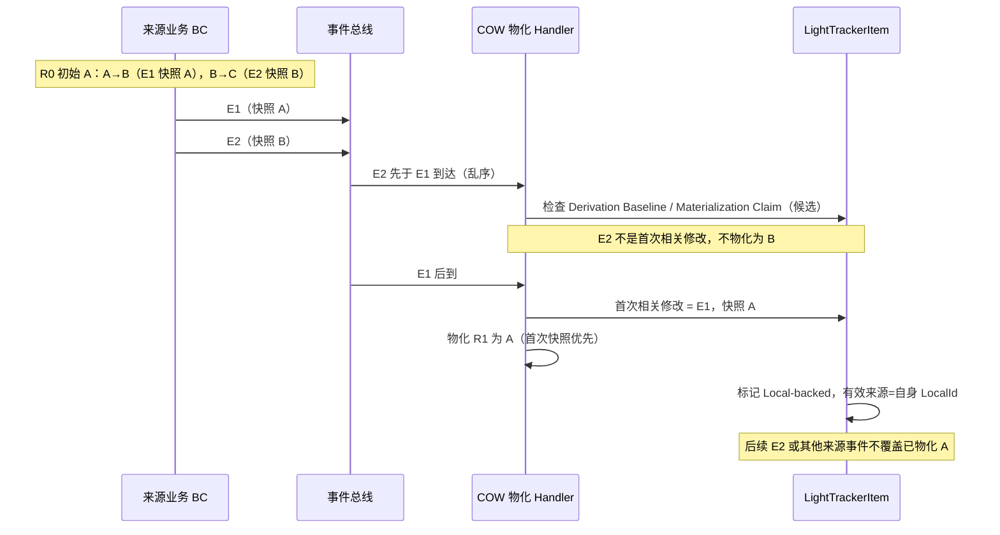

注意：Source Change Order 如何表达（复用乐观锁 `lock_version` 还是独立序列）、Derivation Baseline 判定、Materialization Claim 证据保留均候选，不提前用数据库锁或消息队列偏移量替代业务裁定。

## SourceLocalId / SourceRevision 职责分离（D-012 字段对比与多级派生）

已确认：SourceLocalId 表示当前有效内容来源的 LocalId，SourceRevision 表示当前有效内容来源的业务 Revision；COW 前指向来源，COW 后指向自身。

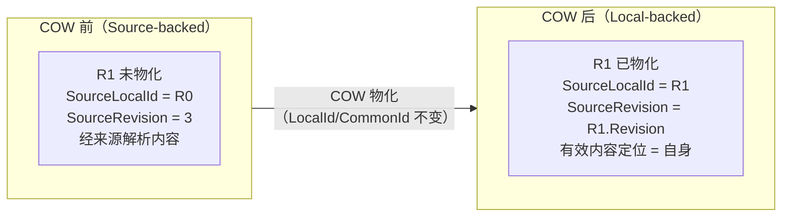

多级派生（R0→R1→R2）：D-012 原按逐级解析绘制，现由 D-013 修正为直接有效来源定位（见下节）。历史派生关系不要求由 LightTrackerItem 保存。

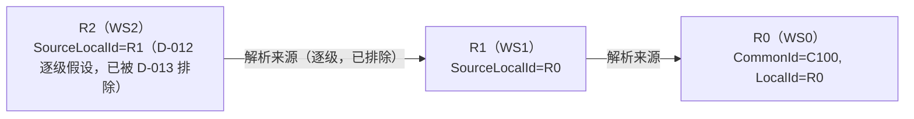

## 直接有效来源定位与依赖者扇出（D-013）

已确认：SourceLocalId 直接指向实际拥有完整业务内容的变体，不逐级递归解析未物化中间变体。

场景 A（仅 R0 物化，R1/R2 未物化）：R1.SourceLocalId=R0、R2.SourceLocalId=R0，R0 修改触发 R1、R2 都 COW 物化。

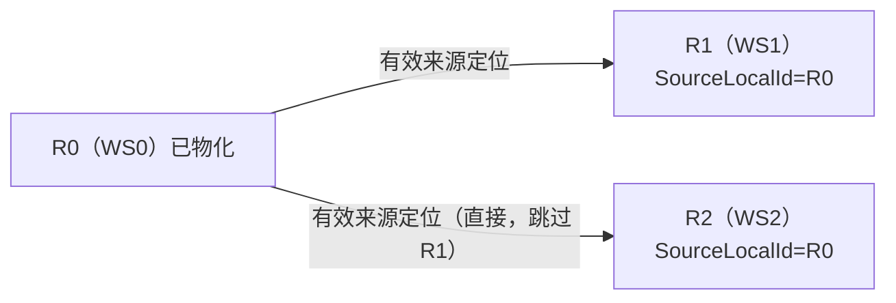

场景 B（R0/R1 已物化，R2 未物化）：R2.SourceLocalId=R1；R0 修改不物化 R2，R1 修改才物化 R2。

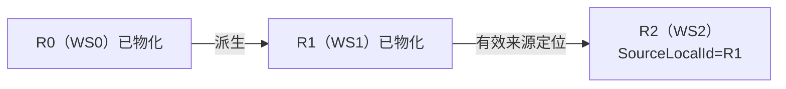

COW 扇出时序：同一实际来源修改，触发所有依赖该来源的未物化变体物化（不限派生深度）。

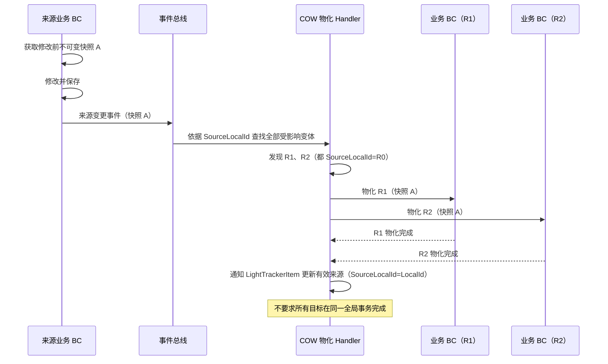

## 派生层级与有效来源依赖的区分（D-014）

已确认：R1 物化后，已有下游 R2 的 SourceLocalId 不自动重定向；派生层级（虚线）与有效来源依赖（实线）是两个不同维度。

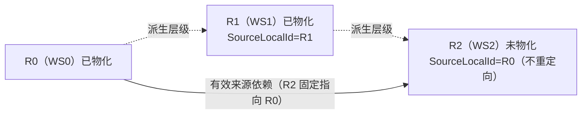

R1 物化前后 R2 来源保持不变：

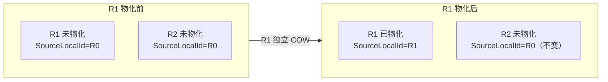

说明：R2 的 SourceLocalId 固定于派生时确定的实际内容来源，直至 R2 自身 COW；不随 R1 物化重定向。派生层级仅表达 Working Set 派生关系，不决定有效内容依赖。

## 派生主流程（D-015 时间基准）

已确认：派生不复制完整业务数据，只生成 LightTrackerItem 建立身份与有效来源引用；时间基准（命名 Snapshot 或 Head）只用于选 Revision，不固定内容。

说明：Derivation Time Basis（T）不等于 BeforeSnapshot；命名 Snapshot 不是完整业务内容快照。同一 Revision 内时间基准与具体内容状态的关系保持 Open（SCN-044）。

## 派生完成边界与 COW 保护（D-016 时序对比）

已确认：完整派生完成（Derivation Completion）是新变体开始受 COW 保护的边界；派生完成前来源修改不触发 COW。

场景 A：派生完成 → 来源修改 → 触发 COW。

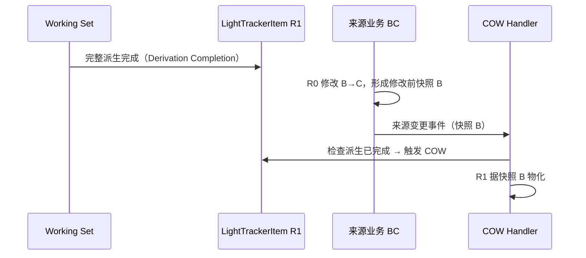

场景 B：来源修改 → 派生完成 → 不因该修改触发 COW。

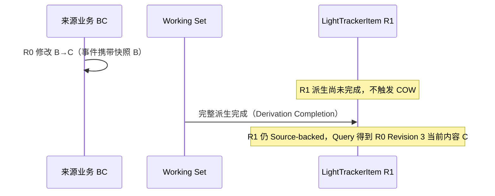

场景 C：来源修改已开始 → 派生完成 → 来源修改成功提交（竞态，待裁定）。

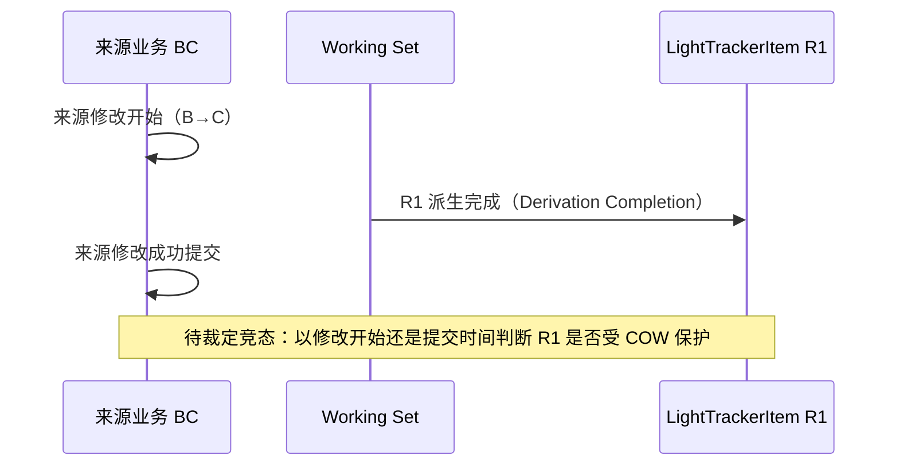

说明：如何表达和判定 Derivation Completion 与 Source Mutation 的实际先后属候选协作协议，不直接确定新数据库字段、全局锁或新聚合。（此时间边界判定现由 D-017 修订，见下节）

## COW 目标集合消费时确定（D-017 主流程时序）

已确认：COW 目标集合在 Handler 消费事件时确定，不在修改开始时固定；查询当前 SourceLocalId/SourceRevision 匹配且未物化的 LightTrackerItem，命中的都物化。前文 D-016 场景 A/B/C 时序图的「派生完成时间边界」由本裁定取代。

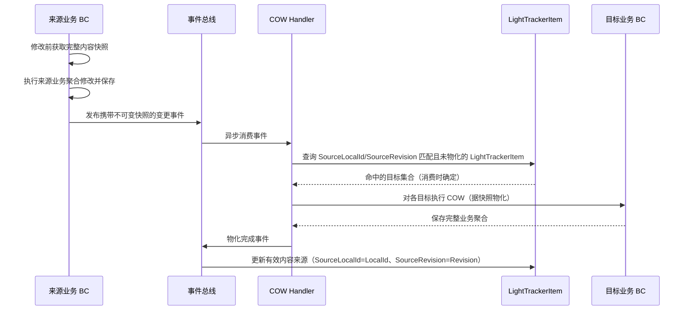

说明：不追溯比较修改开始时间与派生完成时间；D-011 首次快照优先的乱序/幂等实现细节留待实施评审。
