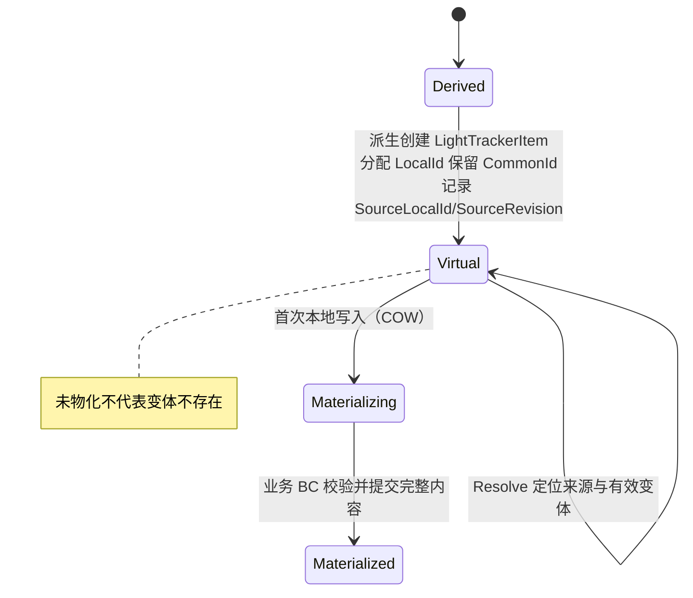
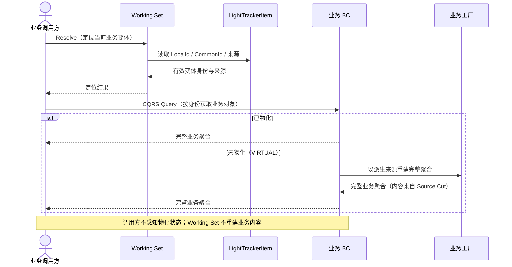
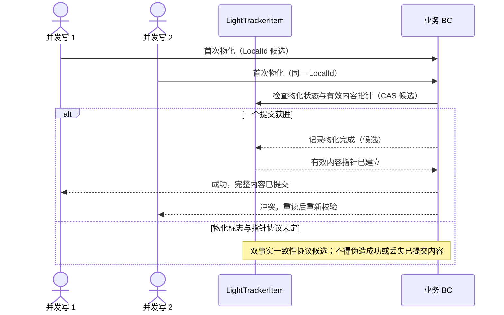

# LightTrackerItem 派生、解析与物化生命周期

**状态：Draft / Candidate；派生与身份分配由 D-008 确认，物化协议与并发仍候选。**

目的：表达 LightTrackerItem 从派生（Derive）到解析（Resolve）与物化（Materialize）的生命周期，以及未物化状态下经 Query 与工厂重建业务聚合、首次 COW 并发。依据：[D-008](../reviews/2026-11-09-stage-3-architecture-review.md#d-008)、[术语](../domain/glossary.md)、[候选不变量](../domain/invariants.md)、[聚合分析](../domain/aggregate-model.md)。

## 派生 → 未物化 → 物化（生命周期）

已确认：派生创建 LightTrackerItem 并分配 LocalId、保留 CommonId、记录来源，不立即物化业务内容；未物化（VIRTUAL）是合法状态。物化由首次本地写入触发，其完成标志与内容指针候选。

## 未物化经 Query 与工厂重建（时序）

已确认：业务调用方不感知底层是否已物化，业务 BC 通过 CQRS Query 路径与工厂重建完整业务聚合。Working Set 只负责身份定位，不拥有或重建业务 BC 完整状态。

## 首次 COW 并发反例（候选）

候选：同一 LightTrackerItem 首次物化并发时，最多一个业务对象物化获胜，身份保持不变；物化完成标志与有效内容指针、LocalId 是否等同业务聚合变体身份均待裁定。

说明：此图不承诺跨 BC 事务或物化原子性；业务对象内部不变量仍由业务 BC 负责。
