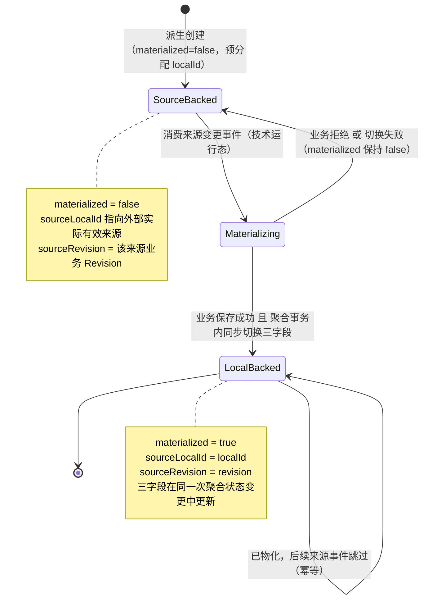
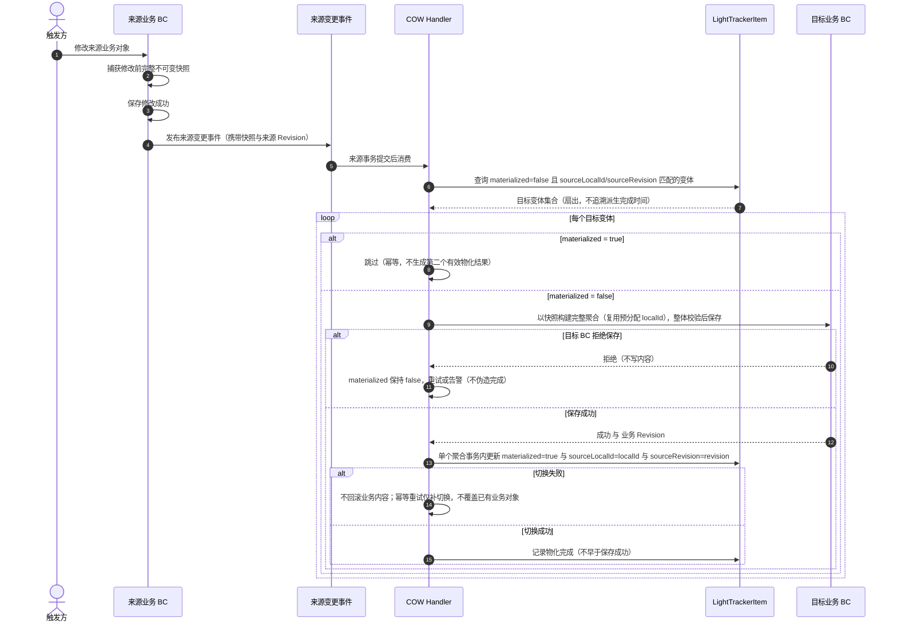

# LightTrackerItem 物化状态与首次物化时序

**状态：Draft / Candidate（T3 契约配套图；K1′～K3′ 已由用户 2026-11-11 确认；图本身未纳入正式基线）**

- 目的：表达 LightTrackerItem 的 `materialized` 状态字段、Source-backed / Local-backed 双态判定，以及首次物化（COW）在来源 BC、事件、Handler、目标 BC 与 LightTrackerItem 之间的协作与失败处理。
- 适用范围：阶段 5 T3 物化协议契约（已冻结）；非共享派生变体的 COW 路径（含未物化目标被 Merge 修改的「物化与修改一体」情形）。
- 依据：[LightTrackerItem 物化协议契约 v1](../domain/lighttrackeritem-materialization-contract-v1.md)、D-008～D-019、INV-024～052/069～071、[ADR-0002](../adr/0002-lighttrackeritem-authoritative-aggregate.md)、[ADR-0003](../adr/0003-cow-event-driven-final-consistency.md)、SCN-019～049、SCN-066～068。
- 顺序协调及重提的实现证据见 [S4 验证](../implementation/t5-s4-verification-result.md)。

**内容范围补充（2026-11-11 用户选择 A）**：图中来源快照用于普通字段；目标 BC 构建时须合入目标派生时固定的附件、关系，不能直接用来源快照覆盖它们。完整定义见 T3 §2.1、SCN-072。

## 图例

- `LightTrackerItem` 与业务 BC 聚合是**双事实**，按 ID 引用，不组合；**不要求同库事务**。
- `materialized` 是物化状态的**权威字段**；`sourceLocalId`/`sourceRevision` 是一致性约束。
- 「Materializing」是技术运行态，**不纳入领域枚举**。
- 虚线返回＝结果或回执；`alt` 分支列出契约级失败语义。

## 1. 双态与状态判定

判定规则（K1′，用户确认）：以 `materialized` 为权威；Local-backed 时必须同时满足 `sourceLocalId == localId` 且 `sourceRevision == revision`。`sourceLocalId != localId` **不再**单独作为物化状态定义，只作为身份/来源一致性约束。若三字段不一致，按元数据一致性缺陷修复，不引入第三种业务状态。

## 2. 首次物化时序（双事实）

补充：未物化目标被 Merge 修改时，「构建业务聚合并 Save」由 Merge 执行（T1），保存成功后按**同一状态切换行为**更新三字段（物化与修改一体，D-019），不新增第三条物化路径。
