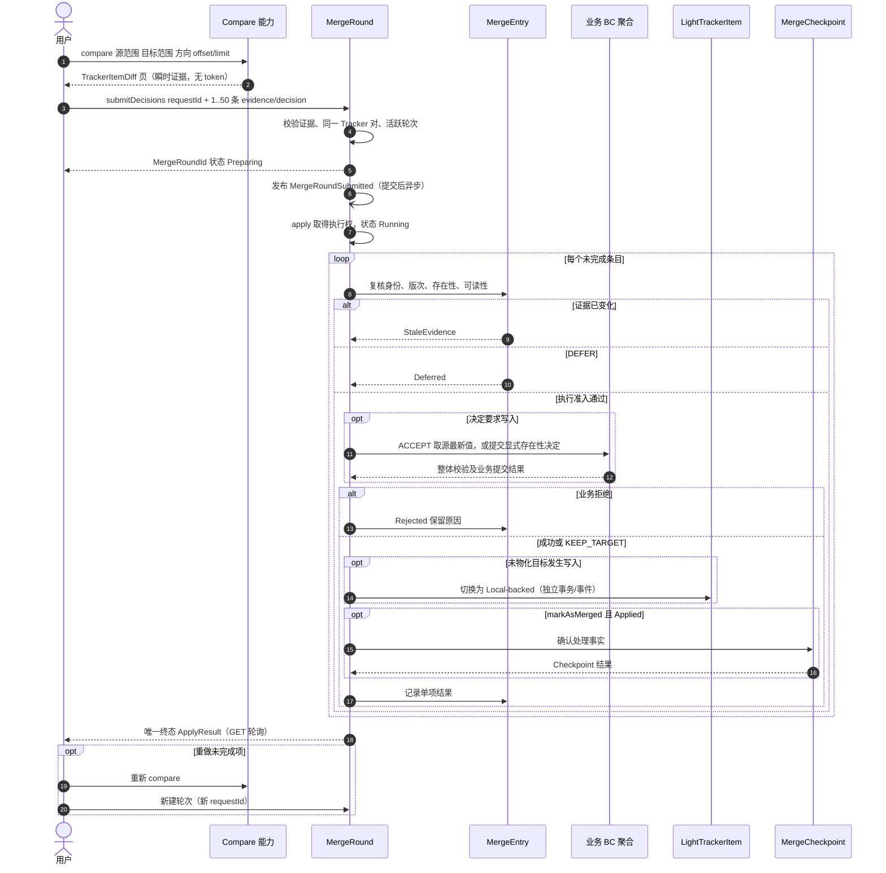
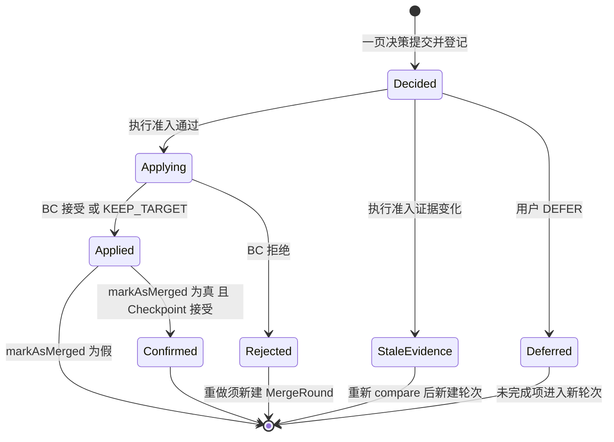
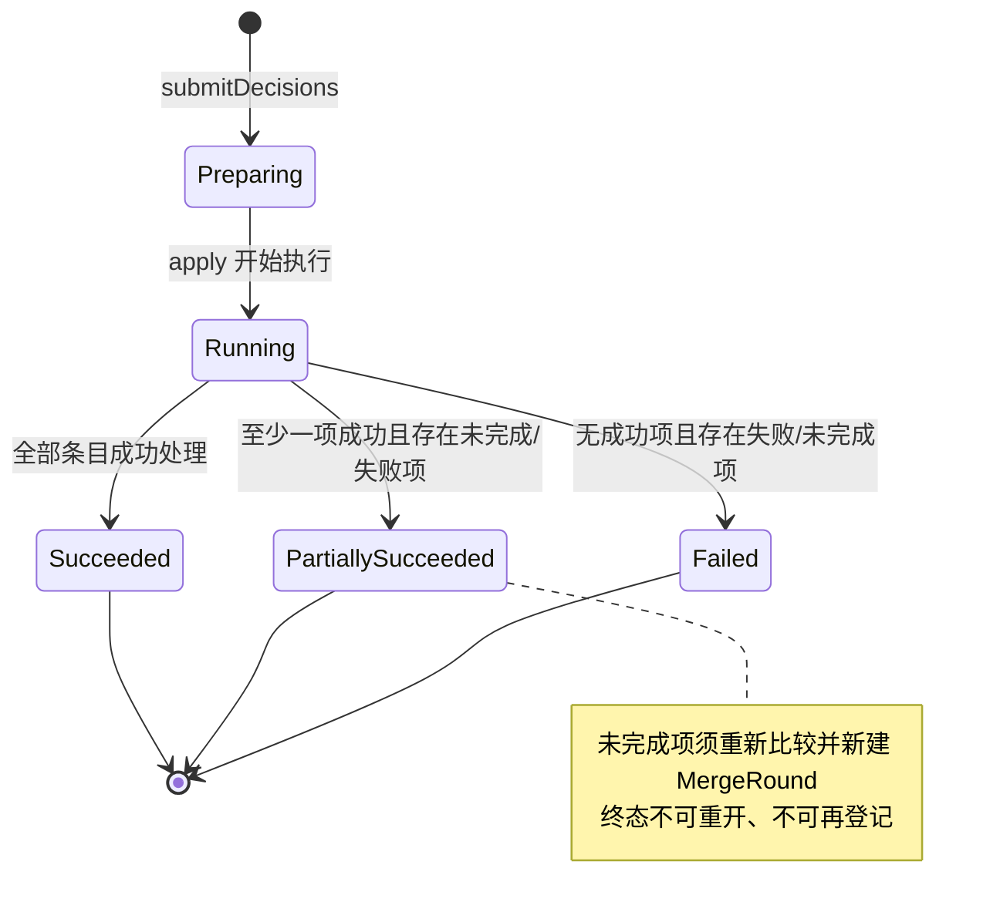

# MergeEntry 生命周期与提交到确认时序

**状态：Draft / Candidate（T6-E 后的当前交互；Q1～Q4 语义见 ADR-0005，图本身未纳入正式基线）**

- 目的：表达一页 Merge 决策从 Compare、提交、异步执行、业务 BC 提交、LightTrackerItem 维护到 Checkpoint 确认的协作顺序，以及 MergeRound 的一次执行与终态。
- 适用范围：直属父子非共享 Tracker。证据分界见 [S7 实施裁定](../reviews/2026-11-12-s7-merge-implementation-decisions.md)。
- 依据：[Merge 执行契约 v1](../domain/merge-execution-contract-v1.md)、ADR-0005、D-019、T6-E、T6-B。
- 不表达：事件中间件、数据库表、事务隔离级别；不表达共享 Tracker 与兄弟/跨代合并。
- **2026-11-16 更新**：Compare 只读瞬时，不返回可回读的 `ComparisonToken`；提交入口改为整页决策（1～50 条，`requestId` 幂等），轮次由事件异步执行，客户端轮询。

## 图例

- 实线调用＝同步请求；虚线返回＝结果/回执。
- `MergeRound`、`MergeCheckpoint`、`LightTrackerItem`、业务 BC 聚合之间均按身份引用，图不表示同事务或聚合包含。
- `MergeEntry` 是 MergeRound 内的 Entity，图中置于 MergeRound 协作内部。

## 1. 提交到确认的协作时序

## 2. MergeEntry 状态机

状态定义与责任边界见 [T1 §5、§8](../domain/merge-execution-contract-v1.md)，落地证据见 [T6-E 验收](../implementation/t6-e-merge-round-verification.md)。

### MergeRound 一次执行与终态

当前实现没有独立 `Completed` 阶段：本轮全部条目完成后直接进入三种终态之一。
