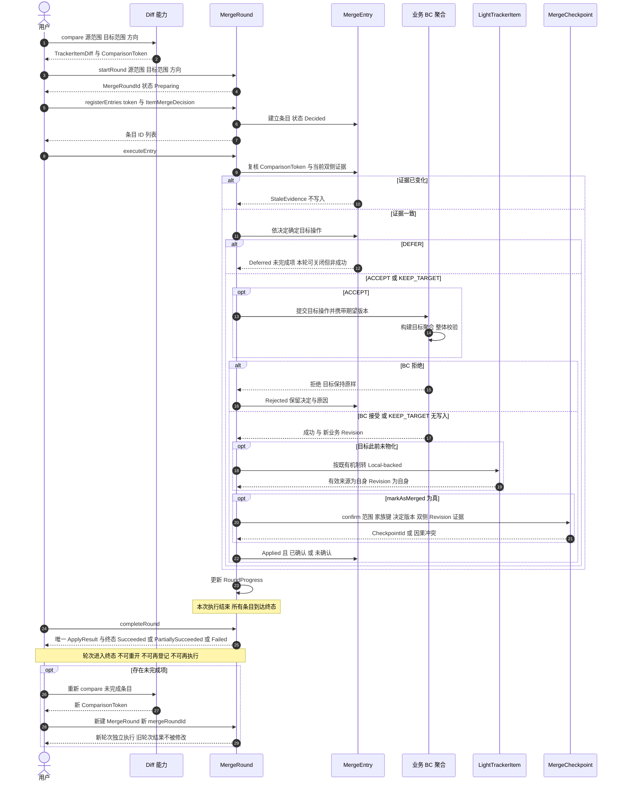
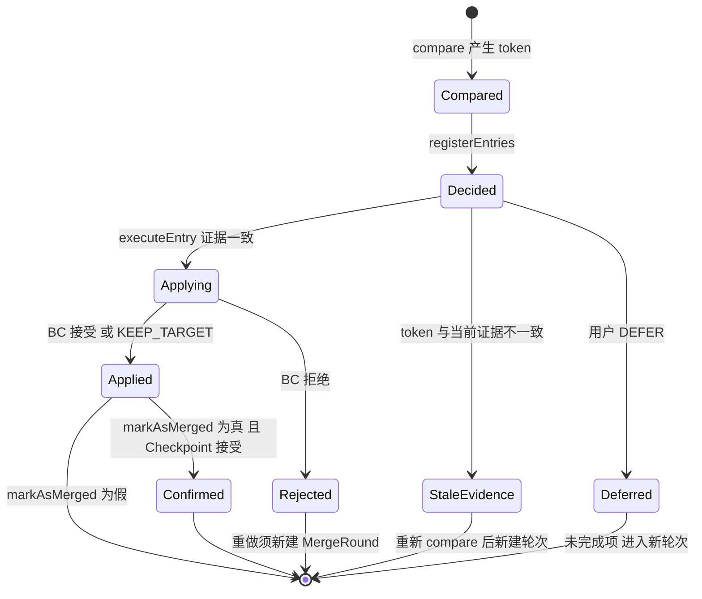
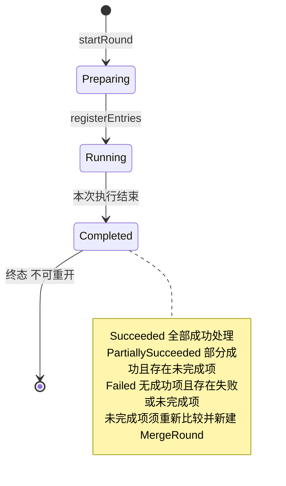

# MergeEntry 生命周期与提交到确认时序

**状态：Draft / Candidate（契约候选配套图；Q1～Q4 的语义已由 ADR-0005 及其 2026-11-11 补充裁定确认，图本身未纳入正式基线）**

- 目的：表达一条 MergeEntry 从 Diff、提交决策、执行、业务 BC 提交、LightTrackerItem 维护到 Checkpoint 确认的协作顺序，以及 MergeRound 的一次执行与终态。
- 适用范围：阶段 5 T1 契约草案；直接父子、非共享 Tracker 的合并路径。
- 依据：[Merge 执行行为契约 v1](../domain/merge-execution-contract-v1.md)、D-019（FACT-027、INV-061～063、SCN-055/056/059/060）、FACT-007/008、INV-006～010、POL-004、R08～R11、B06/B08/B09/B10。
- 不表达：Token 编码、幂等键实现、事件中间件、数据库表与事务隔离级别；不表达共享 Tracker（不参与 Merge）与兄弟/跨代合并（不准入）。

## 图例

- 实线调用＝同步请求；虚线返回＝结果／回执。
- `MergeRound`、`MergeCheckpoint`、`LightTrackerItem`、业务 BC 聚合之间均为**按身份引用**，图不表示同事务或聚合包含。
- `MergeEntry` 是 MergeRound 内的 Entity，图中置于 MergeRound 协作内部。

## 1. 提交到确认的协作时序（Happy Path + 关键分支）

## 2. MergeEntry 状态机

状态语义与约束见[契约第 5 节](../domain/merge-execution-contract-v1.md#5-mergeentry-生命周期)，要点：

- `Deferred` 不得迁移到 `Confirmed`（INV-008）；
- `StaleEvidence` 不得直接执行，必须重新比较产生新 token；
- `Applied` 是业务事实，`Confirmed` 是处理事实，二者分离（FACT-008）；
- 终态条目不可重复执行；跨轮次重做须新建 MergeRound（新 `mergeRoundId`、有效 token），原结果保留可追溯（Q4）。

### MergeRound 一次执行与终态

约束（Q4，2026-11-11 用户裁定）：

- 一轮合并、一次执行、一个终态结果；终态不可重开、不可再登记决定、不可再执行条目；
- `ApplyResult` 是本轮不可变终态快照，只汇总本轮 `summary` 与 `itemResults`；
- 新轮次使用新 `mergeRoundId` 与有效 `ComparisonToken`，可只选未完成条目，不自动重复已成功条目；
- 旧轮次结果不被修改，保留可追溯。

## 3. 责任边界（与图对应）

| 参与者 | 在时序中的职责 | 不承担 |
| --- | --- | --- |
| Diff 能力 | 产生有向冻结差异与 ComparisonToken | 写业务内容、记录决定 |
| MergeRound | 登记条目、校验证据、编排执行、记录结果与进度 | 直接写字段、判定 BC 合法性 |
| MergeEntry | 单条目的状态与目标操作 | 跨轮次复用、独立聚合 |
| 业务 BC 聚合 | 构建目标聚合、整体校验、提交、返回真实结果 | 合并选择、Checkpoint |
| LightTrackerItem | 有效来源与 Revision 维护（既有 COW 机制） | 构造业务内容 |
| MergeCheckpoint | 已处理确认/撤销与因果单调 | 内容相等证明、业务内容 |

## 4. 已裁定与剩余候选

Q1～Q4 已由用户裁定，见[契约第 11 节](../domain/merge-execution-contract-v1.md)与 [ADR-0005](../adr/0005-merge-execution-model.md)（含 2026-11-11 补充裁定）。

仍为契约候选：`TrackerItemDiff` 字段集、`ComparisonToken` 编码与存储形式、MergeRound 行为签名与状态机细节、`ApplyResult` 字段结构、CK-1～CK-5。
