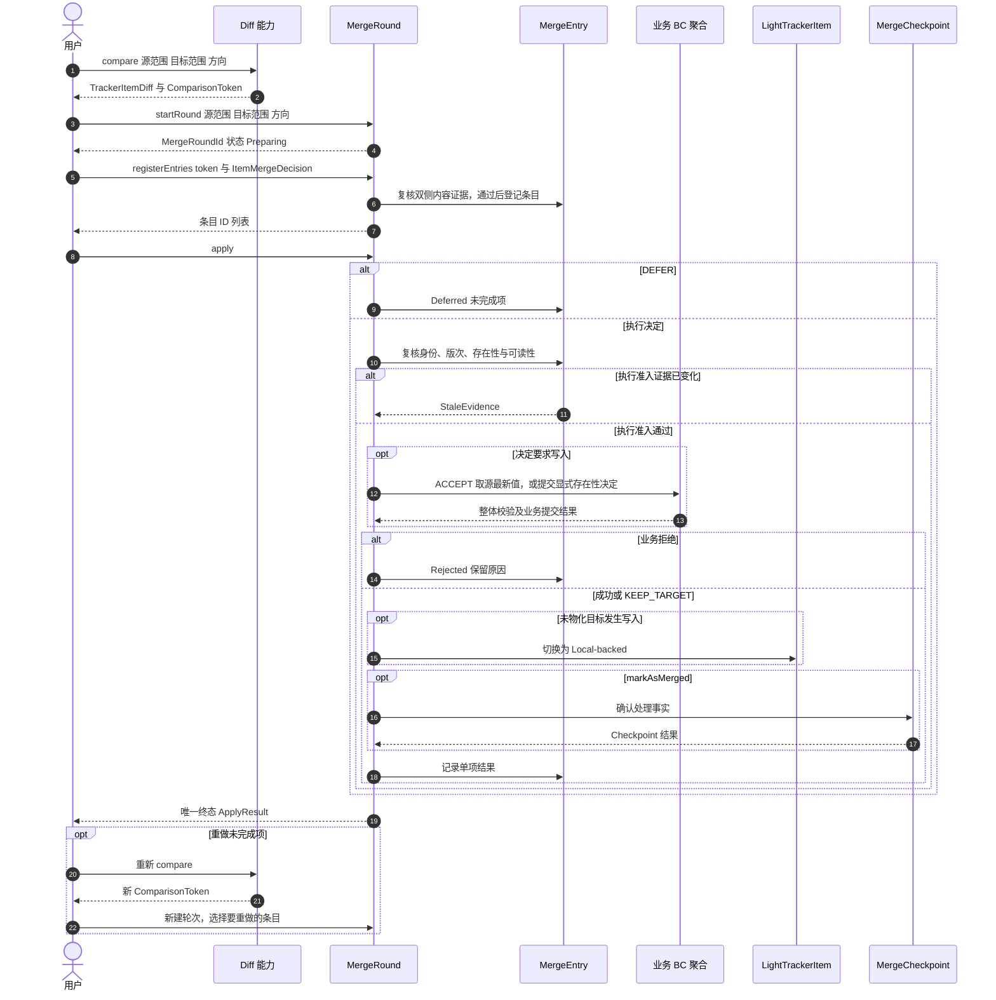
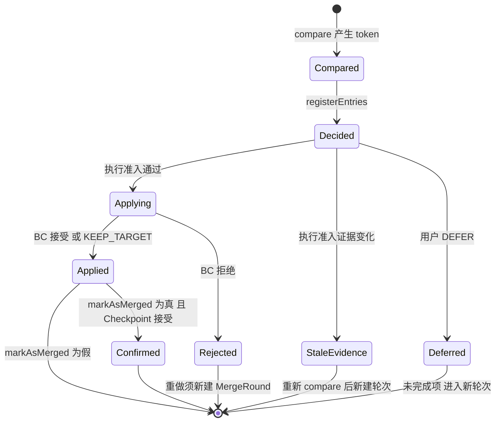

# MergeEntry 生命周期与提交到确认时序

**状态：Draft / Candidate（契约候选配套图；Q1～Q4 的语义已由 ADR-0005 及其 2026-11-11 补充裁定确认，图本身未纳入正式基线）**

- 目的：表达一条 MergeEntry 从 Diff、提交决策、执行、业务 BC 提交、LightTrackerItem 维护到 Checkpoint 确认的协作顺序，以及 MergeRound 的一次执行与终态。
- 适用范围：直属父子非共享 Tracker。证据分界见 [S7 实施裁定](../reviews/2026-11-12-s7-merge-implementation-decisions.md)。
- 依据：[Merge 执行行为契约 v1](../domain/merge-execution-contract-v1.md)、D-019（FACT-027、INV-061～063、SCN-055/056/059/060）、FACT-007/008、INV-006～010、POL-004、R08～R11、B06/B08/B09/B10。
- 不表达：Token 编码、幂等键实现、事件中间件、数据库表与事务隔离级别；不表达共享 Tracker（不参与 Merge）与兄弟/跨代合并（不准入）。

## 图例

- 实线调用＝同步请求；虚线返回＝结果／回执。
- `MergeRound`、`MergeCheckpoint`、`LightTrackerItem`、业务 BC 聚合之间均为**按身份引用**，图不表示同事务或聚合包含。
- `MergeEntry` 是 MergeRound 内的 Entity，图中置于 MergeRound 协作内部。

## 1. 提交到确认的协作时序（Happy Path + 关键分支）

## 2. MergeEntry 状态机

状态定义与责任边界见 [T1 §2、§5、§8](../domain/merge-execution-contract-v1.md)，落地证据见 [S7 验证](../implementation/t5-s7-verification-result.md)。

### MergeRound 一次执行与终态

